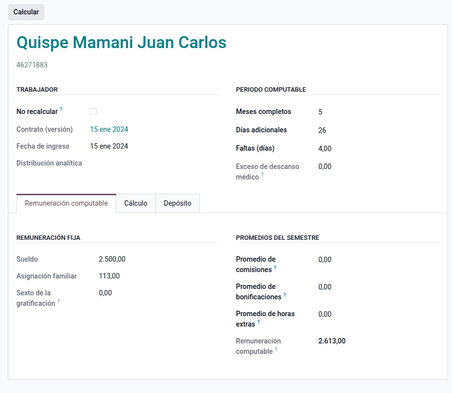
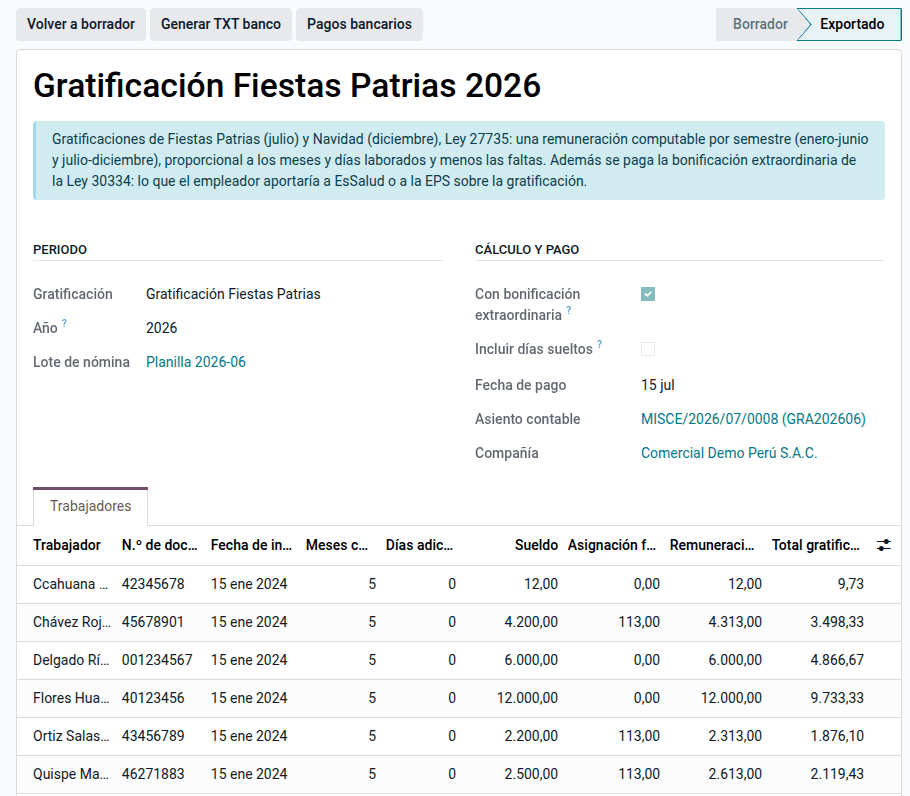
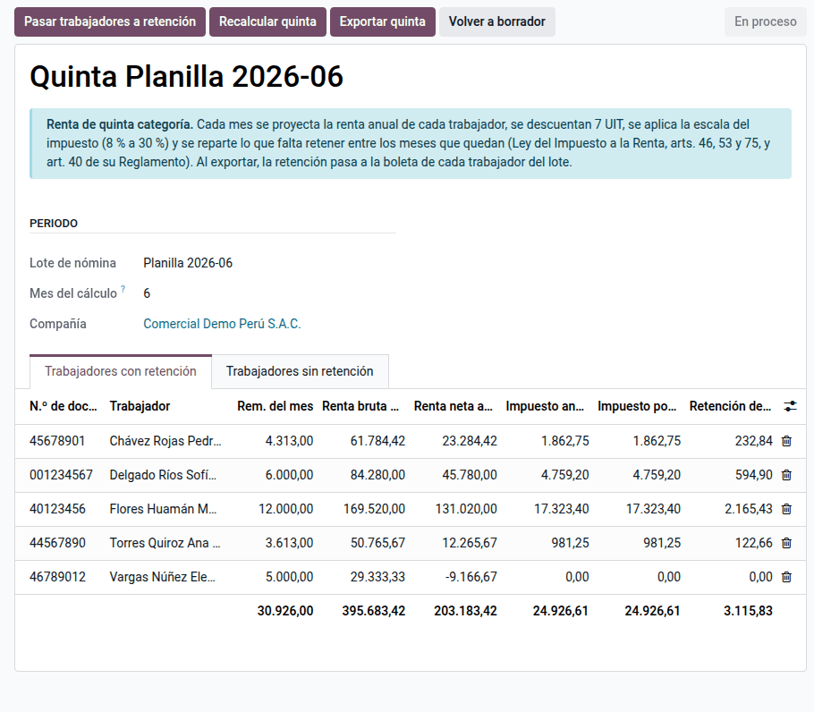
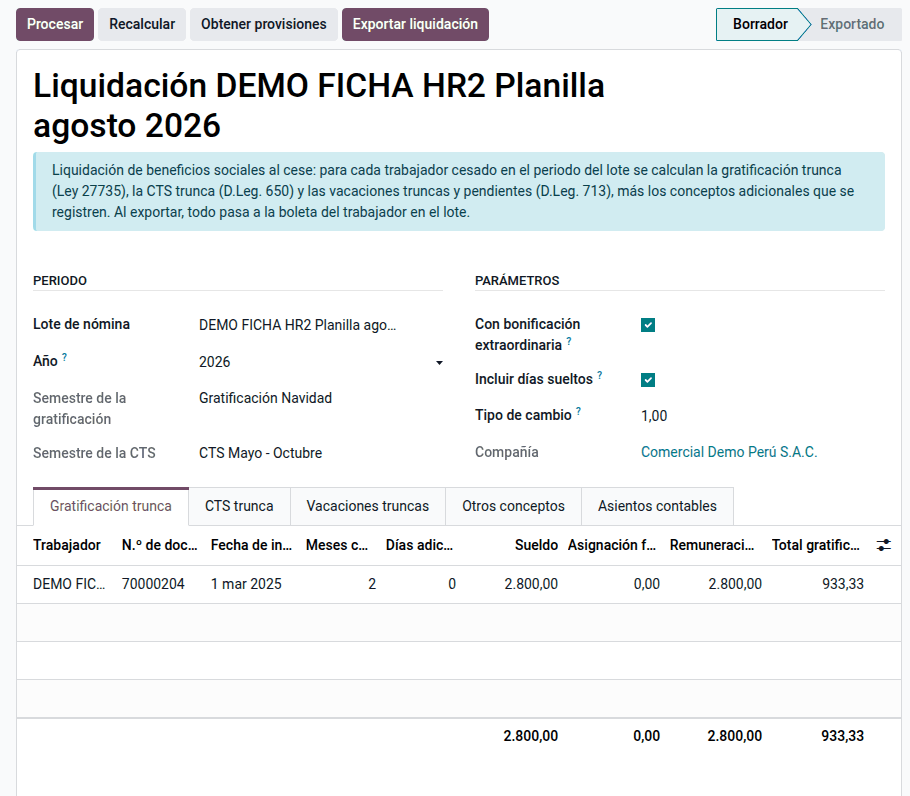

# Beneficios sociales

Casi ningún beneficio peruano se calcula sobre el sueldo, sino sobre la
**remuneración computable**: lo fijo se suma y lo variable se promedia solo si
apareció suficientes veces. La suite calcula, desde las boletas y con la
configuración de cada compañía, la CTS, las gratificaciones con su
bonificación extraordinaria, la retención de renta de 5.ª categoría, la
liquidación de cese, las provisiones, los subsidios, las utilidades, las
vacaciones y los adelantos y préstamos. La usa el responsable de planillas.

Todos los beneficios siguen el mismo circuito: documento del periodo →
**Procesar** → revisar → **Exportar** a las boletas del lote. Los asientos los
genera la [contabilización de planillas](accounting.md) desde estos mismos
documentos; el depósito bancario y los pagos masivos, los
[reportes y documentos](reports.md).

## Conceptos

| Término | Significado | Dónde aparece en Odoo |
|---|---|---|
| Remuneración computable | Fijos + asignación familiar + promedio de variables | Línea de CTS, gratificación o liquidación |
| Regla de las tres apariciones | Un variable entra al promedio si aparece en 3 o más boletas del semestre | Motor de la configuración principal |
| No recalcular | Protege una línea editada a mano al volver a procesar | Línea del documento |
| Exportar | Escribe el importe como entrada de la boleta del lote | Botón del documento |
| Excluidos de 5.ª | Trabajadores sin retención en el mes | **Renta de 5.ª ‣ Trabajadores sin retención** |

Un variable (comisiones, por ejemplo) que aparece en 3 o más boletas del
semestre se suma y se divide entre 6, o entre los meses trabajados si el
trabajador ingresó a mitad del semestre.

## Configuración

1. Instale **Beneficios sociales de planilla** (`al_hr_pe_benefits`).
2. Vaya a **Ajustes ‣ Nómina ‣ Perú: quincena y beneficios sociales** e
   indique el modo y la fracción de la quincena, la asignación familiar en
   vacaciones y el encargado de la liquidación.
3. En **Configuración principal ‣ Beneficios sociales**, elija las entradas de
   trabajo y de boleta de cada beneficio, las reglas cuyos importes se
   promedian y los tipos de días (laborados, faltas, descanso médico).
4. Registre la **UIT** del año y, en **Configuración principal ‣ Quinta
   categoría**, genere los tramos de la renta de 5.ª (en soles, desde la UIT).
5. Revise los **tipos de préstamo y de adelanto**.
6. Calcule los **lotes mensuales con su periodo** antes de procesar CTS,
   gratificación, provisiones o utilidades.

!!! note "Nota"
    La compañía de cada documento es la activa al crearlo y no se cambia
    después.

## CTS

TUO del D. Leg. 650 (D.S. 001-97-TR) y su reglamento (D.S. 004-97-TR): se
deposita en los primeros 15 días de mayo (periodo noviembre–abril) y de
noviembre (mayo–octubre), a razón de 1/12 de la remuneración computable por
mes y 1/360 por día. La remuneración computable incluye 1/6 de la
gratificación del semestre.

1. Vaya a **Nómina ‣ Beneficios sociales ‣ CTS** y cree el documento del
   semestre.
2. Haga clic en **Procesar**: hay una línea por trabajador.
3. Revise y haga clic en **Exportar** para llevar el importe a la boleta.

Trabajador del régimen general con sueldo S/ 2 500 y asignación familiar
S/ 113, sin variables, que en el semestre computa 5 meses y 26 días con 4
faltas:

| Concepto | Cálculo | S/ |
|---|---|---:|
| Remuneración computable | 2 500,00 + 113,00 | 2 613,00 |
| Importe por mes | 2 613,00 ÷ 12 | 217,75 |
| Importe por día | 217,75 ÷ 30 | 7,2583 |
| Meses completos | 217,75 × 5 | 1 088,75 |
| Días | 7,2583 × 26 | 188,72 |
| Faltas | 7,2583 × 4 | −29,03 |
| **Total CTS** | | **1 248,44** |

!!! note "Nota"
    - Un trabajador con menos de un mes en el semestre no deposita: pasa al
      semestre siguiente.
    - El descanso médico que supera 60 días se descuenta de la CTS.
    - Si el 1/6 de gratificación sale en cero, procese antes la gratificación
      del semestre.

## Gratificaciones

Ley 27735 y D.S. 005-2002-TR: una remuneración en julio y otra en diciembre
(1/6 por mes completo del semestre), pagaderas en la primera quincena. Por la
Ley 30334 son inafectas de aportes y llevan una **bonificación extraordinaria**
igual al aporte del seguro social del trabajador: 9 % con EsSalud o el de su
EPS (6,75 %).

1. Vaya a **Beneficios sociales ‣ Gratificación**, cree el documento y haga
   clic en **Procesar**.
2. Revise y haga clic en **Exportar**: la gratificación y la bonificación
   llegan a la boleta.

Con el mismo trabajador (remuneración computable de S/ 2 613,00):

| Concepto | Cálculo | S/ |
|---|---|---:|
| Importe por mes | 2 613,00 ÷ 6 | 435,50 |
| Meses completos | 435,50 × 5 | 2 177,50 |
| Faltas | 435,50 ÷ 30 × 4 | −58,07 |
| **Gratificación** | | **2 119,43** |
| Bonificación extraordinaria 9 % | 2 119,43 × 9 % | 190,75 |
| **Total a pagar** | | **2 310,18** |

## Renta de 5.ª categoría

TUO de la Ley del Impuesto a la Renta y art. 40 de su reglamento: proyección
anual, deducción de 7 UIT, tasas de 8 %, 14 %, 17 %, 20 % y 30 % por tramos de
5, 20, 35 y 45 UIT, y divisores del mes (enero a marzo, 12; abril, 9; mayo a
julio, 8; agosto, 5; setiembre a noviembre, 4; diciembre, regularización).

1. Vaya a **Beneficios sociales ‣ Renta de 5ta categoría**, genere el documento
   del mes y revíselo.
2. Registre los ingresos de otro empleador en la línea (**Rem. otros
   empleadores** y **Retenido otros empleadores**): entran a la proyección.
3. Haga clic en **Exportar**: la retención (QUINTA) llega a la boleta.

Trabajadora con sueldo constante de S/ 6 000, UIT 2026 = S/ 5 500 y
gratificaciones de S/ 6 540 con su bonificación:

| Paso | Cálculo | S/ |
|---|---|---:|
| Renta bruta anual | 6 000 × 12 + 6 540 × 2 | 85 080,00 |
| Deducción 7 UIT | 7 × 5 500 | −38 500,00 |
| Renta neta | | 46 580,00 |
| Hasta 5 UIT al 8 % | 27 500 × 8 % | 2 200,00 |
| Exceso al 14 % | (46 580 − 27 500) × 14 % | 2 671,20 |
| **Impuesto anual proyectado** | | **4 871,20** |
| Retención de enero a marzo | 4 871,20 ÷ 12 | 405,93 c/u |
| Retención de abril | (4 871,20 − 1 217,79) ÷ 9 | 405,93 |
| Retención de junio | (4 871,20 − 1 623,72 retenido de enero a abril) ÷ 8 | 405,94 |

Con el sueldo constante, la retención de los 12 meses suma exactamente
4 871,20: diciembre regulariza la diferencia de céntimos. En diciembre y en el
mes de cese la quinta se regulariza y, si se retuvo de más, se devuelve en la
boleta.

## Liquidación de cese

1. Vaya a **Beneficios sociales ‣ Liquidación de cese** y cree la liquidación
   del cesado.
2. Haga clic en **Procesar**: calcula los truncos (gratificación con su
   bonificación, CTS y vacaciones) y admite conceptos extra.
3. Exporte a la boleta del cesado.

Sueldo S/ 2 800, ONP, cese el 31/08/2026, 2 meses computables en cada trunco:

| Concepto | Cálculo | S/ |
|---|---|---:|
| Gratificación trunca | 2 800 ÷ 6 × 2 | 933,33 |
| Bonificación extraordinaria | 933,33 × 9 % | 84,00 |
| CTS trunca | 2 800 ÷ 12 × 2 | 466,67 |
| Vacaciones truncas | 2 800 ÷ 12 × 2 | 466,67 |
| ONP de las vacaciones | 466,67 × 13 % | −60,67 |
| **Total por pagar** | | **1 890,00** |

## Provisiones

En **Beneficios sociales ‣ Provisiones**, procese el devengo mensual de CTS,
gratificación y vacaciones. Su asiento lo genera la
[contabilización de planillas](accounting.md). Un trabajador cesado no se
provisiona: se liquida.

## Vacaciones

D. Leg. 713 (modificado por el D. Leg. 1405): 30 días calendario por año
completo de servicios y vacaciones truncas al cese. En **Beneficios sociales ‣
Vacaciones** se llevan el récord vacacional, los saldos por trabajador y año
(con exportación a Excel), el goce, la venta y la liquidación vacacional.

## Subsidios

Ley 26790 y D.S. 013-2019-TR: los primeros 20 días de incapacidad del año los
paga el empleador; desde el día 21, EsSalud. En **Beneficios sociales ‣
Subsidios**, el subsidio se arma por periodos desde las suspensiones T21 21/22
(enfermedad y maternidad). Un periodo ya importado se devuelve con **Cambiar a
no pagado**.

## Utilidades

D. Leg. 892 y D.S. 009-98-TR: un porcentaje de la renta anual antes de
impuestos según la actividad, repartido 50 % por remuneraciones y 50 % por días
laborados. Procese el reparto en **Beneficios sociales ‣ Utilidades** y
expórtelo.

Renta de S/ 500 000 al 10 % = S/ 50 000: S/ 25 000 por remuneraciones
(S/ 230 386,83 en el año → 0,108513 por sol) y S/ 25 000 por días (1 716 días
→ 14,5688 por día). Un trabajador con S/ 15 344,67 y 173 días recibe
1 665,10 + 2 520,40 = **S/ 4 185,50**.

## Adelantos, préstamos y quincena

En **Beneficios sociales ‣ Adelantos y préstamos** y **Adelantos
quincenales**, registre los adelantos y los préstamos al personal; las cuotas
y adelantos se descuentan en la boleta. Un préstamo de S/ 1 500 en 3 cuotas de
S/ 500 vence a fin de mes (30/09, 31/10 y 30/11/2026) y se descuenta en cada
boleta.

## Asientos

Los asientos los genera la [contabilización de planillas](accounting.md); con
las cuentas de la base de demostración, el depósito de la CTS anterior sin
provisión previa y el pago de la gratificación quedan así:

| Cuenta | Descripción | Debe | Haber |
|---|---|---:|---:|
| 6291000 | Gasto de CTS | 1 248,44 | |
| 4151000 | CTS por pagar — trabajador | | 1 248,44 |
| 6214000 | Gasto de gratificación y bonificación | 2 310,18 | |
| 4114000 | Gratificación por pagar — trabajador | | 2 310,18 |
| | **Totales** | **3 558,62** | **3 558,62** |

## Reportes

- Cada documento tiene su lista por trabajador (y Excel en vacaciones) y queda
  enlazado a las boletas del lote.
- Las entradas exportadas salen en la boleta impresa y en la PLAME (códigos
  SUNAT de gratificación, CTS, quinta, vacaciones y subsidios).
- Saldos de vacaciones por trabajador y año.

## Casos especiales

| Situación | Qué pasa | Qué hacer |
|---|---|---|
| La CTS no muestra trabajadores | Falta el lote del mes de cierre o la configuración no apunta a las reglas de la estructura | Revisar lote, periodo y configuración principal |
| Se perdió un ajuste manual al reprocesar | La línea no estaba protegida | Marcar **No recalcular** |
| Pequeña empresa | CTS ÷ 24 y gratificación ÷ 12; provisiones a la mitad | Régimen correcto en la versión del empleado |

!!! info "Ver también"
    - [TUO de la Ley de CTS (D.S. 001-97-TR) — El Peruano](https://diariooficial.elperuano.pe/Normas/obtenerDocumento?idNorma=37)
    - [SERVIR — gratificaciones (Ley 27735)](https://cdn.www.gob.pe/uploads/document/file/5690429/5053106-informe-tecnico-482-2017-servir-gpgsc.pdf)
    - [D. Leg. 713, descansos remunerados — El Peruano](https://diariooficial.elperuano.pe/Normas/obtenerDocumento?idNorma=42)
    - [SUNAT — Renta de 5.ª categoría, cálculo del impuesto](https://orientacion.sunat.gob.pe/3071-02-calculo-del-impuesto)
    - [SUNAT — TUO de la Ley del Impuesto a la Renta](https://www.sunat.gob.pe/legislacion/renta/tuo.html)
    - [EsSalud — Ley 26790](https://www.gob.pe/institucion/essalud/informes-publicaciones/4936482-ley-n-26790)
    - [SUNAT — Informe 033-2012 (participación en las utilidades)](https://www.sunat.gob.pe/legislacion/oficios/2012/informe-oficios/i033-2012.pdf)
    - [D.S. 006-2024-TR, RMV — El Peruano](https://busquedas.elperuano.pe/dispositivo/NL/2357884-10)
    - [Referencia técnica de `al_hr_pe_benefits`](../../../../developer/reference/modules/al_hr_pe_benefits/index.md)
