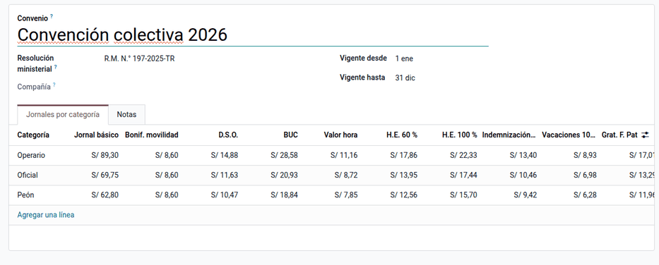
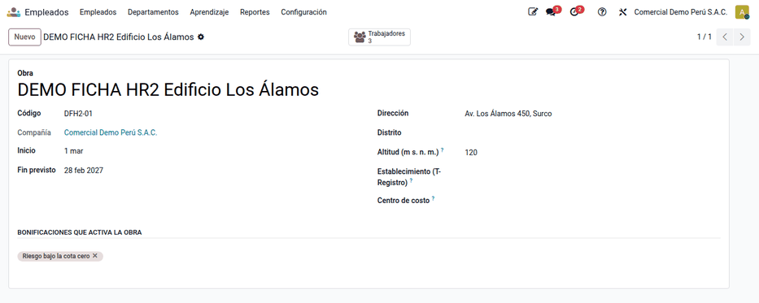
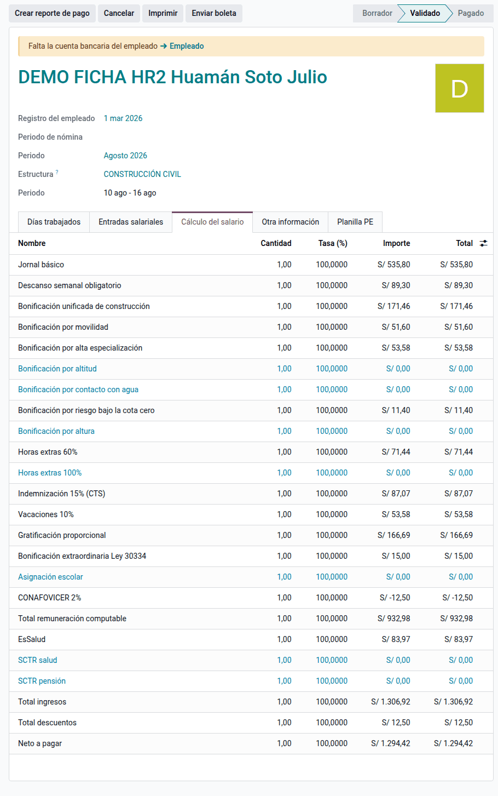
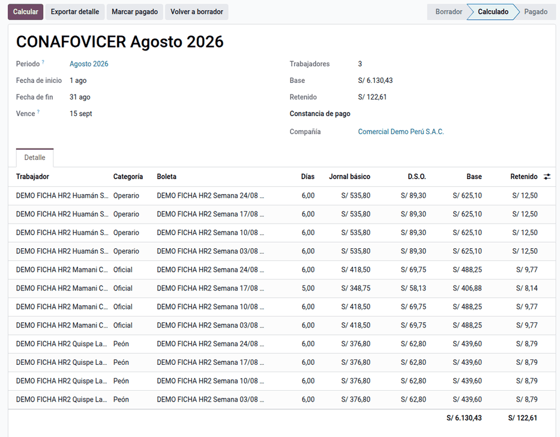

# Construcción civil

En construcción civil se paga por **jornal diario**, fijado por la convención
colectiva por rama (CAPECO–FTCCP) según la **categoría** (operario, oficial,
peón), con planilla **semanal**. La CTS y las vacaciones se pagan en cada
planilla (15 % y 10 %), la gratificación es de **40 jornales**, las horas
extras van al **60 % y 100 %** y el trabajador aporta el 2 % al
**CONAFOVICER**. La suite modela el régimen con sus tablas salariales,
categorías, bonificaciones, obras, la estructura salarial **CONSTRUCCIÓN
CIVIL** con su boleta impresa y el resumen mensual del CONAFOVICER. La usan el
responsable de planillas de obra y RR. HH.

La inscripción en el registro de trabajadores de construcción civil (RETCC) y
el depósito del CONAFOVICER se hacen fuera de Odoo, con el Excel que genera el
sistema.

## Conceptos

- **Régimen de construcción civil**: régimen especial con condiciones fijadas
  cada año por la negociación colectiva por rama entre CAPECO y la FTCCP, que
  el MTPE difunde por resolución ministerial (para 2026, la R.M. 197-2025-TR,
  vigente del 01/01/2026 al 31/12/2026).
- **Conceptos del régimen**:
    - jornal básico y descanso semanal obligatorio (D.S.O.);
    - bonificación unificada de construcción (BUC): 32 % operario, 30 %
      oficial y peón;
    - movilidad y bonificación por alta especialización (BAE);
    - indemnización por tiempo de servicios del 15 % (CTS del régimen) y
      vacaciones del 10 %;
    - gratificación de 40 jornales en julio y en diciembre, con la
      bonificación extraordinaria de la Ley 30334 (9 %, o el de la EPS);
    - asignación escolar y horas extras al 60 % y 100 %.
- **CONAFOVICER**: fondo para vivienda y centros recreacionales de los
  trabajadores de construcción civil (D. Ley 21067). El empleador retiene el
  2 % del jornal más el D.S.O. y lo deposita cada mes.
- **Pensiones y salud**: SPP/SNP y EsSalud como en el régimen general; SCTR
  obligatorio en obra (Ley 26790).

| Término | Significado | Dónde aparece en Odoo |
|---|---|---|
| Tabla salarial | Jornales por categoría con su vigencia | **Configuración ‣ Construcción civil ‣ Tablas salariales** |
| Categoría | Operario, oficial, peón (con su % de BUC) | **Construcción civil ‣ Categorías** |
| Obra | Lugar de trabajo con sus bonificaciones y centro de costo | **Empleados ‣ Obras** |
| Jornal congelado | La boleta guarda el jornal vigente al fin del periodo | Boleta |
| TREM | Remuneración computable para aportes: jornal + D.S.O. + BUC + BAE + bonificaciones + extras + asignación escolar | Regla TREM |

Movilidad, indemnización, vacaciones y gratificación no forman la base de
aportes (TREM).

## Configuración

1. Instale **Planillas de construcción civil** (`al_hr_pe_construction`).
2. Revise la tabla salarial vigente en **Nómina ‣ Configuración ‣
   Construcción civil ‣ Tablas salariales** (trae la de 2026) o importe la del
   convenio (ver más abajo).
3. Contraste los importes de las **bonificaciones** (BAE, altitud, agua, cota
   cero, altura) con el convenio de la empresa.
4. En **Ajustes ‣ Usuarios y empresas ‣ Empresas ‣ Construcción civil (PE)**,
   indique las tasas del SCTR de la póliza y la cuenta del CONAFOVICER.
5. Genere los periodos del año con **Generar también semanas** (ver la
   [nómina peruana](../peru.md#configuración)).
6. Cree las **obras** en **Empleados ‣ Empleados ‣ Obras**, con sus
   bonificaciones y su centro de costo.
7. En cada obrero, en **Planilla PE ‣ Construcción civil**, indique el régimen
   Construcción civil, la categoría, la obra, la especialidad y la cobertura
   SCTR.

Las tablas, categorías y bonificaciones sin compañía son nacionales; las obras
y los resúmenes del CONAFOVICER son de cada compañía.

!!! warning "Importante"
    Un trabajador sin SCTR marcado solo aporta EsSalud sobre la TREM. Marque la
    cobertura en su ficha.

### Importar la tabla del convenio

1. En **Tablas salariales**, haga clic en **Importar tabla del convenio** y
   cargue el PDF publicado.
2. La tabla nueva llega **archivada**: revísela contra el PDF y actívela.
3. La revisión mensual busca convenios nuevos en la dirección de CAPECO.

Un convenio nuevo se carga como otra tabla con su vigencia: las boletas
antiguas conservan su jornal. Dos tablas activas con vigencias solapadas no se
pueden guardar.

## Obras y reparto del costo

La obra del día se indica en la marcación o en el detalle diario del
[tareaje](attendance.md); un obrero puede cambiar de obra de un día a otro.
Con **Asiento de lote con analítica** en la
[contabilización de planillas](accounting.md), el gasto se reparte por días u
horas: si un operario trabajó 4 días en la obra «Cota cero» y 2 en otra, el
gasto se distribuye 66,67 % / 33,33 %. Los días sin obra van a la obra de su
ficha.

## Boleta semanal

1. Vaya a **Nómina ‣ Recibos de nómina** y cree las boletas de la semana con la
   estructura **CONSTRUCCIÓN CIVIL**: toman el jornal de la tabla vigente al
   fin del periodo.
2. Valide y pague la semana. El jornal se puede ajustar a mano en una boleta
   puntual.

La semana que cruza el fin de mes se corta en el fin de mes, y el lote semanal
se declara en la PLAME de su mes.

### Ejemplo

Operador de equipo pesado (operario, BAE 10 %) en una obra con bonificación por
riesgo bajo la cota cero (S/ 1,90 por día), semana del 3 al 9 de agosto de
2026 con 6 días, afiliado a la ONP, jornal 2026 de S/ 89,30:

| Código | Concepto | Cálculo | S/ |
|---|---|---|---:|
| JOR | Jornal básico | 89,30 × 6 | 535,80 |
| DSO | Descanso semanal obligatorio | 535,80 ÷ 6 | 89,30 |
| BUC | Bonificación unificada | 32 % de 535,80 | 171,46 |
| MOV | Movilidad | 8,60 × 6 | 51,60 |
| BAE | Alta especialización | 10 % de 535,80 | 53,58 |
| BCOTA | Riesgo bajo la cota cero | 1,90 × 6 | 11,40 |
| INDEM | Indemnización 15 % (CTS) | 15 % de 535,80 | 80,37 |
| VAC10 | Vacaciones 10 % | 10 % de 535,80 | 53,58 |
| GRAT | Gratificación proporcional | 89,30 × 40 ÷ 150 × 7 días | 166,69 |
| BEXT | Bonificación Ley 30334 | 9 % de 166,69 | 15,00 |
| | **Total ingresos** | | **1 228,78** |
| CONAF | CONAFOVICER | 2 % de (535,80 + 89,30) | −12,50 |
| ONP | ONP | 13 % de 861,54 (TREM) | −112,00 |
| | **Neto a pagar** | 1 228,78 − 12,50 − 112,00 | **1 104,28** |
| ESSALUD | EsSalud (empleador) | 9 % de 861,54 | 77,54 |

TREM = 535,80 + 89,30 + 171,46 + 53,58 + 11,40 = 861,54. En agosto la
gratificación se devenga en la ventana de Navidad (150 días); con el mismo
jornal, hasta julio saldría 119,07.

El asiento de esa boleta (cuentas ilustrativas del PCGE) queda así:

| Cuenta | Descripción | Debe | Haber |
|---|---|---:|---:|
| 6211 | Jornal, D.S.O., BUC, movilidad, BAE y cota cero | 913,14 | |
| 6291 | Indemnización 15 % (CTS) | 80,37 | |
| 6215 | Vacaciones 10 % | 53,58 | |
| 6214 | Gratificación y bonificación extraordinaria | 181,69 | |
| 4111 | Remuneraciones por pagar (ingresos) | | 1 228,78 |
| 4111 | Descuentos al trabajador (ONP y CONAFOVICER) | 124,50 | |
| 4032 | ONP por pagar | | 112,00 |
| — | CONAFOVICER por pagar (cuenta de la regla CONAF) | | 12,50 |
| 6271 | EsSalud | 77,54 | |
| 4031 | EsSalud por pagar | | 77,54 |
| | **Totales** | **1 430,82** | **1 430,82** |

El saldo de la 4111 es el neto: 1 228,78 − 124,50 = 1 104,28.

Semana completa de las tres categorías (6 días, sin bonificaciones de obra ni
extras), que reproduce la tabla oficial:

| Categoría | Jornal | D.S.O. | BUC | Movilidad | Total salarios | CONAFOVICER 2 % |
|---|---:|---:|---:|---:|---:|---:|
| Operario | 535,80 | 89,30 | 171,46 | 51,60 | 848,16 | 12,50 |
| Oficial | 418,50 | 69,75 | 125,55 | 51,60 | 665,40 | 9,77 |
| Peón | 376,80 | 62,80 | 113,04 | 51,60 | 604,24 | 8,79 |

Horas extras: valor hora del operario 89,30 ÷ 8 = 11,1625; cuatro horas al
60 % = 4 × 11,1625 × 1,6 = 71,44.

!!! note "Nota"
    El periodo se redondea una sola vez, no día por día: así se reproducen los
    céntimos de la tabla oficial.

## CONAFOVICER

1. Vaya a **Configuración ‣ Construcción civil ‣ CONAFOVICER** y cree el
   resumen del mes.
2. Calcúlelo: toma el 2 % de jornal + D.S.O. de cada obrero (no solo del
   jornal, como publica la tabla oficial).
3. Exporte el Excel adjunto para el depósito y registre el pago.

En agosto de 2026: operario 4 × 625,10 = 2 500,40 (retenido 50,00); oficial
3 × 488,25 + 406,88 = 1 871,63 (37,45); peón 4 × 439,60 = 1 758,40 (35,16).
Base total 6 130,43 y retenido 122,61, que vence el 15/09/2026.

## Reportes

- **Boleta impresa del régimen** (jornal básico, categoría, obra,
  especialidad), en [reportes y documentos](reports.md).
- **Resumen CONAFOVICER** mensual con el Excel adjunto para el depósito.
- Archivos **PLAME** del lote semanal, declarado en su mes (ver la
  [nómina peruana](../peru.md#reportes)).
- **Asiento de planilla por lote** con el costo repartido por obra.

!!! info "Ver también"
    - [El Peruano — aumentos salariales de construcción civil 2026](https://elperuano.pe/noticia/285414-trabajas-en-construccion-civil-conoce-los-nuevos-aumentos-salariales-para-2026)
    - [El Peruano — beneficios de construcción civil 2026](https://elperuano.pe/noticia/284624-los-beneficios-de-construccion-civil-2026)
    - [El Peruano — negociación colectiva 2027](https://elperuano.pe/noticia/305897-construccion-civil-negociacion-colectiva-2027-se-inicia-con-proyecto-presentado-por-los-trabajadores-al-mtpe)
    - [El Peruano — Comité Nacional del CONAFOVICER](https://busquedas.elperuano.pe/dispositivo/NL/2418872-1)
    - [SERVIR — gratificaciones](https://cdn.www.gob.pe/uploads/document/file/5690429/5053106-informe-tecnico-482-2017-servir-gpgsc.pdf)
    - [EsSalud — Ley 26790](https://www.gob.pe/institucion/essalud/informes-publicaciones/4936482-ley-n-26790)
    - [SBS — comisiones y primas del SPP](https://www.sbs.gob.pe/app/spp/empleadores/comisiones_spp/Paginas/comision_prima.aspx)
    - [Análisis del régimen](../../../../developer/specs/planillas/construccion_civil_analisis.md)
    - [Referencia técnica de `al_hr_pe_construction`](../../../../developer/reference/modules/al_hr_pe_construction/index.md)
