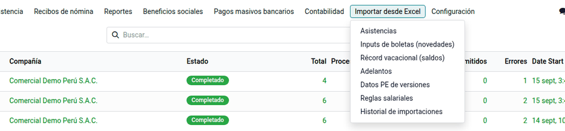
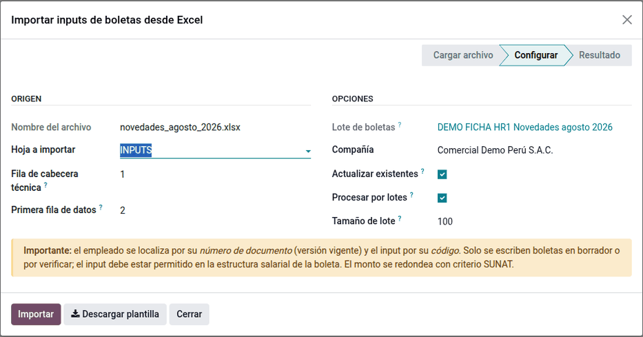
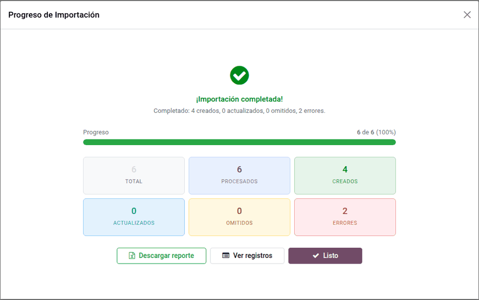

# Importación de novedades

Cada mes llegan comisiones, bonos, adelantos o préstamos en hojas de cálculo, y
al arrancar con el sistema hay que cargar los datos laborales y los saldos de
vacaciones de toda la planilla. La suite ofrece seis importadores de planilla
con el mismo asistente de tres pasos (cargar, configurar, ver el resultado).
Cada fila se valida contra la localización y el resultado se entrega en un
Excel con el número de fila, el motivo y una sugerencia de corrección. Los usa
el responsable de planillas en la puesta en marcha y en cada cierre.

| Importador | Qué carga |
|---|---|
| Inputs de boletas (novedades) | Comisiones, bonos, adelantos, préstamos… en las boletas del lote |
| Datos PE de versiones | Régimen, AFP/ONP, CUSPP, seguro social, catálogos del T-Registro |
| Récord vacacional (saldos) | Saldo inicial de vacaciones en días y soles |
| Adelantos | Adelantos con su tipo y fecha de descuento |
| Asistencias | Marcaciones de entrada y salida (relojes, biométricos) |
| Reglas salariales | Reglas exportadas de una base anterior, adaptadas a las versiones del empleado |

Los préstamos con cronograma se registran en los
[beneficios sociales](benefits.md#adelantos-préstamos-y-quincena); los
maestros contables o de productos, con el importador estándar de Odoo.

## Conceptos

Los datos que se importan son los que exige la Planilla Electrónica (T-Registro
y PLAME): catálogos SUNAT del trabajador y conceptos de la boleta con su código
de la tabla 22. Las marcaciones importadas forman parte del registro de control
de asistencia (D.S. 004-2006-TR) y conservan su fecha y hora reales.

| Término | Significado | Dónde aparece en Odoo |
|---|---|---|
| Plantilla | Excel con las columnas exactas y una fila de ejemplo | Botón del asistente |
| Proceso por lotes | Se confirma cada 100 filas (configurable) | Paso **Configurar** |
| Actualizar existentes | Vuelve a escribir las filas ya importadas | Paso **Configurar** |
| Zona horaria del archivo | Huso de las horas de las marcaciones | Importador de asistencias |
| Historial | Registro de cada importación con su reporte | **Nómina ‣ Importar desde Excel ‣ Historial de importaciones** |

Los importes se redondean a dos decimales «medio hacia arriba» (180,255 →
180,26), como en la planilla.

## Configuración

1. Instale **Planillas Perú — Importadores Excel** (`al_hr_pe_import`). El
   servidor necesita la biblioteca Python `openpyxl`.
2. Verifique que los trabajadores tengan su **número de documento** en la
   versión vigente: es como se localiza a cada uno.
3. Para novedades, cree el lote del mes y permita los códigos de input en la
   estructura salarial.
4. Para adelantos, cree los **tipos de adelanto** de la compañía con el nombre
   que usará el Excel.

## Importar un archivo

1. Vaya a **Nómina ‣ Importar desde Excel** y elija el importador (asistencias y
   reglas también tienen un botón en sus listas).
2. Haga clic en **Descargar plantilla** y complete el Excel. Las columnas se
   leen por posición: parta siempre de la plantilla.
3. En el paso 1, cargue el archivo (`.xlsx` o `.xlsm`) y elija la hoja.
4. En el paso 2, elija el lote, la estructura, la zona horaria y si se
   **actualizan los existentes**.
5. En el paso 3, la importación corre en segundo plano con el progreso en vivo.
   Puede cerrar la ventana: el resultado queda en el historial.
6. Si hay filas con error, descargue el reporte, corríjalas y vuelva a subir
   solo esas.

Con **Actualizar existentes**, las filas ya cargadas se actualizan; sin él, se
omiten. El récord vacacional reemplaza el saldo inicial en lugar de sumarlo.
Para otra compañía, cámbiela arriba a la derecha antes de abrir el asistente.

### Ejemplo

Novedades de agosto de 2026 sobre el lote «DEMO FICHA HR1 Novedades agosto
2026»:

| Fila | N.º documento | Código de input | Monto |
|---|---|---|---:|
| 2 | 72418305 | COMI | 350 |
| 3 | 70935214 | ADELANTO | 400 |
| 4 | 75102846 | BONI_EX | 500 |
| 5 | 75102846 | PREST | 180,255 |
| 6 | 70935214 | HEX25 | 150,50 |
| 7 | 40000001 | COMI | 120 |

| Fila | Estado | Detalle | Sugerencia |
|---|---|---|---|
| 2 | CREADO | COMI = 350,00 en la boleta de Salazar | — |
| 3 | CREADO | ADELANTO = 400,00 en la boleta de Huamán | — |
| 4 | CREADO | BONI_EX = 500,00 en la boleta de Rivas | — |
| 5 | CREADO | PREST = 180,26 en la boleta de Rivas (redondeo de 180,255) | — |
| 6 | ERROR | No existe el tipo de input «HEX25» | Revisar el código en **Nómina ‣ Configuración ‣ Tipos de entrada de boleta** |
| 7 | ERROR | No hay boleta en el lote para el documento 40000001 | Verificar la boleta y el documento de la versión vigente |

Importado: 350,00 + 400,00 + 500,00 + 180,26 = **S/ 1 430,26** en cuatro
entradas; las dos filas con error se corrigen y se vuelven a subir solas.

### Otros importadores

- **Datos PE de versiones**: actualiza los campos indicados de cada versión y
  rechaza valores fuera del catálogo. Por ejemplo, el régimen «CAS» se rechaza:
  los aceptados son general, small, micro, practicante y construccion.
- **Récord vacacional**: crea, por ejemplo, un saldo de 12,5 días /
  S/ 1 166,67. Las fechas van como fecha de Excel o en formato ISO
  (2026-01-01); «01/01/2026» escrita como texto se rechaza.
- **Asistencias**: las horas se leen en la zona horaria del archivo; una
  entrada de las 14:00 en Lima se guarda como 19:00 UTC.
- **Reglas salariales**: adapta el código de las reglas al modelo de versiones
  del empleado (contrato → versión) y anota cada cambio.

Los importes cargados en las boletas se contabilizan con el asiento de la
planilla ([contabilización de planillas](accounting.md)).

## Reportes

- **Reporte de importación** (Excel) con el estado de cada fila.
- **Historial de importaciones** con archivo, fecha, usuario y totales.
- Lo importado alimenta la boleta, la PLAME y el asiento de planilla.

## Casos especiales

| Situación | Qué pasa | Qué hacer |
|---|---|---|
| Input no permitido en la estructura | Fila rechazada | Añadir el input a la estructura salarial |
| Boleta validada | No se importa | Solo boletas en borrador o por verificar |
| Fecha escrita como texto | Fila rechazada | Usar fecha de Excel o formato ISO |
| Columnas en otro orden | Datos en campos equivocados | Usar la plantilla del asistente |
| Trabajador de otra compañía | El servidor lo rechaza | Cambiar la compañía activa antes de abrir el asistente |
| Archivo `.xls` antiguo | No se lee | Guardarlo como `.xlsx` o `.xlsm` |

!!! info "Ver también"
    - [SUNAT — Planilla Electrónica](https://orientacion.sunat.gob.pe/informacion-general-planilla-electronica)
    - [SUNAT — PDT PLAME](https://orientacion.sunat.gob.pe/pdt-plame)
    - [El Peruano — registro de control de asistencia](https://elperuano.pe/noticia/292443)
    - [Odoo — Exportar e importar datos](https://www.odoo.com/documentation/19.0/applications/essentials/export_import_data.html)
    - [Referencia técnica de `al_hr_pe_import`](../../../../developer/reference/modules/al_hr_pe_import/index.md)
