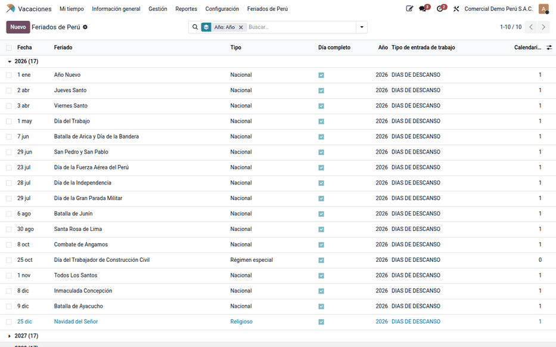
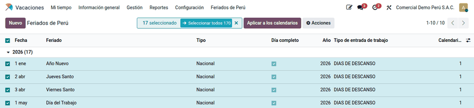
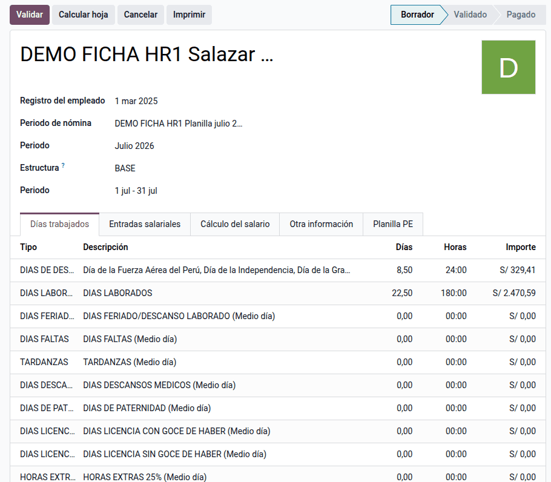

# Feriados

Si los feriados no están en el horario de trabajo, Odoo los trata como días
laborables: las ausencias descuentan días que no correspondían, la planilla no
reconoce el descanso remunerado y el tareaje no detecta el feriado trabajado.
La suite trae los **feriados nacionales de 2026 a 2035** (16 por año, incluida
la Semana Santa de fecha móvil), los aplica como descansos en los horarios de
trabajo y les asigna el tipo de entrada de trabajo con el que la nómina los
paga. La usan RR. HH. y el responsable de planillas.

Los días no laborables que el Gobierno decreta para el sector público y los
feriados regionales o locales no vienen cargados: se agregan a mano si la
empresa los adopta.

## Conceptos

- **Feriados y descansos remunerados** (D. Leg. 713 y modificatorias): los
  feriados nacionales son días de descanso remunerado; si se trabajan sin
  descanso sustitutorio, se pagan con una sobretasa del 100 %.
- En Odoo, los descansos globales del horario de trabajo son los «días
  festivos» que leen Vacaciones y las entradas de trabajo.

| Término | Significado | Dónde aparece en Odoo |
|---|---|---|
| Feriado | Fecha y nombre del feriado nacional | **Vacaciones ‣ Feriados de Perú ‣ Feriados** |
| Descanso global | Bloqueo del horario de trabajo ese día | Horario de trabajo, descansos |
| Tipo de entrada de trabajo | Concepto con que la nómina paga el feriado | Ficha del feriado |
| Medio día | Descanso desde las 00:00 hasta la hora indicada | Ficha del feriado |

## Configuración

1. Instale **Feriados del Perú** (`al_hr_pe_public_holidays`). Requiere
   Vacaciones y Entradas de trabajo.
2. Revise que cada horario de trabajo tenga la zona horaria correcta
   (America/Lima).
3. Con la [nómina peruana](../peru.md), compruebe que el tipo de entrada de
   trabajo de los feriados sea el de días de descanso (es el valor por
   defecto).

## Revisar y agregar feriados

1. Vaya a **Vacaciones ‣ Feriados de Perú ‣ Feriados** y filtre el año.
2. Para un feriado regional o un día adoptado por la empresa, haga clic en
   **Nuevo**.
3. Para un feriado de medio día, marque **Medio día** e indique la hora de fin
   del descanso (13:00 por defecto).

La Semana Santa se calcula para cada año: 2026 jueves 02/04 y viernes 03/04;
2027 25/03 y 26/03; 2028 13/04 y 14/04; 2030 18/04 y 19/04; 2035 22/03 y 23/03.

## Aplicar a los calendarios

1. En el selector de compañías, active las compañías cuyos horarios quiere
   afectar.
2. Seleccione los feriados y use **Aplicar a los calendarios**.
3. Revise los descansos creados con el botón **Calendarios** del feriado: hay
   uno por horario, de 00:00 a 23:59 en la zona horaria de cada horario.

Aplicar dos veces actualiza el descanso, no lo duplica. Si se elimina un
feriado, se eliminan sus descansos. La tarea programada **Feriados de Perú:
aplicación anual** corre el 2 de enero y aplica el año en curso y el siguiente
a todas las compañías, incluidas las creadas después de instalar.

| Feriado | Configuración | Inicio en Lima | Fin en Lima | Guardado en UTC |
|---|---|---|---|---|
| Batalla de Junín (06/08) | Día completo | 06/08 00:00 | 06/08 23:59 | 06/08 05:00 → 07/08 04:59 |
| Feriado de medio día | Medio día, hora 13:00 | 00:00 | 13:00 | 05:00 → 18:00 |

!!! warning "Importante"
    Si un feriado aparece corrido un día, la zona horaria del horario está mal.
    Corríjala y vuelva a aplicar. Los horarios de otra compañía no se tocan:
    active esa compañía y aplique.

## En la planilla

En julio de 2026 son feriados el jueves 23 (Día de la Fuerza Aérea del Perú),
el martes 28 (Día de la Independencia) y el miércoles 29 (Día de la Gran
Parada Militar). En las entradas de trabajo de julio aparecen como días de
descanso, y la boleta los cuenta como 3 días de descanso remunerado (24 horas),
sin descuento.

Un trabajador con sueldo mensual de S/ 3 000 cobra en julio sus S/ 3 000
completos: el feriado no laborado está remunerado dentro del sueldo mensual. Si
trabaja el 28 de julio sin descanso sustitutorio, el
[tareaje](attendance.md) lo clasifica como feriado laborado y la boleta paga
además ese día con la sobretasa del 100 % (valor día = 3 000 ÷ 30 = 100,00).

!!! note "Nota"
    El tareaje reconoce el feriado laborado solo si el feriado está aplicado
    como descanso en el horario. Si se pagó como día normal, aplique el feriado
    y vuelva a procesar el tareaje.

Sin la nómina peruana, los feriados sirven igual a Vacaciones y a las
entradas de trabajo.

!!! info "Ver también"
    - [Feriados — gob.pe](https://www.gob.pe/feriados)
    - [D. Leg. 713, descansos remunerados — El Peruano](https://diariooficial.elperuano.pe/Normas/obtenerDocumento?idNorma=42)
    - [Odoo — Vacaciones](https://www.odoo.com/documentation/19.0/applications/hr/time_off.html)
    - [Referencia técnica de `al_hr_pe_public_holidays`](../../../../developer/reference/modules/al_hr_pe_public_holidays/index.md)
