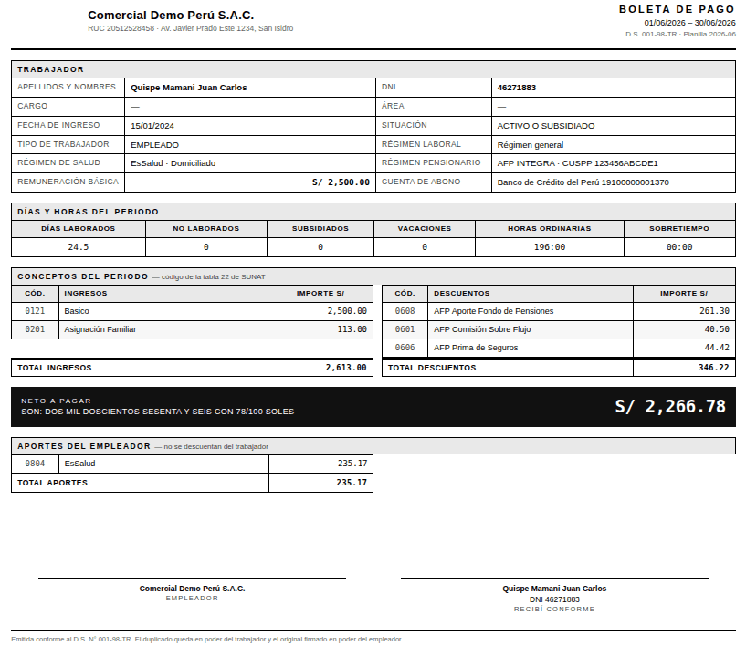
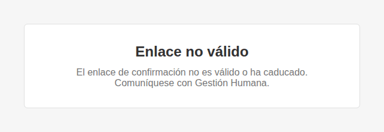
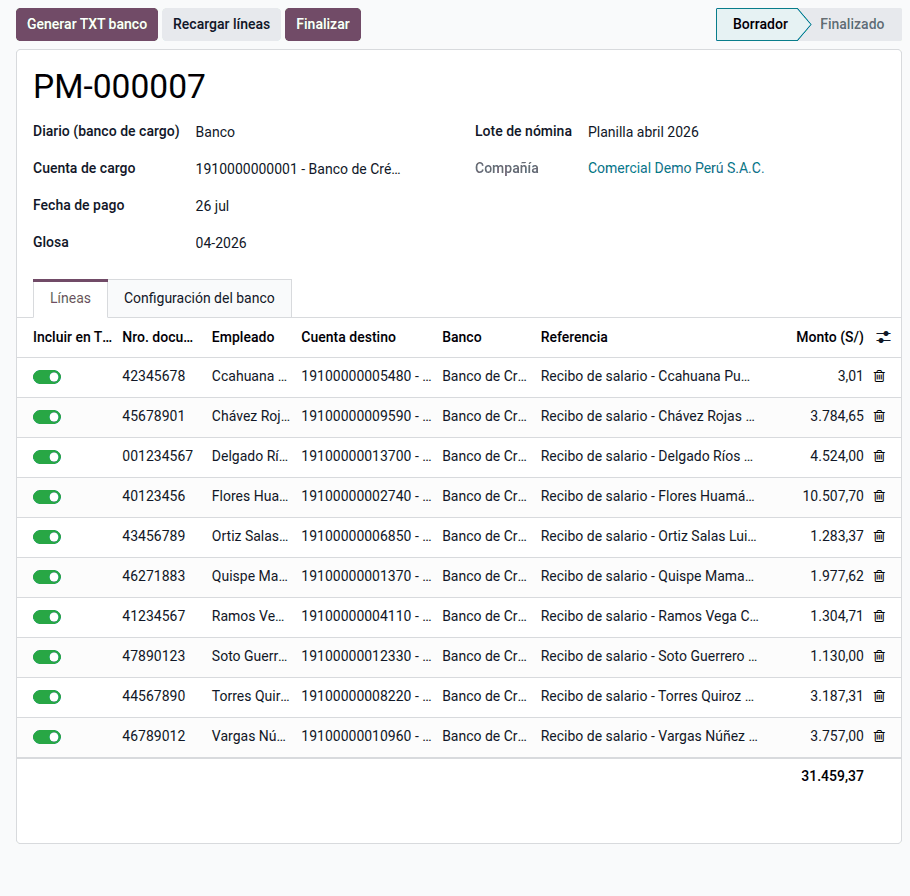
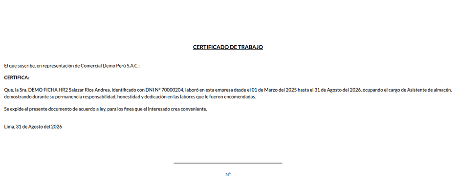

# Reportes y documentos

Cerrada la planilla, hay que entregar la boleta a cada trabajador y poder
probar que la recibió, pagar en el banco con el archivo de ancho fijo propio
de cada entidad y emitir los certificados y contratos de cada caso. La suite lo
genera desde Nómina: la **boleta de pago legal**, su **envío por correo con
confirmación de recepción**, el **certificado de trabajo**, la **carta de
retiro de CTS**, el **certificado de rentas y retenciones de 5.ª categoría**,
los **contratos desde plantilla** y el **TXT de pago masivo** de haberes y CTS
para BCP, BBVA, Interbank, Scotiabank y BanBif. Lo usan el responsable de
planillas, RR. HH. y tesorería.

La boleta electrónica firmada digitalmente con un proveedor externo no está
incluida: la constancia es el envío por correo con confirmación. El TXT tampoco
contabiliza: el pago se registra con el extracto bancario contra la cuenta 411
que deja la [contabilización de planillas](accounting.md).

## Conceptos

- **Boleta de pago** (D.S. 001-98-TR, arts. 18 y 19): contenido mínimo (datos
  del empleador y del trabajador, periodo, ingresos, descuentos y aportes del
  empleador) y entrega hasta el tercer día hábil siguiente al pago. Con el D.
  Leg. 1310, puede entregarse por medios electrónicos si el empleador prueba el
  envío. Los códigos de concepto son los de la tabla 22 de la PLAME.
- **Certificado de rentas y retenciones de 5.ª categoría** (art. 45 del
  Reglamento de la LIR): formato de la R.S. 010-2006/SUNAT. El trabajador
  acredita hoy sus rentas ante un nuevo empleador con el reporte de SUNAT
  (R.S. 350-2017/SUNAT), que descarga de SUNAT Operaciones en Línea.
- **CTS** (D. Leg. 650): la carta autoriza al banco depositario a liberar el
  saldo al cese.
- **Periodo de prueba** (art. 10 del TUO del D. Leg. 728): 3 meses en general,
  hasta 6 para trabajadores calificados o de confianza y hasta 12 para personal
  de dirección.

| Término | Significado | Dónde aparece en Odoo |
|---|---|---|
| Boleta PE | Reporte de la estructura salarial, el único que imprime el botón | **Recibo de nómina ‣ Imprimir** |
| Recepción confirmada | El trabajador pulsó **Confirmar recepción** en la página del enlace | Recibo, campo y fecha de confirmación |
| Pago masivo | Documento con las líneas y el TXT de un banco | **Nómina ‣ Recibos de nómina ‣ Pagos y contabilidad ‣ Pagos masivos bancarios** |
| Diario de pago masivo | Cuenta de cargo; su banco define el formato TXT | **Ajustes ‣ Nómina ‣ Perú** |
| Regla de neto a pagar | Regla de donde sale el importe de cada abono | Configuración principal |

## Configuración

1. Instale **Documentos y bancos de planilla** (`al_hr_pe_reports`).
2. Vaya a **Ajustes ‣ Nómina ‣ Perú** y, con cada compañía activa, indique el
   representante que firma y su firma, el cifrado de la boleta enviada y los
   diarios de pago masivo. El banco de la cuenta del diario debe tener su
   formato TXT.
3. En **Configuración principal** (botón **Abrir configuración principal**),
   indique las categorías de la boleta y la **regla de neto a pagar** (y la de
   neto quincenal).
4. En **Contactos ‣ Configuración ‣ Cuentas bancarias**, registre el tipo de
   cuenta y, en el banco, su formato y sus datos propios:
    - BCP: subtipo e IDC;
    - BBVA: tipo y hora de proceso;
    - Interbank: códigos de empresa y servicio;
    - Scotiabank: forma y tipo de cargo;
    - BanBif: subtipo.
5. En cada trabajador, registre sus cuentas de haberes y de CTS y su correo
   laboral.
6. En **Nómina ‣ Configuración ‣ Tipos y plantillas ‣ Plantillas de contrato**,
   cree o revise las plantillas y asígnelas en la ficha del trabajador.
7. Configure el servidor de correo saliente para el envío de boletas.

Cada compañía tiene su propia configuración, y los asistentes rechazan
trabajadores de otra compañía.

## Boleta de pago

En **Recibos de nómina**, use **Imprimir** (o el menú ⋮ del lote). El Imprimir
nativo ya saca la boleta peruana, así que el PDF impreso, el adjunto y el
enviado por correo son el mismo documento. Una estructura salarial con boleta
propia (como la de [construcción civil](construction.md)) se imprime con su
reporte.

Boleta de junio de 2026 de una trabajadora en AFP con comisión sobre el flujo,
sueldo de S/ 2 500,00 y asignación familiar:

| Bloque | Código | Concepto | Importe |
|---|---|---|---:|
| Ingresos | 0121 | Remuneración básica | 2 500,00 |
| Ingresos | 0201 | Asignación familiar | 113,00 |
| **Total ingresos** | | | **2 613,00** |
| Descuentos | 0608 | Aporte obligatorio AFP (10 %) | 261,30 |
| Descuentos | 0601 | Comisión AFP (1,55 %) | 40,50 |
| Descuentos | 0606 | Prima de seguros (1,70 %) | 44,42 |
| **Total descuentos** | | | **346,22** |
| **Neto a pagar** | | dos mil doscientos sesenta y seis con 78/100 soles | **2 266,78** |
| Aportes del empleador | 0804 | EsSalud (9 % de 2 613,00) | 235,17 |

2 613,00 − 346,22 = 2 266,78. La boleta muestra además 24,5 días laborados y
196:00 horas ordinarias. Con un neto negativo (adelanto o préstamo mayor que el
ingreso), la boleta se imprime y se envía igual: revise el saldo con el
trabajador.

## Envío por correo y confirmación

1. En el recibo, use **Enviar boleta**, o en la lista, **Acciones ‣ Enviar
   boletas PE por correo**.
2. El trabajador recibe el PDF (cifrado con su número de documento, si se
   activó) y un enlace firmado que vale 90 días.
3. Al pulsar **Confirmar recepción** en la página del enlace, queda la fecha en
   la boleta; la lista de boletas tiene la columna **Recepción confirmada**.

El enlace va firmado con HMAC: nadie puede confirmar una boleta ajena. Las
boletas sin correo laboral o no validadas se omiten y se listan en el aviso
final. Si el enlace venció, reenvíe la boleta: el enlace se renueva.

## Pago masivo bancario

1. Desde el lote, la quincena, la CTS, la gratificación o las vacaciones, use
   **Generar pago masivo**: se crea un documento por diario de cargo.
2. En el pago masivo, cargue las líneas y use **Generar TXT**: el archivo queda
   adjunto. Generarlo de nuevo reemplaza el anterior.
3. Suba el TXT a la banca por internet del banco.
4. Use **Finalizar**: los datos quedan de solo lectura. Un pago finalizado
   vuelve a borrador para corregirlo.

El pago masivo PM-000007 (planilla de abril de 2026 en formato BCP) tiene 10
abonos por S/ 31 459,37. Al llegar el extracto, la conciliación deja este
movimiento:

| Cuenta | Debe | Haber |
|---|---:|---:|
| 4111000 Remuneraciones por pagar | 31 459,37 | |
| 1041 Cuenta corriente (banco de cargo) | | 31 459,37 |
| **Total** | **31 459,37** | **31 459,37** |

La CTS se puede pagar en dólares si la cuenta de cargo y la cuenta CTS del
trabajador están en dólares.

## Certificados y carta de CTS

En **Empleados**, seleccione a uno o varios trabajadores y use la acción del
documento: **Certificado de trabajo**, **Carta de retiro de CTS** o
**Certificado de 5.ª categoría**. Sale un PDF con un documento por página.

El certificado de 5.ª no copia la retención: calcula el impuesto con la escala
progresiva sobre la renta imponible y muestra la diferencia con lo retenido,
incluso con otros empleadores. Ejercicio 2026 (UIT = S/ 5 500), trabajador con
S/ 6 000 al mes y dos gratificaciones de S/ 6 540 (con la bonificación
extraordinaria):

| Concepto | Importe |
|---|---:|
| Renta bruta: 6 000 × 12 + 6 540 × 2 | 85 080,00 |
| Deducción de 7 UIT | −38 500,00 |
| Renta neta imponible | 46 580,00 |
| Impuesto: 8 % × 27 500 + 14 % × 19 080 | 4 871,20 |
| Retenciones del año (ene–abr 405,93; may–jul 405,94; ago–nov 405,93; dic 405,94) | 4 871,20 |
| Saldo por regularizar | 0,00 |

## Contratos desde plantilla

En la ficha del trabajador, vaya a **Planilla PE ‣ Contrato de trabajo** y use
**Imprimir contrato**: la plantilla se rellena con los marcadores `{{…}}`.

- `S/ {{salario}} ({{salario_letras}} {{moneda}})` se imprime como «S/ 2800.00
  (DOS MIL OCHOCIENTOS CON 00/100 Soles)».
- Con ingreso el 01/03/2025 y prueba de 3 meses, el periodo de prueba termina
  el 01/06/2025.

Un marcador desconocido queda sin sustituir y se anota en el registro del
servidor: corrija su nombre en la plantilla.

## Casos especiales

| Situación | Qué pasa | Qué hacer |
|---|---|---|
| Pago masivo con importes en cero | No está configurada la regla de neto | Indicarla en la configuración principal |
| Lote abierto o boletas en borrador | No se genera el TXT | Validar el lote primero |
| Cuenta del trabajador en otra moneda que la de cargo | Queda fuera del archivo | Registrar una cuenta en la moneda del diario |
| Banco sin diario de pago masivo | Se lista en el aviso tras generar | Agregar el diario en Ajustes |
| Falta la UIT del ejercicio | El certificado de 5.ª avisa antes de imprimir | Registrar la UIT en el catálogo |

!!! info "Ver también"
    - [SUNAT — PDT PLAME](https://orientacion.sunat.gob.pe/pdt-plame)
    - [R.S. 010-2006/SUNAT, certificados de rentas y retenciones](https://www.sunat.gob.pe/legislacion/superin/2006/010.htm)
    - [SUNAT — preguntas frecuentes de 5.ª categoría](https://orientacion.sunat.gob.pe/node/27)
    - [SUNAT — cálculo del impuesto de 5.ª categoría](https://orientacion.sunat.gob.pe/3071-02-calculo-del-impuesto)
    - [D. Leg. 650, CTS — El Peruano](https://diariooficial.elperuano.pe/Normas/obtenerDocumento?idNorma=37)
    - [TUO del D. Leg. 728 — El Peruano](https://diariooficial.elperuano.pe/Normas/obtenerDocumento?idNorma=35)
    - [Referencia técnica de `al_hr_pe_reports`](../../../../developer/reference/modules/al_hr_pe_reports/index.md)
