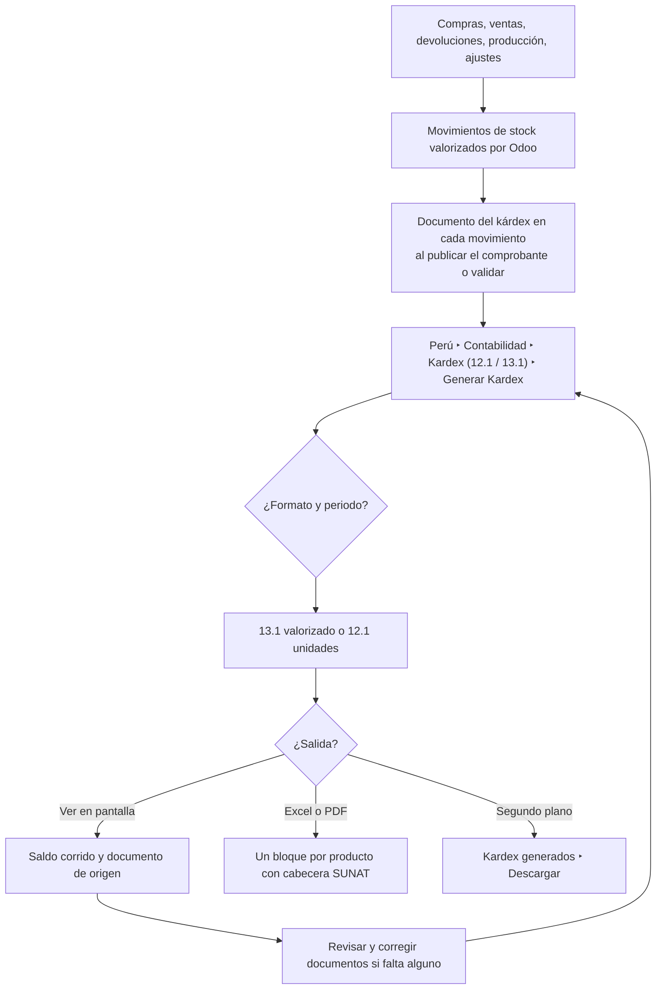
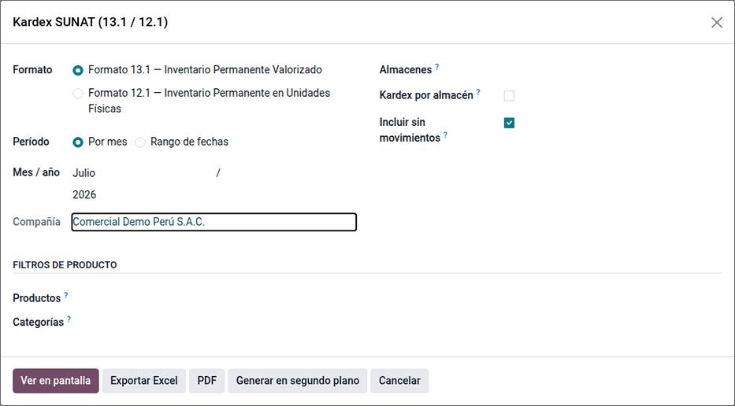
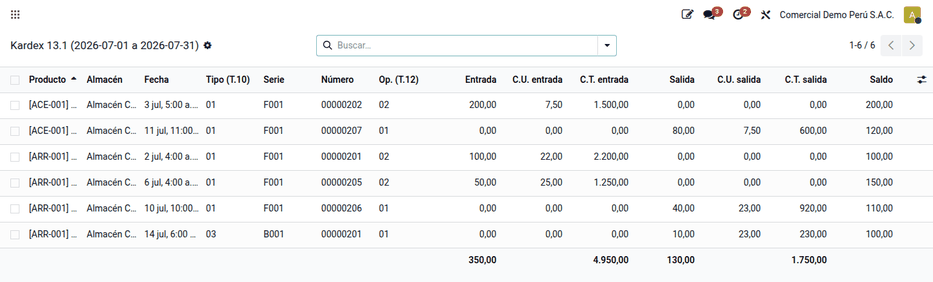
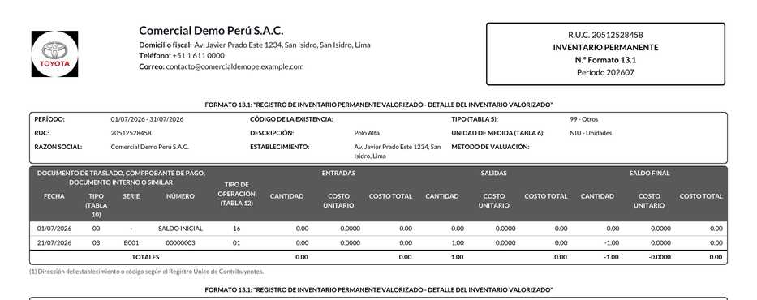

# Kárdex valorizado (SUNAT)

Los contribuyentes obligados a llevar el **Registro de Inventario Permanente**
lo presentan en el formato **13.1** (valorizado) o **12.1** (unidades físicas):
un bloque por existencia, con su cabecera y cada movimiento clasificado por
tipo de comprobante (tabla 10) y tipo de operación (tabla 12). Odoo valoriza el
inventario, pero no presenta el registro con ese diseño. El módulo **Kárdex
SUNAT** lo genera desde los movimientos de stock de Odoo: en pantalla con saldo
corrido, en Excel y PDF con la cabecera SUNAT, consolidado de la compañía o por
almacén, y en segundo plano para periodos largos. Lo usan contabilidad y
almacén.

Cada movimiento guarda su **comprobante** (tipo, serie y número), que usa
también el TXT del PLE de inventarios de Odoo Enterprise. Los asientos de
valorización los hace `stock_account` y el TXT del PLE lo genera
`l10n_pe_reports_stock` (Enterprise); el módulo corrige el documento de cada
fila de ese TXT.

## Configuración

1. Instale el módulo **Kárdex SUNAT** (`ol_stock_kardex_pe`).
2. Dé a los productos almacenables su **tipo de existencia** (tabla 5) y a las
   unidades de medida su **código SUNAT** (tabla 6).
3. Registre el **código de establecimiento anexo** en los almacenes.
4. Indique el **tipo de operación** (tabla 12) en las transferencias, en la
   página [Logística PE](stock_base.md). Si falta, se deduce de las
   ubicaciones.
5. Publique los comprobantes en los diarios correctos: el documento del kárdex
   se llena solo al publicar el comprobante y al validar la transferencia.
6. Para documentos antiguos, use las acciones masivas **completar vacíos** y
   **recalcular**, que respetan las correcciones manuales.

!!! note "Nota"
    El art. 35 del Reglamento de la Ley del Impuesto a la Renta define, según
    los ingresos brutos del ejercicio anterior, quién lleva el inventario
    permanente valorizado y quién en unidades físicas. Verifique los umbrales
    vigentes con el contador del cliente.

## Conceptos

| Término | Significado | Dónde aparece |
|---|---|---|
| Formato 13.1 | Registro de inventario permanente valorizado | **Generar Kardex ‣ Formato** |
| Formato 12.1 | Registro en unidades físicas | **Generar Kardex ‣ Formato** |
| Tabla 5 | Tipo de existencia (mercadería, producto terminado…) | Producto |
| Tabla 6 | Unidad de medida SUNAT | Unidad de medida |
| Tabla 10 | Tipo de comprobante (01 factura, 03 boleta, 07 nota de crédito, 09 guía, 00 otros) | Columna del kárdex |
| Tabla 12 | Tipo de operación (01 venta, 02 compra, 16 saldo inicial, 11 y 21 traslados…) | Transferencia (Logística PE) |
| Promedio ponderado | Costo unitario = valor del saldo ÷ cantidad del saldo | Método de valuación |

## Generar el kárdex

1. Vaya a **Perú ‣ Contabilidad ‣ Kardex (12.1 / 13.1) ‣ Generar Kardex** (también en
   **Inventario ‣ Reportes ‣ Kardex SUNAT**).
2. Elija el **Formato**, el periodo (por mes o por rango) y, si hace falta,
   los almacenes, los productos o las categorías. Active **Kardex por
   almacén** o **Incluir productos sin movimientos** según el caso.
3. Elija la salida:
    - **Ver en pantalla**: movimientos con las tablas 10 y 12, entradas,
      salidas, saldo corrido y acceso al documento de origen;
    - **PDF** o **Exportar Excel**: un bloque por producto con la cabecera
      SUNAT;
    - **Generar en segundo plano**, para periodos largos: el archivo aparece en
      **Perú ‣ Contabilidad ‣ Kardex (12.1 / 13.1) ‣ Kardex generados** con el estado **Listo** para
      descargarlo.

Desde un producto o una categoría, **Ver Kardex** abre el asistente con el
filtro cargado.

### Ejemplo con promedio ponderado

Arroz Superior 5 kg, método **promedio ponderado**, sin saldo al 1 de julio de
2026 (formato 13.1):

| Fecha | Documento (T.10) | Op. (T.12) | Entrada | Salida | Costo unitario | Saldo | Costo del saldo |
|---|---|---|---|---|---|---|---|
| 02/07/2026 | 01 F001-00000201 | 02 Compra | 100 × 22,00 | — | 22,00 | 100 | 2 200,00 |
| 06/07/2026 | 01 F001-00000205 | 02 Compra | 50 × 25,00 | — | 23,00 | 150 | 3 450,00 |
| 10/07/2026 | 01 F001-00000206 | 01 Venta | — | 40 × 23,00 | 23,00 | 110 | 2 530,00 |
| 14/07/2026 | 03 B001-00000201 | 01 Venta | — | 10 × 23,00 | 23,00 | 100 | 2 300,00 |

- Tras la segunda compra: (2 200,00 + 50 × 25,00) ÷ (100 + 50) =
  3 450,00 ÷ 150 = **23,00**.
- Las salidas se valoran al promedio vigente: 40 × 23 = 920,00 y
  10 × 23 = 230,00.
- Totales del mes: entradas de 150 unidades por **3 450,00**; salidas de 50 por
  **1 150,00**; saldo final de 100 por **2 300,00** (3 450,00 – 1 150,00).

El kárdex no genera asientos: el costo de ventas del mes (1 150,00) y el
ingreso del inventario (3 450,00) los contabiliza la valorización de Odoo con
las cuentas de la categoría del producto. En el consolidado, el costo es el de
la valorización de Odoo con el método del producto.

## Corregir el documento de un movimiento

1. Abra la transferencia y edite el **Documento del kardex**, o hágalo desde el
   historial de movimientos.
2. El llenado automático nunca cambia una corrección manual. Para volver al
   automático, use la acción masiva **recalcular**.

Cómo se elige el documento:

- una venta del TPV se vincula con su boleta o factura, no con el nombre
  interno de la transferencia;
- una entrega facturada en partes se empareja en orden (la primera entrega con
  la primera factura);
- un movimiento sin comprobante lleva el tipo 09 (guía) en ventas o compras y
  00 (otros) en el resto, como traslados y ajustes.

## Reportes

- **Kárdex en pantalla**, **PDF A4 horizontal** y **Excel** con la estructura de
  la plantilla SUNAT. La consulta en pantalla se calcula al momento y no deja
  copia; solo los archivos en segundo plano quedan guardados.
- **Kardex generados**: los archivos preparados en segundo plano.
- **TXT del PLE de inventarios** (Enterprise): usa el mismo documento por
  movimiento que el kárdex, con la serie de cada factura y las ventas del TPV
  con su boleta o factura. Vea [Libros electrónicos (PLE)](../../finance/fiscal_localizations/peru/ple.md).

## Casos especiales

| Situación | Qué pasa | Qué hacer |
|---|---|---|
| Sin movimientos ni saldos en el periodo | No se genera nada y se avisa | Revisar los filtros y el periodo |
| Entrega facturada en partes | Se empareja en orden | Verificar y corregir a mano si el orden real fue otro |
| Movimiento sin comprobante (traslado, ajuste) | Tipo 09 en ventas o compras sin comprobante y 00 en el resto | Revisar si corresponde un documento |
| Kárdex por almacén | El costo por almacén es aproximado; los traslados internos salen como operaciones 11 y 21 | Usar el consolidado para el valor oficial |
| Bienes de terceros (propietario distinto) | No se valorizan en Odoo ni van al kárdex valorizado | Controlarlos con [Traslados y bienes de terceros](stock_transfers.md) |

!!! info "Ver también"
    - [R.S. 234-2006/SUNAT, formatos 12.1 y 13.1](https://www.sunat.gob.pe/legislacion/superin/2006/234.htm)
    - [R.S. 286-2009/SUNAT, libros electrónicos](https://www.sunat.gob.pe/legislacion/superin/2009/rs286.doc)
    - [R.S. 042-2018/SUNAT](https://www.sunat.gob.pe/legislacion/superin/2018/042-2018.pdf) y [su anexo](https://www.sunat.gob.pe/legislacion/superin/2018/anexo-042-2018.pdf)
    - [MEF, presentación sobre libros electrónicos](https://www.mef.gob.pe/contenidos/conta_publ/capacitaciones/seminario_may2013/diapositivas/libros_electronicos_mef17052013_parte1.pdf)
    - [Inventario en Odoo 19](https://www.odoo.com/documentation/19.0/es/applications/inventory_and_mrp/inventory.html)
    - [Referencia del módulo](../../../developer/reference/modules/ol_stock_kardex_pe/index.md)
