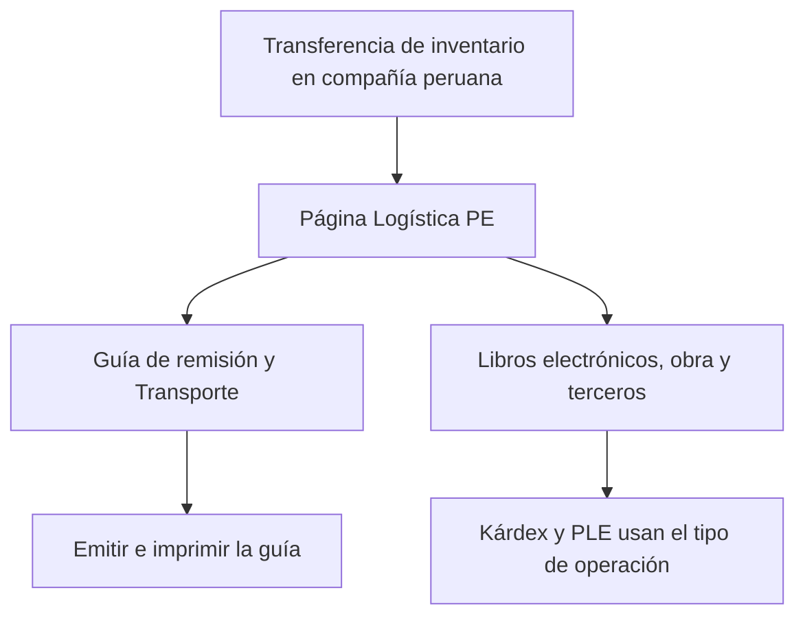
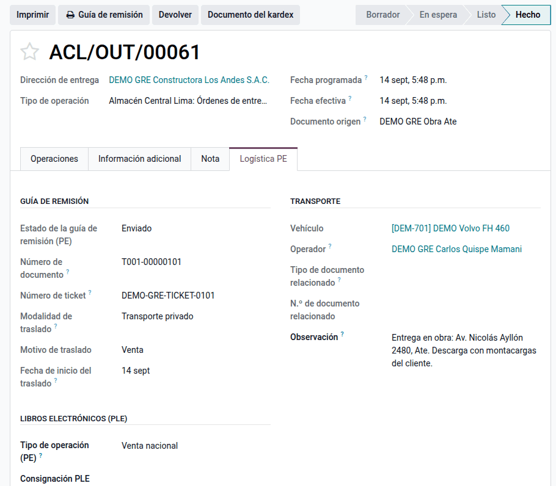

# Datos peruanos en transferencias

Varios módulos de la suite agregan datos peruanos a las transferencias de
inventario: guía de remisión, transporte, libros electrónicos, requerimiento de
obra y bienes de terceros. El módulo **Base de inventario Perú** los reúne en
la página **Logística PE** de la transferencia, el único lugar donde la suite
muestra lo peruano, agrupado por tema, como la página «Facturación PE» de la
factura. La cabecera de la transferencia queda como en Odoo.

Los cálculos y los envíos los hacen los módulos de cada grupo. Además, el
módulo deja compacto el **resumen de inventario** (**Inventario ‣ Información
general**): las tarjetas de los tipos de operación salen sin gráfico, más
angostas y con las etiquetas en español, para que quepan más en pantalla. Y
guarda la regla de los **tableros en planchas enteras** (unidad «Plancha
entera», **Plancha indivisible** en el producto, necesidad y redondeo de cada
movimiento) que usan el [requerimiento de
obra](../../services/project/construction/material_requests.md#tableros-en-planchas-enteras)
y la [orden de corte](../../services/project/construction/planning/production_order.md#tableros-en-planchas-enteras).

## Configuración

No necesita configuración: se instala como dependencia de los módulos de la
suite. La página aparece solo en compañías peruanas, y cada grupo, solo si su
módulo está instalado.

Las tarjetas del resumen se configuran en **Inventario ‣ Configuración ‣
Ajustes ‣ Resumen de inventario**: **Estilo de las tarjetas** (Compacta, la de
siempre, o Estándar de Odoo), **Ancho de las tarjetas** (300, 340 o 400 px) y
**Mostrar el gráfico en las tarjetas**. Cada usuario puede elegir otro estilo
en **Mis preferencias ‣ Tarjetas del resumen de Inventario**; «Según la
compañía» usa el de la compañía activa.

| Grupo de la página | Módulo que lo llena | Contenido |
|---|---|---|
| Guía de remisión | Guía de remisión impresa (con `l10n_pe_edi_stock`) | Estado, número, ticket, modalidad, motivo y fecha de inicio |
| Transporte | Guía de remisión impresa | Vehículo, conductor, documento relacionado y observaciones |
| Libros electrónicos (PLE) | [Libros electrónicos (PLE)](../../finance/fiscal_localizations/peru/ple.md) | Tipo de operación (tabla 12 de SUNAT) y consignación |
| Requerimiento de obra | [Requerimientos de materiales](../../services/project/construction/material_requests.md) | Requerimiento que originó la transferencia |
| Bienes de terceros | [Traslados y bienes de terceros](stock_transfers.md) | Propietarios y aviso de no valorización |

La guía de remisión impresa se explica en
[Guía de remisión impresa](../../finance/fiscal_localizations/peru/electronic_invoicing/delivery_guide.md).

## Completar los datos peruanos

1. Vaya a **Inventario ‣ Operaciones ‣ Transferencias** y abra la
   transferencia.
2. Abra la página **Logística PE** y complete los grupos que correspondan.

!!! note "Nota"
    La pestaña **EDI PE** nativa de Odoo queda oculta: sus datos están en
    **Logística PE**.

### Ejemplo

En una entrega a obra con guía de remisión, **Logística PE ‣ Guía de
remisión** muestra la guía T001-00000101 con motivo venta y modalidad privada;
**Transporte**, el vehículo y su conductor; **Libros electrónicos**, el tipo de
operación 01 (venta), y si la entrega viene de un requerimiento, **Requerimiento
de obra** muestra el documento de origen. El módulo no genera asientos
contables.

## Reportes

La guía de remisión impresa, el [kárdex valorizado](kardex.md) y el PLE de
inventarios toman sus datos de los grupos de esta página.

## Casos especiales

| Situación | Qué pasa | Qué hacer |
|---|---|---|
| No aparece la página | La compañía no es peruana | Revisar el país de la compañía |
| Falta un grupo | Su módulo no está instalado | Instalar el módulo correspondiente |
| No se puede desinstalar | Lo usan los módulos de la suite | Desinstalar primero los que dependen de él |

!!! info "Ver también"
    - [Guía de remisión electrónica (R.S. 123-2022/SUNAT)](https://www.sunat.gob.pe/legislacion/superin/2022/123-2022.pdf)
    - [Anexo de la R.S. 042-2018/SUNAT, formato 13.1 electrónico](https://www.sunat.gob.pe/legislacion/superin/2018/anexo-042-2018.pdf)
    - [Inventario en Odoo 19](https://www.odoo.com/documentation/19.0/es/applications/inventory_and_mrp/inventory.html)
