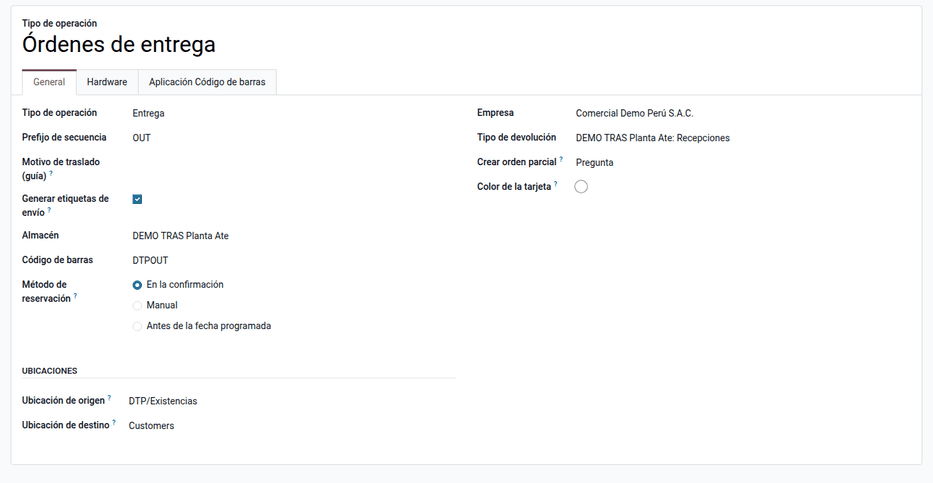
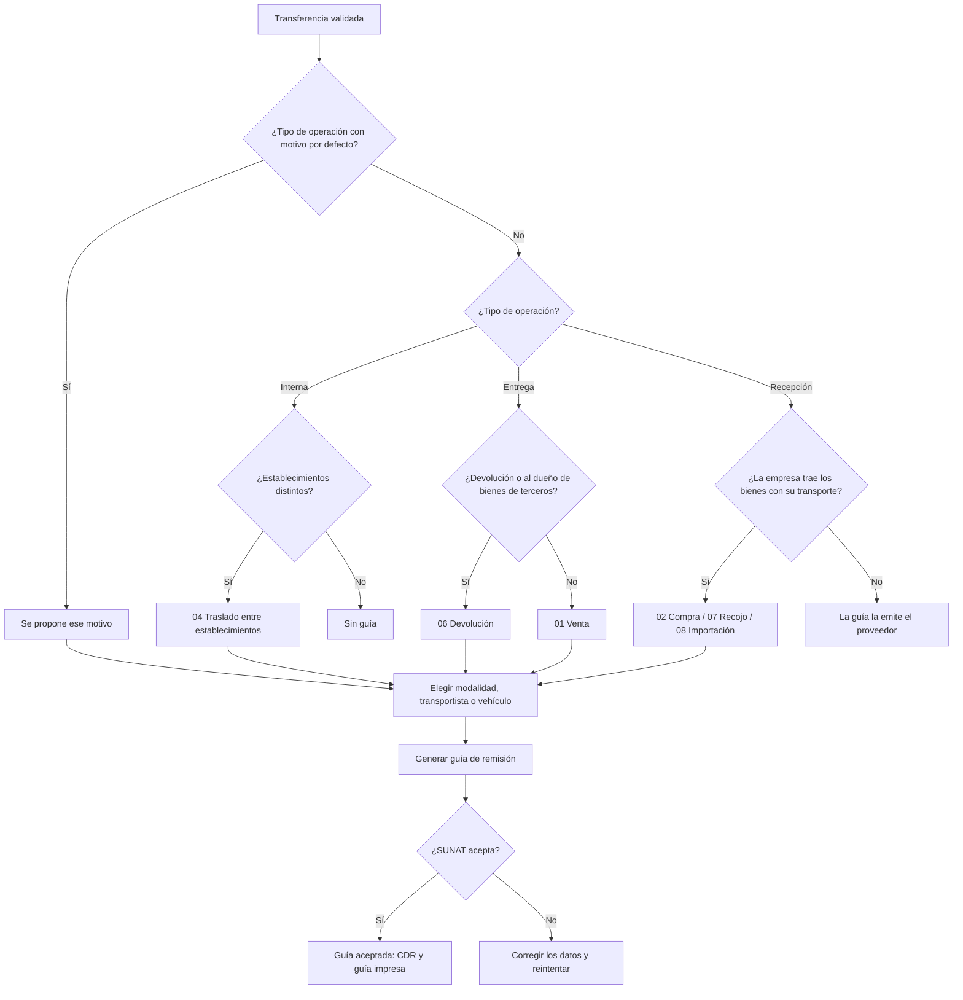
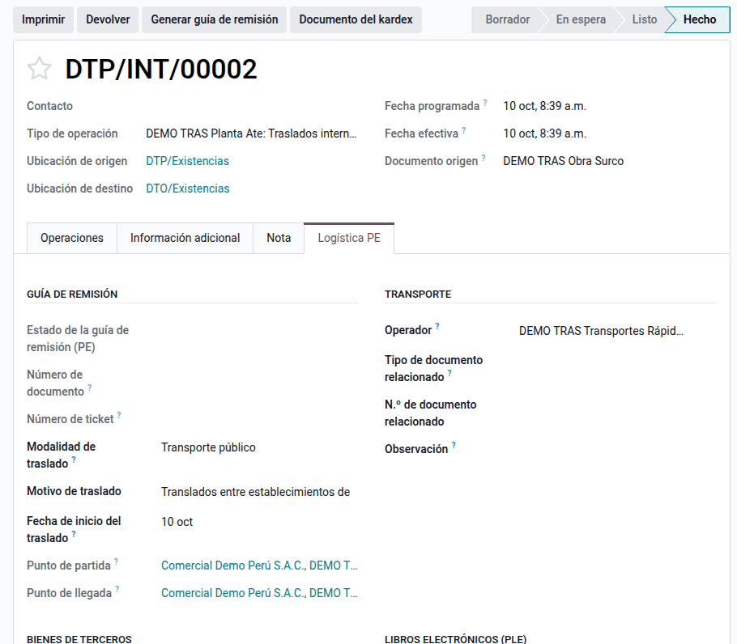
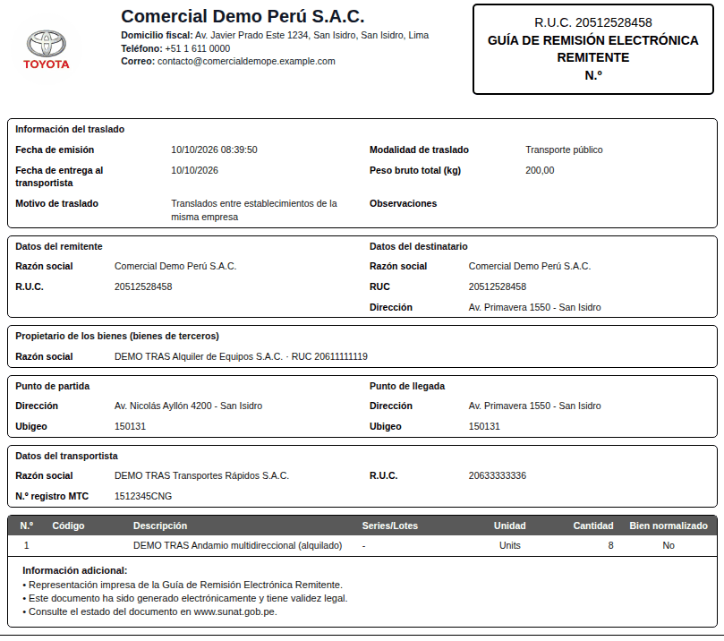
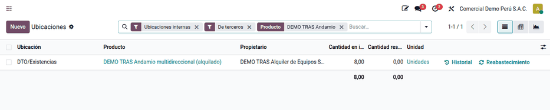

# Traslados y bienes de terceros

Toda empresa que mueve bienes en el Perú sustenta el traslado con una **guía de
remisión remitente**. Odoo la emite con el módulo `l10n_pe_edi_stock`, pero
solo en las entregas a clientes y con parte de los motivos de SUNAT. El módulo
**Traslados y bienes de terceros** completa el proceso para los traslados que
hace la propia empresa:

- entre sus establecimientos (planta → obra, almacén central → tienda);
- compras que recoge con su transporte, recojo de bienes mandados a
  transformar, importaciones desde el puerto y exportaciones;
- devoluciones al proveedor o al dueño de bienes de terceros;
- **bienes de terceros** (equipos alquilados, mercadería en consignación),
  identificados en el almacén y en la guía, sin valorizarlos.

Almacén y logística emiten la guía; contabilidad revisa que los bienes de
terceros no entren a la valorización. Quedan fuera el motivo 19 «Traslado de
mercancía extranjera», que exige datos del terminal portuario y del almacén
aduanero, y la guía de remisión **transportista**, que emite la empresa de
transporte.

## Configuración

1. Instale el módulo **Traslados y bienes de terceros**
   (`al_l10n_pe_stock_transfer`).
2. **Direcciones de los establecimientos**: en el contacto de cada almacén
   (**Inventario ‣ Configuración ‣ Gestión del almacén ‣ Almacenes ‣
   Dirección**), registre la calle, el distrito (ubigeo) y el **Establecimiento
   anexo** SUNAT de la ficha RUC.
3. **Compañía**: RUC y tipo de documento RUC en su contacto.
4. **Bienes de terceros**: active **Inventario ‣ Configuración ‣ Ajustes ‣
   Consignación** para ver el campo **Propietario**.
5. **Transporte**: registre los vehículos en **Inventario ‣ Configuración ‣
   Perú ‣ Configuración ‣ Comprobantes electrónicos ‣ Vehículos (guías de remisión)** y, para transporte público, el transportista con su RUC y
   su número MTC.
6. **Motivo por defecto** (opcional): en **Inventario ‣ Configuración ‣
   Gestión del almacén ‣ Tipos de operaciones**, complete **Motivo de traslado
   (guía)**; por ejemplo, un tipo «Envío en consignación» con el 05.
7. **Conexión con SUNAT**: la de la guía electrónica estándar
   (`l10n_pe_edi_stock`, en los ajustes de Inventario, sección Perú).

!!! warning "Importante"
    El Reglamento exige que los puntos de partida y llegada entre
    establecimientos de la empresa estén declarados en el RUC, y su código de
    anexo va en la guía. Desde el 01/06/2026 SUNAT valida el RUC y el código
    del establecimiento de partida y de llegada.

## Conceptos

| Término | Significado | Dónde aparece en Odoo |
|---|---|---|
| Remitente | Quien envía los bienes y emite la guía (aquí, la empresa) | Compañía |
| Destinatario | Quien los recibe; en el motivo 04 y en las compras que recoge la empresa es la misma empresa | Datos del destinatario de la guía |
| Punto de partida y de llegada | Direcciones de origen y destino, con su ubigeo | Transferencia ‣ Logística PE |
| Establecimiento anexo | Código que SUNAT asigna a cada local declarado en el RUC (0000 el domicilio fiscal) | Contacto de la dirección ‣ **Establecimiento anexo** |
| Motivo de traslado | Código del catálogo 20 | Transferencia ‣ Logística PE ‣ **Motivo de traslado** |
| Bienes de terceros | Bienes que están en el almacén pero son de otro (consignación) | **Propietario** de la transferencia o de la línea |
| Modalidad | 01 transporte público (empresa de transportes) o 02 privado (vehículo propio) | **Modalidad de traslado** |

La norma: el [capítulo V del Reglamento de Comprobantes de Pago](https://www.sunat.gob.pe/legislacion/comprob/regla/capituloV.pdf)
(artículos 17 a 21) dice quién emite la guía, sus datos y los motivos del
traslado; la [R.S. N.° 123-2022/SUNAT](https://www.sunat.gob.pe/legislacion/superin/2022/123-2022.pdf)
regula la guía de remisión electrónica (GRE) remitente y transportista, que se
envía a SUNAT y devuelve un CDR; el catálogo 20 «Motivo de traslado» está en el
[anexo de la R.S. N.° 240-2024/SUNAT](https://www.sunat.gob.pe/legislacion/superin/2024/anexo1-000240-2024.pdf)
(códigos 01, 02, 03, 04, 05, 06, 07, 08, 09, 13, 14, 17, 18 y 19), y la
[R.S. N.° 000108-2026/SUNAT](https://www.sunat.gob.pe/legislacion/superin/2026/000108-2026.pdf)
ajusta la fecha de entrega al transportista y los documentos relacionados del
comercio exterior.

## Emitir la guía de un traslado

1. Cree y valide la transferencia en **Inventario ‣ Operaciones ‣ Traslados**
   (**Interno**, **Recepciones** o **Entregas**).
2. En la página **Logística PE**, elija la **Modalidad de traslado**. El
   sistema propone el motivo y la fecha de inicio.
3. Revise el motivo, la partida y la llegada en el grupo **Guía de remisión**.
4. Complete el grupo **Transporte**: el transportista (público) o el vehículo y
   el conductor (privado).
5. Haga clic en **Generar guía de remisión**. La guía recibe su número
   (T001-…), el ticket y el CDR de SUNAT.
6. Con la guía aceptada, haga clic en **Guía de remisión** para imprimir la
   representación impresa del transportista.

El motivo propuesto se puede cambiar antes de enviar: la propuesta solo
reemplaza el 01 que Odoo pone al crear la transferencia.

### Qué motivo usar

| Caso | Motivo |
|---|---|
| Traslado entre establecimientos de la empresa (también equipos alquilados a una obra propia) | 04; el propietario de los bienes va en las observaciones |
| Compra que la empresa recoge con su transporte | 02 |
| Recojo de bienes mandados a transformar | 07 |
| Importación desde el puerto | 08, con la DAM o la DS como documento relacionado |
| Exportación | 09, con la DAM o la DS como documento relacionado |
| Devolución al proveedor o al dueño de bienes de terceros | 06 |
| Otros traslados | 13, con la **Descripción del motivo** |
| Compra que trae el proveedor | Ninguno: la guía la emite el proveedor (motivo 01 en la suya) |

!!! note "Nota"
    Entre dos ubicaciones del mismo establecimiento (mismo anexo o misma
    dirección) no hay guía: el botón no aparece y, si se fuerza, el sistema
    avisa.

!!! tip "Consejo"
    Verifique en el ambiente de pruebas de SUNAT el primer envío de cada motivo
    nuevo, en especial la exportación.

Si SUNAT devuelve un error, el detalle queda en la transferencia: corrija el
dato (dirección, distrito, transportista…) y vuelva a enviar. Una guía
rechazada o anulada se gestiona como en el estándar de Odoo
(`l10n_pe_edi_stock`).

## Bienes de terceros

Indique el **Propietario** al recibir los bienes de terceros, en la
transferencia o en cada línea. Con un propietario ajeno, los bienes:

- no se valorizan ni entran al kárdex valorizado: solo se controlan en
  cantidades;
- aparecen en la guía, con el propietario en las observaciones;
- se separan en los informes con los filtros **De terceros** y **Propios**.

## Ejemplo

Datos de demostración «DEMO TRAS» en la compañía Comercial Demo Perú S.A.C.,
RUC 20512528458:

| Establecimiento | Dirección | Anexo |
|---|---|---|
| DEMO TRAS Planta Ate (almacén DTP) | Av. Nicolás Ayllón 4200 | 0001 |
| DEMO TRAS Obra Surco (almacén DTO) | Av. Primavera 1550 | 0002 |

Bienes: andamios tubulares propios (18 kg) y andamios multidireccionales
alquilados a DEMO TRAS Alquiler de Equipos S.A.C., RUC 20611111119 (25 kg), con
el transportista DEMO TRAS Transportes Rápidos S.A.C. (RUC 20633333336, MTC
1512345CNG).

**a) Traslado de 8 andamios alquilados de la planta a la obra** (DTP/INT/00002)

| Dato de la guía | Valor |
|---|---|
| Motivo | 04 Traslado entre establecimientos de la misma empresa (propuesto) |
| Destinatario | Comercial Demo Perú S.A.C. (la misma empresa) |
| Partida | Av. Nicolás Ayllón 4200 · RUC 20512528458 · anexo 0001 |
| Llegada | Av. Primavera 1550 · RUC 20512528458 · anexo 0002 |
| Peso bruto | 8 × 25 kg = **200 kg** |
| Observaciones | «Bienes de propiedad de DEMO TRAS Alquiler de Equipos S.A.C. (20611111119).» |

**b) Compra de 15 andamios tubulares que la empresa recoge** (DTP/IN/00001,
factura del proveedor F001-00004521)

| Dato de la guía | Valor |
|---|---|
| Motivo | 02 Compra (propuesto en la recepción) |
| Destinatario | Comercial Demo Perú S.A.C. |
| Partida | Av. Argentina 2100 (proveedor, RUC 20622222222, anexo 0) |
| Llegada | Av. Nicolás Ayllón 4200 (anexo 0001) |
| Documento relacionado | Factura F001-00004521 |
| Peso bruto | 15 × 18 kg = **270 kg** |

**c) Devolución de 4 andamios alquilados a su dueño** (DTP/OUT/00001)

| Dato de la guía | Valor |
|---|---|
| Motivo | 06 Devolución (propuesto: el destinatario es el dueño de los bienes) |
| Destinatario | DEMO TRAS Alquiler de Equipos S.A.C. |
| Peso bruto | 4 × 25 kg = **100 kg** |

El módulo no genera asientos: la guía es un documento de traslado, no
contable.

| Movimiento | Existencias físicas | Valorización y kárdex valorizado | Asiento |
|---|---|---|---|
| a) 8 alquilados planta → obra | Planta −8, obra +8 (de terceros) | No entran (propietario ajeno) | Ninguno |
| b) Compra de 15 propios | Planta +15 | Sí, como cualquier recepción | El de la recepción estándar, si la categoría tiene valorización automática |
| c) Devolución de 4 alquilados | Planta −4 (de terceros) | No entran | Ninguno |

Tras los tres movimientos, el filtro **De terceros** muestra 8 andamios en la
obra y 0 en la planta (12 recibidos − 8 trasladados − 4 devueltos).

## Reportes

- **Guías de remisión**: menú **Perú ‣ Clientes ‣ Comprobantes ‣ Guías de remisión**, con su estado ante
  SUNAT y la guía impresa. Vea
  [Guía de remisión impresa](../../finance/fiscal_localizations/peru/electronic_invoicing/delivery_guide.md).
- [Kárdex valorizado](kardex.md): los bienes de terceros no entran a las
  cantidades valorizadas; los traslados internos entre almacenes se ven como
  salida y entrada del mismo producto.
- **Existencias de terceros**: **Inventario ‣ Reportes ‣ Ubicaciones**, filtros
  **De terceros** y **Propios**; en los movimientos, **De terceros**; en las
  transferencias, **Con bienes de terceros**.

## Casos especiales

| Situación | Qué pasa | Qué hacer |
|---|---|---|
| Transferencia interna sin botón de guía | Origen y destino son el mismo establecimiento | Es correcto: no sale del local. Si sí sale, revisar la dirección de los almacenes |
| «Con el motivo 13… describa el traslado» | Falta la descripción | Completar **Descripción del motivo** (por ejemplo, «Exhibición en feria») |
| «Con importación o exportación indique la declaración aduanera» | Motivo 08 o 09 sin DAM o DS | Documento relacionado 50 (DAM) o 52 (DS) con su número |
| «Los motivos 02, 07 y 08 son de ingreso» | Se eligió un motivo de ingreso en una entrega | Usar el motivo de la salida (01, 06, 05…) |
| Recepción que no deja emitir guía | El motivo es de venta | Si la empresa trajo los bienes, elegir 02, 07 u 08; si no, la guía es del proveedor |
| El propietario no aparece en la guía | La transferencia y sus líneas no tienen propietario | Indicar el propietario al recibir los bienes de terceros |
| Motivo 04 escrito «Translados…» | Errata de la traducción del estándar | Solo es el texto; el código enviado es 04 |

## Datos de demostración

Una base creada **con datos de demostración** carga, al instalar el módulo, un
ejemplo completo en la compañía **PE Company** (la compañía peruana de la demo
de Odoo, con el plan contable de Perú). Los registros llevan el prefijo **DEMO
TRAS** y las fechas se calculan respecto del día de la instalación. En una base
sin datos de demostración no se carga nada.

- Almacenes **DEMO TRAS Planta Ate** (DTP, anexo 0001) y **DEMO TRAS Obra
  Surco** (DTO, anexo 0002).
- Andamios propios y andamios alquilados a un tercero (consignación).
- Dos traslados de la planta a la obra (motivo 04), una compra recogida en el
  proveedor (motivo 02) y la devolución al propietario (motivo 06).

!!! info "Ver también"
    - [Reglamento de Comprobantes de Pago, capítulo V (guías de remisión)](https://www.sunat.gob.pe/legislacion/comprob/regla/capituloV.pdf)
    - [R.S. N.° 123-2022/SUNAT, guía de remisión electrónica](https://www.sunat.gob.pe/legislacion/superin/2022/123-2022.pdf)
    - [R.S. N.° 240-2024/SUNAT](https://www.sunat.gob.pe/legislacion/superin/2024/000240-2024.pdf) y [su anexo con el catálogo 20](https://www.sunat.gob.pe/legislacion/superin/2024/anexo1-000240-2024.pdf)
    - [R.S. N.° 000108-2026/SUNAT](https://www.sunat.gob.pe/legislacion/superin/2026/000108-2026.pdf)
    - [R.S. N.° 097-2012/SUNAT, catálogos de la emisión electrónica](https://www.sunat.gob.pe/legislacion/superin/2012/097-2012.pdf)
    - [Guía de remisión remitente, orientación SUNAT](https://orientacion.sunat.gob.pe/02-guia-de-remision-remitente)
    - [GRE: traslado de mercancía extranjera](https://www.gob.pe/institucion/sunat/informes-publicaciones/6189305-gre-traslado-de-mercancia-extranjera)
    - [Localización peruana en Odoo 19 (guía de remisión)](https://www.odoo.com/documentation/19.0/applications/finance/fiscal_localizations/peru.html)
    - [Existencias de terceros en Odoo 19](https://www.odoo.com/documentation/19.0/applications/inventory_and_mrp/inventory/shipping_receiving/daily_operations/owned_stock.html)
    - [Datos peruanos en transferencias](stock_base.md)
