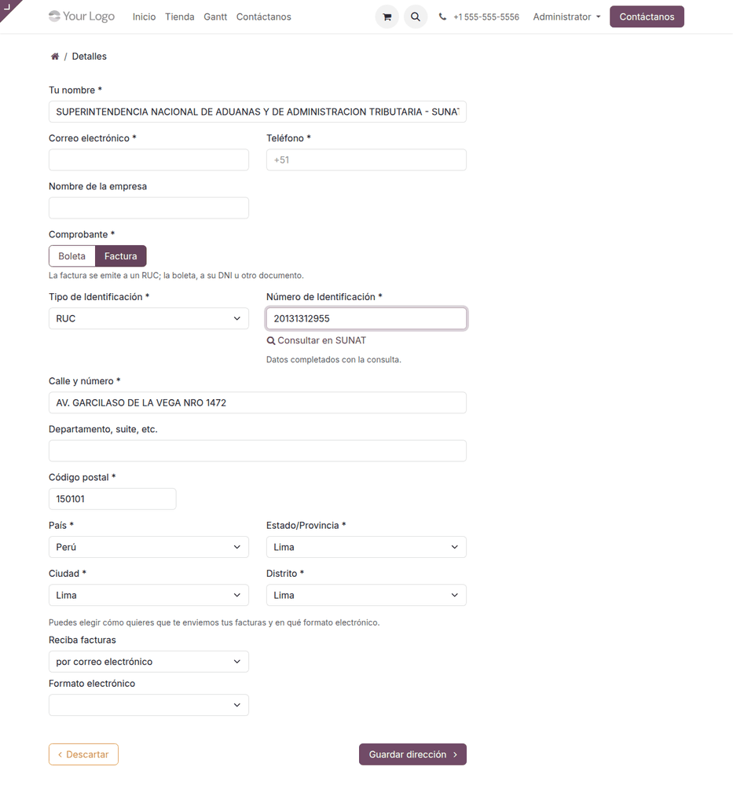

# Checkout peruano

En la tienda en línea, Odoo 19 ya pide en la dirección de facturación el
**tipo y el número de documento**, y el **departamento, la provincia y el
distrito**. Con RUC emite factura; con otro documento, boleta. El módulo
**Tienda en línea peruana** lo hace explícito y rápido para el cliente:

- el cliente elige **Boleta** o **Factura**, y el tipo de documento se ajusta
  solo;
- su **RUC o DNI se consulta en SUNAT** y llena el nombre o la razón social,
  la dirección y el ubigeo.

La misma dirección de facturación aparece en el portal del cliente (**Mi
cuenta**), con el mismo comportamiento.

## Configuración

1. Instale el módulo **Tienda en línea peruana** (`al_website_sale_pe`).
   Requiere la tienda en línea de Odoo (**Sitio web ‣ Comercio electrónico**).
2. Revise que la consulta de RUC y DNI esté activa: **Perú ‣ Configuración ‣
   Consultas RUC / DNI ‣ Conexiones RUC/DNI** (vea
   [Consulta de RUC y DNI](../../finance/fiscal_localizations/peru/ruc_dni_lookup.md)).
3. Publique una pasarela para cobrar: [Culqi](../../finance/payment_providers/culqi.md),
   [Niubiz](../../finance/payment_providers/niubiz.md) o
   [Izipay](../../finance/payment_providers/izipay.md).

## Elegir el comprobante y consultar el documento

1. En el checkout, en la **dirección de facturación**, el cliente elige
   **Boleta** o **Factura**.
    - **Factura**: el tipo de documento pasa a **RUC**.
    - **Boleta**: el tipo de documento pasa a **DNI**, salvo que haya elegido
      otro documento, como el carné de extranjería o el pasaporte.
2. Escribe el número. Al completar 11 dígitos (RUC) u 8 (DNI), se consulta
   solo; también puede hacer clic en **Consultar en SUNAT**.
3. Se llenan el nombre o la razón social, la calle, el código postal, el
   departamento, la provincia y el distrito. El cliente revisa los datos y
   continúa.

| Elección | Tipo de documento | Comprobante que emite Odoo |
|---|---|---|
| Factura | RUC | Factura electrónica (01) |
| Boleta | DNI, carné de extranjería, pasaporte… | Boleta de venta electrónica (03) |

!!! note "Nota"
    La consulta es pública: cada visitante tiene un límite de consultas por
    sesión, para que nadie gaste las consultas de pago de las conexiones. Al
    llegar al límite, el cliente completa sus datos a mano.

!!! tip "Consejo"
    La consulta del DNI depende de que alguna conexión devuelva datos de
    RENIEC. Si no hay datos, el cliente escribe su nombre.

!!! info "Ver también"
    - [Facturación electrónica](../../finance/fiscal_localizations/peru/electronic_invoicing.md)
    - [Odoo: comercio electrónico](https://www.odoo.com/documentation/19.0/es/applications/websites/ecommerce.html)
