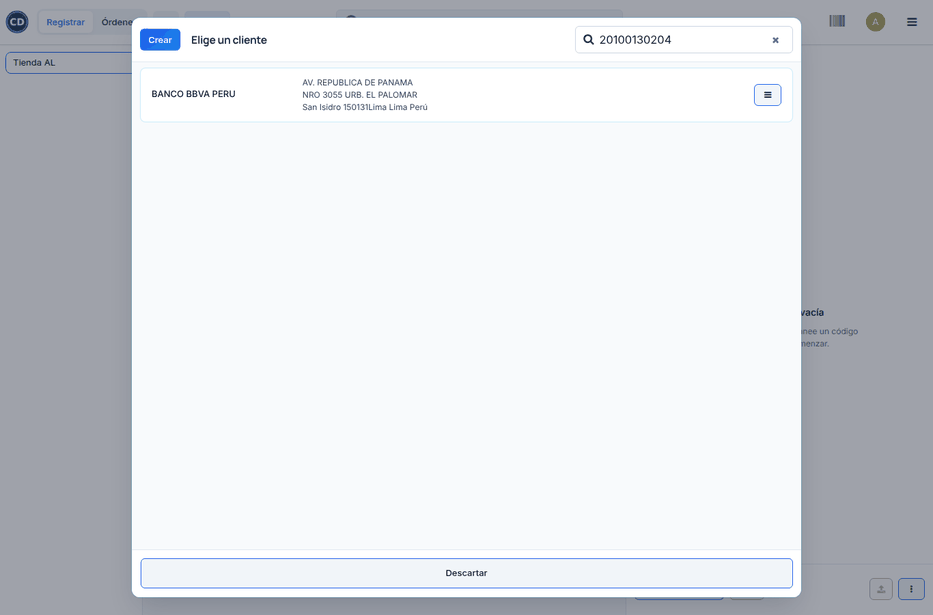
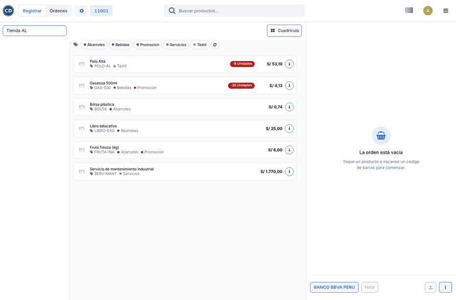

# Cliente por RUC o DNI

En la caja, el cliente dicta su RUC para la factura o su DNI para la boleta.
Si no está registrado, el TPV de Odoo solo muestra «No se encontraron
clientes». El módulo **Cliente por RUC/DNI en el TPV** agrega en esa búsqueda
el botón **Crear cliente … desde SUNAT**. El botón consulta el documento y
crea el cliente con su razón social o nombre, su dirección y su ubigeo. El
cliente queda elegido en la orden, listo para emitir el
[comprobante electrónico](electronic_invoicing.md).

## Configuración

1. Instale el módulo **Cliente por RUC/DNI en el TPV**
   (`al_pos_pe_partner_lookup`).
2. Revise que la consulta de RUC y DNI esté activa: **Perú ‣ Configuración ‣
   Consultas RUC / DNI ‣ Conexiones RUC/DNI**. Es la misma consulta de los
   contactos de la localización (vea
   [Consulta de RUC y DNI](../../finance/fiscal_localizations/peru/ruc_dni_lookup.md)).
3. Recargue el TPV.

!!! note "Nota"
    El formulario completo de cliente del TPV (botón **Crear**) también
    consulta SUNAT al escribir el documento. Este módulo agrega el atajo desde
    la búsqueda, sin abrir el formulario.

## Crear el cliente desde la búsqueda

1. En la orden, haga clic en el botón del cliente (**Consumidor Final**).
2. Escriba el RUC (11 dígitos) o el DNI (8 dígitos) en **Buscar clientes**.
3. Si no está registrado, haga clic en **Crear cliente … desde SUNAT**.

Odoo consulta el documento, crea el cliente y lo elige en la orden:

| Situación | Resultado |
|---|---|
| RUC o DNI no registrado | Se crea con los datos de la consulta y queda en la orden |
| El documento ya existe, aunque no esté cargado en la caja | Se trae ese cliente; no se duplica |
| RUC con dígito verificador incorrecto | Aviso, sin gastar una consulta de pago |
| Ninguna conexión devuelve datos | Aviso: cree el cliente a mano con **Crear** |

!!! tip "Consejo"
    Para una factura, busque por RUC: Odoo emite factura solo a clientes con
    RUC. Con DNI se emite boleta.

!!! info "Ver también"
    - [Comprobantes electrónicos en el TPV](electronic_invoicing.md)
    - [Cobros con QR y pasarelas en el TPV](qr_payments.md)
