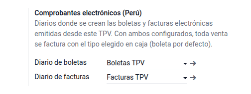
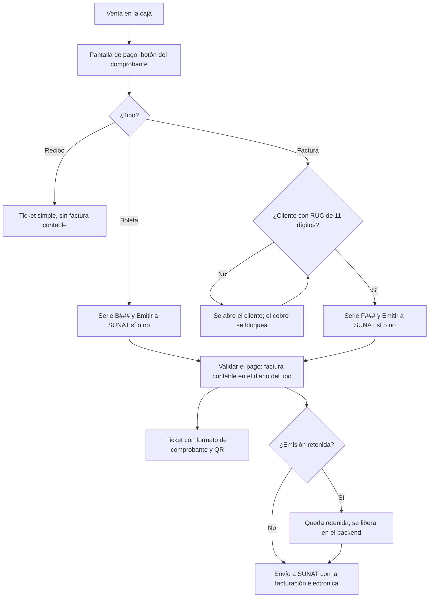
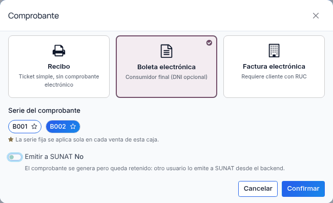
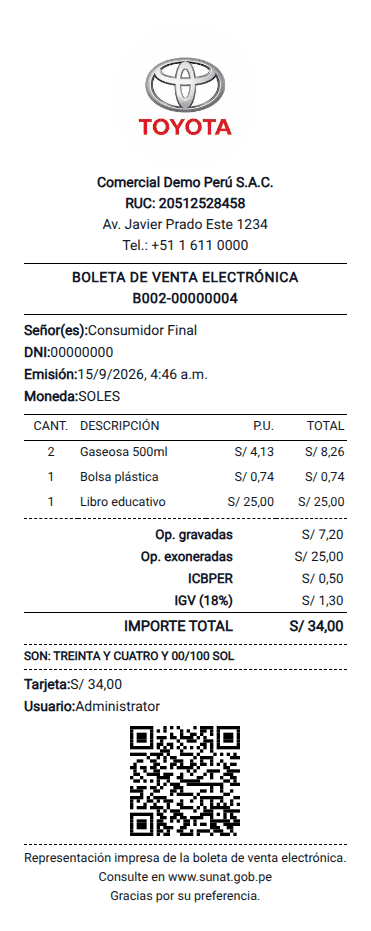
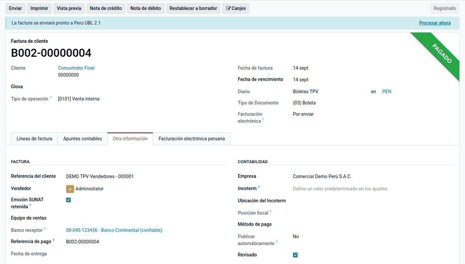

# Comprobantes electrónicos en el TPV

En Perú cada venta de la caja se respalda con un **comprobante de pago**: la
**boleta de venta** para el consumidor final y la **factura** cuando el cliente
tiene RUC, cada una con su serie (B### o F###) y su numeración. El punto de
venta estándar solo ofrece un interruptor de factura y un único diario. Con el
módulo **Boleta y factura electrónica en el TPV**, el cajero elige en la
pantalla de pago **Recibo**, **Boleta electrónica** o **Factura electrónica** y
su serie; cada tipo se registra en su diario, se envía a SUNAT con la
facturación electrónica de Odoo y el ticket sale con el formato del comprobante
(RUC, tipo y número, desglose tributario, importe en letras y código QR). Lo
usan cajeros, supervisores de tienda y contabilidad.

Las notas de crédito no se emiten desde la caja, sino en Contabilidad. Para la
impresión física en impresoras de red, vea
[Impresoras de red](network_printers.md).

## Configuración

1. Instale el módulo **Boleta y factura electrónica en el TPV**
   (`al_l10n_pe_edi_pos`). La compañía debe ser peruana y tener la facturación
   electrónica configurada (certificado y operador).
2. Cree un diario de ventas para **boletas** y otro para **facturas**, con sus
   series de comprobante publicadas. La numeración por serie la puede llevar el
   módulo de [numeración de asientos y series](../../finance/fiscal_localizations/peru/entry_numbering.md).
3. Vaya a **Punto de venta ‣ Configuración ‣ Ajustes**, sección
   **Contabilidad**, bloque **Comprobantes electrónicos (Perú)**, y elija el
   diario de boletas y el de facturas de cada caja. Con los dos diarios
   configurados se activa el flujo.

## Conceptos

| Término | Significado |
|---|---|
| Recibo | Ticket interno, sin comprobante electrónico ni factura contable |
| Boleta electrónica | Comprobante para el consumidor final (DNI opcional), serie B### |
| Factura electrónica | Comprobante para un cliente con RUC de 11 dígitos, serie F### |
| Serie fija | Serie que la caja aplica sola en cada venta (marcada con la estrella) |
| Emisión SUNAT retenida | El comprobante se genera, pero no se envía hasta liberarlo |

La norma que respalda el flujo: el
[Reglamento de Comprobantes de Pago (R.S. 007-99/SUNAT)](https://www.sunat.gob.pe/legislacion/superin/1999/007.pdf)
define la boleta y la factura y cuándo exigir RUC; la
[R.S. 340-2017/SUNAT](https://www.sunat.gob.pe/legislacion/superin/2017/340-2017.pdf)
hace obligatorio el código QR en la representación impresa, y el
[Anexo I de la R.S. 117-2017/SUNAT](https://www.sunat.gob.pe/legislacion/superin/2017/anexoI-117-2017.pdf)
fija los requisitos del comprobante electrónico.

## Vender con boleta o factura

1. Abra la caja y registre la venta.
2. En la pantalla de pago, haga clic en el botón del comprobante y elija
   **Recibo**, **Boleta electrónica** (por defecto) o **Factura electrónica**.
3. Elija la serie. Para que la caja la aplique sola en las ventas siguientes,
   márquela con la estrella.
4. Deje marcado **Emitir a SUNAT** o desmárquelo para retener la emisión.
5. Haga clic en **Validar**. El sistema publica la factura contable en el
   diario del tipo elegido e imprime el ticket con el formato del comprobante.

| Elección | ¿Factura contable? | Diario | Requisito | Ticket |
|---|---|---|---|---|
| Recibo | No | — | — | Recibo estándar |
| Boleta electrónica | Sí | Diario de boletas | Ninguno (DNI opcional) | BOLETA DE VENTA ELECTRÓNICA |
| Factura electrónica | Sí | Diario de facturas | Cliente con RUC de 11 dígitos | FACTURA ELECTRÓNICA |

!!! warning "Importante"
    Una factura exige un cliente con RUC de 11 dígitos. Sin él, el TPV muestra
    el aviso **Factura electrónica**, abre el cliente y no deja cobrar hasta
    completarlo.

!!! note "Nota"
    La serie fija se guarda por caja y por tipo en el navegador de esa caja: no
    se comparte entre cajas. Si el diario tiene series y no se elige ninguna,
    el diálogo no se puede confirmar.

### Ejemplo de una boleta

En la caja «DEMO TPV Vendedores» se venden gaseosas, una bolsa plástica y un
libro exonerado, con la **boleta B002-00000004** por S/ 34,00:

| Fila del ticket | Importe |
|---|---|
| Op. gravadas | 7,20 |
| Op. exoneradas | 25,00 |
| ICBPER | 0,50 |
| IGV 18 % (7,20 × 0,18 = 1,296) | 1,30 |
| **Total** | **34,00** |

El código QR lleva nueve datos separados por `|` (RUC, tipo, serie, número,
IGV, total, fecha, tipo y número de documento del cliente) y está disponible en
cuanto la factura se publica, sin esperar respuesta de SUNAT:
`20512528458|03|B002|00000004|1.30|34.00|2026-09-14|1|00000000`.

Asiento de la boleta (diario de boletas):

| Cuenta | Descripción | Debe | Haber |
|---|---|---|---|
| 1212 | Facturas, boletas y otros comprobantes por cobrar | 34,00 | |
| 70121 | Mercaderías – venta local (7,20 + 25,00) | | 32,20 |
| 40111 | IGV – cuenta propia | | 1,30 |
| 40189 | Otros impuestos (ICBPER, según su impuesto) | | 0,50 |
| | **Totales** | **34,00** | **34,00** |

Cobro en efectivo, que el TPV concilia contra la boleta:

| Cuenta | Descripción | Debe | Haber |
|---|---|---|---|
| 101 | Caja | 34,00 | |
| 1212 | Facturas, boletas y otros comprobantes por cobrar | | 34,00 |
| | **Totales** | **34,00** | **34,00** |

### Ventas sin conexión

Sin conexión, el TPV guarda la orden y la sincroniza al volver la conexión.
Revise después que la factura se haya enviado a SUNAT.

## Revisar las órdenes

Vaya a **Punto de venta ‣ Órdenes ‣ Órdenes**. Cada orden muestra el **Tipo de
comprobante (PE)**, la **Serie CPE** y la marca **Emitir a SUNAT**. Al cerrar la
sesión, el TPV genera los asientos de la sesión (pagos y diferencias de caja).

!!! tip "Consejo"
    Facture por orden. Si se facturan varias órdenes juntas al cierre, el TPV
    usa su diario estándar y puede mezclar boletas y facturas.

## Liberar una emisión retenida

Un comprobante con la emisión retenida no lo envía ni el proceso automático ni
**Procesar ahora**.

1. Vaya a **Contabilidad ‣ Clientes ‣ Facturas** y abra el comprobante.
2. En la pestaña **Otra información**, desmarque **Emisión SUNAT retenida**.
3. El proceso automático lo envía, o haga clic en **Procesar ahora**.

Para anular una boleta, emita una nota de crédito en Contabilidad (o la
comunicación de baja, según el caso), como con cualquier comprobante.

## Reportes

- **Órdenes del TPV** con el tipo, la serie y la marca de emisión.
- Las boletas y facturas van al **Registro de Ventas** (RVIE y PLE) como
  cualquier comprobante. Vea [Registros SIRE](../../finance/fiscal_localizations/peru/sire.md)
  y [Libros electrónicos (PLE)](../../finance/fiscal_localizations/peru/ple.md).
- El [kárdex valorizado](../../inventory_and_mrp/inventory/kardex.md) vincula
  las salidas del TPV con su boleta o factura.

## Casos especiales

| Situación | Qué pasa | Qué hacer |
|---|---|---|
| No aparece el botón del comprobante | Faltan los dos diarios o la compañía no es peruana | Configurar los diarios de la caja |
| No se puede confirmar el diálogo | El diario tiene series y no se eligió ninguna | Elegir la serie o fijarla con la estrella |
| Factura sin RUC | Aviso **Factura electrónica**; el cobro no procede | Completar el RUC del cliente |
| Boleta retenida | No se envía a SUNAT | Desmarcar **Emisión SUNAT retenida** |

El **Recibo** sigue disponible para ventas sin comprobante: evalúe con el
cliente si corresponde según su régimen.

!!! info "Ver también"
    - [Reglamento de Comprobantes de Pago (R.S. 007-99/SUNAT)](https://www.sunat.gob.pe/legislacion/superin/1999/007.pdf)
    - [R.S. 340-2017/SUNAT, código QR](https://www.sunat.gob.pe/legislacion/superin/2017/340-2017.pdf)
    - [Anexo I de la R.S. 117-2017/SUNAT](https://www.sunat.gob.pe/legislacion/superin/2017/anexoI-117-2017.pdf)
    - [Comunicados de SUNAT sobre factura electrónica](https://orientacion.sunat.gob.pe/node/754)
    - [Punto de venta en Odoo 19](https://www.odoo.com/documentation/19.0/es/applications/sales/point_of_sale.html)
    - [Localización peruana en Odoo 19](https://www.odoo.com/documentation/19.0/es/applications/finance/fiscal_localizations/peru.html)
    - [Vendedor por venta](salesperson.md)
