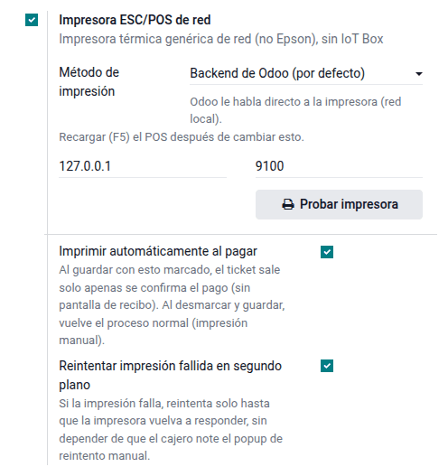
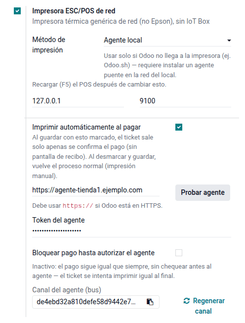
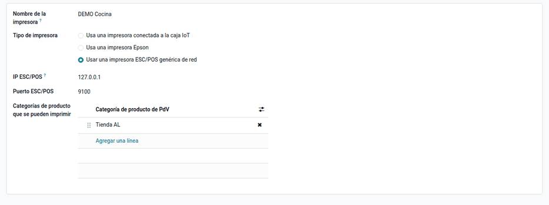
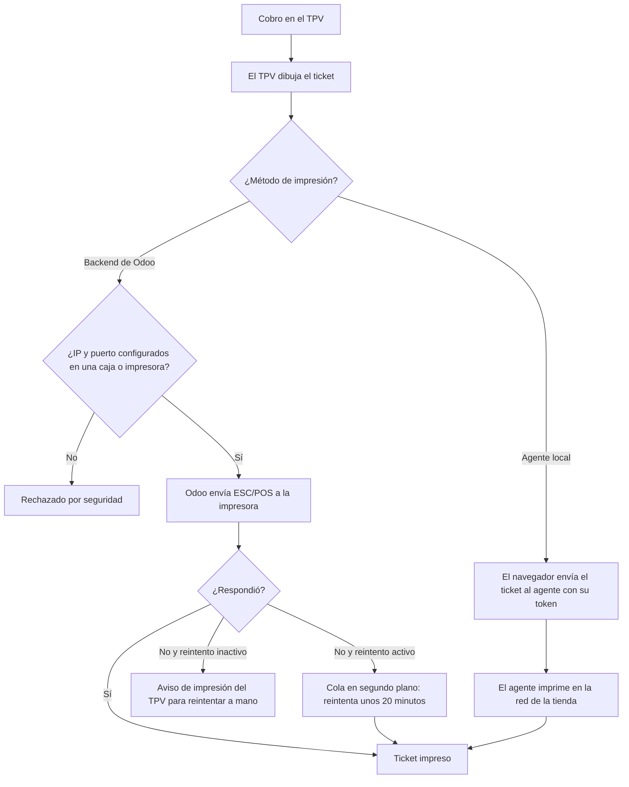

# Impresoras de red

El punto de venta de Odoo imprime por red sin IoT Box solo en impresoras Epson
(protocolo ePOS). Las térmicas genéricas más comunes y económicas (Xprinter,
Zjiang, Gainscha, MUNBYN…) usan **ESC/POS por el puerto 9100**, que el
navegador no puede abrir. El módulo **Impresora ESC/POS de red** agrega ese
tipo de impresora para el recibo de cada caja y para las impresoras de
preparación (cocina, barra), sin IoT Box:

- con **Backend de Odoo**, el servidor envía el ticket a la impresora (Odoo en
  la tienda o con acceso a su red);
- con **Agente local**, cuando Odoo está en la nube, un programa pequeño en una
  PC de la tienda recibe el ticket del navegador y lo imprime;
- si la impresora no responde, el ticket se reintenta en segundo plano durante
  unos 20 minutos.

Lo configura el administrador del TPV y lo usan los cajeros. El diseño del
ticket es el del TPV estándar (el formato peruano lo pone
[Comprobantes electrónicos en el TPV](electronic_invoicing.md)). Las
impresoras USB o Bluetooth directas necesitan el agente o una IoT Box, y la
apertura del cajón no entra en la cola de reintentos.

## Configuración

### Requisitos

1. Asigne a cada impresora una **IP fija** en la red de la tienda y habilite el
   puerto RAW **9100**.
2. Para los reintentos en segundo plano, el servidor de Odoo debe cargar el
   módulo `queue_job` de la OCA como módulo global
   (`--load=base,web,queue_job`). Es parte de la instalación del servidor.
3. Instale el módulo **Impresora ESC/POS de red** (`al_pos_network_printer`).

### Impresora de la caja

1. Vaya a **Punto de venta ‣ Configuración ‣ Ajustes** y elija la caja arriba.
2. Active **Impresora ESC/POS de red** e indique la IP, el puerto (9100) y el
   **Método de impresión**: **Backend de Odoo** o **Agente local**.
3. Haga clic en **Probar impresora**: sale un ticket de prueba y un aviso verde.
4. Defina el comportamiento de la caja: **Imprimir automáticamente al pagar**,
   **Reintentar impresión fallida en segundo plano** y **Bloquear pago hasta
   autorizar el agente**.

!!! warning "Importante"
    La impresora ESC/POS de red y la impresora ePos (Epson) nativa son
    excluyentes en una misma caja: elija una sola.

### Agente local (Odoo en la nube)

1. Instale el agente en una PC de la tienda con Windows o Linux. El programa y
   sus instrucciones están en la carpeta `agent/` del módulo (vea la
   [referencia del módulo](../../../developer/reference/modules/al_pos_network_printer/index.md)).
2. Si Odoo está en HTTPS, publique también el agente con HTTPS: el navegador
   bloquea una conexión HTTP desde una página HTTPS.
3. En los ajustes de la caja, elija **Agente local**, escriba la **URL** y el
   **Token** del agente y haga clic en **Probar agente**.

### Impresoras de preparación

1. Vaya a **Punto de venta ‣ Configuración ‣ Impresoras de preparación** y
   haga clic en **Nuevo**.
2. Elija el tipo **Usar una impresora ESC/POS genérica de red** e indique la IP,
   el puerto y las categorías de producto que imprime.
3. Asígnela a la caja.

## Conceptos

| Término | Significado |
|---|---|
| ESC/POS | Lenguaje de comandos de las impresoras térmicas de tickets |
| Puerto 9100 (RAW) | Puerto de red por el que se envían los comandos |
| Backend de Odoo | El servidor de Odoo imprime |
| Agente local | Programa en la tienda que imprime en nombre de Odoo en la nube |
| Impresora de preparación | Imprime comandas por categoría (cocina, barra) |

## Imprimir

Al validar el pago, la caja imprime el recibo y cada impresora de preparación
recibe la comanda con los productos de sus categorías. El sistema solo imprime
en las IP y puertos que configuró un administrador en una caja o una impresora;
el agente se protege con su token. Una caja puede tener su impresora y todas
las de preparación que hagan falta.

### Ejemplo

Restaurante con Odoo en la nube y dos impresoras térmicas en su red local:

| Equipo | IP | Uso |
|---|---|---|
| Térmica de caja (Xprinter 80 mm) | 192.168.1.50:9100 | Recibo del cliente |
| Térmica de cocina | 192.168.1.51:9100 | Comandas de las categorías «Platos» y «Entradas» |
| PC de la caja con el agente local | 192.168.1.10:8443 (HTTPS) | Recibe los tickets del navegador y los imprime |

1. En la caja «Salón», método **Agente local**, URL del agente en
   `192.168.1.10:8443` (con HTTPS) y su token; **Probar agente** responde
   correcto.
2. Impresora de preparación «Cocina», tipo ESC/POS genérica, IP
   192.168.1.51:9100, categorías Platos y Entradas, asignada a la caja.
3. En un pedido de 2 lomos saltados y 1 gaseosa, la cocina recibe la comanda
   con los 2 lomos (la gaseosa no es de sus categorías) y, al cobrar, la caja
   imprime el recibo.

Con el servidor de Odoo en el local, el método sería **Backend de Odoo** y no
haría falta el agente. Con **Reintentar impresión fallida** activo, un ticket
que no sale por un corte de la impresora se imprime solo cuando vuelve. El
módulo no genera asientos contables.

## Casos especiales

| Situación | Qué pasa | Qué hacer |
|---|---|---|
| **Probar impresora** falla | La impresora no responde en esa IP y puerto | Revisar la IP fija, el cable y que el puerto 9100 esté abierto |
| Odoo en la nube con método **Backend de Odoo** | El servidor no alcanza la red de la tienda | Usar **Agente local** |
| Odoo en HTTPS y agente en HTTP | El navegador bloquea la conexión | Publicar el agente con HTTPS |
| Impresión en una IP no configurada | Se rechaza por seguridad | Configurar la IP en la caja o en una impresora |
| Impresora apagada un rato | Con reintento activo, imprime sola al volver (unos 20 minutos) | Activar **Reintentar impresión fallida** |
| Caja con ePos Epson y ESC/POS a la vez | No se permite | Elegir una sola |

!!! info "Ver también"
    - [Impresoras Epson por red en el TPV de Odoo 19](https://www.odoo.com/documentation/19.0/es/applications/sales/point_of_sale/configuration/epos_ssc.html)
    - [IoT Box en el TPV de Odoo 19](https://www.odoo.com/documentation/19.0/es/applications/sales/point_of_sale/configuration/pos_iot.html)
    - [Punto de venta en Odoo 19](https://www.odoo.com/documentation/19.0/es/applications/sales/point_of_sale.html)
    - [Cola de trabajos de la OCA (`queue_job`)](https://github.com/OCA/queue)
    - [Referencia del módulo: agente, configuración paso a paso e impresoras recomendadas](../../../developer/reference/modules/al_pos_network_printer/index.md)
