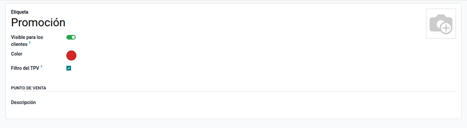
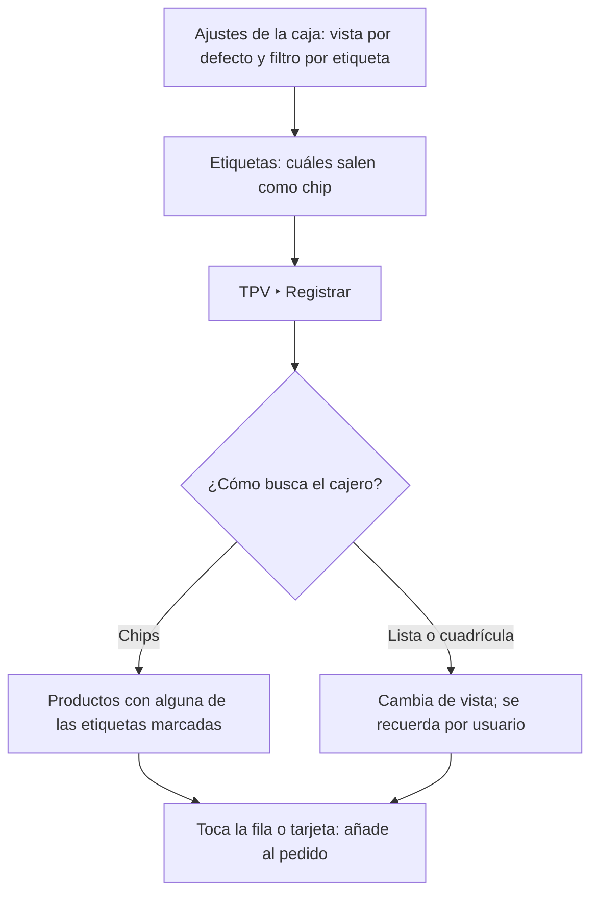
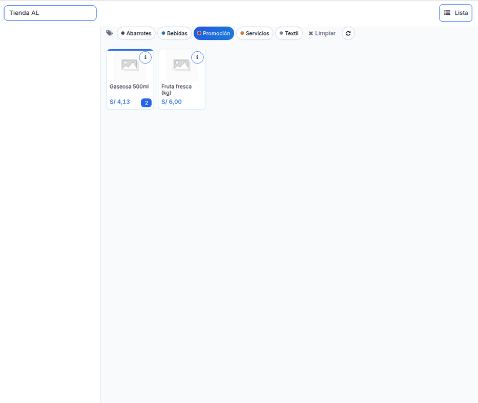
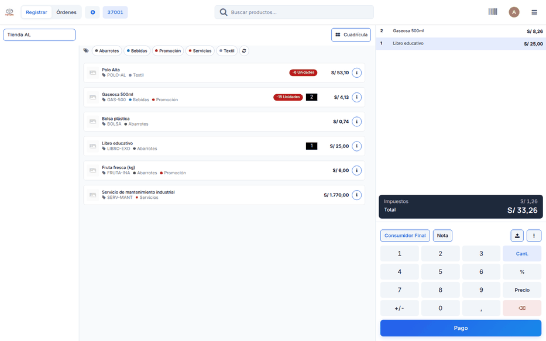

# Vista de productos

El catálogo estándar del TPV filtra solo por categoría y texto y muestra
tarjetas grandes. En tiendas con muchos productos parecidos, el cajero necesita
otros cortes y más datos a la vista. El módulo **Vista de productos del TPV**
agrega chips de **etiquetas** para filtrar el catálogo, un conmutador entre
**cuadrícula** y **lista compacta**, un botón de **información** del producto
que no lo añade al pedido y la **vista preferida** de cada cajero.

Usa las etiquetas de producto estándar de Odoo, sin modelos nuevos. Precios,
impuestos y existencias los calcula el TPV estándar: el módulo solo los muestra.

## Configuración

1. Instale el módulo **Vista de productos del TPV** (`al_pos_product_view`). Al
   instalarlo se crean algunas etiquetas de ejemplo.
2. Vaya a **Punto de venta ‣ Productos ‣ Etiquetas de producto** y dé a cada
   etiqueta su color y su orden. Marque **Mostrar en la barra de filtros del
   TPV** en las que deben salir como chip; la lista permite editarlas en bloque.
3. Vaya a **Punto de venta ‣ Configuración ‣ Ajustes**, sección **Interfaz de
   PdV**, y elija la **Vista de productos por defecto** (cuadrícula o lista) y
   active **Filtrar productos por etiqueta** en cada caja.

## Conceptos

| Término | Significado |
|---|---|
| Etiqueta de producto | Marca libre del backend (Promoción, Bebidas…) con color |
| Chip | Botón de la etiqueta sobre el catálogo |
| Vista por defecto | La de la caja; cada usuario puede tener la suya |

## Filtrar por etiquetas

1. En la caja, toque uno o varios chips: el catálogo muestra los productos con
   **alguna** de las etiquetas marcadas.
2. Haga clic en **Limpiar** para quitar todos los filtros.
3. Para ver etiquetas nuevas sin cerrar la sesión, use el botón de recarga (↻).

El filtro se aplica antes del tope de 100 productos del TPV, así que no se
pierden resultados, y convive con la búsqueda y las categorías.

## Cambiar entre cuadrícula y lista

Haga clic en **Lista** o **Cuadrícula** sobre el catálogo. La elección se
guarda en las preferencias del usuario. La lista compacta muestra el código, el
código de barras, las etiquetas, el stock, la cantidad en el carrito y el
precio final.

### Ejemplo

En el TPV de demostración, con las etiquetas Bebidas, Textil, Abarrotes,
Servicios y Promoción, el chip **Promoción** deja a la vista Gaseosa 500ml y
Fruta fresca (kg). En la vista de lista, un pedido de 2 Gaseosa 500ml
(S/ 4,13 c/u) y 1 Libro educativo (S/ 25,00) muestra en cada fila la cantidad
en el carrito y suma S/ 33,26 (2 × 4,13 + 25,00). El precio de la fila coincide
con el de la línea porque aplica la tarifa y los impuestos de la caja. El
módulo no genera asientos contables.

## Casos especiales

| Situación | Qué pasa | Qué hacer |
|---|---|---|
| No aparece un chip | Ningún producto de la caja usa la etiqueta o está desmarcada | Revisar la etiqueta |
| Pantalla pequeña | La fila de chips se oculta | Usar la búsqueda o las categorías |
| El filtro deja el catálogo vacío | Los chips siguen visibles | Desmarcar o **Limpiar** |
| Stock en rojo | Producto almacenable sin existencias | Revisar el inventario |

!!! info "Ver también"
    - [Punto de venta en Odoo 19](https://www.odoo.com/documentation/19.0/es/applications/sales/point_of_sale.html)
    - [Precios y tarifas en el TPV de Odoo 19](https://www.odoo.com/documentation/19.0/es/applications/sales/point_of_sale/pricing.html)
    - [Tema del TPV](theme.md)
