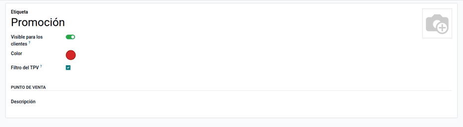
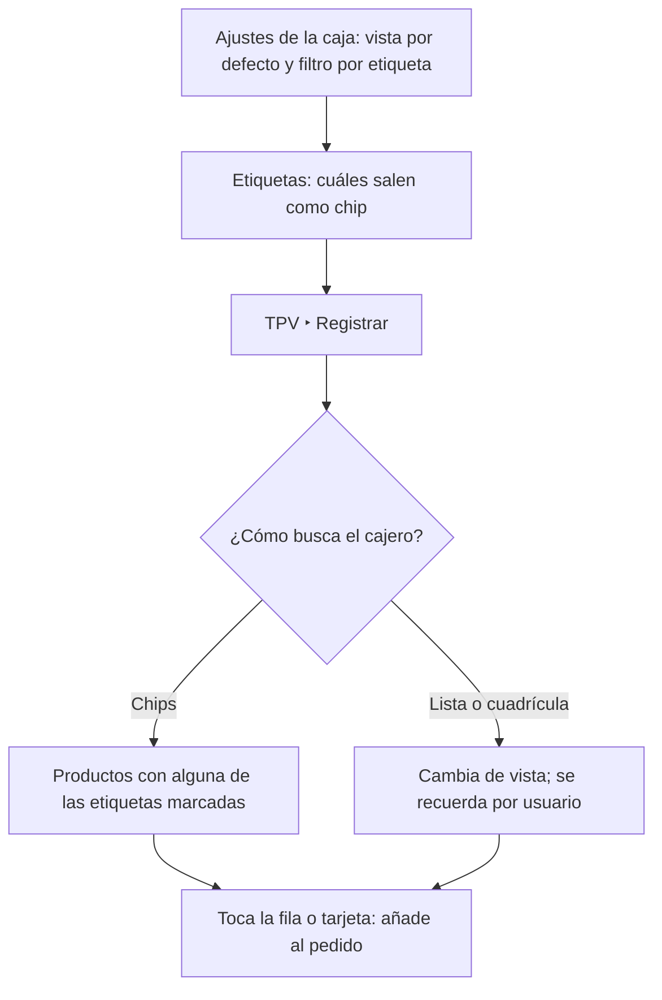
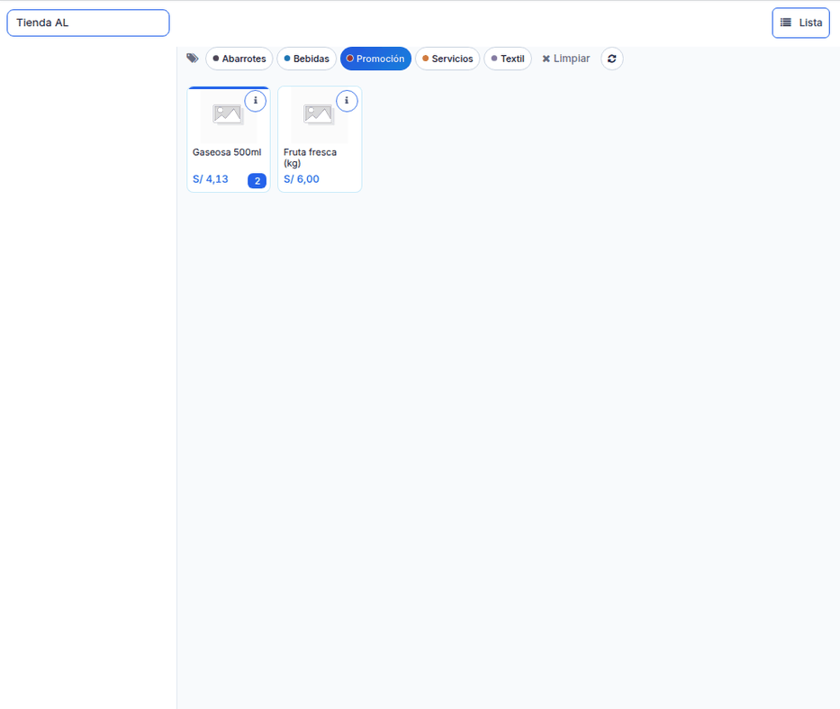
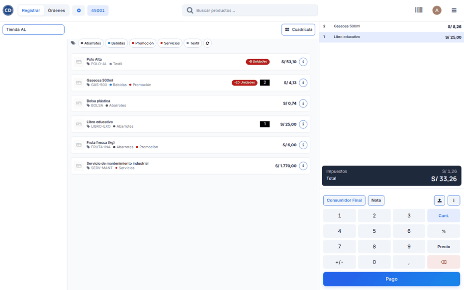

# Vista de productos

El catálogo estándar del TPV filtra solo por categoría y texto y muestra
tarjetas grandes. En tiendas con muchos productos parecidos, el cajero necesita
otros cortes y más datos a la vista. El módulo **Vista de productos del TPV**
agrega chips de **etiquetas** para filtrar el catálogo, un **filtro de stock**,
el **stock al día** de la caja en filas y tarjetas, un conmutador entre
**cuadrícula** y **lista compacta**, un botón de **información** del producto
que no lo añade al pedido y la **vista preferida** de cada cajero.

Usa las etiquetas de producto estándar de Odoo, sin modelos nuevos. Precios,
impuestos y existencias los calcula el TPV estándar: el módulo solo los muestra.

## Configuración

1. Instale el módulo **Vista de productos del TPV** (`al_pos_product_view`). Al
   instalarlo se crean algunas etiquetas de ejemplo.
2. Vaya a **Punto de venta ‣ Productos ‣ Etiquetas de producto** y dé a cada
   etiqueta su color y su orden. Marque **Mostrar en la barra de filtros del
   TPV** en las que deben salir como chip; la lista permite editarlas en bloque.
3. Vaya a **Punto de venta ‣ Configuración ‣ Ajustes**, sección **Interfaz de
   PdV**, y elija la **Vista de productos por defecto** (cuadrícula o lista) y
   active **Filtrar productos por etiqueta** en cada caja. En el mismo bloque,
   **Limpiar la búsqueda al añadir** (activada por defecto) vacía el buscador
   cuando el producto entra al pedido.

## Conceptos

| Término | Significado |
|---|---|
| Etiqueta de producto | Marca libre del backend (Promoción, Bebidas…) con color |
| Chip | Botón de la etiqueta sobre el catálogo |
| Vista por defecto | La de la caja; cada usuario puede tener la suya |
| Stock de la caja | Existencias de la ubicación de origen de la caja (o de su almacén) |
| Faceta | Filtro aplicado que se muestra junto a **Filtros** y se quita con su aspa |

## Filtrar por etiquetas

1. En la caja, toque uno o varios chips: el catálogo muestra los productos con
   **alguna** de las etiquetas marcadas.
2. Haga clic en **Limpiar** para quitar todos los filtros.
3. Para ver etiquetas nuevas sin cerrar la sesión, use el botón de recarga (↻).

El filtro se aplica antes del tope de 100 productos del TPV, así que no se
pierden resultados, y convive con la búsqueda y las categorías.

Si la caja aún no había cargado todos los productos de una etiqueta, el TPV los
trae del servidor al marcarla.

## Filtrar por stock

1. Haga clic en **Filtros**, a la izquierda de la barra del catálogo.
2. Elija **Con stock** o **Sin stock**; **Todos los productos** quita el filtro.
3. Junto al botón aparece una faceta por filtro aplicado (stock y etiquetas).
   Haga clic en su aspa para quitarlo, o en **Limpiar filtros** para quitarlos
   todos.

Solo cuentan los productos almacenables: servicios y consumibles no aparecen
en ninguna de las dos opciones. Si los filtros dejan el catálogo vacío, el TPV
lo dice con el mensaje «Ningún producto cumple los filtros seleccionados».

## Cambiar entre cuadrícula y lista

Haga clic en **Cuadrícula** o **Lista** en el control de la barra del catálogo.
La elección se guarda en las preferencias del usuario. La lista compacta
muestra el código, el código de barras, las etiquetas, el precio final (con el
descuento o recargo de la tarifa debajo), la cantidad en el carrito y el stock.

Filas y tarjetas muestran el **stock de la caja** en verde, o en rojo si no
hay. Se actualiza al buscar, al cambiar de categoría o de vista y al añadir un
producto; el botón de recarga (↻) junto al control lo pide al momento. La
ficha del producto (botón **i**) muestra una tarjeta por almacén con lo
disponible y lo previsto, con el almacén de la caja resaltado.

### Ejemplo

En el TPV de demostración, con las etiquetas Bebidas, Textil, Abarrotes,
Servicios y Promoción, el chip **Promoción** deja a la vista Gaseosa 500ml y
Fruta fresca (kg). En la vista de lista, un pedido de 2 Gaseosa 500ml
(S/ 4,13 c/u) y 1 Libro educativo (S/ 25,00) muestra en cada fila la cantidad
en el carrito y suma S/ 33,26 (2 × 4,13 + 25,00). El precio de la fila coincide
con el de la línea porque aplica la tarifa y los impuestos de la caja. El
módulo no genera asientos contables.

## Casos especiales

| Situación | Qué pasa | Qué hacer |
|---|---|---|
| No aparece un chip | Ningún producto de la caja usa la etiqueta o está desmarcada | Revisar la etiqueta |
| Pantalla pequeña | La fila de chips se oculta | Usar la búsqueda o las categorías |
| El filtro deja el catálogo vacío | Los chips siguen visibles y sale un mensaje | Desmarcar, **Limpiar** o **Limpiar filtros** |
| Stock en rojo | Producto almacenable sin existencias en la caja | Revisar el inventario |
| Sin conexión al elegir **Con stock** por primera vez | El filtro vuelve a **Todos los productos** con un aviso | Reintentar con conexión |
| Pantalla pequeña con filtros | No hay facetas; **Filtros** muestra cuántos hay aplicados | Abrir **Filtros** |

!!! info "Ver también"
    - [Punto de venta en Odoo 19](https://www.odoo.com/documentation/19.0/es/applications/sales/point_of_sale.html)
    - [Precios y tarifas en el TPV de Odoo 19](https://www.odoo.com/documentation/19.0/es/applications/sales/point_of_sale/pricing.html)
    - [Tema del TPV](theme.md)
