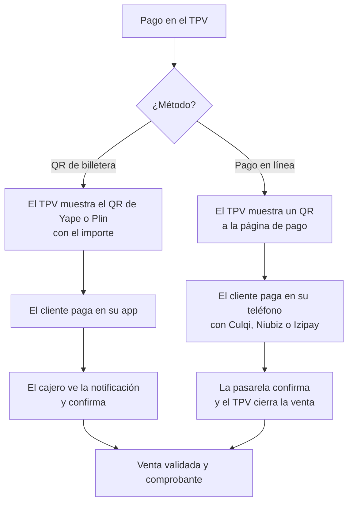
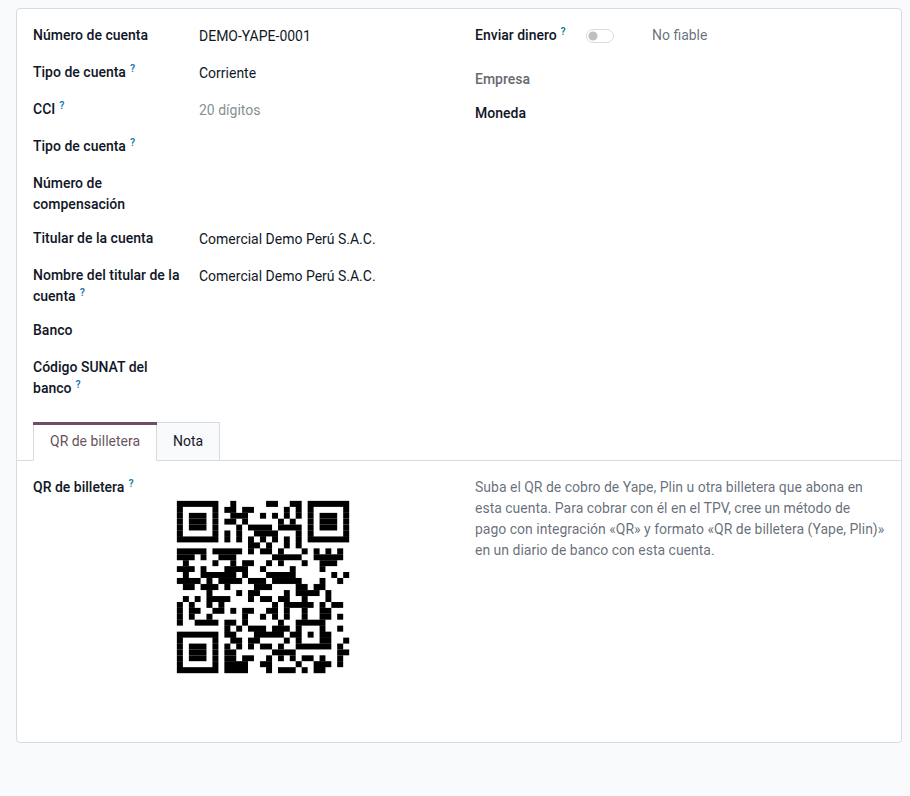
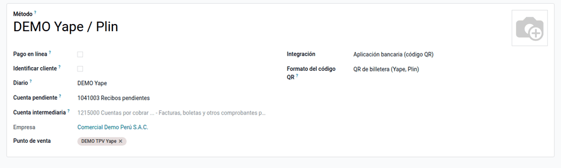
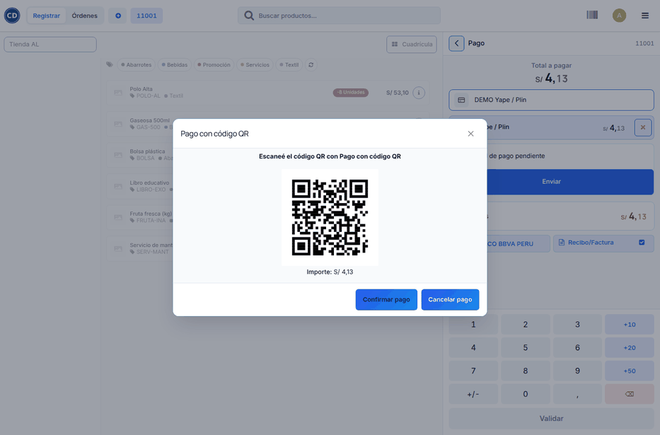
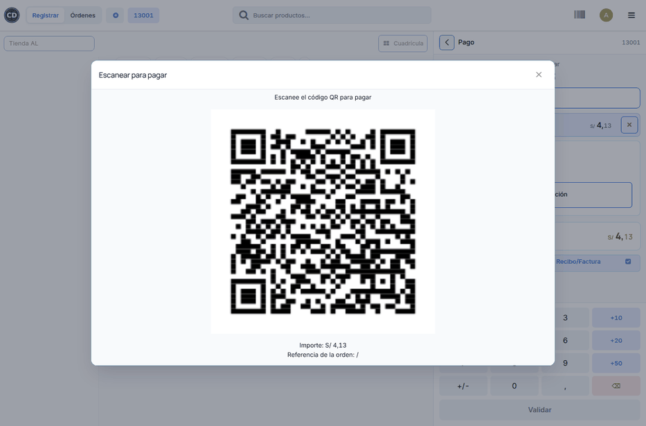
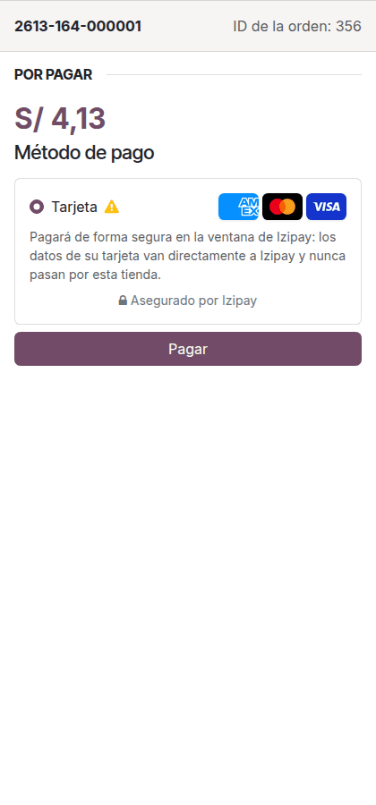

# Cobros con QR y pasarelas en el TPV

En la caja se puede cobrar con Yape, Plin o tarjeta sin un POS físico, de dos
maneras:

| Forma | Cómo paga el cliente | Quién confirma el pago | Módulos |
|---|---|---|---|
| **QR de billetera** | Escanea el QR de Yape o Plin del negocio y escribe el importe | El cajero, al ver la notificación del pago | `al_pos_pe_wallet_qr` |
| **Pago en línea** | Escanea un QR que abre la página de pago de la orden en su teléfono y paga con Culqi, Niubiz o Izipay (tarjeta y, según la pasarela, Yape) | La pasarela: el TPV recibe el pago solo | `pos_online_payment` (Odoo) y [Culqi](../../finance/payment_providers/culqi.md), [Niubiz](../../finance/payment_providers/niubiz.md) o [Izipay](../../finance/payment_providers/izipay.md) |

Yape y Plin no publican una API para comercios que avise del pago. Por eso el
QR de billetera necesita la confirmación del cajero, y el cobro confirmado
automáticamente pasa por una pasarela.

## QR de billetera (Yape, Plin)

### Configuración

1. Instale el módulo **Cobro con QR de Yape y Plin en el TPV**
   (`al_pos_pe_wallet_qr`).
2. Vaya a **Contabilidad ‣ Configuración ‣ Cuentas bancarias**, abra la
   cuenta donde abona la billetera y, en la pestaña **QR de billetera**, suba
   la imagen del QR de cobro que entrega Yape, Plin o el banco.

    

3. Esa cuenta debe estar en un diario de **Banco** (por ejemplo «Yape»).
4. Con la sesión de la caja cerrada, vaya a **Punto de venta ‣ Configuración ‣
   Métodos de pago** y cree el método:
    - **Diario**: el de la billetera.
    - **Integración**: **Aplicación bancaria (código QR)**.
    - **Formato del código QR**: **QR de billetera (Yape, Plin)**.

    Luego agréguelo a la caja.

    

!!! note "Nota"
    Solo admite soles: Yape y Plin no cobran en dólares. Si la caja se queda
    sin conexión, el TPV usa el mismo QR, porque no depende del importe.

### Cobrar

1. En la pantalla de pago, elija el método de la billetera y haga clic en
   **Enviar**.
2. El TPV muestra el QR y el importe, también en la pantalla del cliente.
3. El cliente escanea, escribe el importe en su app y paga.
4. Al ver la notificación del pago en el celular de la tienda, haga clic en
   **Confirmar pago**.

Ejemplo: una venta de S/ 4,13 cobrada con Yape queda pagada en el diario
«Yape» y se emite su boleta o factura como cualquier otra venta del TPV.

!!! warning "Advertencia"
    El QR no lleva el importe: revise que lo pagado coincida con la venta
    antes de confirmar. Si el cliente pagó menos, cancele el pago y cobre la
    diferencia.

## Pago en línea con Culqi, Niubiz o Izipay

El TPV de Odoo 19 trae el **pago en línea** (`pos_online_payment`). El TPV
muestra un QR que abre, en el teléfono del cliente, la página de pago de la
orden con las pasarelas publicadas. Cuando la pasarela confirma, el TPV cierra
la venta solo.

### Configuración

1. Configure y publique la pasarela: [Culqi](../../finance/payment_providers/culqi.md),
   [Niubiz](../../finance/payment_providers/niubiz.md) o
   [Izipay](../../finance/payment_providers/izipay.md).
2. En **Punto de venta ‣ Configuración ‣ Métodos de pago**, cree un método con
   **Pago en línea** marcado y elija las pasarelas en **Proveedores
   permitidos**. Si lo deja vacío, se ofrecen todas las publicadas.
3. Agregue el método a la caja con la sesión cerrada.

### Cobrar

1. En la pantalla de pago, elija el método de pago en línea y haga clic en
   **Validar**.
2. El TPV muestra el QR de la orden con el importe.

    

3. El cliente escanea y paga en su teléfono con la pasarela.

    

4. El TPV recibe el pago y muestra el ticket.

!!! note "Nota"
    Si la orden no tiene cliente con correo, Izipay pide el correo en su
    formulario.

!!! note "Nota"
    En Odoo 19, el ticket de una venta cobrada en línea muestra la línea de
    pago dos veces y un vuelto igual al importe, aunque la orden queda con un
    solo pago. El módulo `al_pos_online_payment`, que se instala solo con el
    pago en línea, lo corrige: el ticket muestra únicamente el pago que
    registró la pasarela.

### Un método por pasarela

El pago en línea de Odoo admite un solo método por caja: el cliente elige la
pasarela en su teléfono y el cierre de caja muestra todo junto. Con el módulo
`al_pos_payment_gateway`, la caja puede tener un método por pasarela
(«Izipay», «Niubiz», «Culqi»):

- El cajero elige con cuál cobra y el QR abre directamente esa pasarela.
- El cierre de caja muestra lo cobrado con cada una, para cuadrar con la
  liquidación de cada proveedor.

Para crear el método, abra la pasarela en **Contabilidad ‣ Configuración ‣
Proveedores de pago** y haga clic en **Cobrar en el TPV**: Odoo crea el método
de pago en línea con esa pasarela (o abre el que ya existe). Agréguelo a la
caja con la sesión cerrada. Una pasarela va en un solo método de la caja.

### Devolver a la tarjeta

Una venta cobrada con una pasarela se devuelve al medio de pago del cliente:

1. En **Órdenes**, abra la venta, elija los productos y haga clic en
   **Reembolso**.
2. En la pantalla de pago, elija el método de la pasarela con que se cobró y
   haga clic en **Validar**.
3. Odoo pide la devolución a la pasarela y, cuando la confirma, cierra la
   devolución con el pago de la pasarela.

Si la pasarela no la acepta, el TPV muestra el motivo y la devolución no se
cierra: elija otro método (por ejemplo, efectivo). Se puede devolver una parte
del cobro; el importe no puede superar lo que queda por devolver de un mismo
cobro.

!!! warning "Niubiz"
    Niubiz acepta devoluciones desde las 48 horas hábiles siguientes al cobro.
    El mismo día, la venta se anula desde la transacción de pago
    (**Anular en Niubiz**), no desde el TPV.

!!! info "Ver también"
    - [Cliente por RUC o DNI](customer_lookup.md)
    - [Comprobantes electrónicos en el TPV](electronic_invoicing.md)
    - [Odoo: pagos en línea en el TPV](https://www.odoo.com/documentation/19.0/es/applications/sales/point_of_sale/payment_methods.html)
