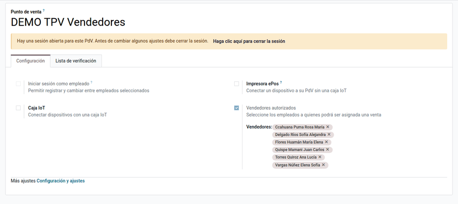
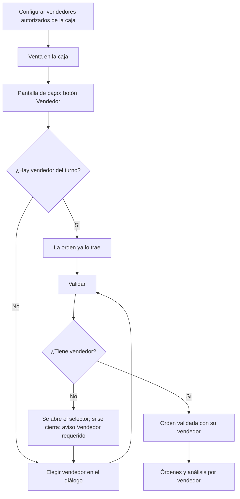
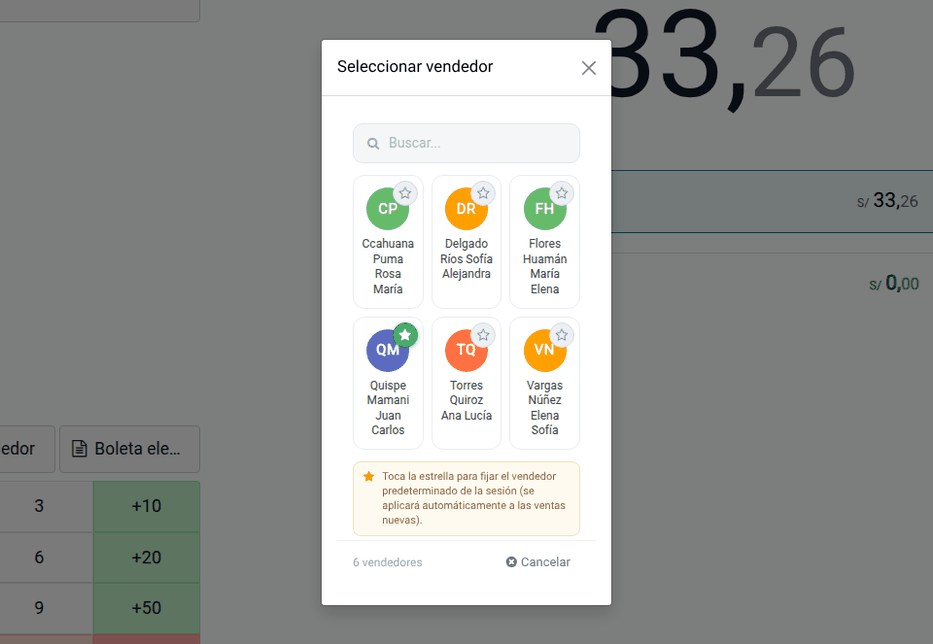
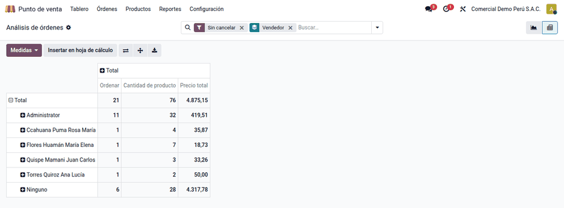

# Vendedor por venta

Odoo registra en cada orden del TPV al **cajero**, es decir, a quien tiene la
sesión abierta, y no a quien atendió al cliente. En tiendas con vendedores de
piso y una sola caja, todas las ventas quedan a nombre del cajero. El módulo
**Vendedor por venta** asigna a cada orden el **vendedor** (empleado) que la
atendió, elegido en la pantalla de pago entre los vendedores autorizados de la
caja, y suma las ventas por vendedor en las órdenes y en el análisis del TPV.

El cálculo de comisiones no forma parte del módulo: se hace con los reportes o
con el módulo de comisiones de Ventas, a partir del dato por vendedor.

## Configuración

1. Instale el módulo **Vendedor por venta** (`al_pos_vendedor`).
2. Cree los empleados en **Empleados**, en la compañía de la caja.
3. Con la sesión de la caja cerrada, vaya a **Punto de venta ‣ Configuración ‣
   Punto de venta**, abra la caja y, en la pestaña **Configuración**, active
   **Vendedores autorizados** y elija los **Vendedores**. Solo se aceptan
   empleados de la compañía de la caja.
4. Recargue la interfaz del TPV para que llegue la lista.

!!! note "Nota"
    No hace falta activar **Iniciar sesión como empleado**: vender no es lo
    mismo que cobrar, y el vendedor no necesita poder abrir la caja.

## Conceptos

| Término | Significado |
|---|---|
| Cajero | Usuario o empleado con la sesión abierta (el dato estándar de la orden) |
| Vendedor | Empleado que atendió la venta; aparece en la orden, en el recibo y en el análisis |
| Vendedores autorizados | Lista por caja de quienes pueden recibir ventas |
| Vendedor del turno | Vendedor predeterminado de la sesión, marcado con la estrella |

## Asignar el vendedor a una venta

1. En la pantalla de pago, haga clic en **Vendedor**.
2. Busque al vendedor en las tarjetas y selecciónelo. **Quitar** deja la orden
   sin vendedor y **Cancelar** cierra el diálogo sin cambios.
3. Haga clic en **Validar**. La orden queda con su vendedor y el recibo muestra
   «Vendedor:».

Si la orden no tiene vendedor al validar, se abre el selector. Si se cierra sin
elegir, aparece el aviso **Vendedor requerido** y la venta sigue abierta.

### Vendedor del turno

En el diálogo, marque un vendedor con la estrella: las órdenes nuevas de la
sesión lo traen ya asignado. Se conserva al recargar la página mientras la
sesión siga abierta.

## Ejemplo

Sesión de la caja «DEMO TPV Vendedores» con un mismo cajero:

| Orden | Productos | Vendedor | Total |
|---|---|---|---|
| 000001 | 2 Gaseosa 500ml + 1 Libro educativo | Quispe Mamani Juan Carlos | S/ 33,26 |
| 000002 | 3 Bolsa plástica + 4 Gaseosa 500ml | Flores Huamán María Elena | S/ 18,73 |
| 000003 | 2 Libro educativo | Torres Quiroz Ana Lucía | S/ 50,00 |
| | | **Total de la sesión** | **S/ 101,99** |

En el análisis cada vendedor suma su propia venta (una orden y su total), y la
suma 33,26 + 18,73 + 50,00 = 101,99 coincide con el total de la sesión. El
módulo no genera asientos propios: los asientos de la sesión son los del TPV
estándar.

## Reportes

- **Punto de venta ‣ Órdenes ‣ Órdenes**: columna **Vendedor**, búsqueda por su
  nombre y **Agrupar por ‣ Vendedor**.
- **Punto de venta ‣ Reportes ‣ Órdenes**: dimensión **Vendedor**, con órdenes,
  cantidades y total por vendedor.

## Casos especiales

| Situación | Qué pasa | Qué hacer |
|---|---|---|
| Opción desactivada en la caja | No hay botón **Vendedor**; la venta se valida como siempre | — |
| Se cierra el selector sin elegir | Aviso **Vendedor requerido**; la venta sigue abierta | Elegir un vendedor |
| «Ninguno» en el análisis | Órdenes anteriores a activar la opción o de cajas sin vendedores | Es normal |
| Un vendedor nuevo no aparece | La caja no recargó la lista | Recargar la interfaz del TPV |

!!! info "Ver también"
    - [Punto de venta en Odoo 19](https://www.odoo.com/documentation/19.0/es/applications/sales/point_of_sale.html)
    - [Configuración del TPV en Odoo 19](https://www.odoo.com/documentation/19.0/es/applications/sales/point_of_sale/configuration.html)
    - [Comprobantes electrónicos en el TPV](electronic_invoicing.md)
