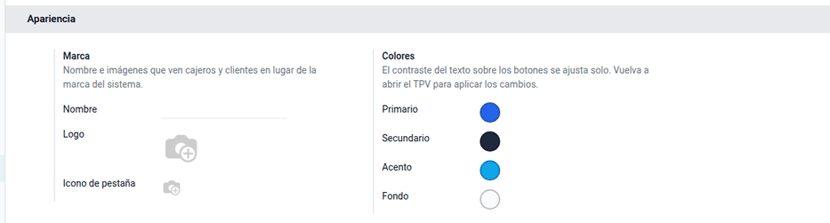
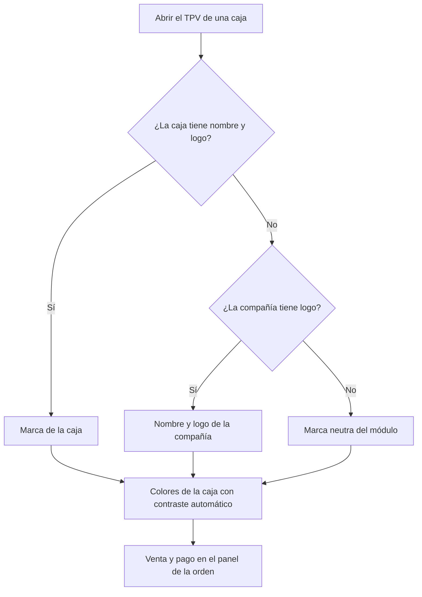
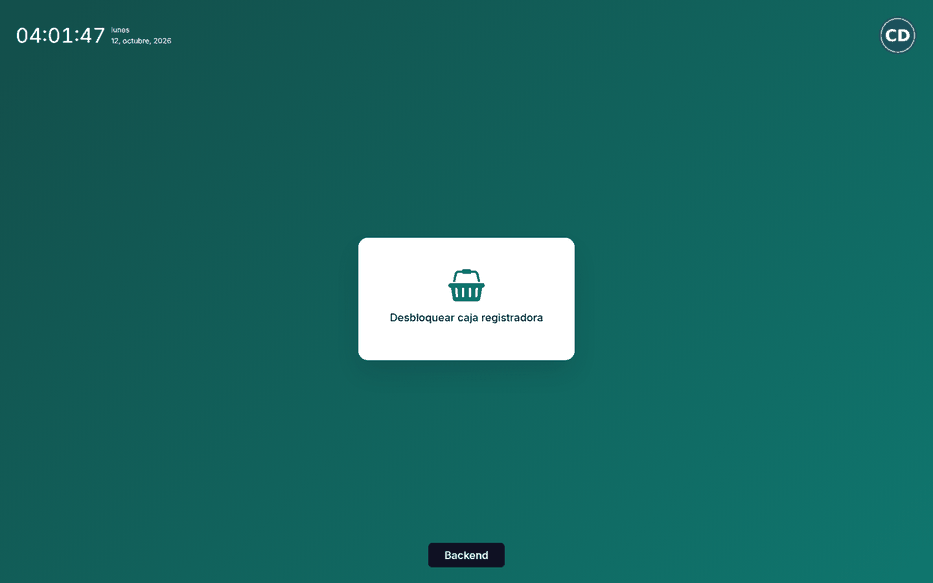
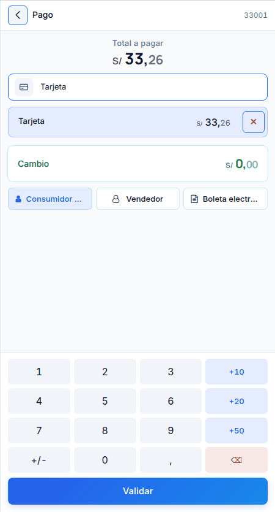

# Tema del TPV

El TPV estándar muestra el nombre, el logo y el morado de Odoo en la pestaña del
navegador, la pantalla de bloqueo, el recibo y los mensajes. Para una cadena o
una franquicia, la caja es la cara de la marca. El módulo **Tema del TPV**
permite dar a cada caja su nombre, su logo, su icono de pestaña y cuatro
colores, con contraste automático y modo oscuro; ordena la pantalla con el
**pago dentro del panel de la orden** y quita los rastros de Odoo de la pestaña,
la app instalable, la pantalla de bloqueo, el recibo y los mensajes.

Solo cambia la apariencia: precios, impuestos, pagos, comprobantes,
sincronización y modo sin conexión funcionan igual que en el TPV estándar. El
contenido fiscal del ticket lo pone
[Comprobantes electrónicos en el TPV](electronic_invoicing.md).

## Configuración

1. Instale el módulo **Tema del TPV** (`al_pos_theme`).
2. Vaya a **Punto de venta ‣ Configuración ‣ Ajustes**, elija la caja arriba y,
   en la sección **Apariencia**, complete:
    - **Nombre**, **Logo** e **Icono de pestaña**, en buena resolución;
    - los colores **Primario**, **Secundario**, **Acento** y **Fondo**, en
      formato `#RRGGBB`. Un valor no válido se rechaza.
3. Opcional: **Mostrar u ocultar categorías** agrega en la barra superior de la
   caja el botón **Categorías**, junto al buscador. Con él, el cajero oculta la
   barra de categorías cuando prefiere buscar o filtrar (en farmacia, por
   principio activo), y el catálogo gana espacio; un segundo toque la vuelve a
   mostrar. Cada dispositivo recuerda la última elección. Sin la opción, las
   categorías se ven siempre.
4. Cierre y vuelva a abrir el TPV para ver los cambios. No hace falta
   actualizar el módulo.

## Marca de cada caja

La marca es por caja: lo que la caja no define se completa con la compañía, y
sin logo de la compañía se usa la **marca neutra** del módulo (paleta azul y
pizarra).

### Ejemplo

La cadena «Bodegas Andinas» tiene dos cajas: «Miraflores», con el primario
`#0F766E` y logo propio, y «Surco», sin configurar. Miraflores abre con su
nombre, su logo y su verde azulado; Surco usa el nombre y el logo de la
compañía con la paleta neutra. El módulo no genera asientos contables.

## Cobrar en el panel de la orden

En escritorio y en tablet horizontal, al hacer clic en **Pago** el panel
derecho muestra el total, los métodos de pago, el cambio, el cliente y el
teclado, y el catálogo queda bloqueado. Los botones de
[vendedor](salesperson.md) y de [comprobante](electronic_invoicing.md) siguen
en el panel. En teléfono o tablet vertical, el pago conserva su propia
pantalla, como en el TPV estándar.

## Modo oscuro

Abra el menú ☰ de la caja y elija **Cambiar al modo oscuro** (Odoo
Enterprise). La preferencia se recuerda en cada navegador. Si el color
primario se lee mal sobre el fondo oscuro, el tema lo aclara solo.

## Casos especiales

| Situación | Qué pasa | Qué hacer |
|---|---|---|
| Color primario poco legible en modo oscuro | Se aclara solo | Nada |
| Teléfono o tablet vertical | El pago sigue en su propia pantalla | Es el comportamiento estándar |
| No se ven los cambios | El TPV tiene cargada la versión anterior | Cerrar y volver a abrir la caja |

!!! info "Ver también"
    - [Configuración del punto de venta en Odoo 19](https://www.odoo.com/documentation/19.0/es/applications/sales/point_of_sale/configuration.html)
    - [Punto de venta en Odoo 19](https://www.odoo.com/documentation/19.0/es/applications/sales/point_of_sale.html)
    - [Vista de productos](product_view.md)
