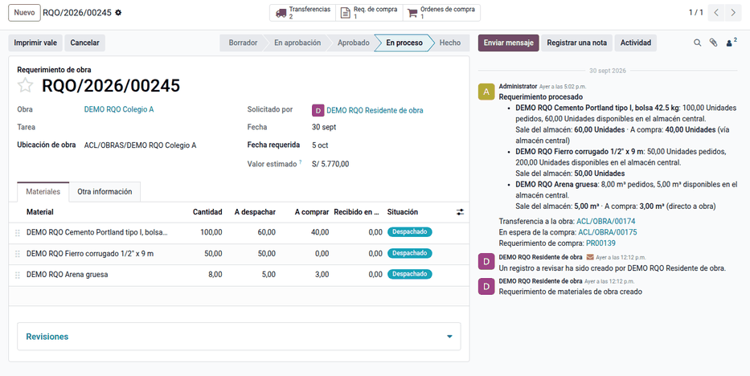
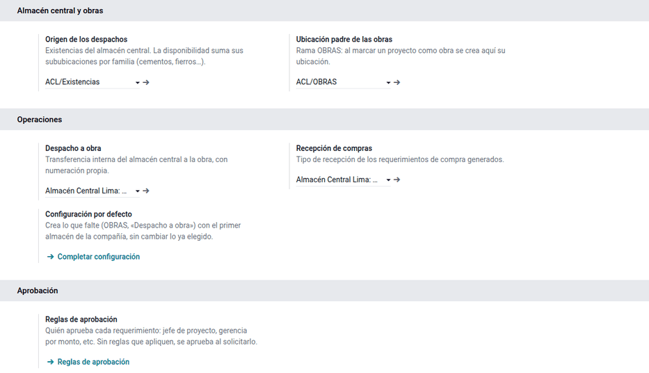
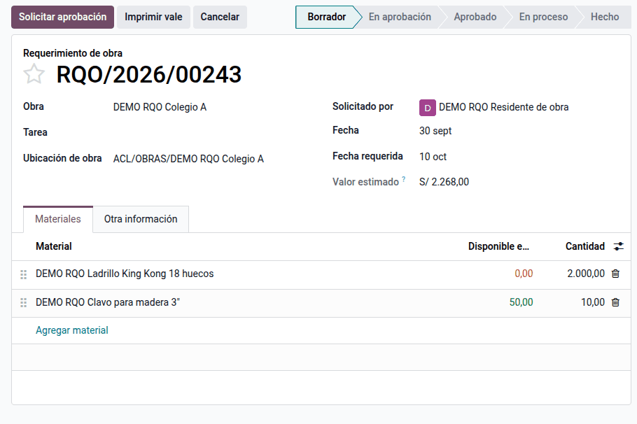
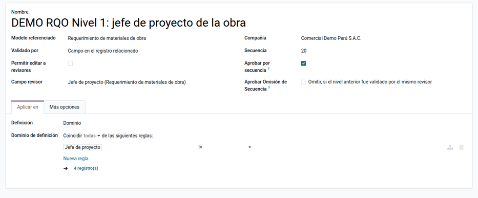
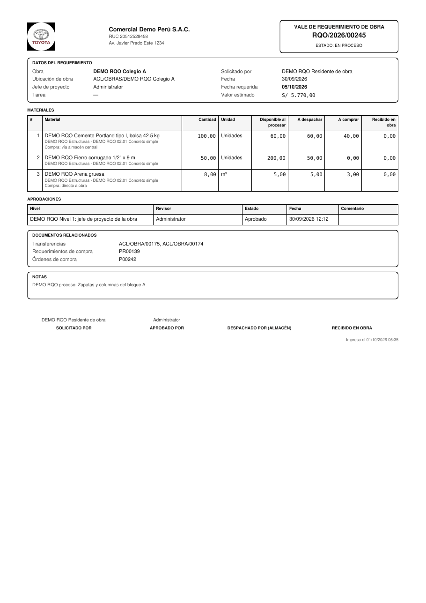

# Requerimientos de materiales

El **requerimiento de obra** es el documento con el que la obra pide
materiales a la oficina. El residente lo crea para una obra, se aprueba por
niveles y Logística lo procesa con un botón: por cada material, lo que hay
libre en el almacén central sale a la obra por transferencia interna y lo que
falta pasa a compras como requerimiento de compra ya aprobado. Así el pedido no
viaja por correo ni Excel, todos ven si se aprobó, el almacén despacha
reservando y Compras no vuelve a comprar lo que ya había.

Lo usan residentes y personal de obra (piden), jefes de proyecto y gerencia de
operaciones (aprueban), Logística (procesa y despacha) y Compras (compra).

El consumo del material en la obra, el control de presupuesto por partida y la
aprobación de las órdenes de compra quedan fuera. El control del saldo contra
el plan de la obra lo agrega la [planificación de obra](planning.md).

## Configuración

1. Instale **Requerimientos de obra** (`al_construction_material_request`).
   Instala los módulos de la comunidad (OCA) **Requerimiento de compra**
   (`purchase_request`) y **Aprobación por niveles** (`base_tier_validation`).
2. Vaya a **Requerimientos de obra ‣ Configuración ‣ Ajustes** y complete el
   **Origen** (existencias del almacén central, incluidas sus sububicaciones),
   la ubicación padre **OBRAS**, el tipo de operación **Despacho a obra** y la
   recepción de compras. **Completar configuración** rellena lo que falte.
3. En cada obra, vaya a **Proyecto ‣ (proyecto) ‣ Ajustes**, active **Es obra**
   (crea la ubicación `OBRAS/<obra>`) y asigne el **Jefe de proyecto**.
4. En **Requerimientos de obra ‣ Configuración ‣ Reglas de aprobación**, defina
   los niveles, los revisores, el dominio por monto y **Aprobar por
   secuencia**.
5. Asigne los grupos: **Solicitante** (obra), **Aprobador** (jefes),
   **Logística** (almacén), **Administrador** y **Gerencia de operaciones** para
   el nivel por monto.
6. Contabilidad configura la cuenta de compra en las categorías de producto.

!!! warning "Importante"
    Si se instala `purchase_request_tier_validation`, los requerimientos de
    compra pedirían otra aprobación. Agregue el dominio
    `[('construction_request_id', '=', False)]` a sus reglas para excluir los
    que nacen de un requerimiento de obra.

## Conceptos

| Término | Significado |
|---|---|
| Obra | Proyecto marcado como obra, con su ubicación `OBRAS/<obra>` |
| Origen o almacén central | Existencias desde las que se despacha, con sus sububicaciones |
| Disponible en central | Stock libre hoy (no reservado), en la unidad de la línea |
| Disponible al procesar | Foto del stock libre en el momento de procesar |
| Vía almacén central / Directo a obra | Cómo llega lo que se compra, por línea (**Si hay que comprar**) |
| Valor estimado | Cantidad × costo de cada material; lo usan las reglas de aprobación |

Todo traslado de bienes entre establecimientos de la misma empresa se sustenta
con guía de remisión remitente, motivo **04, Traslado entre establecimientos de
la misma empresa**. El despacho a obra lleva ese motivo para que la guía
electrónica salga correcta.

## Pedir materiales

1. Vaya a **Requerimientos de obra ‣ Requerimientos ‣ Nuevo**.
2. Elija la **Obra** y la **Fecha requerida**, y agregue los materiales con su
   cantidad. El requerimiento toma la ubicación de la obra y su analítica, y
   recibe el número `RQO/AAAA/#####`.
3. Haga clic en **Solicitar aprobación**. El requerimiento pasa a **En
   aprobación** con una revisión por nivel; si ninguna regla aplica, pasa
   directo a **Aprobado**.

El formulario y las líneas se adaptan al celular: los materiales se muestran
como tarjetas.

## Aprobar

1. Los revisores filtran **Necesita mi revisión** y abren el requerimiento.
2. Haga clic en **Validar** o **Rechazar**. Con la última validación queda
   **Aprobado**; un rechazo deja **Rechazado**.
3. Para corregir un rechazado, haga clic en **Volver a borrador**: se borran las
   revisiones y se puede pedir aprobación de nuevo.

Con la regla de demostración, el jefe de proyecto revisa todos los pedidos y
la gerencia de operaciones además los que superan S/ 10 000.

## Procesar el pedido

Logística abre el requerimiento aprobado y hace clic en **Procesar**. Por cada
línea:

- lo que hay libre en el central entra en una transferencia **Despacho a obra**
  reservada;
- lo que falta pasa a un requerimiento de compra ya aprobado, porque el de obra
  ya pasó su aprobación;
- si la compra llega **Vía almacén central**, se crea además la transferencia
  central → obra en espera de la compra.

El requerimiento pasa a **En proceso** y el chatter anota la división de cada
material. Si al reservar se obtiene menos de lo calculado (otro pedido se llevó
el stock), la diferencia pasa a compra y el chatter lo anota. Un pedido en una
unidad distinta (por ejemplo, docenas) se divide en la unidad de la línea.

### Despachar

En **Transferencias** del requerimiento, el almacén valida el despacho. El
material queda en `OBRAS/<obra>` y la guía de remisión sale con el motivo 04.
Un traslado interno entre el central y la obra no genera asiento contable: la
analítica viaja en el movimiento solo como trazabilidad.

### Comprar y recibir

1. Desde **Req. de compra**, Compras crea la orden de compra. Toma la fecha
   requerida y la analítica de cada línea; lo que va al central y lo que va
   directo a obra no se mezclan en una misma línea.
2. Al recibir:
    - **Vía almacén central**: entra al central y la salida a la obra queda
      reservada con exactamente lo recibido;
    - **Directo a obra**: entra a la ubicación de la obra.
3. Cuando todo lo pedido está en la ubicación de la obra, el requerimiento pasa
   solo a **Hecho**. Una devolución de la obra al almacén resta de **Recibido en
   obra**.

### Cancelar

Solo Logística cancela un requerimiento en proceso: se anulan las
transferencias pendientes y las líneas de compra que aún no están en una orden.
Lo despachado se queda en la obra y lo ya pedido al proveedor no se toca; el
chatter lo avisa.

## Ejemplo

Datos de demostración «DEMO RQO»: obra **Colegio A**, almacén central con 60
bolsas de cemento libres. Requerimiento `RQO/2026/00245`:

| Material | Pedido | Costo | Libre al procesar | Transferencia | Compra | Llega |
|---|---|---|---|---|---|---|
| Cemento bolsa 42.5 kg | 100 | 29,50 | 60 | 60 | 40 | Vía almacén central |
| Fierro 1/2" | 50 | 46,00 | 200 | 50 | 0 | — |
| Arena gruesa | 8 m³ | 65,00 | 5 m³ | 5 m³ | 3 m³ | Directo a obra |

**Valor estimado**: 100 × 29,50 + 50 × 46,00 + 8 × 65,00 = 2 950,00 + 2 300,00
+ 520,00 = **S/ 5 770,00**. Solo revisa el jefe de proyecto; un pedido de 400
bolsas (S/ 11 800,00) pasaría además por gerencia.

1. **Procesar** crea el despacho a obra con 60 bolsas, 50 fierros y 5 m³ de
   arena, reservado; un requerimiento de compra con 40 bolsas (vía central) y
   3 m³ (directo a obra); y la transferencia central → obra de 40 bolsas en
   espera de la compra.
2. El almacén valida el despacho, sin asiento contable y con guía motivo 04.
3. La orden de compra pide 40 bolsas con destino el central y 3 m³ con destino
   final la obra.
4. La factura del proveedor la registra Contabilidad como cualquier compra; la
   cuenta sale de la categoría del producto. Por ejemplo:

    | Cuenta | Descripción | Debe | Haber |
    |---|---|---|---|
    | 6031 | Compras: 40 × 29,50 + 3 × 65,00 | 1 375,00 | |
    | 40111 | IGV 18 % sobre 1 375,00 | 247,50 | |
    | 4212 | Facturas por pagar al proveedor | | 1 622,50 |
    | | **Totales** | **1 622,50** | **1 622,50** |

5. Las 40 bolsas entran al central y su salida a la obra queda reservada; los
   3 m³ entran directo a la obra.
6. Con las 100 bolsas, los 50 fierros y los 8 m³ en `OBRAS/Colegio A`, el
   requerimiento pasa a **Hecho**.

## Reportes

- **Vale de requerimiento** (PDF A4): materiales, división, aprobaciones,
  documentos relacionados y firmas.
- **Materiales pedidos** (Logística): todas las líneas con su situación.
- Lista, tablero, calendario por fecha requerida y actividades.
- Stock por obra: **Inventario ‣ Informes ‣ Existencias**, filtrando la
  ubicación de la obra. El [kárdex valorizado](../../../inventory_and_mrp/inventory/kardex.md)
  registra los traslados.

## Casos especiales

| Situación | Qué pasa | Qué hacer |
|---|---|---|
| No se pidió aprobación | Ninguna regla aplicó (sin jefe de proyecto o bajo el umbral) | Revisar las reglas y el jefe de proyecto de la obra |
| **Disponible en central** en 0 aunque hay stock | El stock está reservado por otro documento o fuera del origen | Revisar reservas y sububicaciones del origen |
| El residente no ve el requerimiento | Solo ve los suyos y los de obras que sigue o dirige | Hacerlo seguidor de la obra o asignarlo |

Cada compañía tiene su configuración y sus reglas.

!!! info "Ver también"
    - [Planificación de obra](planning.md)
    - [SUNAT: guía de remisión remitente](https://orientacion.sunat.gob.pe/02-guia-de-remision-remitente)
    - [MEF: Plan Contable General Empresarial](https://www.mef.gob.pe/es/consejo-normativo-de-contabilidad/plan-contable)
    - [Ubicaciones en Odoo 19](https://www.odoo.com/documentation/19.0/applications/inventory_and_mrp/inventory/warehouses_storage/inventory_management/use_locations.html) y [Compras](https://www.odoo.com/documentation/19.0/applications/inventory_and_mrp/purchase.html)
    - OCA: [purchase_request](https://github.com/OCA/purchase-workflow/tree/19.0/purchase_request) y [base_tier_validation](https://github.com/OCA/tier-validation/tree/19.0/base_tier_validation)
    - Referencia técnica: [al_construction_material_request](../../../../developer/reference/modules/al_construction_material_request/index.md)
