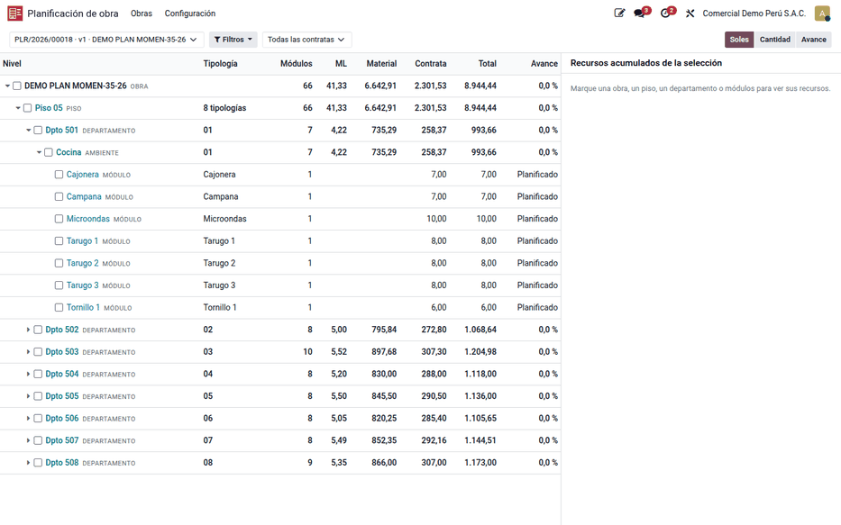
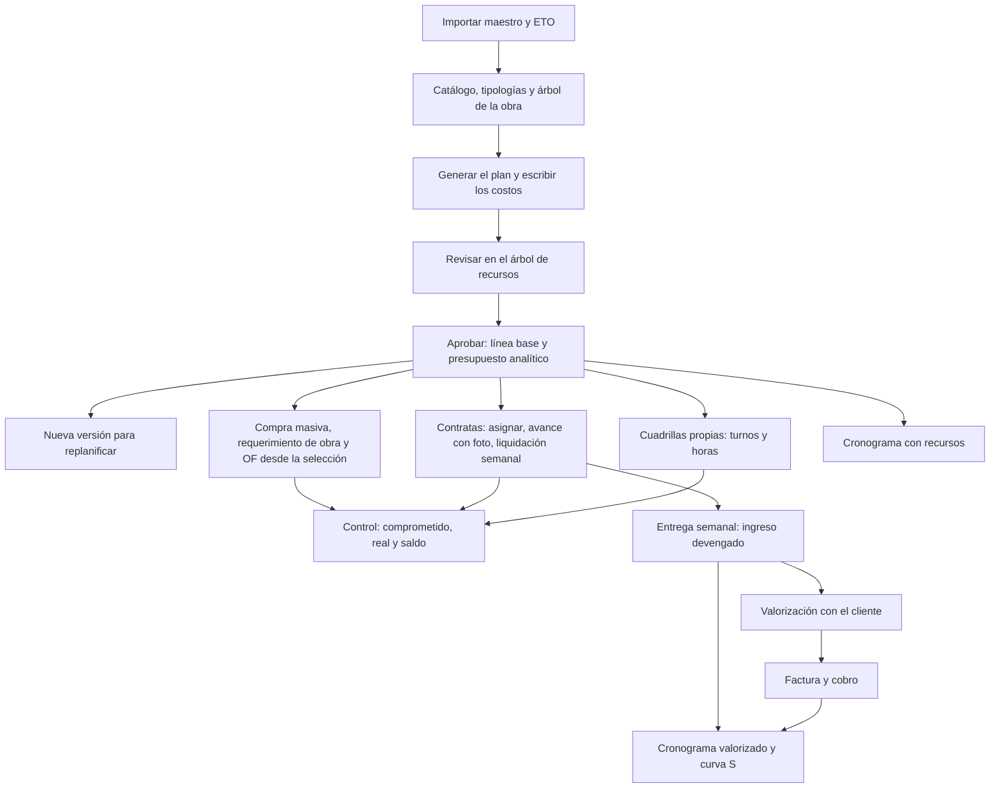

# Planificación de obra

La aplicación **Planificación de obra** genera el **plan de recursos** de una
obra sobre su propio árbol de tareas, con el monto planificado de cada nivel.
Los niveles, las etapas y los recursos los define cada rubro: piso ›
departamento › ambiente › módulo en una obra de muebles a medida, disciplina ›
subpartida › partida en una edificación, área › línea › spool en tuberías (ver
[configuración por rubro](planning/vertical_configuration.md)). Desde
ese plan se compra y se pide material, se fabrica, se paga a las contratas a
destajo, se controla lo real contra el presupuesto y se cobra al cliente por
valorizaciones. La usan Oficina Técnica (planificador), Jefatura de Proyectos,
Logística, supervisores de obra y Administración y Finanzas.

Está construida sobre el [diagrama de Gantt](../gantt.md) de la suite. El
núcleo solo necesita Proyecto; los
[requerimientos de materiales](material_requests.md), las compras, la
fabricación, la planificación de turnos, los presupuestos analíticos y las
ventas de Odoo se suman con puentes que se activan en los Ajustes. No alimenta libros PLE ni archivos SUNAT.

## Menú de la aplicación

**Planificación de obra** se organiza como Contabilidad: pocos menús
principales y, dentro de cada uno, secciones por tema.

| Menú | Secciones y pantallas |
|---|---|
| **Obras** | **Obras y tareas** (inicio, obras, tareas de la obra), **Plan de recursos** (planes, árbol de recursos, recursos planificados) y **Cronograma** (cronograma de la obra, etapas, Gantt de proyectos) |
| **Ejecución** | **Avance** (registrar, por validar, avances y, con la función **Metrado**, metrados), **Contratas** (asignar contrata o cuadrilla, OC de servicio, liquidaciones semanales), **Cambios** (adicionales y deductivos, dependencias de terceros) y **Asistencia** (con el módulo de sedes) |
| **Abastecimiento** | Tablero de abastecimiento, requerimientos de obra y de compra, órdenes de fabricación, asignaciones del plan y, en mobiliario, envíos de planta a obra |
| **Ingresos** | Contratos de obra, hitos por unidad, entregas semanales, preparar valorización, valorizaciones y cobranza |
| **Informes** | **Plan** (análisis, control de saldo, excesos autorizados, jornales de las cuadrillas y, en mobiliario, presupuestado frente a real), **Cronograma valorizado** y **Compras** (precios de compra, compras por producto) |
| **Configuración** | Ajustes, **Plan de obra** (perfiles de vertical, plantillas de niveles, etapas, tipos de recurso, recetas, tipologías, reglas del método de unión, actividades, tarifas, listas de tarifas, reglas analíticas, importar recetas y niveles, importar maestro y ETO, importar la proyección de materiales, sedes de obra), **Cobro al cliente** (plantillas de hitos) y **Aprobaciones y Gantt** |

## Configuración

1. Instale **Planificación de obra** (`al_construction_planner`) desde
   **Aplicaciones**.
2. En **Planificación de obra ‣ Configuración ‣ Ajustes**, elija el **Perfil
   de vertical** del rubro (**Mobiliario** o **Construcción por partidas**) y
   pulse **Aplicar el perfil**: deja la plantilla de niveles, las etapas, los
   tipos de recurso y las funciones del rubro, e instala sus puentes. Las
   funciones se pueden ajustar después una por una. Ver [configuración por
   rubro](planning/vertical_configuration.md).
3. En cada obra, vaya a **Proyecto ‣ (proyecto) ‣ Ajustes** y active **Es
   obra**. La obra necesita su cuenta analítica (o cada línea su distribución)
   para crear el presupuesto del plan. Las obras de la aplicación están en
   **Planificación de obra ‣ Obras ‣ Obras y tareas ‣ Obras**.

    !!! tip "Consejo"
        Si las obras nacen de una venta, marque **Crea una obra** en el producto
        de servicio que crea el proyecto (pestaña **Ventas**, junto a la
        plantilla del proyecto). Al confirmar la orden de venta, el proyecto se
        crea ya marcado como obra y con esa venta como **Orden de venta del
        contrato**. Un proyecto que se marca como obra después también toma su
        venta de origen.
4. En **Ajustes ‣ Usuarios**, asigne los grupos de la aplicación:
    - **Planificador** a Oficina Técnica;
    - **Planificación de obra: jefatura de proyectos** a la jefatura y a quien
      la reemplace: aprueba las reglas de validación del planificador (plan,
      excesos, metrados, material extra y liquidaciones), los cambios, las
      entregas semanales, la anulación de valorizaciones y el descuento a
      contratas, y autoriza los pagos repetidos, los porcentajes escritos
      sobre el avance validado y los metrados que pasan el umbral;
    - **Planificación de obra: asistente de proyectos** al asistente: crea los
      requerimientos a obra y los envía a aprobación, sin aprobarlos;
    - **Administrador** a quien configura la aplicación (catálogo, ajustes y
      cierre de planes). No aprueba las reglas de validación si no está también
      en la jefatura;
    - **Reporte de avance** a capataces y supervisores;
    - **Planificación de obra: ingresos** a Administración y Finanzas;
    - **Planificación de obra: ve montos** a quien debe ver costos, precios,
      presupuestos, comprometido, real, saldos y valorizaciones. Lo tienen
      ya el **Administrador**, la jefatura de proyectos y los ingresos.
      Retírelo a quien no deba ver montos, por ejemplo a los supervisores
      (ver [Visibilidad de montos](#visibilidad-de-montos)).

    El despacho a obra de un requerimiento lo valida solo el almacén (grupo
    **Logística** de requerimientos de obra), aunque quien lo pidió tenga
    acceso a Inventario.
5. Para comprar y pedir desde el plan, el planificador necesita también los
   grupos de **requerimientos de compra** y de **requerimientos de obra** (y de
   **fabricación** para las órdenes de fabricación).
6. Cargue el catálogo (actividades, tarifas, recetas o tipologías) y el árbol
   de la obra, a mano, con **Importar recetas y niveles** o, en mobiliario, con
   [Importar maestro y ETO](planning/import_master.md).
7. Revise las reglas de aprobación en **Planificación de obra ‣ Configuración ‣
   Reglas de aprobación**. Sin reglas, el plan se aprueba al solicitarlo.

Las demás opciones están en **Ajustes ‣ Planificación de obra** y se explican
en la página de cada flujo: la semana de las contratas y la cuenta de
retención en [contratas](planning/contractors.md), el código de familia y la
alerta de precio en [abastecimiento](planning/prices_supply.md), y los valores
del ingreso en [ruta del ingreso](planning/income.md).

## Visibilidad de montos

El grupo **Planificación de obra: ve montos** separa a quien ve importes de
quien solo ve cantidades. Quien no lo tiene trabaja con cantidades, fechas,
avance y estados:

- los formularios y las listas del plan, sus líneas, los avances, las tareas,
  las liquidaciones y los metrados no muestran los campos en soles;
- el [árbol de recursos](planning/resource_tree.md), el
  [cronograma](planning/schedule.md), sus paneles, la [matriz
  insumo-producto](planning/resource_tree.md#matriz-insumo-producto), el
  inicio y el tablero de abastecimiento se ven solo en cantidades; el
  cronograma no muestra la carga semanal y el tablero avisa la alerta de
  precio en porcentaje;
- las exportaciones a Excel dejan vacías las columnas de monto;
- los pivotes y los gráficos no admiten medidas ni agrupaciones en soles.

!!! note "Bases que ya usaban el planificador"
    Al actualizar, el grupo lo reciben los usuarios internos que ya usaban el
    planificador (nivel **Usuario** o superior), para que nadie pierda lo que
    veía. La jefatura se lo retira a quien no deba ver montos.

## Conceptos

| Término | Significado |
|---|---|
| Perfil de vertical | Configuración de un rubro: niveles, etapas, tipos de recurso, puentes y parámetros |
| Receta | Recursos de una unidad del nivel con etapas (el APU de una partida) |
| Tipología | En mobiliario, plantilla de un ambiente (p. ej. «Cocina 01»): módulos, actividades y lista de materiales |
| Módulo | Mueble unitario (tornillo, tarugo, campana, cajonera…); el armado se paga por módulo |
| Driver | Unidad con la que se mide y se paga una actividad (unidad, ML, m², módulo…). La actividad usa el suyo propio o el de la partida |
| Cantidad presupuestada | Cantidad del nivel en su driver (120 m² de muro drywall): con ella la receta genera el plan y la partida mide su avance |
| ML bajo / alto | Suma de los anchos de los módulos bajos o altos |
| Etapa | Fase del catálogo del rubro. Puede tener sub etapas: en mobiliario, 1 Producción (1.1 Producción de piezas, 1.2 Armado) y 2 Instalación (2.1 Instalación, 2.2 Acabado, 2.3 Limpieza) |
| Metrado | En mobiliario, la receta real del mueble: medida del espacio, diseño y despiece, frente a la receta planificada |
| Tipo de recurso | Clase visible del recurso con su comportamiento: material, servicio, equipo, contrata, personal propio o producción |
| Tarifa | Precio del driver por obra y contrata, con vigencia y retención |
| Línea base | Versión aprobada del plan: sus montos quedan congelados como presupuesto |
| Versión | Copia del plan para replanificar; la vigente sigue en uso hasta aprobar la nueva |
| Exceso autorizado | Exceso sobre el saldo, pedido repetido, pago repetido, re-trabajo o porcentaje manual que autorizó la jefatura, con quién, cuándo, motivo y cantidad |
| Asignación | Parte de un documento (compra, requerimiento, OF, OC de servicio, turno) que corresponde a una línea del plan |
| Fecha de necesidad | Inicio de la tarea menos la anticipación del tipo de recurso |
| Saldo del plan | Planificado menos lo ya pedido (requerimientos de obra y OF) |
| Comprometido / real | Lo pedido que aún no es real / lo consumido, recibido u horas registradas |
| Avance valorizado | Σ ejecutado × costo ÷ Σ planificado de contratas y personal propio: pondera por valor porque las unidades no se suman |
| Partida | Línea de la orden de venta del contrato; su familia (cocina, closet…) dice qué ambientes le pertenecen |

La tarifa de una actividad se busca en este orden: obra y contrata › solo obra
› solo contrata › tarifa base › precio de la actividad.

## Flujo de la obra

## Pantallas y asistentes

| Código | Pantalla o asistente | Dónde en Odoo | Página |
|---|---|---|---|
| P-01 | Inicio: obras y pendientes de hoy | Al abrir la aplicación; **Obras ‣ Inicio** | [Cronograma valorizado e inicio](planning/valued_schedule.md) |
| P-02 | Árbol del plan con selección en cascada | **Obras ‣ Árbol de recursos** | [Árbol de recursos](planning/resource_tree.md) |
| P-03 | Resumen por etapa | Plan ‣ pestaña **Resumen por etapa** | [Generar el plan](planning/generate_plan.md) |
| P-04 / W-01 | Generar plan | Plan ‣ **Generar plan** | [Generar el plan](planning/generate_plan.md) |
| P-05 / W-05 | Asignar contrata | **Contratas ‣ Asignar contrata**; árbol, plan o cronograma | [Contratas](planning/contractors.md) |
| P-06 / W-07 | Registrar avance | **Avance ‣ Registrar avance**; árbol, plan o tarea | [Contratas](planning/contractors.md) |
| P-07 | Avances por validar | **Avance ‣ Avances por validar** | [Contratas](planning/contractors.md) |
| P-08 | Liquidación semanal | **Contratas ‣ Liquidaciones semanales** | [Contratas](planning/contractors.md) |
| P-09 | Recursos y avance del nivel | Tarea ‣ pestaña **Recursos y avance** | [Árbol de recursos](planning/resource_tree.md) |
| P-10 / W-02 | Compra masiva | Árbol, plan, cronograma o abastecimiento | [Asignaciones y compras](planning/supply.md) |
| P-11 / W-03 | Requerimiento de obra con control de plan | Árbol o plan ‣ **Requerimiento de obra** | [Asignaciones y compras](planning/supply.md) |
| W-04 | Orden de fabricación desde la BOM | Árbol o plan ‣ **Orden de fabricación** | [Asignaciones y compras](planning/supply.md) |
| W-06 | Asignar cuadrilla | **Contratas ‣ Asignar cuadrilla**; árbol, plan o cronograma | [Control y personal propio](planning/control.md) |
| W-08 | Cambiar fechas | Árbol, plan o cronograma ‣ **Cambiar fechas** | [Control y personal propio](planning/control.md) |
| W-09 | Nueva versión | Plan aprobado ‣ **Nueva versión** | [Línea base y versiones](planning/baseline.md) |
| W-10 | Exceso sobre el plan | Se abre solo al pasar el saldo | [Asignaciones y compras](planning/supply.md) |
| W-12 | Aplicar costo | Plan ‣ **Aplicar costo**; precios de compra | [Generar el plan](planning/generate_plan.md) |
| P-12 | Tipología de la obra | **Configuración ‣ Tipologías** | [Catálogo y árbol de la obra](planning/catalog.md) |
| P-13 | Control de saldo | Plan ‣ pestaña **Control**; **Reportes ‣ Control de saldo** | [Control y personal propio](planning/control.md) |
| P-14 | Actividades y tarifas | **Configuración ‣ Actividades de obra / Tarifas de contrata** | [Catálogo y árbol de la obra](planning/catalog.md) |
| W-15 | Importar maestro y ETO | **Configuración ‣ Importar maestro y ETO**; obra | [Importar maestro y ETO](planning/import_master.md) |
| P-15 | Cronograma con recursos | **Cronograma ‣ Cronograma de la obra** | [Cronograma con recursos](planning/schedule.md) |
| P-16 | Precios de compra del producto | **Abastecimiento ‣ Precios de compra del producto** | [Precios y abastecimiento](planning/prices_supply.md) |
| P-17 / W-11 | Crear producto desde el plan | Línea sin producto ‣ **Crear producto** | [Precios y abastecimiento](planning/prices_supply.md) |
| P-18 | Abastecimiento de la obra | **Abastecimiento ‣ Abastecimiento de la obra** | [Precios y abastecimiento](planning/prices_supply.md) |
| P-19 | Entrega semanal | **Ingresos ‣ Entregas semanales** | [Ruta del ingreso](planning/income.md) |
| P-20 | Valorización con el cliente | **Ingresos ‣ Valorizaciones** | [Ruta del ingreso](planning/income.md) |
| W-13 | Preparar valorización | **Ingresos ‣ Preparar valorización** | [Ruta del ingreso](planning/income.md) |
| W-14 | Confirmar valorización | Valorización ‣ **Confirmar** | [Ruta del ingreso](planning/income.md) |
| P-21 | Calendario e ingresos de la obra | Obra ‣ pestaña **Calendario e ingresos** | [Ruta del ingreso](planning/income.md) |
| P-22 | Cronograma valorizado | **Reportes ‣ Cronograma valorizado** | [Cronograma valorizado e inicio](planning/valued_schedule.md) |
| P-23 a P-25 | Portal de la contrata: mis obras, registrar avance, mis avances | **Mi cuenta ‣ Mis obras** (portal) | [Portal de obra, sedes y marcación](planning/site_portal.md) |
| P-26 | Parte diario de cuadrilla | **Mi cuenta ‣ Mis obras** (portal) | [Portal de obra, sedes y marcación](planning/site_portal.md) |
| P-27 | Quiosco de la sede | Enlace del quiosco en la sede de obra | [Portal de obra, sedes y marcación](planning/site_portal.md) |
| P-28 | Asistencia diaria de la obra | **Ejecución ‣ Asistencia** | [Portal de obra, sedes y marcación](planning/site_portal.md) |
| 4.11 | Aplicación de obra: avance, parte diario, tareo, pedidos, recepción, devolución y valorizaciones sin señal | `/obra/app/` (celular o tablet) | [Aplicación de obra en el celular](planning/field_app.md) |
| P-29 | Costo de personal por sede | Boleta ‣ distribución analítica | [Portal de obra, sedes y marcación](planning/site_portal.md) |
| P-30 | Contrato de obra e hitos por unidad | **Ingresos ‣ Contratos de obra / Hitos por unidad** | [Contratos de obra e hitos de cobro](planning/client_contracts.md) |
| P-31 | Plantilla de niveles | **Configuración ‣ Plan de obra ‣ Plantillas de niveles** | [Niveles de la obra y tipologías](planning/levels_typologies.md) |
| P-32 | Adicionales y dependencias | **Ejecución ‣ Cambios** | [Adicionales, deductivos y dependencias](planning/changes.md) |
| — | Reglas analíticas | **Configuración ‣ Plan de obra ‣ Reglas analíticas** | [Tramos, analítica y presupuesto](planning/analytic_budget.md) |
| — | Perfiles de vertical, funciones, etapas, tipos de recurso y recetas | **Configuración ‣ Plan de obra**; **Ajustes ‣ Funciones** | [Configuración por rubro](planning/vertical_configuration.md) |
| — | Pestaña Planificación y hoja de trabajo | Obra ‣ pestaña **Planificación** | [Pestaña Planificación y hoja de trabajo](planning/planning_worksheet.md) |
| — | Matriz insumo-producto | Plan ‣ **Insumo-producto**; árbol o cronograma | [Árbol de recursos](planning/resource_tree.md#matriz-insumo-producto) |
| — | Aplicar el perfil | **Ajustes ‣ Perfil de vertical ‣ Aplicar el perfil** | [Configuración por rubro](planning/vertical_configuration.md#perfil-de-vertical) |
| — | Sincronizar con el Work Item | Receta ‣ **Sincronizar con el Work Item** | [Configuración por rubro](planning/vertical_configuration.md#recetas-y-work-items) |
| — | Excesos autorizados | **Informes ‣ Plan ‣ Excesos autorizados**; plan ‣ **Excesos** | [Asignaciones y compras](planning/supply.md#control-de-consumo) |
| — | Jornales de las cuadrillas | **Informes ‣ Plan ‣ Jornales de las cuadrillas** | [Control y personal propio](planning/control.md#cuadrillas-en-jornales) |
| — | Modelo del mueble, listas de tarifas, productos por módulo y envíos | **Configuración ‣ Plan de obra**; plan ‣ **Fabricar o enviar módulos** | [Mobiliario: módulos, productos y envíos](planning/furniture.md) |
| — | Metrado (receta real) y presupuestado frente a real | **Ejecución ‣ Avance ‣ Metrados (receta real)**; **Informes ‣ Plan** | [Metrado](planning/measurement.md) |
| — | Importar la proyección de materiales | **Configuración ‣ Plan de obra ‣ Importar la proyección de materiales** | [Importar la proyección de materiales](planning/projection_import.md) |

## Ejemplo de la demostración

Los datos de demostración (perfil **Mobiliario**) planifican el piso 05 de una obra de cocinas, con
ocho departamentos (tipologías 01 a 08). Tras generar el plan y aplicar los
costos:

| Nivel | Módulos | ML | Material | Contrata | Total |
|---|---|---|---|---|---|
| Dpto 501 | 7 | 4.22 | 735.29 | 258.37 | 993.66 |
| Dpto 502 | 8 | 5.00 | 795.84 | 272.80 | 1,068.64 |
| Dpto 503 | 10 | 5.52 | 897.68 | 307.30 | 1,204.98 |
| Dptos 504 a 508 | 41 | 26.59 | 4,214.10 | 1,463.06 | 5,677.16 |
| **Piso 05** | **66** | **41.33** | **6,642.91** | **2,301.53** | **8,944.44** |

Las páginas de cada flujo siguen este mismo ejemplo: la línea base de
S/ 8,944.44, la instalación del piso por S/ 941.17 y su liquidación semanal.
El reparto entre las tipologías 04 a 08 y los precios de material son de
ejemplo y cuadran con una línea de ajuste marcada «(ajuste demo)».

## Reportes

- **Planes de recursos**: lista con montos por tipo y estado.
- **Recursos planificados** y **Análisis del plan**: pivote y gráfico de las
  líneas de los planes vigentes, por departamento y etapa.
- **Resumen por etapa** (P-03) y **Control de saldo** (P-13): planificado,
  presupuesto, comprometido, real, saldo y % ejecutado, en el orden del árbol
  de etapas.
- **Matriz insumo-producto**, en pantalla y en Excel.
- **Excesos autorizados** y **Jornales de las cuadrillas** (planificado contra
  ejecutado, en jornales y en soles).
- En mobiliario, **Presupuestado frente a real** (metrado contra receta
  planificada) y **Envíos de planta a obra**.
- Presupuesto analítico de cada versión aprobada (**Contabilidad ‣
  Presupuestos**).
- **Asignaciones del plan**, **Avances**, **Liquidaciones semanales** y OC de
  servicio de las contratas.
- **Precios de compra del producto** (P-16), **Compras por producto** y
  **Abastecimiento de la obra** (P-18).
- **Entregas semanales**, **Valorizaciones** (con su PDF) y **Cobranza de la
  obra**.
- **Cronograma valorizado** (P-22) con su análisis en pivote y gráfico, e
  **Inicio** (P-01).

!!! info "Ver también"
    - [Requerimientos de materiales](material_requests.md)
    - [Diagrama de Gantt](../gantt.md)
    - [Proyecto en Odoo 19](https://www.odoo.com/documentation/19.0/applications/services/project.html)
    - [Fabricación en Odoo 19](https://www.odoo.com/documentation/19.0/applications/inventory_and_mrp/manufacturing.html)
    - [Presupuestos en Odoo 19](https://www.odoo.com/documentation/19.0/applications/finance/accounting/reporting/budget.html)
    - Especificación y diseño: [planificador](../../../../developer/specs/planificador/index.md)
    - Referencia técnica: [al_construction_planner](../../../../developer/reference/modules/al_construction_planner/index.md)
