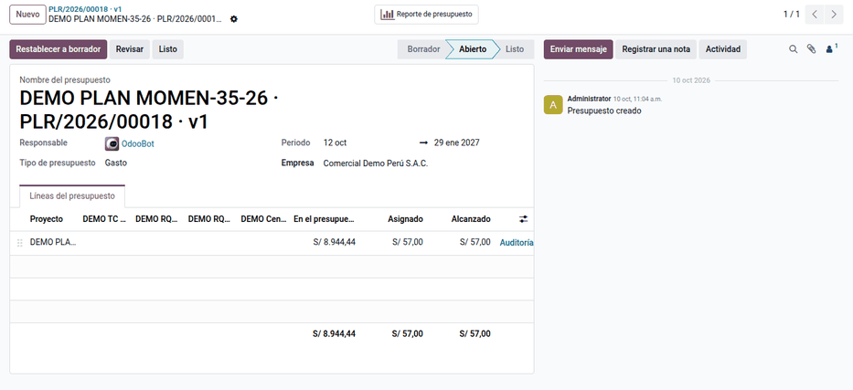
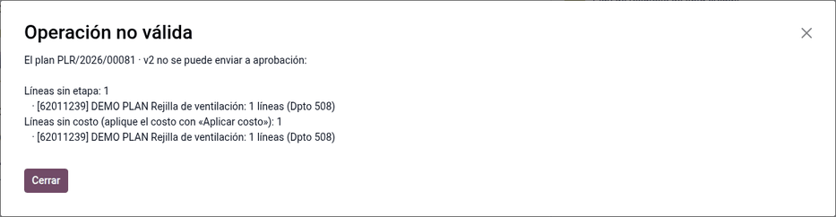
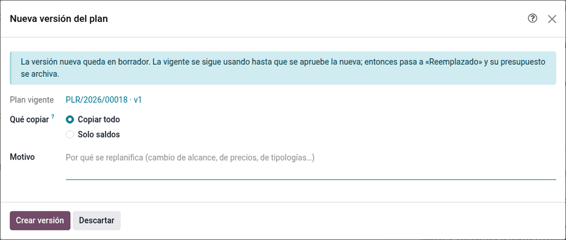

# Línea base y versiones

Aprobar el plan lo convierte en la **línea base** de la obra: sus montos quedan
congelados y se crea el presupuesto analítico con el que Contabilidad y
Compras controlan lo real. Para cambiar el plan después se crea una **nueva
versión**, que reemplaza a la vigente al aprobarse; la anterior queda como
historia.

## Configuración

1. En **Planificación de obra ‣ Configuración ‣ Aprobaciones y Gantt ‣ Reglas de aprobación**, defina
   los niveles por grupo o usuario, con condición por monto (`amount_total`).
   Las reglas de ejemplo piden la jefatura y, sobre S/ 100 000, la gerencia. Sin
   reglas, el plan se aprueba al solicitarlo.
2. En el plan en borrador, pestaña **Políticas**, elija la **política de
   exceso** (avisar, pedir aprobación o bloquear) y la **tolerancia** (por
   ejemplo, 10 %). Se usan al pedir material, fabricar o comprar con la
   analítica de la obra (ver [Asignaciones y compras](supply.md)).
3. La obra necesita su cuenta analítica, o cada línea su distribución.

## Aprobar el plan

1. En el plan, haga clic en **Solicitar aprobación**. El plan pasa a **En
   aprobación** con una revisión por nivel.
2. Los revisores hacen clic en **Validar** o **Rechazar** en el bloque de
   revisiones. Un rechazo devuelve el plan a borrador.
3. Con la última aprobación, el plan queda **Aprobado**: las líneas quedan
   congeladas (solo cambia la fecha de necesidad) y se crea el presupuesto
   analítico, con una línea por cada combinación de cuentas analíticas de las
   líneas. En mobiliario se crean también los [productos de cada
   módulo](furniture.md#productos-por-módulo) con su lista de materiales.

!!! warning "Importante"
    **Solicitar aprobación** se bloquea si hay líneas sin etapa, líneas sin
    costo o contratas sin actividad; el mensaje las lista. Corrija la etapa,
    aplique el costo o asigne la actividad.

En la demostración, la versión 1 del piso 05 queda aprobada (la melamina
hidrófuga, sin etapa en el maestro, se asigna a 1.1 Producción de piezas
antes) y su resumen por etapa cuadra con el presupuesto:

| Etapa | Material | Contrata | Planificado | Presupuesto | Diferencia |
|---|---|---|---|---|---|
| **1 Producción** | **6,566.91** | **781.29** | **7,348.20** | **7,348.20** | **0.00** |
| 1.1 Producción de piezas | 4,928.28 | — | 4,928.28 | 4,928.28 | 0.00 |
| 1.2 Armado | 1,638.63 | 781.29 | 2,419.92 | 2,419.92 | 0.00 |
| **2 Instalación** | **76.00** | **1,520.24** | **1,596.24** | **1,596.24** | **0.00** |
| 2.1 Instalación | 55.00 | 941.17 | 996.17 | 996.17 | 0.00 |
| 2.2 Acabado | 21.00 | 579.07 | 600.07 | 600.07 | 0.00 |
| **Total** | **6,642.91** | **2,301.53** | **8,944.44** | **8,944.44** | **0.00** |

El presupuesto tiene una línea de S/ 8,944.44 en la cuenta de la obra, porque
todas las líneas usan la distribución por defecto (la obra al 100 %). Si una
línea repartiera 60 % / 40 % entre dos partidas de otro plan analítico, el
presupuesto tendría una línea por combinación (obra + partida).

## Replanificar con una nueva versión

1. En el plan aprobado, haga clic en **Nueva versión**.
2. Escriba el **motivo** (obligatorio) y elija qué copiar: **todo** o **solo
   saldos**. Solo saldos copia lo planificado menos lo pedido con documentos ya
   cerrados; los documentos abiertos pasan a la versión nueva al aprobarla y
   siguen contando allí, y las líneas totalmente cubiertas no se copian.
3. Edite la versión en borrador; cada línea queda enlazada a la de la versión
   anterior. Su resumen por etapa compara contra el presupuesto vigente.
4. Al aprobarla, la versión anterior pasa a **Reemplazado** y su presupuesto a
   **Revisado**; el nuevo presupuesto la tiene como padre, así queda la historia
   de revisiones en **Contabilidad ‣ Presupuestos**. Los avances no liquidados
   pasan a la línea que continúa a la suya; los liquidados quedan en la versión
   anterior.

Ejemplo: la versión 2 copia las 226 líneas, aplica el ponderado de 6 meses (el
material de Producción baja de 4,928.28 a 4,109.22) y agrega una rejilla de
ventilación sin etapa ni costo. Su resumen muestra la diferencia de −819.06 y
la fila **Sin etapa**, y **Solicitar aprobación** se bloquea listando la
rejilla.

## Cancelar y cerrar

- Un plan que no se aprobó se puede **Cancelar**; **Volver a borrador** lo
  recupera desde cancelado o desde **En aprobación** (las revisiones se
  reinician).
- Un plan aprobado no se elimina: queda como historia de la obra.
- **Cerrar** (Administrador) deja el plan de solo lectura y su presupuesto
  **Hecho**. No se cierra con compras, requerimientos u órdenes de fabricación
  abiertos ni con liquidaciones de contrata pendientes. En mobiliario, cerrar
  el plan archiva los productos de módulo de la obra.

## Casos especiales

| Situación | Qué pasa | Qué hacer |
|---|---|---|
| Editar una línea de un plan aprobado | Bloqueado, salvo la fecha de necesidad | Crear una nueva versión |
| «Ya tiene la versión … en preparación» | Solo una versión en preparación por obra | Terminarla o cancelarla |
| El revisor no ve el botón **Validar** | No pertenece al grupo de la regla o falta un nivel previo | Revisar la regla y el orden de los niveles |
| «Tiene documentos abiertos» al cerrar | Hay compras, requerimientos u OF sin terminar | Terminarlos o cancelarlos |
| «Tiene liquidaciones de contrata pendientes» al cerrar | Liquidaciones sin aprobar o avances validados sin liquidar | Aprobarlas o anularlas |

!!! info "Ver también"
    - [Presupuestos en Odoo 19](https://www.odoo.com/documentation/19.0/applications/finance/accounting/reporting/budget.html)
    - [OCA base_tier_validation](https://github.com/OCA/server-ux/tree/18.0/base_tier_validation)
    - [Control y personal propio](control.md)
    - [Planificación de obra](../planning.md)
