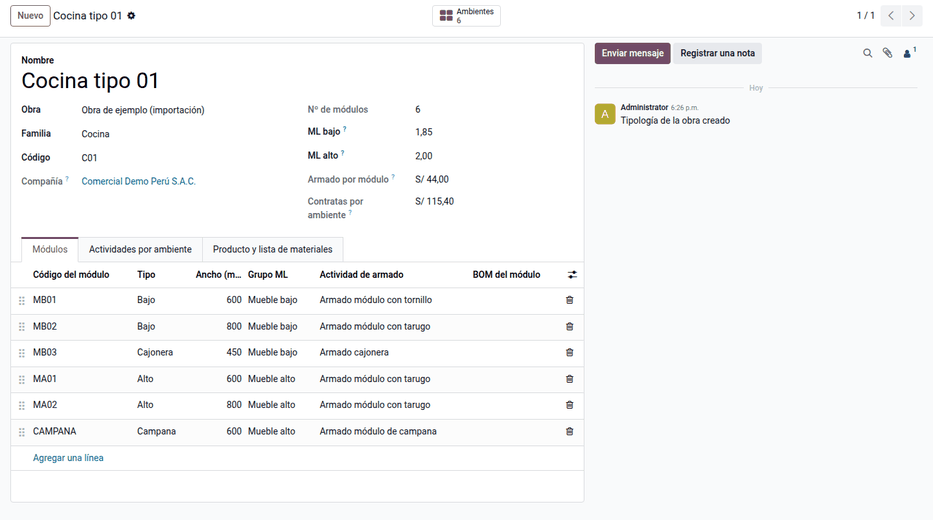

# Catálogo y árbol de la obra

Antes de generar un plan, la obra necesita su catálogo (actividades de las
contratas con su driver y sus tarifas), sus tipologías (la plantilla de cada
ambiente) y su árbol de tareas (pisos, departamentos y ambientes con su
tipología). Todo se puede cargar a mano, como se explica aquí, o de una vez con
[Importar maestro y ETO](import_master.md).

## Actividades y tarifas

1. Vaya a **Planificación de obra ‣ Configuración ‣ Plan de obra ‣ Actividades de obra** y
   cree cada actividad de las contratas con su **driver** (unidad, ML o módulo),
   su **etapa** y su precio. Las actividades de personal propio van en horas y
   con su **rol**.
2. Elija su **Driver**: **El de la partida** si la actividad se mide en la
   unidad de la partida (el muro drywall en m²): su avance es el avance físico
   de la partida; **Propio** si avanza y se liquida en su unidad (el emplacado
   en m² de placa, los esquineros en ml) sin mover el avance de la partida. Las
   líneas del plan lo toman de la actividad (**En el driver del nivel**).
3. Opcional: dé a cada actividad su **producto de servicio** (con sus
   impuestos). Si no lo tiene, **Asignar contrata** crea uno sin impuestos y con
   recepción manual.
4. En **Configuración ‣ Tarifas de contrata**, registre los precios por obra,
   por contrata o por la combinación de ambas, con su **vigencia** y su
   **retención**. Las vigencias de una misma combinación no se superponen.

La tarifa se busca en este orden: obra y contrata › solo obra › solo contrata ›
tarifa base › precio de la actividad. Así una contrata puede cobrar distinto en
una obra concreta. En mobiliario, las tarifas también pueden venir de
[listas de tarifas](furniture.md#listas-de-tarifas) por familia y por obra.

## Etapa de consumo de los materiales

En **Fabricación ‣ Productos ‣ Listas de materiales**, la lista de cada
tipología indica en sus componentes la **Etapa de consumo**, siempre una sub
etapa: 1.1 Producción de piezas, 1.2 Armado, 2.1 Instalación, 2.2 Acabado o
2.3 Limpieza. La etapa decide en qué semana se necesita cada material.

!!! warning "Importante"
    Un componente sin etapa se genera en el plan «sin etapa» y se avisa. El
    plan no se puede enviar a aprobación mientras tenga líneas sin etapa.

## Tipologías

Vaya a **Planificación de obra ‣ Configuración ‣ Plan de obra ‣ Tipologías** y cree una por
cada tipo de ambiente de la obra (p. ej. «Cocina tipo 01»), con:

- **Módulos**: código, nombre, tipo (bajo, alto, cajonera, campana…), tipo
  de módulo (estándar o especial), método de unión, ancho en mm, grupo ML
  (mueble bajo o alto), mueble y actividad de armado. Sin actividad de armado,
  el plan usa la del catálogo según el método de unión o el tipo especial.
  Cada módulo abre su formulario con sus **Materiales** (con su sub etapa) y
  sus **Piezas** (ver [Mobiliario: módulos, productos y
  envíos](furniture.md)). Con los anchos, la tipología calcula sus **ML
  bajo** y **ML alto**; sin ellos, se escriben a mano;
- **Muebles**: cada mueble de la tipología con su **Tipo de mueble** (bajo,
  alto, torre, isla o mueble completo) y su grupo ML;
- **Actividades por ambiente**: las que no se miden por módulo, con su cantidad
  por ambiente (instalación por ML, colocación de puertas, entarugado…);
- **Producto y lista de materiales**: el mueble terminado de la tipología, con
  los materiales de un ambiente.

La tipología muestra como referencia el armado por módulo y las contratas por
ambiente a la tarifa vigente de la obra.

Por ejemplo, la tipología 01 de la demostración:

| Concepto | Driver | Tarifa | Monto S/ |
|---|---|---|---|
| Armado: 1 tornillo, 3 tarugo, microondas, campana, cajonera | 7 módulos | 6 · 8 · 10 · 7 · 7 | 54.00 |
| Colocación de puertas | 1.93 und | 3.00 | 5.79 |
| Entarugado de muebles | 8.5 und | 3.00 | 25.50 |
| **Armado de la tipología** | | | **85.29** |
| Instalación mueble bajo / alto | 2.12 / 2.10 ML | 18.00 (tarifa de la obra) | 38.16 + 37.80 |

## Árbol de la obra

En **Proyecto**, cree las tareas de la obra como subtareas, con el campo
**Nivel de obra**: piso › departamento › ambiente. Cada ambiente lleva su
**Tipología**. Los módulos los crea el plan al generarse, o el ETO al
importarse.

!!! note "Nota"
    Cada nivel debe colgar del nivel inmediato superior: un ambiente de un
    departamento, un departamento de un piso. Si no, Odoo avisa «Debe colgar de
    un …»: corrija la tarea padre.

!!! info "Ver también"
    - [Importar maestro y ETO](import_master.md)
    - [Generar el plan](generate_plan.md)
    - [Planificación de obra](../planning.md)
