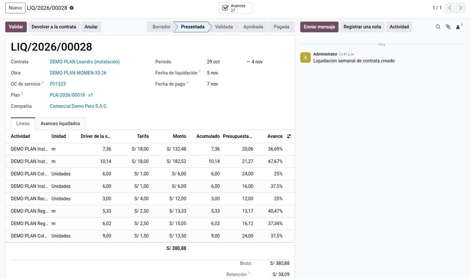
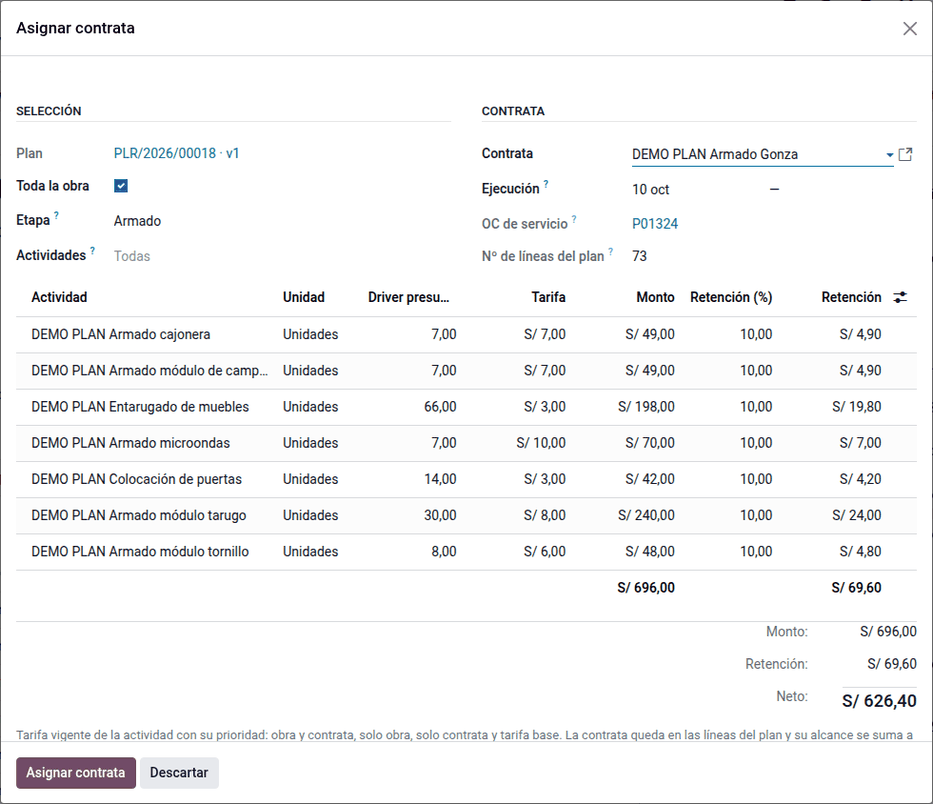
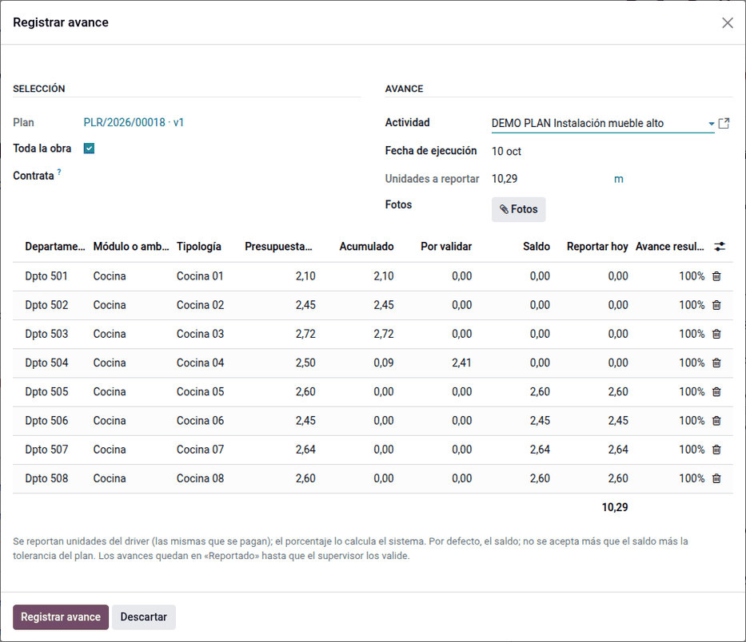

# Contratas y liquidación semanal

Las contratas a destajo se pagan por su **driver**: unidades, metros lineales o
módulos hechos, a la tarifa vigente. Desde el plan se asigna la contrata a una
selección de la obra (con su orden de compra de servicio), la contrata reporta
lo que hizo con foto, el supervisor valida, cada jueves se prepara la
liquidación de la semana y, aprobada, se recibe en la orden de compra y se
factura con vencimiento el sábado.

## Configuración

1. En **Ajustes ‣ Planificación de obra**, defina la **semana de las
   contratas**: día de inicio, día de liquidación y día de pago (por defecto
   jueves, jueves y sábado). Cada obra puede cambiarlos en **Proyecto ‣ Ajustes**.
2. Los feriados se toman de las ausencias globales de la compañía (**Empleados ‣
   Configuración ‣ Horarios laborales ‣ Ausencias públicas**): si el jueves o el
   sábado es feriado, la liquidación o el pago se corre al día hábil anterior.
3. Opcional, en el mismo ajuste: la **cuenta de retención**. Con ella, la factura
   de la liquidación lleva la retención como línea negativa y su total es el
   neto; sin ella, la factura va por el bruto.
4. La regla «Liquidación de contrata: jefatura de proyectos» viene con el módulo
   (**Configuración ‣ Reglas de aprobación**); sin reglas, la liquidación se
   aprueba al validarla.
5. Revise las tarifas de la obra y de cada contrata (ver
   [Catálogo y árbol de la obra](catalog.md)).

## Asignar la contrata

1. Seleccione en el árbol, el plan o el [cronograma](schedule.md) y haga clic en
   **Asignar contrata**.
2. Elija la contrata y la etapa. El asistente lista las actividades de la
   selección con su driver total, la tarifa vigente, el monto y la retención.
3. Confirme. La contrata queda en las líneas del plan y su alcance se suma a la
   **OC de servicio** abierta de la contrata en la obra (una por contrata y
   obra); si no existe, se crea en borrador. Las líneas que ya tienen otra
   contrata no se reasignan.
4. Compras confirma la OC de servicio en **Contratas ‣ OC de servicio**: es
   requisito para aprobar las liquidaciones.

Ejemplo: la instalación del piso 05 asignada a la contrata de instalación
(Leandro), con la tarifa de la obra (18.00 por ML, no la base de 16.00) y
retención del 10 %:

| Actividad | Und | Driver | Tarifa | Monto | Retención |
|---|---|---|---|---|---|
| Instalación mueble bajo | ML | 21.27 | 18.00 | 382.86 | 38.29 |
| Regulación puerta mueble bajo | ML | 16.12 | 2.50 | 40.30 | 4.03 |
| Instalación mueble alto | ML | 20.06 | 18.00 | 361.08 | 36.11 |
| Regulación puertas mueble alto | ML | 13.17 | 2.50 | 32.93 | 3.29 |
| Colocación tapas de cajones | Und | 24 | 1.50 | 36.00 | 3.60 |
| Recortes de muebles | Und | 12 | 4.00 | 48.00 | 4.80 |
| Colocación pines y repisas | Und | 24 | 1.00 | 24.00 | 2.40 |
| Instalación sistema push tip on | Und | 16 | 1.00 | 16.00 | 1.60 |
| **Total · neto S/ 847.05** | | | | **941.17** | **94.12** |

La contrata queda en las 64 líneas de instalación del piso (8 actividades × 8
cocinas) y su OC de servicio tiene 8 líneas por S/ 941.17. Una segunda
asignación a la misma contrata en la obra suma a la misma OC.

## Registrar y validar el avance

1. El capataz de la contrata o el supervisor abre **Avance ‣ Registrar avance**
   (o el botón del plan, del árbol o de la pestaña **Recursos y avance** de la
   tarea). Para cada módulo o ambiente se propone el saldo.
2. Indique las unidades de driver hechas y adjunte al menos una foto. El avance
   queda **Reportado**. No se acepta más que lo presupuestado más la tolerancia
   del plan, contando también lo reportado aún sin validar.
3. El supervisor revisa **Avance ‣ Avances por validar**, agrupado por obra,
   contrata y semana de liquidación, y **Valida** o **Rechaza** con motivo. Solo
   lo validado suma al acumulado y al avance de la línea y de los niveles.

Ejemplo: validar 2.70 ML de mueble bajo en la cocina del Dpto 504 deja esa línea
en 100 % (**Completa**) y la instalación de la cocina en 42.2 % (48.60 de
115.10).

!!! note "Nota"
    Un avance validado se corrige con **Volver a reportado** (supervisor) si
    aún no está liquidado. Si su liquidación está presentada o validada, primero
    se devuelve la liquidación; un avance de una liquidación aprobada ya no se
    revierte. Revertir un avance devuelve el módulo al estado que justifica el
    avance que queda.

### Foto de evidencia en las tareas

En **Proyecto ‣ Configuración ‣ Etapas de tareas**, una etapa con **Exige foto
de evidencia** (por ejemplo **Hecha**) no acepta tareas sin adjuntos: antes de
moverla, adjunte la foto del mueble con su etiqueta.

## Liquidar la semana

1. Cada día de liquidación (jueves), una acción programada prepara en borrador
   la liquidación de cada contrata y obra con los avances validados de la
   semana (de jueves a miércoles) más los **rezagados**: avances validados
   después de liquidar su semana. **Actualizar avances** la rehace a mano.
2. La liquidación calcula driver × tarifa de la OC de servicio, la retención
   según la tarifa, el bruto y el neto, con el acumulado y el avance
   informativos.
3. El supervisor la **Presenta** en nombre de la contrata y la **Valida**, o la
   devuelve con motivo.
4. La Jefatura de Proyectos la aprueba en el bloque de revisiones. Al aprobarla,
   se recibe en la OC de servicio lo liquidado (nunca más de lo ordenado) y se
   crea la factura de proveedor con vencimiento el día de pago.
5. Tesorería registra el pago en **Contabilidad ‣ Facturas de proveedor**.
   Cuando la factura queda pagada, la liquidación pasa a **Pagada**.

Ejemplo: del 29/10 al 03/11/2026 la contrata instala las cocinas 501 a 503 y
parte de la 504. El jueves 05/11 se prepara su liquidación del 29/10 al 04/11,
con pago el sábado 07/11:

| Actividad | Driver de la semana | Tarifa | Monto |
|---|---|---|---|
| Instalación mueble bajo | 10.14 ML | 18.00 | 182.52 |
| Regulación puerta mueble bajo | 6.02 ML | 2.50 | 15.05 |
| Instalación mueble alto | 7.36 ML | 18.00 | 132.48 |
| Regulación puertas mueble alto | 5.33 ML | 2.50 | 13.33 |
| Tapas · recortes · pines · push | 9 · 3 · 6 · 6 | 1.50 · 4 · 1 · 1 | 37.50 |
| **Bruto · retención 10 % · neto** | | | **380.88 · 38.09 · 342.79** |

Un avance hecho el jueves 05/11 ya es del periodo del 05/11 al 11/11 y entra en
la liquidación del 12/11, junto con lo validado tarde de semanas anteriores.

Si la Jefatura decidió descontar a la contrata un material extra de la obra, la
liquidación lo resta del neto y la factura lleva la línea negativa: vea
[Material extra y descuento a la contrata](extra_material.md).

## Casos especiales

| Situación | Qué pasa | Qué hacer |
|---|---|---|
| «No hay actividades de contrata por asignar» | Las líneas ya están asignadas o son de otra etapa | Revisar la etapa y la contrata de las líneas |
| «Necesita al menos una foto» | El avance no tiene fotos | Adjuntar la foto |
| «No se puede pasar … sin adjuntar la foto de evidencia» | La etapa exige foto y la tarea no tiene adjuntos | Adjuntar la foto a la tarea |
| «Con este avance se reportan … de … presupuestados» | Lo reportado pasa lo planificado más la tolerancia | Corregir la cantidad o replanificar |
| «Solo se corrige un avance reportado» | El avance ya está validado | **Volver a reportado**, si no está liquidado |
| El avance no entra a la liquidación | Está sin validar, es de otra semana o su línea no tiene OC de servicio de esa contrata | Validarlo o asignar la contrata |
| «Confirme la OC de servicio … antes de aprobar» | La OC está en borrador | Que Compras la confirme |
| «Con esta liquidación se recibirían … de … ordenados» | La semana pasa lo ordenado en la OC | Ampliar la OC o corregir los avances |
| La liquidación no pasa a **Pagada** | La factura no está pagada del todo | Registrar y conciliar el pago |

!!! info "Ver también"
    - [Árbol de recursos](resource_tree.md)
    - [Material extra y descuento a la contrata](extra_material.md)
    - [Control y personal propio](control.md)
    - [Compras en Odoo 19](https://www.odoo.com/documentation/19.0/applications/inventory_and_mrp/purchase.html)
