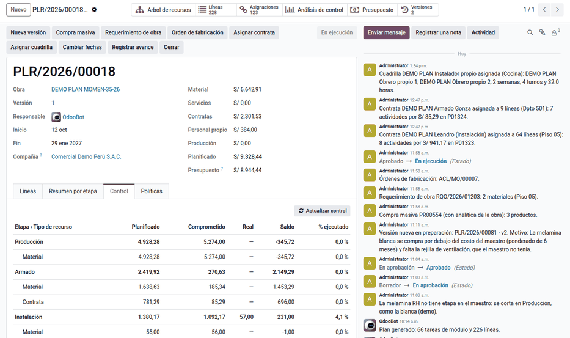
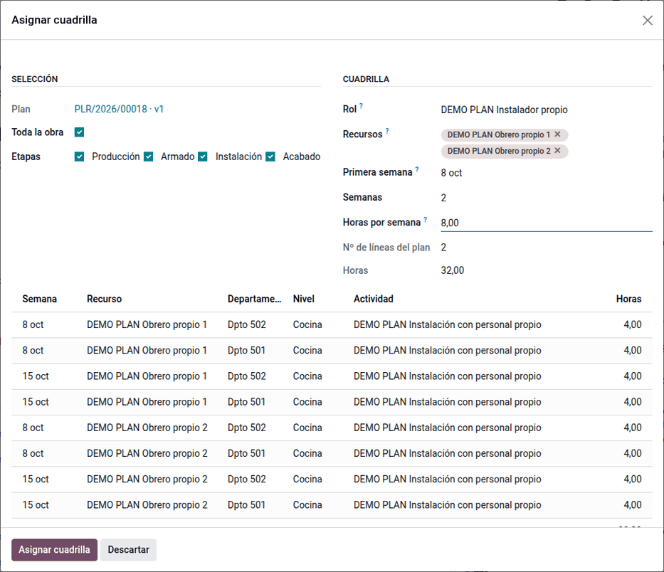
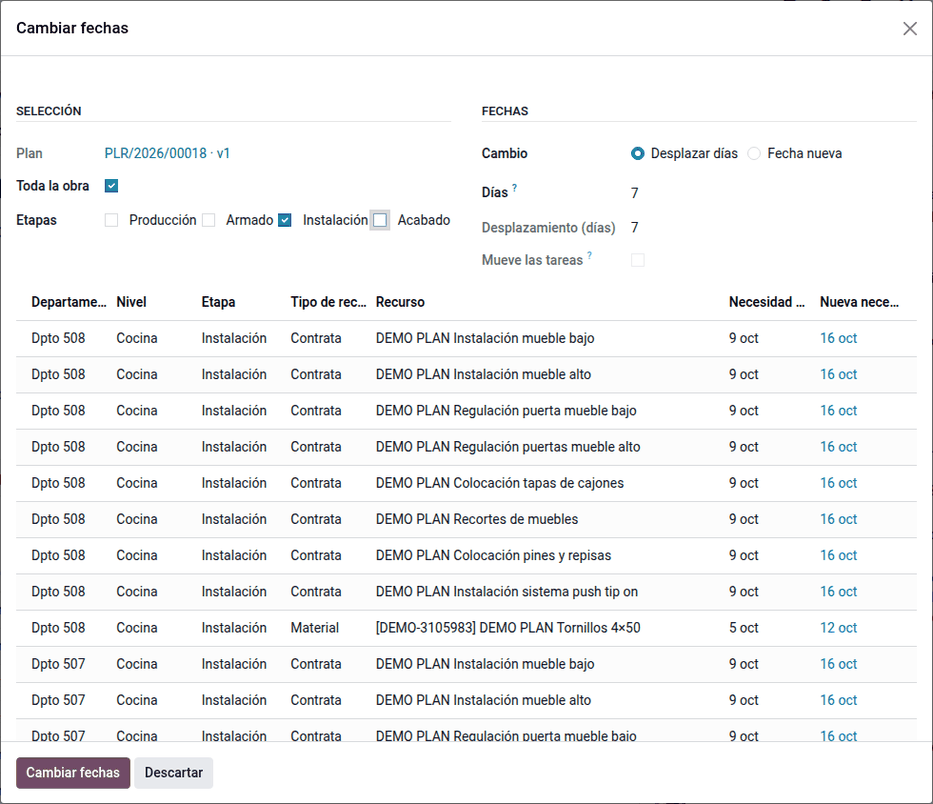

# Control y personal propio

Cada línea del plan guarda su estado y sus montos de control: comprometido,
real, saldo y porcentaje ejecutado. Con ellos la Jefatura y Finanzas ven por
etapa y por tipo de recurso cómo va la obra contra su presupuesto. Esta página
explica también cómo se planifican y se costean las cuadrillas de personal
propio, cómo se controla una orden de compra con la analítica de la obra y
cómo se mueven las fechas del plan.

## Configuración

- **Personal propio**: las actividades en horas llevan su **rol**
  (**Planificación ‣ Configuración ‣ Roles**) y los empleados su **costo hora**
  (**Empleados ‣ Ajustes de RR. HH.**). El capataz necesita el permiso de hoja de
  horas sobre otros empleados para registrar las de la cuadrilla.
- **OC con analítica**: el control usa el presupuesto analítico del plan
  vigente. Las OC de servicio de las contratas no se controlan aquí: las
  controlan **Asignar contrata** y la liquidación.
- **Obra de la planilla de construcción civil**: póngale la cuenta analítica
  del proyecto. El planificador y la planilla no dependen uno del otro y se
  encuentran por esa cuenta.

## Conceptos

| Concepto | Qué incluye |
|---|---|
| Comprometido | Lo pedido que aún no es real: requerimientos y compras sin consumir, OC de servicio sin recibir y turnos sin horas registradas |
| Real | Lo consumido al costo del plan, lo recibido en la OC de servicio y las horas registradas por el costo hora del empleado |
| Saldo | Planificado − comprometido − real |
| % ejecutado | Real ÷ planificado |

Los montos se actualizan con cada documento del plan. Lo que cambia con el
tiempo (turnos que terminan) lo recoge una acción programada cada hora, o el
botón **Actualizar control**.

## Revisar el control

- La pestaña **Control** del plan muestra, por etapa y dentro de ella por tipo
  de recurso, lo planificado, comprometido, real, saldo y % ejecutado.
- **Reportes ‣ Control de saldo** y **Análisis de control** abren las mismas
  líneas en pivote y gráfico para agrupar por contrata, producto, actividad,
  nivel o estado.

## Asignar una cuadrilla

1. Seleccione en el árbol, el plan o el [cronograma](schedule.md) y haga clic en
   **Asignar cuadrilla**.
2. Elija el rol, los obreros, la semana de inicio, el número de semanas y las
   horas por semana. El asistente crea los turnos de **Planificación** por obrero
   y semana, con la tarea y la línea del plan, y le da el rol al empleado si no
   lo tenía.
3. Los obreros registran sus horas en la hoja de horas de la tarea o de sus
   módulos. Las horas son lo ejecutado y, por el costo hora de cada empleado, lo
   real. El costo del personal propio va por hoja de horas, no por liquidación.

Ejemplo: la cocina del Dpto 501 tiene planificado personal propio de 16 h a
S/ 12.00 (S/ 192.00). Se asignan dos obreros (costo hora S/ 9.50), dos semanas
desde el jueves 29/10/2026 y 4 h por semana cada uno: 4 turnos y 16 h. Un
obrero registra 6 h en un módulo de esa cocina:

| Concepto | Cálculo | Monto |
|---|---|---|
| Ejecutado | 6 h registradas | 6 h de 16 (37.5 %) |
| Real | 6 h × S/ 9.50 | 57.00 |
| Comprometido | (8 − 6) h del obrero 1 + 8 h del obrero 2 = 10 h × S/ 9.50 | 95.00 |
| Saldo | 192.00 − 95.00 − 57.00 | 40.00 |

El real va al costo hora del empleado, no al costo del plan: el saldo muestra si
la cuadrilla sale más cara o más barata que lo planificado.

## Controlar una OC con la analítica de la obra

Al confirmar una orden de compra de material con la cuenta analítica de la obra,
se suma su monto al comprometido de la combinación analítica (OC confirmadas sin
facturar más lo imputado). Si pasa el presupuesto de esa combinación más la
tolerancia, decide la política del plan:

- **Avisar**: se confirma y queda **Excede el plan**;
- **Pedir aprobación**: la justificación es obligatoria y confirma la jefatura
  del planificador (**Exceso aprobado**);
- **Bloquear**: no se confirma.

## Cambiar fechas

1. Seleccione en el árbol, el plan o el cronograma y haga clic en **Cambiar
   fechas**.
2. Elija las etapas y desplace un número de días o fije una fecha.
3. Las fechas de necesidad de las líneas se recalculan. Con todas las etapas,
   también se mueven las tareas en el Gantt. Los requerimientos de obra y las
   compras con fecha anterior a la nueva necesidad reciben la actividad «Fechas
   del plan cambiadas» para Logística.

Ejemplo: postergar 14 días solo la instalación del piso 05 desplaza 14 días la
fecha de necesidad de sus líneas sin mover las tareas, y el requerimiento de
obra del piso recibe la actividad para Logística.

## Casos especiales

| Situación | Qué pasa | Qué hacer |
|---|---|---|
| Comprometido y real en cero | Se llenan con las asignaciones y las horas | Generar los documentos desde el plan; **Actualizar control** |
| «Pasa el presupuesto analítico … bloquear» | La OC lleva la combinación sobre su presupuesto | Reducir la OC, cambiar la política o replanificar |
| «El exceso lo aprueba la jefatura del planificador» | Política «pedir aprobación» en una OC | Que el administrador del planificador confirme el aviso |
| «Combinación fuera del presupuesto» | La OC usa una combinación sin línea en el presupuesto | Usar la combinación del plan o replanificar |
| «La selección no tiene líneas de personal propio del rol» | No hay líneas de personal propio o tienen otro rol | Revisar la selección y el rol |
| Las horas no suben el ejecutado | El empleado no tiene el rol o registró en otra tarea | Asignar la cuadrilla; registrar en la tarea del nivel o sus módulos |
| «Las fechas no cambian» | Cero días o la fecha nueva es la actual | Indicar los días o la fecha |

!!! info "Ver también"
    - [Línea base y versiones](baseline.md)
    - [Cronograma con recursos](schedule.md)
    - [Construcción civil en la planilla](../../../../hr/payroll/peru/construction.md)
