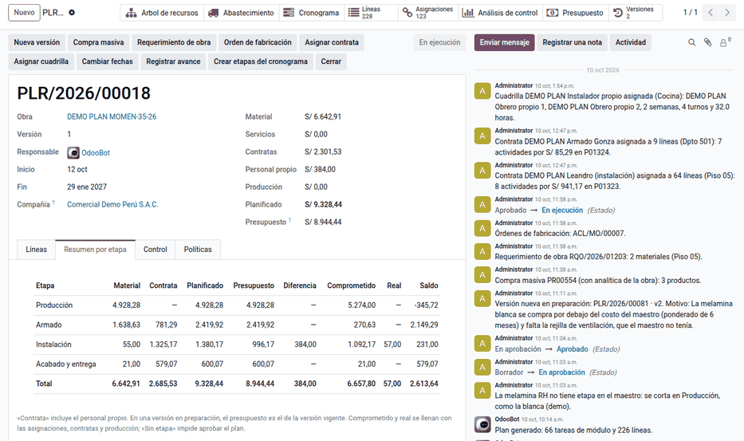
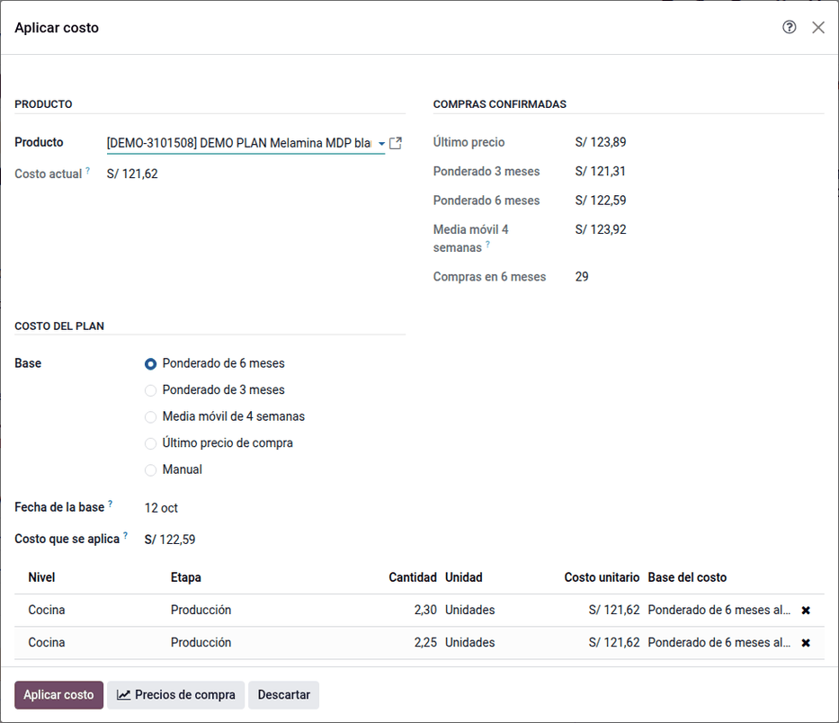

# Generar el plan

El **plan de recursos** de una obra es la lista de todo lo que la obra va a
consumir, módulo por módulo: el armado de cada módulo, las contratas por
ambiente y los materiales de cada tipología, cada línea con su etapa, su
cantidad y su costo. **Generar plan** lo arma desde las tipologías; el
planificador escribe después el costo de los materiales con la base de precios
que elija.

## Configuración

- La obra tiene sus tipologías y su árbol con la tipología de cada ambiente
  (ver [Catálogo y árbol de la obra](catalog.md)).
- Las reglas de aprobación y la política de exceso se definen antes de aprobar
  (ver [Línea base y versiones](baseline.md)).

## Crear y generar el plan

1. Vaya a **Planificación de obra ‣ Obras ‣ Plan de recursos ‣ Planes de recursos ‣ Nuevo** y elija
   la obra. El plan recibe el número `PLR/AAAA/#####` · v1 en borrador. Cada
   obra tiene como máximo un plan vigente (aprobado o en ejecución) y uno en
   preparación (borrador o en aprobación).
2. Haga clic en **Generar plan** y elija los ambientes, los tipos de recurso y
   las etapas (**1.1 Producción de piezas**, **1.2 Armado**, **2.1
   Instalación** y **2.2 Acabado**). La vista previa muestra, sin escribir nada, las tareas a crear
   por nivel, las líneas y el monto por tipo y etapa, y las advertencias.
3. Confirme. El asistente:
    - crea bajo cada ambiente una tarea por módulo de su tipología, con su
      nombre, código, tipo, tipo de módulo, método de unión, ancho y estado
      **Planificado**. Si el ambiente ya tiene módulos (del ETO), los usa por
      su código y avisa los que faltan;
    - crea las líneas de armado (una por módulo, con su actividad de armado o,
      sin ella, la del catálogo según su método de unión o su tipo especial),
      las [líneas de contrata desde las piezas](furniture.md#líneas-de-contrata-desde-las-piezas)
      de cada módulo (puertas, cajones, tapas y correderas) y las de contratas
      por ambiente;
    - crea las líneas de materiales desde la receta de cada módulo (sus
      **Materiales**, con su sub etapa) o, si el módulo no la tiene, desde la
      lista de materiales del módulo o de la tipología;
    - deja las contratas con la tarifa vigente de la obra (o la de la [lista
      de tarifas](furniture.md#listas-de-tarifas) de la familia de la
      tipología) y los materiales en cero, con el aviso «líneas sin costo».

Las actividades por ML cuelgan del módulo cuando se conoce su ancho; si no,
quedan en el ambiente con la cantidad de la tipología y se avisa.

### Personal propio o contrata

Cada actividad sale como **Personal propio** o como **Contrata** según su
modalidad de ejecución, que se busca en este orden:

1. la **Modalidad de ejecución** del ambiente (el nivel con etapas, p. ej.
   «Mueble instalado»);
2. la **Modalidad** de la actividad (**Configuración ‣ Actividades**);
3. la **Modalidad por defecto** de su etapa (**Configuración ‣ Etapas**), que
   viene en **Personal propio**;
4. personal propio.

La línea de personal propio lleva la misma actividad, cantidad, unidad y
tarifa que tendría la contrata, y su analítica sale de la regla del tipo de
recurso **Personal propio**. **Contrata a todo costo** no aplica al
mobiliario: la línea sale como contrata solo de mano de obra y se avisa.

Para tercerizar una etapa en todas las obras, cambie la modalidad de la
etapa; para un ambiente, la de su tarea. Con el plan aprobado, la modalidad
de un ambiente con líneas se cambia en una nueva versión del plan. El
catálogo de etapas es de toda la base: su modalidad vale para todas las
compañías.

### Volver a generar

Con el modo **Reemplazar lo generado**, el asistente borra solo las líneas
generadas de esos ambientes, conserva las manuales y los costos ya escritos y
no duplica módulos.

!!! note "Nota"
    Un ambiente sin tipología no se genera y se avisa. Un componente sin etapa
    se genera «sin etapa» y también se avisa.

## Aplicar costo

El costo de los materiales lo escribe el planificador después de revisar los
precios de compra, porque el costo del producto puede estar mal cargado (por
ejemplo, en dólares). Al regenerar se conserva el costo ya escrito.

1. En el plan, haga clic en **Aplicar costo**, o seleccione líneas y use
   **Aplicar costo** desde la acción.
2. Elija la base: **Manual**, **Último precio**, **Ponderado de 3 meses**,
   **Ponderado de 6 meses** o **Media móvil de 4 semanas**. El asistente
   sugiere el costo de cada base, en soles, con el precio neto de descuento y
   la unidad del producto.
3. Confirme o escriba otro costo. Las líneas guardan el costo, la base y su
   fecha.

Ejemplo con la melamina blanca y tres compras confirmadas: 20 a S/ 118.50 (hace
150 días), 35 a S/ 122.00 (75 días) y 15 a S/ 124.90 (20 días):

| Base | Cálculo | Costo |
|---|---|---|
| Último precio | La compra más reciente | 124.90 |
| Ponderado de 3 meses | (35 × 122.00 + 15 × 124.90) ÷ 50 | 122.87 |
| Ponderado de 6 meses | (20 × 118.50 + 35 × 122.00 + 15 × 124.90) ÷ 70 | 121.62 |

Con el ponderado de 6 meses, las 8 líneas de melamina blanca quedan con 121.62 y
la base «Ponderado de 6 meses al 10/10/2026: 121,62». Para ver todas las compras
y sus estadísticos, use los [precios de compra](prices_supply.md).

## Revisar el resumen por etapa

La pestaña **Resumen por etapa** del plan muestra, en el orden del árbol de
etapas, cada etapa padre con la suma de sus sub etapas y, debajo, cada sub
etapa con su material, su contrata, lo planificado y, una vez aprobado, el presupuesto, la diferencia, el
comprometido, el real y el saldo. Antes de pedir la aprobación no debe quedar
ninguna fila **Sin etapa**. El [árbol de recursos](resource_tree.md) permite
revisar los montos nivel por nivel.

En el piso 05 de la demostración, tras generar y aplicar los costos, el plan
suma 66 módulos, 41.33 ML y S/ 8,944.44 (S/ 6,642.91 de material y S/ 2,301.53
de contrata).

## Casos especiales

| Situación | Qué pasa | Qué hacer |
|---|---|---|
| Líneas de material sin costo | Se avisa | Escribir el costo con **Aplicar costo** |
| «Módulos sin actividad de armado» | El módulo no tiene actividad ni método de unión o tipo especial que la dé; no se genera su armado | Escribir la actividad o completar el método o el tipo del módulo |
| Tipología sin anchos | La instalación por ML queda en el ambiente; se avisa | Cargar los anchos del ETO por módulo |
| El ambiente ya tiene módulos del ETO | Se usan por código; los que faltan se avisan | Crear el módulo faltante o corregir el código |
| «Ya tiene un plan en preparación» | Solo un borrador o en aprobación por obra | Usar el existente o cancelarlo |
| La cantidad de la lista de materiales se redondea | La unidad «Product Unit» guarda dos decimales | Subir la precisión si el maestro necesita más |

!!! info "Ver también"
    - [Árbol de recursos](resource_tree.md)
    - [Línea base y versiones](baseline.md)
    - [Planificación de obra](../planning.md)
