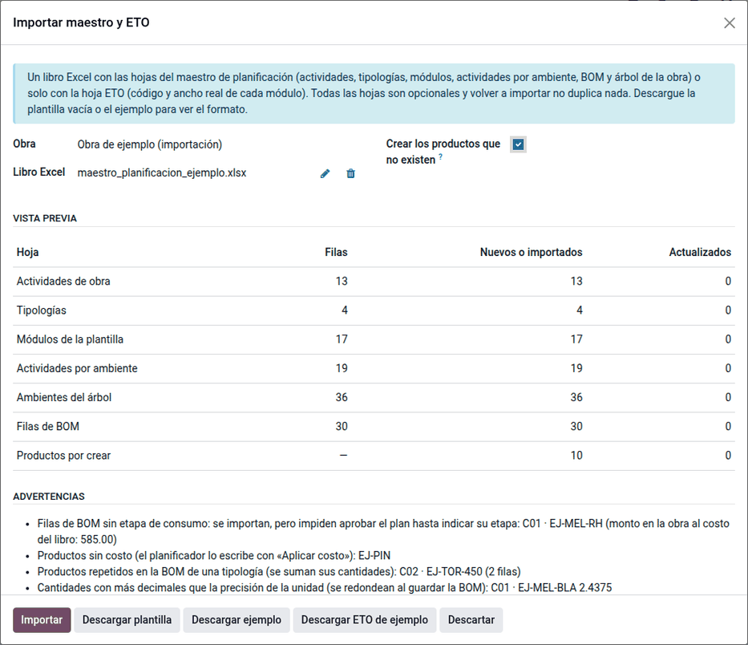
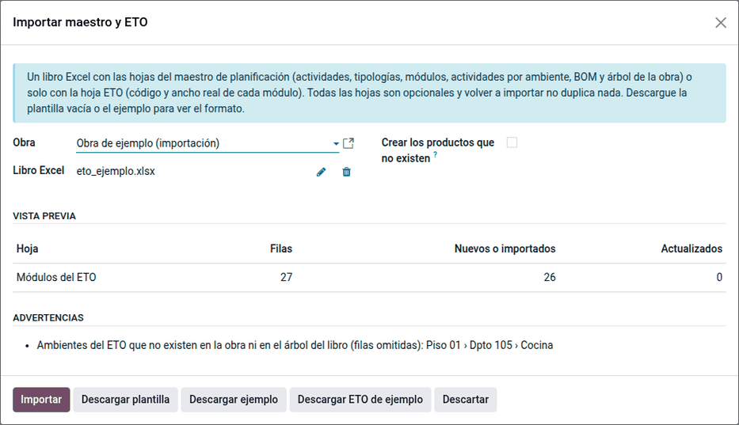

# Importar maestro y ETO

El asistente **Importar maestro y ETO** lee el libro Excel del maestro de
planificación (actividades, tipologías, módulos, actividades por ambiente,
materiales y árbol de la obra) y el ETO con el ancho real de cada módulo. Antes
de escribir nada muestra lo que hará y lo que falta corregir, y se puede
repetir sin duplicar. Así el maestro no se transcribe a mano.

## El libro del maestro

El maestro tiene una hoja por cosa que carga el planificador. Todas son
opcionales: se puede importar el maestro y, semanas después, el ETO de un piso.

| Hoja | Contenido |
|---|---|
| CATALOGO | Actividades de obra con su driver y su tarifa base |
| TIPOLOGIAS | Tipologías de la obra con su familia |
| MODULOS | Plantilla de módulos de cada tipología, con su ancho y su actividad de armado |
| ACTIVIDADES | Actividades por ambiente de cada tipología, con su cantidad |
| BOM | Materiales de un ambiente con su etapa de consumo y su costo |
| ARBOL | Piso › departamento › ambiente, con su tipología |
| ETO | Módulos reales de cada ambiente (código y ancho), del despiece de ingeniería |

La hoja **LEEME** de la plantilla explica cada columna. Las tarifas de la obra
y de las contratas no forman parte del maestro: se cargan en **Configuración ‣
Tarifas de contrata**.

El módulo trae un ejemplo de una obra genérica de 3 pisos con 4 departamentos
por piso y, en cada departamento, cocina, closet y baño (datos ficticios con
códigos `EJ-`):
[maestro de ejemplo](../../../../../../../OL-PROJECTS/al_construction_planner_furniture/static/examples/maestro_planificacion_ejemplo.xlsx)
y [ETO de ejemplo](../../../../../../../OL-PROJECTS/al_construction_planner_furniture/static/examples/eto_ejemplo.xlsx).

## Importar el maestro

1. Cree la obra (proyecto con **Es obra**) y su cuenta analítica.
2. Vaya a **Planificación de obra ‣ Configuración ‣ Plan de obra ‣ Importar maestro y ETO**, o
   haga clic en **Importar maestro y ETO** en la obra. **Descargar plantilla**
   da el libro vacío; **Descargar ejemplo** y **Descargar ETO de ejemplo**, los
   del ejemplo.
3. Elija la **Obra**, suba el libro y marque **Crear los productos que no
   existen** si el maestro trae productos nuevos.
4. Revise la vista previa. Sin escribir nada, cuenta lo que se creará por hoja y
   lista las advertencias.
5. Haga clic en **Importar**. Se abre la lista de tipologías de la obra, cada
   una con su lista de materiales, y el historial de la obra registra la
   importación.

!!! note "Nota"
    La hoja CATALOGO solo la aplica un **Administrador** del planificador. Un
    planificador ve el aviso y carga las actividades antes, en **Configuración ‣
    Actividades de obra**.

### Advertencias

| Advertencia | Qué pasa | Qué hacer |
|---|---|---|
| «No tiene las columnas obligatorias» | No se importa nada | Corregir el encabezado de la hoja (ver LEEME) |
| Material sin etapa | Se importa, pero el plan no se aprueba hasta indicarla; el aviso da su monto en la obra | Indicar la etapa en la lista de materiales |
| Producto que no existe | Esa fila se omite | Marcar **Crear los productos que no existen** o crearlo antes con su referencia interna |
| Producto sin costo | Se importa sin costo | Escribir el costo con **Aplicar costo** |
| Producto repetido en una tipología | Las filas se suman en una sola línea | Revisar el maestro si no era intencional |
| Actividad que no existe | La fila del módulo o de la actividad se omite | Cargarla en CATALOGO o en **Actividades de obra** |
| Ambiente del ETO que no existe | La fila se omite | Importar antes el árbol (hoja ARBOL) o corregir el ambiente |
| Cantidad con más decimales que la unidad | Se redondea a la precisión de la unidad | Revisar si la precisión de la unidad alcanza |

## Importar el ETO

Vuelva a abrir el asistente con el ETO de la obra. Crea los módulos reales de
cada ambiente con su código y su ancho. El ETO no reemplaza a la plantilla de
la tipología, la completa: con el ETO, la instalación y la limpieza por ML se
calculan con el ancho real de cada módulo; los ambientes sin ETO usan el ancho
de la plantilla.

## Volver a importar

Importar el mismo libro de nuevo no duplica nada: las tipologías y los módulos
se reconocen por su código, los pisos, departamentos y ambientes por su nombre
bajo su nivel superior y los productos por su referencia interna. Lo que el
libro trae de una tipología (plantilla de módulos, actividades y materiales)
queda exactamente así: una fila borrada del libro se borra de la tipología. Lo
que no trae (otras tipologías, ambientes, tarifas) no cambia, y los planes ya
generados no se tocan: regenere el plan en borrador.

## Ejemplo

Con el maestro y el ETO de ejemplo:

1. La vista previa del maestro muestra 13 actividades, 4 tipologías (C01 y C02
   cocinas, CL01 closet, B01 baño), 17 módulos de plantilla, 19 actividades por
   ambiente, 30 filas de materiales, 10 productos por crear y 36 ambientes
   nuevos.
2. Las advertencias del ejemplo son intencionales (están en su hoja LEEME):
    - la melamina hidrófuga de C01 no tiene etapa; el aviso da su monto en la
      obra: 0.5 × 195.00 × 6 cocinas = S/ 585.00;
    - el tornillo de C02 está en dos filas: se suman (100 unidades);
    - el pin de repisa no tiene costo;
    - 2.4375 planchas de melamina blanca: con cantidades de dos decimales, la
      lista de materiales guarda 2.44.
3. El ETO crea los 26 módulos reales de las 4 cocinas del piso 01, con su ancho.
   La fila del Dpto 105 se avisa y se omite porque ese departamento no existe.
4. Al [generar el plan](generate_plan.md) de la obra se crean los 100 módulos
   que faltan (126 en total) y 390 líneas de contrata por S/ 3,300.00 (armado
   S/ 1,398.00, instalación S/ 1,366.50 y acabado S/ 535.50), más 240 de
   material, 6 de ellas sin etapa.
5. Las cocinas del piso 01 usan el ancho real del ETO: la del Dpto 101 cuesta
   S/ 157.00 de contrata; con el ancho de la plantilla serían S/ 159.40, como la
   del Dpto 201. Sin el ETO, el plan sumaría S/ 3,303.60.
6. Corrija la etapa de la melamina hidrófuga en la lista de C01 y escriba los
   costos con **Aplicar costo**: al costo del libro, el material de la obra suma
   S/ 22,341.00.

!!! info "Ver también"
    - [Catálogo y árbol de la obra](catalog.md)
    - [Generar el plan](generate_plan.md)
    - [Planificación de obra](../planning.md)
