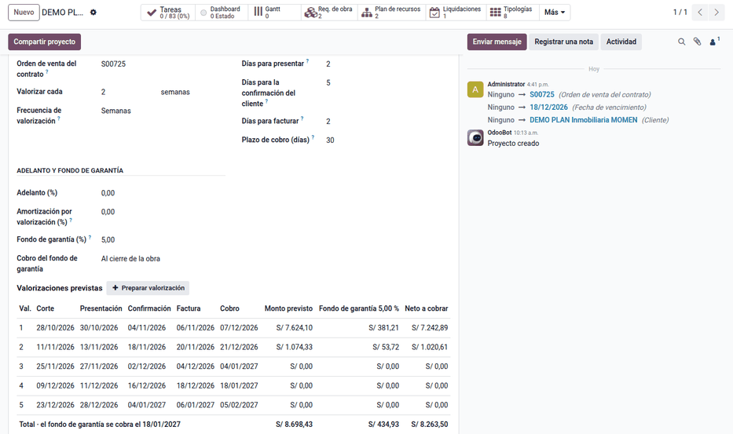
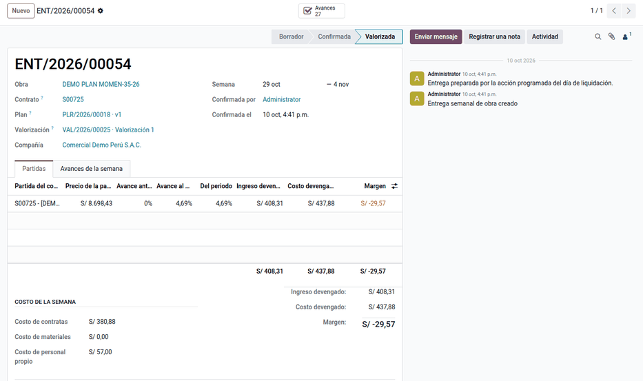
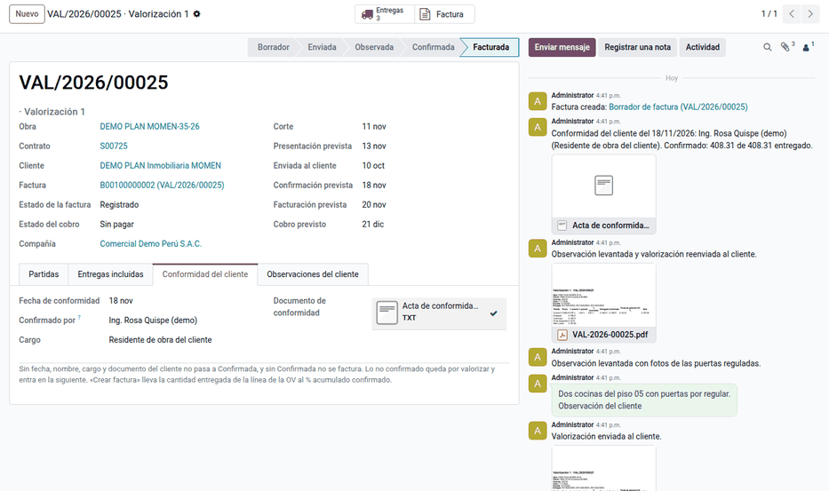

# Ruta del ingreso

La obra cobra por avance: cada semana la **entrega** devenga el ingreso de cada
partida del contrato (precio de la partida × su avance, con el material
consumido), la **valorización** agrupa las entregas confirmadas hasta un corte,
el cliente la observa y la confirma, y Administración y Finanzas factura lo
confirmado desde la orden de venta. El **calendario de la obra** da las fechas
previstas de cada paso.

## Obra desde la venta

Un servicio con **Crea obra** (producto, pestaña Ventas) crea la obra al
confirmar la venta. Si la orden lleva la **referencia del cliente** (el código
de obra, p. ej. `ROOFG-04-25`) y el **Nombre de la obra** (`ROOF GARDEN`), la
obra se llama `ROOFG-04-25 ROOF GARDEN`, toma la referencia como código de
obra y nace con su cuenta analítica y su ubicación.

## Configuración

1. La orden de venta del contrato lleva una línea por **partida**, con cantidad
   1 y un producto de servicio facturado por entregas. Con varias partidas, cada
   línea lleva su **familia** (columna opcional): cocina, closet… La familia
   dice qué ambientes pertenecen a la partida.
2. En **Ajustes ‣ Planificación de obra ‣ Ingresos**, revise los valores por
   defecto: frecuencia de valorización, días para presentar, para la
   confirmación del cliente y para facturar, plazo de cobro, adelanto y fondo de
   garantía. Elija también los **días hábiles del ingreso** (por ejemplo, un
   horario de lunes a viernes aunque la obra trabaje los sábados) y, si
   contabilidad lo decide, las cuentas del fondo de garantía y del adelanto.
3. En la obra, pestaña **Calendario e ingresos**, elija la orden de venta y
   revise el calendario.
4. Quien factura necesita el grupo **Planificación de obra: ingresos** y el de
   facturación.

## Calendario de la obra

La pestaña **Calendario e ingresos** de la obra calcula las valorizaciones
previstas desde cada corte:

- presentación = corte + días para presentar;
- confirmación = presentación + días del cliente;
- factura = confirmación + días para facturar;
- cobro = factura + plazo de cobro.

Una fecha que cae en un día no hábil o feriado pasa al siguiente día hábil, para
no adelantar ingresos. Los feriados son los del calendario de la compañía y,
con **Feriados de Perú** instalado, también los feriados nacionales de día
completo (no los de un solo régimen, como el 25 de octubre de construcción
civil). El cobro previsto es neto del fondo de garantía y de la
amortización del adelanto; el fondo se cobra al cierre de la obra o en una
fecha fija.

Ejemplo: la obra va del 12/10 al 18/12/2026, con semanas de jueves a miércoles y
valorización cada 2 semanas: cortes el 28/10, 11/11, 25/11, 09/12 y 23/12. Con 2
días para presentar, 5 para la confirmación, 2 para facturar y 30 de cobro, la
valorización 1 se presenta el 30/10, se confirma el 04/11, se factura el 06/11 y
se cobra el 07/12 (el 06/12 es domingo). La 5 se presentaría el viernes 25/12,
feriado: pasa al lunes 28/12, la confirmación al 04/01/2027 (el 02/01 es
sábado), la factura al 06/01 y el cobro al 05/02. El fondo de garantía (5 %) se
cobra al cierre.

## Entrega semanal

1. Cada día de liquidación, una acción programada prepara en borrador la entrega
   de la semana de cada obra (o **Ingresos ‣ Entregas semanales ‣ Actualizar**).
2. Por partida, la entrega muestra el **avance de la partida**: contratas a
   tarifa, horas a costo y material consumido a costo del plan, divididos entre
   lo planificado de la partida. El ingreso devengado es el precio de la partida
   × el avance de la semana; también muestra el costo y el margen.
3. La Jefatura de Proyectos la **Confirma**. Las entregas se confirman en orden
   y lo confirmado no cambia: un avance validado después entra en la entrega
   siguiente.

Ejemplo: la partida «Cocinas» vale S/ 159,231.23 y su plan S/ 170,764.10. Hasta
el 28/10 hay S/ 47,984.71 ejecutados a tarifa y a costo del plan (28.10 %); en la
semana del 29/10 al 04/11 se suman S/ 5,552.96 de contratas y S/ 19,786.00 de
material consumido y el avance llega a 42.94 %. El ingreso devengado es
159,231.23 × (42.94 % − 28.10 %) = S/ 23,627.65 (con el avance sin redondear),
el costo S/ 25,338.96 y el margen −S/ 1,711.31.

!!! note "Nota"
    El avance de la partida no es el del árbol de recursos. El del árbol mide
    contratas y personal propio, para pagar y controlar; el de la partida suma
    el material consumido y se divide entre todo lo planificado de la partida,
    para el ingreso.

## Valorización con el cliente

1. Al pasar el corte se prepara la valorización en borrador (o **Ingresos ‣
   Preparar valorización**) según la **Base de la valorización** de la obra
   (pestaña **Calendario e ingresos**):
    - **Entregas semanales**: las entregas confirmadas hasta el corte; entrega el
      avance de la última entrega menos lo ya confirmado.
    - **Avance validado de la partida**: una línea por partida de la venta con su
      avance validado al corte (lo ejecutado al costo del plan ÷ lo planificado
      de la partida), sin entregas, tipologías ni hitos.

    En las dos van el fondo de garantía y la amortización del adelanto. Las
    líneas de la venta de **gastos generales**, **imprevistos**, **utilidad** y
    **descuento** (campo **Rol en la obra** de la línea, que se propone por su
    nombre) no son partidas: no se crean como niveles de la obra ni entran al
    plan, y se valorizan en la proporción del costo directo valorizado; el
    descuento va como línea negativa.
2. Si hace falta, valorice una partida a otro porcentaje (ver [Porcentaje
   escrito a mano](#porcentaje-escrito-a-mano)).
3. Haga clic en **Enviar al cliente**: el PDF queda en el historial. Además de
   las partidas, muestra el avance por etapa y sub etapa de la obra, en el
   orden del árbol de etapas, y los porcentajes escritos a mano.
4. Si el cliente observa, registre la **Observación del cliente** con fecha y
   autor, levante las observaciones y reenvíe.
5. Con la conformidad, haga clic en **Confirmar** y registre la fecha, el nombre,
   el cargo y el documento del cliente. Las entregas pasan a **Valorizadas**. Lo
   que el cliente no confirma queda «por valorizar» y vuelve en la siguiente.

### Porcentaje escrito a mano

Cada partida de la valorización en borrador propone el **% de la regla** de la
vertical (el avance acumulado de la partida o sus hitos por unidad) y admite
otro en **% escrito**, con su **Motivo del porcentaje** obligatorio. La línea
queda **Manual**, con quién la escribió y cuándo; lo entregado y lo confirmado
pasan a ese porcentaje menos lo ya confirmado, y el historial de la
valorización guarda el cambio. El porcentaje no puede quedar por debajo de lo
ya confirmado al cliente.

Ejemplo: una partida con 42 % de avance calculado se valoriza al 50 % escrito,
con motivo. La valorización, su PDF y la descripción de la línea de la factura
muestran el 50 % marcado como manual.

## Facturar y cobrar

1. En la valorización confirmada, haga clic en **Crear factura**. La factura
   lleva la línea de la orden de venta con la cantidad al % acumulado confirmado
   (0.42 si el acumulado es 42.31 %) por el monto confirmado; el precio unitario
   se ajusta para que el subtotal sea exactamente lo confirmado. La valorización
   pasa a **Facturada**.
2. Por defecto, el fondo de garantía no va en la factura: la factura electrónica
   peruana no admite líneas negativas. Queda en la valorización y en el cobro
   previsto. Con una cuenta en Ajustes, va como línea negativa; la decisión es de
   contabilidad.
3. Tesorería concilia el pago o el extracto. **Ingresos ‣ Cobranza de la obra**
   lista las facturas de las valorizaciones y su estado de pago.

Ejemplo con los datos de demostración (solo el piso 05): la partida vale
S/ 8,698.43 y la valorización 1 entrega S/ 408.31 (4.69 %), con S/ 20.42 de
fondo de garantía y S/ 387.89 neto.

## Casos especiales

| Situación | Qué pasa | Qué hacer |
|---|---|---|
| No se prepara la entrega semanal | La obra no tiene orden de venta o plan vigente, o aún no es el día de liquidación | Elegir la orden de venta en **Calendario e ingresos**; esperar o crearla a mano |
| «Confirme primero las entregas anteriores» | Hay una entrega anterior en borrador | Confirmarlas en orden |
| «Tiene N partidas sin familia» | Más de una línea de la orden de venta sin familia | Poner la familia de cada partida |
| «Para confirmar la valorización falta…» | Falta fecha, nombre, cargo o documento del cliente | Completarlos |
| «No alcanza una unidad facturable» | El % confirmado es menor que la precisión de la cantidad (0.01) | Facturar con la siguiente valorización o subir la precisión de la unidad |
| «La factura … supera lo confirmado» | Se cambió la cantidad o el precio de la factura | Dejarla en lo confirmado |
| «Un porcentaje escrito a mano pide su motivo» | Falta el motivo del % escrito | Escribir el motivo |
| «… el porcentaje es menor que lo ya confirmado al cliente» | El % escrito no cubre lo ya confirmado | Escribir un porcentaje mayor |
| Las fechas previstas caen en sábado | El horario de la compañía trabaja los sábados | Elegir los días hábiles del ingreso en Ajustes |

!!! info "Ver también"
    - [Cronograma valorizado e inicio](valued_schedule.md)
    - [Ventas en Odoo 19](https://www.odoo.com/documentation/19.0/applications/sales/sales.html)
    - [Comprobante impreso](../../../../finance/fiscal_localizations/peru/electronic_invoicing/invoice_report.md)
