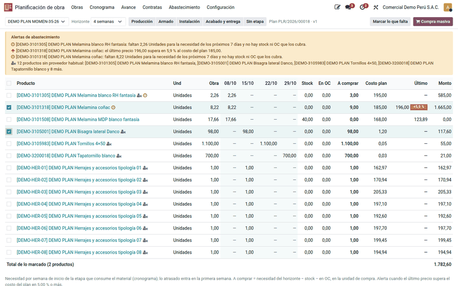
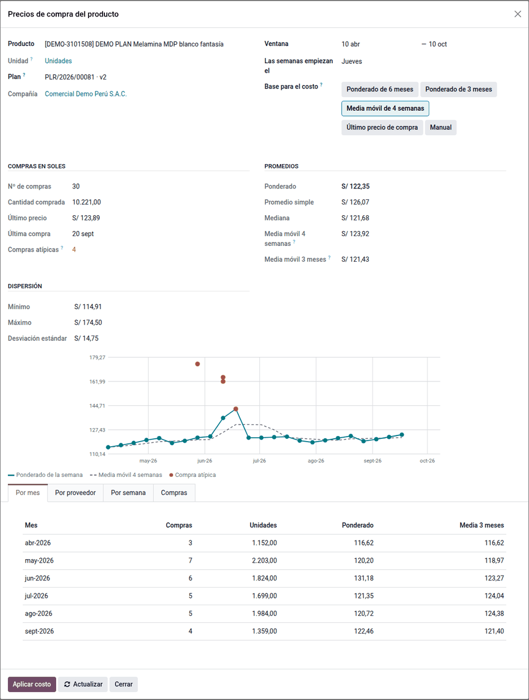
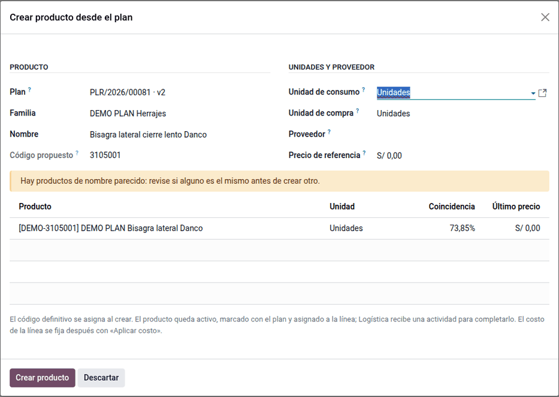

# Precios y abastecimiento

El planificador fija el costo de cada material mirando sus **precios de compra**
en soles, crea desde el plan el producto que todavía no existe, y Logística
compra desde el **abastecimiento de la obra** lo que falta para las próximas
semanas, con alertas de precio y de necesidad sin orden de compra.

## Configuración

1. En **Inventario ‣ Configuración ‣ Categorías de producto**, dé un **código de
   familia** de cuatro dígitos a cada categoría donde se crearán productos desde
   el plan.
2. En **Ajustes ‣ Planificación de obra ‣ Abastecimiento**, revise la **alerta
   de precio** (5 % por defecto): cuándo el último precio supera al del plan.
3. Los tipos de cambio de Odoo deben estar cargados: cada compra en otra moneda
   se convierte con el de su fecha.

## Precios de compra del producto

1. En una línea del plan, haga clic en el ícono de gráfico, o vaya a
   **Abastecimiento ‣ Precios de compra del producto**.
2. Revise la ventana (6 meses por defecto, editable). La pantalla toma las
   compras confirmadas del producto y convierte cada una a soles al tipo de
   cambio de Odoo de su fecha de aprobación, con el precio neto de descuento y
   en la unidad del producto.
3. Compare los estadísticos: ponderado, promedio simple, mediana, mínimo,
   máximo, desviación, último precio y medias móviles de 4 semanas y 3 meses,
   con el resumen por semana, mes y proveedor. El gráfico semanal marca en rojo
   las compras atípicas (fuera de 1.5 veces el rango intercuartílico).
4. Haga clic en **Aplicar costo** con la base elegida. Solo escribe en un plan
   en borrador.

Ejemplo: la melamina blanca tuvo 27 compras en seis meses: 24 a un proveedor en
dólares y 3 compras chicas en soles a otros. El ponderado es S/ 122.39 y la
media móvil de 4 semanas S/ 122.79 (la semana de la base y las 3 anteriores,
ponderadas por cantidad). El promedio simple sube a 127.34 porque las compras
chicas pesan igual que las grandes; esas compras (S/ 162 a 174.50) salen en
rojo. El planificador elige la media móvil y las líneas quedan con «Media móvil
de 4 semanas al 10/10/2026: 122.79».

Cálculo de comprobación con cinco compras:

| Fecha | Cant. | Precio en soles | Monto |
|---|---|---|---|
| 10/02 (S/) | 10 | 100.00 | 1,000.00 |
| 03/03 (US$ 30.00 × 3.70) | 10 | 111.00 | 1,110.00 |
| 10/03 (US$ 372 por docena = 31.00 × 3.80) | 24 | 117.80 | 2,827.20 |
| 12/03 (S/, atípica) | 5 | 150.00 | 750.00 |
| 20/03 (S/ 125 − 4 %) | 30 | 120.00 | 3,600.00 |

Ponderado 9,287.20 ÷ 79 = 117.56; mediana 117.80; media móvil de 4 semanas al
20/03 (semanas desde el jueves 27/02): 8,287.20 ÷ 69 = 120.10.

## Crear un producto desde el plan

1. En una línea del plan sin producto, haga clic en **Crear producto** (o en el
   plan, **Crear producto**).
2. Elija la familia, escriba el nombre y la unidad. Antes de crear, el asistente
   muestra los productos de nombre parecido con su porcentaje de parecido, para
   no duplicar.
3. Confirme. El producto se crea activo, con el código de su familia más un
   correlativo asignado al guardar, queda en la línea y marcado con el plan, y
   Logística recibe una actividad para completar marca, proveedor y cuentas.

Ejemplo: para unas bisagras, el asistente muestra «Bisagra push open copa 35 mm»
al 84 % y «Bisagra lateral Danco» al 45 %. Si es nuevo, recibe el código 3105701
cuando el mayor usado de la familia 3105 es 3105700 (aunque esté archivado); un
segundo planificador en la misma familia recibe 3105702.

Sin costo, la línea impide aprobar el plan hasta que se aplique el costo.

## Abastecimiento de la obra

1. Vaya a **Abastecimiento ‣ Abastecimiento de la obra** o haga clic en el botón
   del plan.
2. Por producto, la pantalla muestra:
    - la necesidad por semana de inicio de la etapa que lo consume (planificado
      menos consumido), en el horizonte elegido;
    - el stock libre en la obra y en el central (sin lo reservado);
    - lo que viene en OC confirmadas con la analítica de la obra;
    - lo que hay que comprar, en la unidad de compra;
    - el costo del plan, el último precio y las alertas.
3. Marque las filas y haga clic en **Compra masiva**.

Alertas: precio sobre el plan (umbral de Ajustes), necesidad sin OC a menos de
una semana y producto sin proveedor habitual.

Ejemplo: la melamina blanca tiene 330.82 planchas en la obra; por semana de
inicio de la etapa que la consume necesita 36.07, 52.02, 52.02 y 52.02 (4
semanas = 192.13). Hay 40 libres en el central y 96 en una OC con la analítica
de la obra: a comprar 192.13 − 40 − 96 = 56.13 → 57 planchas, a S/ 122.79 del
plan = S/ 6,999.03. La melamina coñac (plan 228.07) se compró a 239.42: +5.0 %,
alerta con el umbral del 5 %.

## Casos especiales

| Situación | Qué pasa | Qué hacer |
|---|---|---|
| Sin compras en los precios de compra | No hay OC confirmadas del producto en la ventana o son de otra compañía | Ampliar la ventana o fijar el costo a mano |
| Precio en soles raro de una compra en dólares | Falta el tipo de cambio de esa fecha (se usa el anterior) | Cargar la tasa en **Contabilidad ‣ Monedas** |
| «Elija el plan en borrador» | **Aplicar costo** solo escribe en un plan en borrador | Elegir el plan o crear una nueva versión |
| La familia no aparece en **Crear producto** | La categoría no tiene código de familia | Ponerle sus 4 dígitos |
| «La unidad de compra se guarda en el proveedor» | Unidad de compra distinta sin proveedor | Indicar el proveedor o usar la unidad de consumo |
| **Compra masiva** del tablero no abre | El plan no está aprobado o en ejecución | Aprobar el plan |
| «Sin proveedor habitual» | El producto no tiene proveedor ni compras confirmadas | Que Logística complete el producto |

!!! info "Ver también"
    - [Generar el plan](generate_plan.md)
    - [Asignaciones y compras](supply.md)
    - [Tipo de cambio](../../../../finance/fiscal_localizations/peru/exchange_rates.md)
