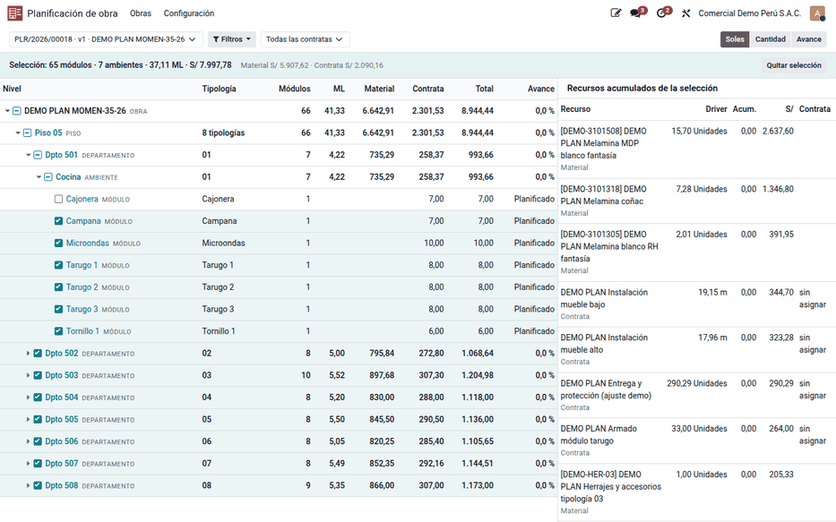
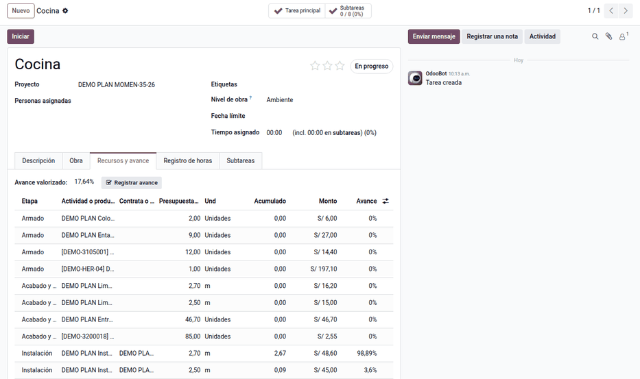

# Árbol de recursos

El **Árbol de recursos** muestra la obra como árbol (obra › piso › departamento ›
ambiente › módulo) con los recursos de cada nivel acumulados: módulos, ML,
material, contrata, total y avance. Permite seleccionar en cascada un piso, un
departamento o un ambiente y actuar sobre toda la selección: comprar, pedir,
fabricar, asignar contratas o cuadrillas, registrar avance o cambiar fechas.

## Recorrer el árbol

1. Vaya a **Planificación de obra ‣ Obras ‣ Árbol de recursos**, o haga clic en
   **Árbol de recursos** en el plan.
2. Abra cada nivel con la flecha: se carga a demanda, para que una obra con
   miles de módulos siga siendo ágil. Cada fila trae sus módulos, ML, material,
   contrata y total.
3. Cambie la **Medida**: soles, cantidad de driver o avance.
4. Use los **Filtros**: etapa, tipo de recurso, estado del módulo y contrata.

En el piso 05 de la demostración:

| Fila | Módulos | ML | Material | Contrata | Total |
|---|---|---|---|---|---|
| Piso 05 | 66 | 41.33 | 6,642.91 | 2,301.53 | 8,944.44 |
| Dpto 501 | 7 | 4.22 | 735.29 | 258.37 | 993.66 |

Con el filtro de etapa **Instalación**, el piso 05 muestra S/ 941.17 de contrata.

!!! note "Nota"
    El filtro **Estado del módulo** solo aplica a lo que cuelga de un módulo:
    con él, no se ven la instalación ni las actividades por ambiente.

## Seleccionar

- **Marcar** un piso marca todos sus departamentos, ambientes y módulos. La
  barra de selección muestra, por ejemplo, «66 módulos · 8 ambientes · 41.33 ML
  · S/ 8,944.44».
- **Desmarcar** un módulo deja al ambiente, al departamento y al piso con un
  guion (selección parcial), y la barra pasa a 65 módulos.
- El panel **Recursos acumulados de la selección** lista cada actividad,
  material o rol con su cantidad de driver, lo ejecutado, el monto y la contrata
  asignada («sin asignar» si falta). **Ver solo lo que no tiene contrata**
  filtra contratas y personal sin asignar.
- Los botones de la barra abren los asistentes sobre la selección: compra
  masiva, requerimiento de obra, orden de fabricación, asignar contrata,
  asignar cuadrilla, registrar avance y cambiar fechas.

## Avance de cada nivel

El avance de un nivel es **valorizado**: Σ ejecutado × costo ÷ Σ planificado de
las contratas y el personal propio del nivel. Pondera por valor porque las
unidades de driver de distintas actividades no se suman. Nadie escribe un
porcentaje: la contrata reporta unidades de driver y el sistema compara contra
lo presupuestado (ver [Contratas](contractors.md)).

La pestaña **Recursos y avance** de cada piso, departamento, ambiente o módulo
(en **Proyecto**) muestra sus líneas con lo planificado, lo ejecutado y el
avance.

El estado del módulo sigue al avance validado: con todo su armado validado pasa
a **Producido**; con toda la instalación de su ambiente (o del módulo, si las
actividades cuelgan de él), a **Instalado**.

!!! info "Ver también"
    - [Asignaciones y compras](supply.md)
    - [Contratas y liquidación semanal](contractors.md)
    - [Planificación de obra](../planning.md)
