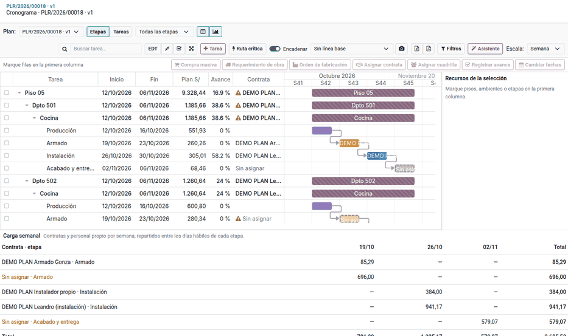
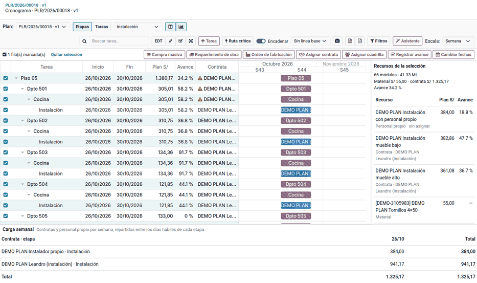

# Cronograma con recursos

El **Cronograma de la obra** es el [diagrama de Gantt](../../gantt.md) de la obra con una
barra por sub etapa de cada ambiente (1.1 Producción de piezas, 1.2 Armado,
2.1 Instalación, 2.2 Acabado y 2.3 Limpieza en mobiliario), con su contrata o
cuadrilla, su monto y su avance. Desde él se
asignan recursos a una selección, se mueven etapas arrastrándolas y se ve la
carga semanal de cada contrata.

## Abrir el cronograma

1. Vaya a **Planificación de obra ‣ Obras ‣ Cronograma ‣ Cronograma de la obra**, o haga clic en **Cronograma**
   en el plan.
2. Al generar el plan, cada ambiente recibe sus etapas con líneas, una semana
   por etapa desde el inicio del plan. Contrata, cuadrilla, monto y avance salen
   de las líneas.
3. Las barras sin contrata ni cuadrilla se ven claras.
4. Cada etapa padre es una **barra resumen** bajo el ambiente, con sus sub
   etapas como barras hijas encadenadas en el orden del perfil.
5. La **carga semanal**, debajo del diagrama, suma por contrata y etapa los
   montos de contratas y personal propio, repartidos entre los días hábiles de
   cada etapa.

Ejemplo, piso 05 desde el lunes 12/10/2026:

| Etapa | Semana | Contrata | Monto del piso |
|---|---|---|---|
| 1.1 Producción de piezas | 12/10 – 16/10 | (material) | — |
| 1.2 Armado | 19/10 – 23/10 | Sin asignar | según tipologías |
| 2.1 Instalación | 26/10 – 30/10 | Sin asignar | 941.17 |
| 2.2 Acabado | 02/11 – 06/11 | Sin asignar | según tipologías |

Las barras resumen **1 Producción** y **2 Instalación** van del 12/10 al 23/10
y del 26/10 al 06/11.

Los S/ 941.17 de instalación caen en la carga de la semana del 26/10.

!!! note "Nota"
    En el modo **Etapas**, los pisos y departamentos muestran el resumen de sus
    etapas, no sus propias fechas. Para editar las tareas, use el modo **Tareas**
    o el Gantt de Proyecto.

## Asignar recursos desde el cronograma

1. Elija las etapas en el filtro de etapas, un árbol con casillas: marcar una
   etapa padre marca sus sub etapas, y desmarcar una sub etapa deja a la
   etapa padre en selección parcial. El filtro acota las filas, la selección
   y la carga semanal.
2. Marque las casillas: marcar un piso marca sus departamentos, ambientes y
   etapas. El panel muestra los recursos de la selección agrupados por tipo de
   recurso, con el subtotal de cada tipo; **Por etapa** los subagrupa por
   etapa y sub etapa.
3. Use los botones de la barra: **Asignar contrata**, **Asignar cuadrilla**,
   **Compra masiva**, **Requerimiento de obra** o **Cambiar fechas**.
   **Insumo-producto** abre la [matriz insumo-producto](resource_tree.md#matriz-insumo-producto)
   de la selección (o de la obra, sin selección).

Ejemplo: con la etapa **2.1 Instalación** y la casilla del piso 05, **Asignar
contrata** se abre con las 8 actividades del piso y S/ 941.17. Con la contrata
asignada, las barras de instalación muestran su nombre y dejan de ser claras.

## Mover etapas

Arrastre una barra de etapa a otra fecha. Las fechas de necesidad de sus líneas
se desplazan lo mismo; las de las otras etapas no cambian. Los requerimientos de
obra y las compras con fecha anterior a la nueva necesidad reciben una sola
actividad «Fechas del plan cambiadas» para Logística, aunque se muevan varias
barras. Con **Encadenar**, si una etapa pisa la siguiente, la siguiente se corre
al lunes siguiente.

Ejemplo: mover las barras de instalación del piso 05 a la semana del 02/11
desplaza 7 días la necesidad de sus líneas (los tornillos, por ejemplo).

!!! warning "Importante"
    Arrastrar etapas exige permiso de escritura en las tareas del proyecto.

!!! info "Ver también"
    - [Diagrama de Gantt](../../gantt.md)
    - [Contratas y liquidación semanal](contractors.md)
    - [Control y personal propio](control.md)
