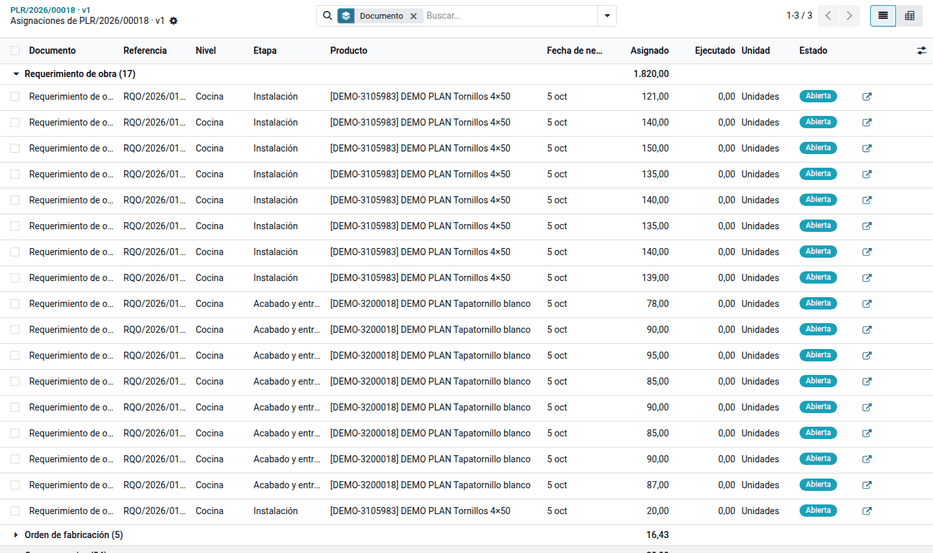
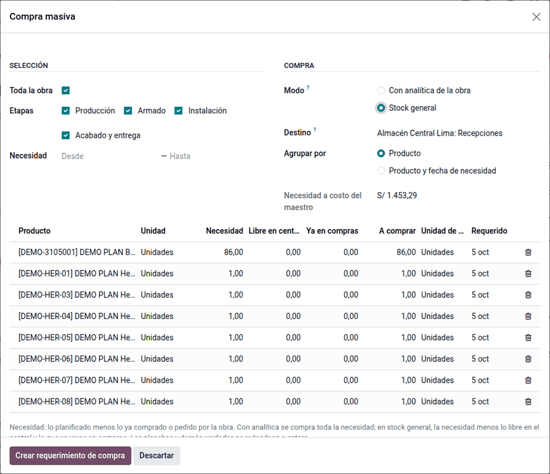
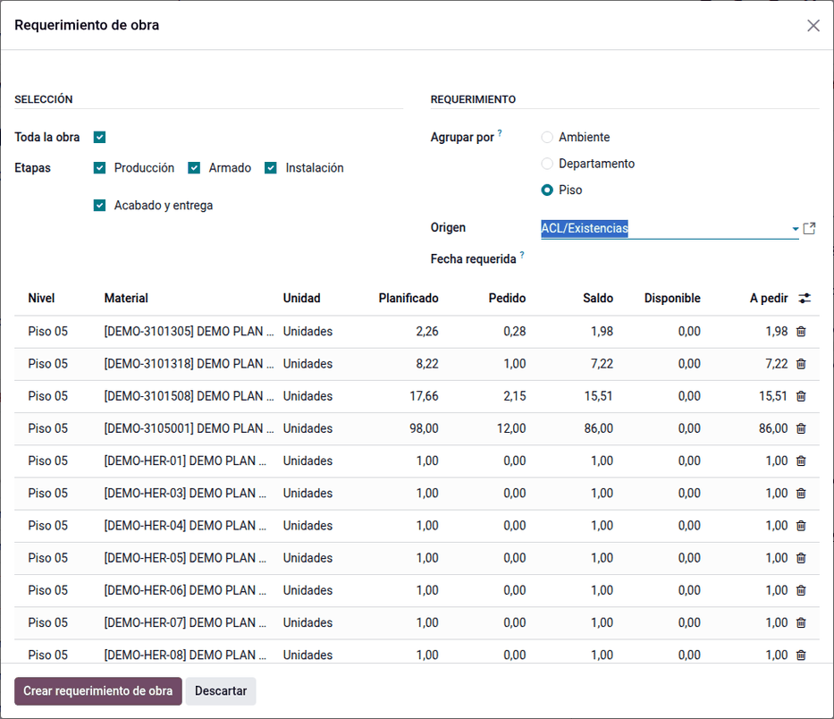

# Asignaciones y compras

Con el plan aprobado, la compra masiva, los requerimientos de obra y las
órdenes de fabricación nacen de la selección del [árbol de recursos](resource_tree.md)
y descuentan el saldo de cada línea. Cada documento queda **asignado** a las
líneas del plan que cubre, así el plan sabe en todo momento qué está pedido,
comprado, despachado y consumido, y el control de exceso impide pedir más de
lo planificado sin una justificación.

## Configuración

- El plan debe estar **Aprobado** o **En ejecución**: los asistentes trabajan
  sobre el plan vigente.
- El planificador necesita los grupos de **requerimientos de compra**, de
  **requerimientos de obra** y, para las órdenes de fabricación, de
  **fabricación**.
- La política de exceso y la tolerancia vienen de la compañía y de la obra, y
  cada plan las puede cambiar en su pestaña **Políticas** (ver [Control de
  consumo](#control-de-consumo)).
- La regla «Exceso sobre el plan: jefatura del planificador» del requerimiento
  de obra viene con el módulo (**Requerimientos de obra ‣ Configuración ‣
  Reglas de aprobación**). Solo actúa cuando la política de **materiales**
  aplicada al requerimiento es **Aprobación adicional**: con materiales en
  **Solo alerta**, el exceso se avisa y el requerimiento sigue sin revisión,
  aunque la política general del plan pida aprobación. Sus revisores necesitan
  también el grupo de aprobador del requerimiento para verlo.

## Conceptos

- **Necesidad**: lo planificado menos lo ya comprado o pedido.
- **Saldo del plan**: lo planificado menos lo pedido por requerimientos de obra
  y órdenes de fabricación. La compra masiva sube lo comprado, no lo pedido.
- **Reparto**: una compra para varias cocinas se reparte por fecha de
  necesidad: primero la que se necesita antes, hasta su saldo; el redondeo o el
  exceso va a la última.
- **Estado de la línea**, en este orden: **Excedida** (pedido mayor que lo
  planificado más la tolerancia), **Completa** (llegó a la obra lo
  planificado), **En compra** (compra masiva abierta o faltante en compra),
  **Parcial** y **Planificada**.

## Control de consumo

Cada documento que pide recursos del plan se compara con su saldo. Si pide más
de lo que queda (más la tolerancia) o repite lo ya pedido, actúa la política:

| Política | Qué pasa |
|---|---|
| Solo alerta | Se avisa y basta confirmar |
| Aprobación adicional | La justificación es obligatoria y decide la jefatura de proyectos |
| Bloquear | El documento no sigue |

### Dónde se define

1. **Ajustes ‣ Planificación de obra ‣ Control de consumo**: la política por
   defecto de las obras nuevas (**Si se excede el saldo del plan** y
   **Tolerancia sobre el saldo (%)**) y, si hace falta, una por tipo de
   recurso.
2. **Proyecto ‣ Ajustes ‣ Control de consumo**: la obra la recibe de la
   compañía y la puede cambiar.
3. Pestaña **Políticas** del plan: el plan la hereda de la obra al crearse y
   la puede cambiar mientras está en borrador.

Las políticas por tipo de recurso (grupo **Por tipo de recurso** del plan)
dejan una regla distinta para cada clase de documento; vacías, se usa la
general:

| Política | Se aplica en |
|---|---|
| Materiales | Requerimiento de obra y OC con la analítica de la obra (también servicio y equipo) |
| Contratas | **Asignar contrata**: alcance por encima de lo que queda de la actividad en la selección (alcance adicional en la OC de servicio) |
| Producción | Confirmar una orden de fabricación |

### Pedido repetido de un nivel y sub etapa

Si los recursos de material de un nivel en una sub etapa ya se pidieron
completos, un requerimiento nuevo para ese nivel y sub etapa es una
**repetición**: pasa por la política aunque el producto todavía tenga saldo.
Así, con **Aprobación adicional**, un segundo requerimiento de melamina para
un mueble cuya producción de piezas ya se pidió al 100 % espera a la jefatura.

### Registro de excesos autorizados

Cada exceso o repetición que autoriza la jefatura queda en **Informes ‣ Plan ‣
Excesos autorizados** (y en el botón **Excesos** del plan) con su tipo, nivel,
etapa, producto o actividad, cantidad, monto, motivo, quién lo autorizó,
cuándo y el documento (**Abrir el documento**). Allí también quedan los
pagos repetidos, los re-trabajos y los porcentajes manuales de las
[liquidaciones de contratas](contractors.md#pago-repetido-re-trabajo-y-porcentaje-manual).

## Compra masiva

1. Seleccione en el árbol (o en el plan, el cronograma o el
   [abastecimiento de la obra](prices_supply.md)) y haga clic en **Compra
   masiva**.
2. Revise las cantidades, redondeadas a la unidad de compra, y confirme. Se crea
   un requerimiento de compra (OCA) en borrador con sus asignaciones.

La compra masiva entra siempre como **stock general**: compra para el almacén
central, descontando lo libre en el central y lo que ya viene en compras, sin
analítica de la obra. El comprado sube en las líneas del plan y el costo cae a
la obra al consumir el material. Compras la junta con las de otras obras en una
sola orden: vea
[Compra masiva consolidada](../material_requests.md#compra-masiva-consolidada).

Ejemplo, solo la etapa de Producción del piso 05:

| Material | Necesidad | A comprar |
|---|---|---|
| Melamina MDP blanco fantasía | 17.66 | 18 planchas |
| Melamina coñac | 8.22 | 9 planchas |
| Melamina blanco RH fantasía | 2.26 | 3 planchas |

El requerimiento de compra lleva 24 asignaciones (una por cocina y material, 30
planchas): la primera cocina que se necesita recibe su parte y el redondeo va a
la última.

## Requerimiento de obra

1. Seleccione en el árbol o el plan y haga clic en **Requerimiento de obra**.
2. Agrupe por ambiente, departamento o piso. Cada línea muestra el saldo del
   plan y su control.
3. Confirme: se crea un [requerimiento de materiales](../material_requests.md) en
   borrador, con la tarea del nivel en cada línea.
4. Al **Solicitar aprobación**, el requerimiento compara lo pedido con el saldo
   del plan más la tolerancia (y si repite un nivel y sub etapa ya pedidos) y
   aplica la política de materiales del plan:
    - **Avisar**: basta confirmar el aviso;
    - **Pedir aprobación**: se abre el asistente de exceso, la justificación es
      obligatoria y el requerimiento recibe la revisión adicional «Exceso sobre
      el plan: jefatura del planificador»;
    - **Bloquear**: no se envía.

El residente no ve el plan: ve el saldo y el control en su requerimiento.

Ejemplo: el requerimiento del piso 05 para instalación y acabado pide 1,100
tornillos 4×50 y 700 tapatornillos, cada línea con la tarea «Piso 05» y 8
asignaciones (una por cocina): control **En plan**. Un segundo requerimiento
del Dpto 501 pide 20 tornillos más; su saldo ya es 0 y la columna **Control**
dice «Excede 20». Con la política **pedir aprobación**, la justificación
«Reposición por piezas dañadas en el traslado» pasa a la jefatura.

## Orden de fabricación

1. Seleccione en el árbol o el plan y haga clic en **Orden de fabricación**.
2. Agrupe por piso o por la selección y elija la planta y la fecha. La orden
   lleva el producto de la tipología, la cantidad de ambientes y los
   componentes de su lista de materiales.
3. Al **Confirmar** la orden se controla el saldo de sus líneas de producción y
   armado con la política de producción del plan; el exceso de una orden de
   fabricación lo confirma la jefatura del planificador y queda en **Excesos
   autorizados**.
4. Al cerrarla, sus consumos suben lo consumido y la línea pasa a **Completa**.

Ejemplo: la orden del Dpto 502 fabrica 1 «Cocina tipo 02» y se asigna a las
líneas de producción y armado de esa cocina (melamina blanca 2.15, coñac 1.00,
RH 0.28, bisagras 12 y un herraje). Los tornillos y tapatornillos de la lista
(instalación y acabado) no se asignan: van a la obra con el requerimiento.

## Seguimiento

**Planificación de obra ‣ Abastecimiento ‣ Asignaciones del plan** (o el botón
del plan) lista lo asignado por documento y producto, con lo ejecutado y su
estado, también en pivote. Las líneas del plan muestran pedido, comprado,
despachado, consumido, saldo por pedir y su estado. Lo consumido cuenta lo que
sale de la ubicación de la obra a una ubicación de consumo.

En **Inventario ‣ Información general**, el resumen de los tipos de operación
(recepciones, despachos a obra, traslados) se muestra compacto: tarjetas más
angostas, sin gráficos y con los indicadores en español (*Con demora*, *En
espera*, *Órdenes parciales*, *Movimientos*).

## Casos especiales

| Situación | Qué pasa | Qué hacer |
|---|---|---|
| «El plan … no está vigente» | Los asistentes trabajan sobre el plan aprobado o en ejecución | Aprobar el plan |
| El asistente no propone un material | Ya no tiene saldo o su etapa no está marcada | Revisar las etapas y las asignaciones de la línea |
| «Pide más de lo que queda en el plan … bloquear» | La política del plan es bloquear | Reducir la cantidad o replanificar |
| El requerimiento pide aprobación aunque el producto tiene saldo | El nivel y la sub etapa ya se pidieron completos (repetición) | Justificarlo para la jefatura o pedirlo en otro nivel |
| «Fuera de plan» en el requerimiento | El material no está en el plan bajo el nivel de la línea | Pedirlo en el nivel correcto o justificarlo |
| «El exceso lo aprueba la jefatura de proyectos» | Política «pedir aprobación» en una OF | Que la jefatura de proyectos confirme la OF |
| Consumido en cero en material de obra | No hay salidas de la ubicación de la obra a consumo | Registrar el consumo en obra |

!!! info "Ver también"
    - [Requerimientos de materiales](../material_requests.md)
    - [Precios y abastecimiento](prices_supply.md)
    - [Control y personal propio](control.md)
    - [Fabricación en Odoo 19](https://www.odoo.com/documentation/19.0/applications/inventory_and_mrp/manufacturing.html)
