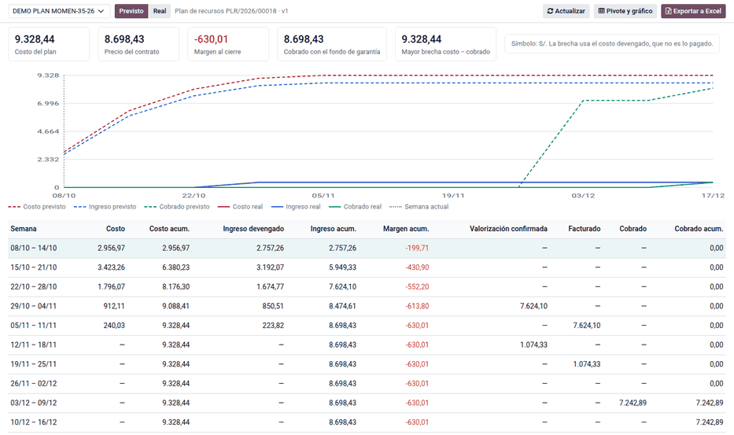
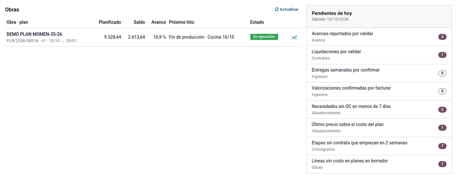

# Cronograma valorizado e inicio

El **cronograma valorizado** muestra la obra de un vistazo: por semana, el
costo, el ingreso devengado, el margen, lo valorizado, lo facturado y lo
cobrado, en dos escenarios (plan y real), con la curva S. El **inicio** de la
aplicación lista las obras con su próximo hito y lo que cada usuario tiene que
atender hoy.

## Configuración

1. Lo ven la Jefatura (**Administrador** del planificador) y Administración y
   Finanzas (**Planificación de obra: ingresos**).
2. Necesita la orden de venta del contrato de la obra (ver
   [Ruta del ingreso](income.md)).
3. En **Proyecto ‣ Ajustes ‣ Supervisión de obra**, indique los **Supervisores
   de obra**. Con el responsable del proyecto, son las obras de cada supervisor.

## Cronograma valorizado

1. Vaya a **Planificación de obra ‣ Reportes ‣ Cronograma valorizado**, o haga
   clic en el botón de la obra o en el ícono de gráfico del inicio.
2. Elija la obra y el escenario:
    - **Plan**: cada línea del plan se reparte en los días hábiles de su etapa
      (lunes a viernes) y el ingreso sale del avance previsto de cada partida y
      del calendario de la obra; la última semana absorbe el redondeo;
    - **Real**: lo ejecutado valorizado, las entregas y valorizaciones
      confirmadas, las facturas publicadas (sin IGV) y los cobros conciliados,
      en proporción a la base imponible.
3. Revise la curva S (costo, ingreso y cobrado acumulados: la brecha de caja de
   la obra) y la tabla semanal. **Excel** la exporta; **Análisis del cronograma
   valorizado** abre las mismas filas en pivote y gráfico por obra, semana,
   concepto y escenario.

El cronograma se recalcula al abrirlo (para esa obra) y cada día con la acción
programada «Planificación de obra: actualizar el cronograma valorizado»; el
pivote lee la última actualización. El plan es siempre el de la versión
vigente, o el de la versión en preparación si aún no hay una aprobada.

!!! note "Nota"
    Es un reporte de gestión: el costo es devengado (lo ejecutado al costo del
    plan), no lo pagado ni lo contabilizado, y los montos van sin IGV. Por eso no
    coincide con la contabilidad.

Ejemplo: con la partida de S/ 159,231.23, un plan de S/ 170,764.10 y las etapas
repartidas entre el 12/10 y el 18/12, el escenario plan cierra el costo en
S/ 170,764.10 y el ingreso en S/ 159,231.23: margen −S/ 11,532.87. La
valorización 2 (corte del 11/11) aparece confirmada en la semana 12/11–18/11
(conformidad prevista el 18/11), facturada en la 19/11–25/11 (20/11) y cobrada
en la 17/12–23/12 (21/12), por su neto sin el 5 % del fondo. Con el fondo de
garantía (fila «al cierre»), el cobrado acumulado llega a S/ 159,231.23.

En el escenario real, S/ 29,975.79 de material consumido el 20/10 caen en la
semana 15/10–21/10, S/ 18,008.92 de contrata del 22/10 en la 22/10–28/10 y
S/ 25,338.96 en la 29/10–04/11.

## Inicio

Al abrir **Planificación de obra**, el **Inicio** muestra:

- **Obras**: cada obra con su plan, lo planificado, el saldo, el avance, el
  próximo hito (corte, presentación, confirmación, factura o cobro) y su estado;
- **Pendientes de hoy**: lo que el usuario tiene que atender según sus grupos.
  Cada fila abre la lista filtrada.

Cada grupo ve sus pendientes: el supervisor, los avances y liquidaciones por
validar de sus obras (si no supervisa ninguna, los de todas); la Jefatura, los
de todas más las entregas por confirmar; Finanzas, las valorizaciones
confirmadas por facturar; Logística, las alertas de abastecimiento, que abren
el tablero de la obra.

Ejemplo: el jueves 05/11 la obra muestra su plan (v1 · 12/10 → 18/12), lo
planificado, el saldo, el avance y el próximo hito «Valorización 1 · factura
06/11».

## Casos especiales

| Situación | Qué pasa | Qué hacer |
|---|---|---|
| Sin ingreso, valorización ni cobro | La obra no tiene orden de venta del contrato | Elegirla en **Calendario e ingresos** |
| Todo el ingreso del plan cae en las primeras semanas | Las etapas del ambiente no tienen fechas | Revisar el [cronograma](schedule.md) |
| El costo real está en cero | La obra no empezó o no hay avances validados, horas ni consumos | Validar avances y registrar consumos |
| El cobro real no aparece | El pago no está conciliado con la factura | Conciliar el extracto o el pago |
| El supervisor no ve un avance en su inicio | No es responsable ni supervisor de esa obra | Agregarlo en **Supervisión de obra** |
| Un pendiente no aparece | El grupo del usuario no lo atiende | Es lo esperado; revisar los grupos |

!!! info "Ver también"
    - [Ruta del ingreso](income.md)
    - [Control y personal propio](control.md)
    - [Planificación de obra](../planning.md)
