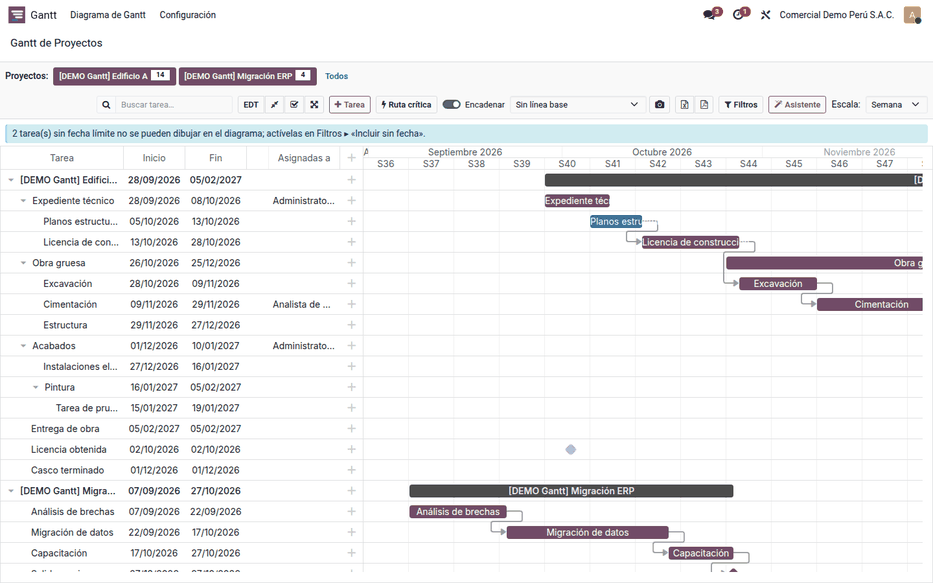
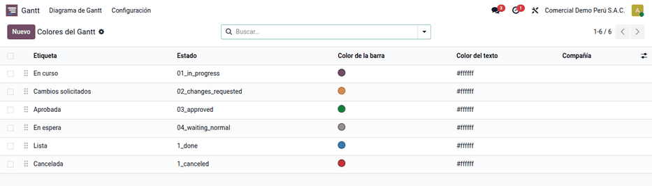
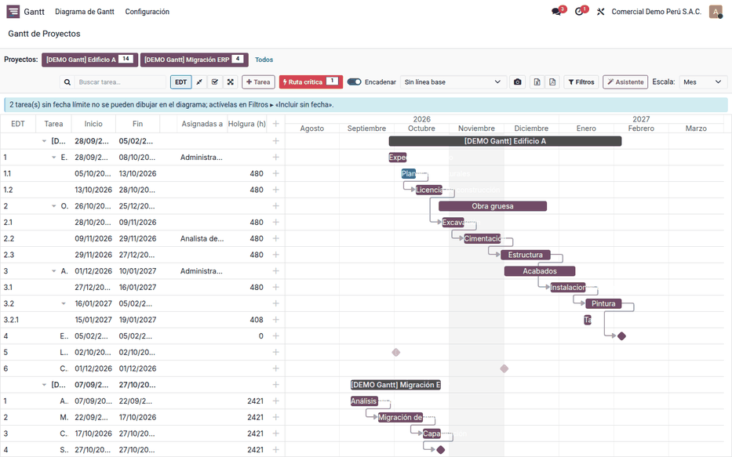
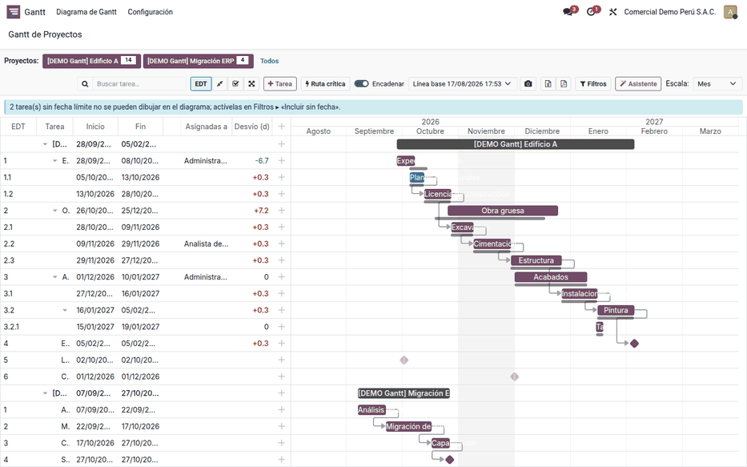
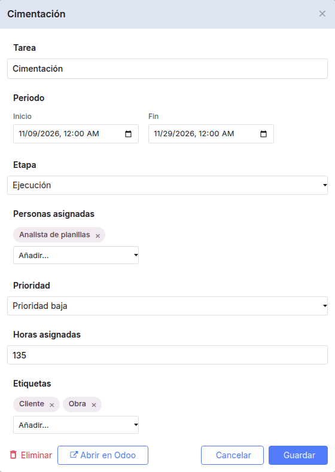

# Diagrama de Gantt

La aplicación **Gantt** muestra uno, varios o todos los proyectos como un
diagrama de barras editable con el ratón, con ruta crítica, líneas base,
filtros, EDT y exportación a Excel y PDF. La usan jefes de proyecto,
planificadores y gerencia para ver y ajustar el cronograma sin salir de Odoo.
Trabaja sobre las tareas y proyectos nativos de la aplicación Proyecto, con sus
mismos permisos, y funciona en Community y Enterprise sin usar la vista Gantt
de Enterprise.

## Configuración

1. Instale **Gantt de Proyectos — Backend** (`al_project_gantt_backend`).
   Instala solo el núcleo común (`al_project_gantt_base`), que también usan
   la [página web del Gantt](gantt_website.md) y el
   [asistente de IA](gantt_ai.md).
2. Vaya a **Ajustes ‣ Usuarios** y dé a quien lo necesite el permiso
   **Gantt de Proyectos: Usuario** (o **Administrador**). Los administradores
   de Proyecto lo reciben al instalar.
3. Revise que las tareas tengan **Fecha límite**; con Enterprise, también la
   fecha de inicio planificada. Una tarea sin fecha de fin no se dibuja.
4. Opcional: en **Gantt ‣ Configuración ‣ Colores por estado**, elija el color
   de las barras para cada estado de tarea. Con la planificación de obra
   instalada, la opción está en **Planificación de obra ‣ Configuración ‣
   Colores del Gantt**.

!!! note "Nota"
    Con la [planificación de obra](construction/planning.md) instalada, la
    aplicación **Gantt** no aparece en el menú principal: sus opciones pasan a
    **Planificación de obra**, para no tener dos accesos al mismo diagrama. Si
    se desinstala la planificación, la aplicación vuelve a aparecer.

### Parámetros del sistema

En **Ajustes ‣ Técnico ‣ Parámetros del sistema** (modo desarrollador):

| Parámetro | Valor por defecto | Para qué |
|---|---|---|
| `al_gantt.task_limit` | 2 000 | Tareas que se leen por consulta (máximo 20 000). Si hay más, el resultado se marca como recortado |
| `al_gantt.default_duration_hours` | 8 | Duración de una tarea sin fecha de inicio: empieza 8 horas antes de su fin |
| `al_gantt.field_map` | — | Otros campos de fecha para el inicio y el fin |

## Conceptos

| Término | En pantalla |
|---|---|
| Barra | Periodo de la tarea; el color indica su estado |
| Flecha | Dependencia fin-comienzo: la sucesora no empieza hasta que termina la predecesora |
| Rombo | Hito del proyecto o tarea de duración cero |
| Trama | Tarea que el usuario no puede modificar |
| Punto rojo, naranja o verde | Actividad atrasada, para hoy o planificada |
| EDT | Código jerárquico de la tarea: 1, 1.1, 1.2… |
| Holgura (h) | Horas que una tarea puede retrasarse sin mover el fin del proyecto |
| Ruta crítica | Cadena de tareas con holgura 0: si se retrasan, se retrasa el proyecto |
| Línea base | Foto inmutable del plan, para medir el desvío |
| Desvío (d) | Fin actual menos fin en la línea base, en días |

## Abrir el diagrama

1. Vaya a **Gantt ‣ Diagrama de Gantt** (con la planificación de obra
   instalada, **Planificación de obra ‣ Obras ‣ Cronograma ‣ Gantt de proyectos**), o
   abra un proyecto en **Proyecto** y
   haga clic en el botón **Gantt**, que muestra cuántas tareas tiene
   planificadas y abre el diagrama acotado a ese proyecto.
2. Elija los proyectos con los botones de la barra, o **Todos**.
3. Cambie la **Escala** (Día, Semana, Mes o Trimestre) y active **EDT** para
   ver el código de cada tarea.
4. Con **Filtros**, acote por personas, estado y rango de fechas, o active
   **Incluir sin fecha** para ver las tareas sin fecha límite.

!!! note "Nota"
    Los días no laborables se sombrean, pero solo se aprecian en la escala
    **Día**. No cambian las fechas al reprogramar.

## Analizar el plan

### Ruta crítica

Haga clic en **Ruta crítica**. El diagrama resalta las tareas críticas y
agrega la columna **Holgura (h)**. Una tarea paralela con tres días de margen
muestra 72 (3 × 24 horas).

### Línea base

1. Haga clic en el botón de la cámara para guardar una línea base: una foto
   del plan en ese momento.
2. Elija la línea base en el desplegable **Sin línea base**. Cada tarea
   muestra una barra gris con el plan original y la columna **Desvío (d)**:
   positivo y en rojo si termina después; negativo y en verde si se adelantó.

Una línea base no se corrige: para otra foto, cree una nueva.

## Editar el cronograma

- **Arrastre** una barra para moverla o estírela para cambiar su duración.
- **Enlace** dos barras para crear una dependencia. El sistema rechaza una
  dependencia que formaría un ciclo.
- **Doble clic** abre un formulario corto con nombre, fechas, avance y
  personas asignadas. **Abrir en Odoo** lleva a la ficha completa (descripción,
  chatter, adjuntos).
- **Clic derecho** abre el menú de la tarea: añadir subtarea, indentar,
  eliminar o planificar una actividad.

Cada cambio se guarda al momento con los permisos de Proyecto del usuario. Si
el servidor lo rechaza, se avisa y el diagrama se recarga.

### Encadenar

Con **Encadenar** activo, mover una tarea hacia adelante empuja a sus sucesoras
lo justo para que empiecen cuando termina su predecesora, y cada una conserva
su duración. Mover una tarea hacia atrás no adelanta a las demás.

Ejemplo con tres tareas encadenadas fin-comienzo, al retrasar **Excavación**
5 días:

| Tarea | Duración | Antes | Después |
|---|---|---|---|
| Excavación | 12 días | 28/10 – 09/11 | 02/11 – 14/11 |
| Cimentación (depende de Excavación) | 20 días | 09/11 – 29/11 | 14/11 – 04/12 |
| Estructura (depende de Cimentación) | 28 días | 29/11 – 27/12 | 04/12 – 01/01 |

!!! note "Nota"
    El avance de la tarea se edita si está instalada la aplicación **Partes
    de horas** (`hr_timesheet`); sin ella, el avance sale del estado de la tarea.

## Reportes

Los botones **Excel** y **PDF** generan en el servidor un archivo con los
filtros y la escala de la pantalla. El plan no se envía al servicio de
exportación del fabricante de la librería de dibujo.

- **Excel**:
    - hoja **Tareas**: EDT, fechas, días, responsables, etapa, avance, horas,
      holgura y desvío;
    - hoja **Diagrama**: una columna por periodo.
- **PDF A4 horizontal**, con el formato común de los documentos impresos: rejilla con EDT, barras por periodo, marca de ruta
  crítica y leyenda. La escala se agranda sola si el plan no cabe.

## Ejemplo

En el proyecto de demostración «[DEMO Gantt] Edificio A»:

1. **Escala Mes y EDT**: «Expediente técnico» es 1, «Planos estructurales» 1.1,
   «Obra gruesa» 2, «Cimentación» 2.2 y «Acabados» 3.
2. **Ruta crítica**: «Entrega de obra» tiene holgura 0: es crítica.
3. **Línea base del 17/08/2026**:

    | EDT | Tarea | Fin actual | Desvío (d) |
    |---|---|---|---|
    | 1 | Expediente técnico | 08/10/2026 | −6,7 |
    | 1.1 | Planos estructurales | 13/10/2026 | +0,3 |
    | 2 | Obra gruesa | 25/12/2026 | +7,2 |
    | 2.2 | Cimentación | 29/11/2026 | +0,3 |
    | 3 | Acabados | 10/01/2027 | 0 |

4. Retrase «Excavación» 5 días con **Encadenar**, como en la tabla de
   [Encadenar](#encadenar), y exporte el resultado a PDF para la reunión de obra.

## Casos especiales

| Situación | Qué pasa | Qué hacer |
|---|---|---|
| Una tarea no aparece | No tiene fecha límite o el usuario no la ve en Proyecto | Darle fecha o revisar seguidores y privacidad |
| Aviso «tareas sin fecha límite» | No se pueden dibujar | Darles fecha o activar **Incluir sin fecha** |
| Barra con trama que no se mueve | El usuario no puede modificar esa tarea | Es correcto: mandan los permisos de Proyecto |
| Aviso de resultado recortado | Hay más tareas que el límite | Filtrar o subir `al_gantt.task_limit` |
| No se puede mover la barra | La instalación no tiene campo de inicio | Instalar Enterprise (fecha de inicio planificada) o mapear otro campo con `al_gantt.field_map` |
| **Aplicar** desactivado en Filtros | **Desde** es posterior a **Hasta** | Corregir el rango |
| No aparece **Añadir subtarea** | El usuario no puede crear tareas | Revisar sus permisos de Proyecto |

!!! info "Ver también"
    - [Gantt en el sitio web](gantt_website.md)
    - [Asistente de IA del Gantt](gantt_ai.md)
    - [Proyecto en Odoo 19](https://www.odoo.com/documentation/19.0/applications/services/project.html)
    - [Permisos de acceso en Odoo 19](https://www.odoo.com/documentation/19.0/applications/general/users/access_rights.html)
    - [dhtmlxGantt: ruta crítica](https://docs.dhtmlx.com/gantt/desktop__critical_path.html) y [líneas base](https://docs.dhtmlx.com/gantt/desktop__baselines.html)
    - Referencia técnica: [al_project_gantt_base](../../../developer/reference/modules/al_project_gantt_base/index.md) y [al_project_gantt_backend](../../../developer/reference/modules/al_project_gantt_backend/index.md)
