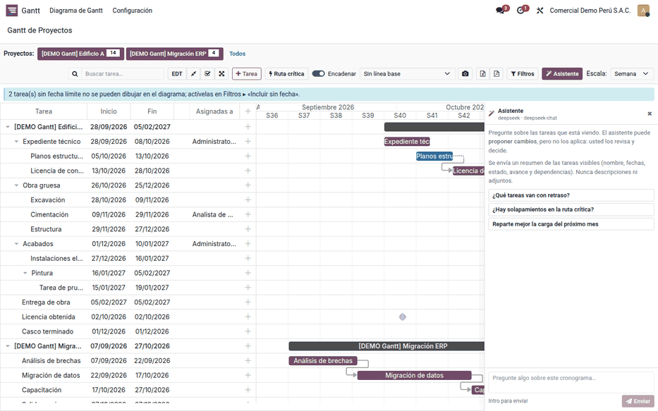
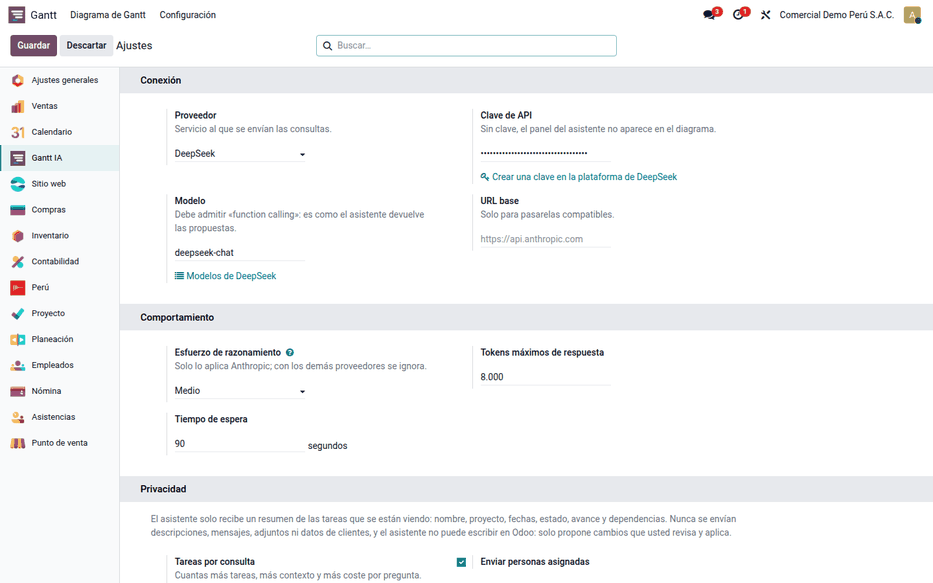

# Asistente de IA del Gantt

El **Asistente** es un chat dentro del [diagrama de Gantt](gantt.md) del
backend para preguntar por el cronograma («¿qué tareas van con retraso?»,
«¿hay solapamientos en la ruta crítica?») y recibir propuestas de cambio
concretas: fechas, avance, nombre o personas asignadas. La IA nunca escribe en
Odoo: el usuario revisa cada propuesta y la aplica con un botón, con sus
propios permisos. Lo usan jefes de proyecto y planificadores.

El asistente no crea ni borra tareas, no está en la [página web del Gantt](gantt_website.md)
y no incluye créditos del proveedor de IA, que se contratan aparte.

## Configuración

1. Instale **Gantt de Proyectos — Asistente IA** (`al_project_gantt_ai`).
   Requiere el Gantt del backend.
2. Cree una clave de API en la consola del proveedor: Anthropic (Claude),
   OpenAI o DeepSeek.
3. Vaya a **Gantt ‣ Configuración ‣ Ajustes** y complete:
    - **Proveedor** y **Clave**: la clave queda en el servidor y no se ve en el
      navegador;
    - **Modelo**: se propone solo (`claude-opus-5-5`, `gpt-5` o
      `deepseek-chat`) y debe admitir llamadas a funciones;
    - **URL base**, solo para pasarelas compatibles con la API de esos
      proveedores (por ejemplo, un modelo local).
4. Decida si activa **Enviar personas asignadas**. Hace falta para que proponga
   reasignaciones.
5. Acote el costo y la privacidad con **Esfuerzo**, **Tokens máximos** (8 000),
   **Tiempo de espera** (90 s) y **Tareas por consulta** (200).

!!! warning "Importante"
    Enviar las personas asignadas a un proveedor externo es tratamiento y
    transferencia de datos personales según la Ley 29733. La empresa decide si
    lo permite.

### Datos que salen de Odoo

| Se envía al proveedor | No se envía |
|---|---|
| Nombre y proyecto de la tarea | Descripción |
| Fechas de inicio y fin | Mensajes y chatter |
| Estado y avance | Adjuntos |
| Dependencias visibles | Cliente o contacto |
| Personas asignadas (opcional) | Etiquetas, horas e importes |

## Preguntar y aplicar cambios

1. En **Gantt ‣ Diagrama de Gantt**, haga clic en **Asistente**. El panel
   muestra el proveedor, el modelo y preguntas de ejemplo.
2. Escriba la pregunta en «Pregunte algo sobre este cronograma…». El servidor
   relee las tareas que el usuario ve, hasta el límite de tareas por consulta,
   y envía solo el resumen.
3. La respuesta llega en la conversación y, si hay cambios, como tarjetas en
   **Cambios propuestos**. El servidor descarta las propuestas inválidas (un
   avance de 140 % o una tarea fuera de la vista) con un aviso.
4. Marque las propuestas que acepta y haga clic en **Aplicar (n)**. Cada cambio
   sigue el mismo camino que arrastrar una barra: si el usuario no tiene
   permiso sobre la tarea, esa propuesta se rechaza. El diagrama se recarga.

Los cambios aplicados quedan en las tareas y en su historial como cualquier
edición del Gantt, y los informes Excel y PDF reflejan el plan resultante.

## Ejemplo

En «[DEMO Gantt] Edificio A», con el proveedor configurado (la respuesta exacta
depende del modelo):

1. Pregunta: «¿Qué tareas de Obra gruesa están atrasadas respecto a la línea
   base y cómo recupero el plazo?».
2. El servidor relee 18 tareas visibles (de un máximo de 200) y envía nombre,
   fechas, estado, avance y dependencias.
3. La respuesta explica que «Obra gruesa» termina 7,2 días después de la línea
   base y propone dos tarjetas:
    - «Cimentación»: avance de 20 % a 60 %, porque el residente reporta el
      vaciado terminado;
    - «Acabados»: inicio del 10/12 al 05/12, porque puede empezar en paralelo.
4. El usuario marca solo la primera y hace clic en **Aplicar (1)**: se guarda el
   avance de «Cimentación» y la segunda no se aplica.

## Casos especiales

| Situación | Qué pasa | Qué hacer |
|---|---|---|
| No aparece el botón **Asistente** | Falta la clave o el modelo | Completar los ajustes |
| «Clave rechazada» | El proveedor no reconoce la clave | Revisarla en su consola |
| «Modelo desconocido» | El modelo no existe en ese proveedor | Elegir uno vigente que admita llamadas a funciones |
| «Límite de peticiones» o tiempo agotado | Cupo del proveedor o respuesta lenta | Esperar o subir el tiempo de espera |
| No propone reasignaciones | **Enviar personas asignadas** está desactivado | Activarlo si la política de datos lo permite |

!!! info "Ver también"
    - [Diagrama de Gantt](gantt.md)
    - [Ley 29733, Protección de Datos Personales](https://www.gob.pe/institucion/minjus/normas-legales/243470-29733)
    - [Autoridad Nacional de Protección de Datos Personales](https://www.gob.pe/anpd)
    - API de [Anthropic](https://docs.anthropic.com/en/api/overview), [OpenAI](https://developers.openai.com/api/docs) y [DeepSeek](https://api-docs.deepseek.com/)
    - Referencia técnica: [al_project_gantt_ai](../../../developer/reference/modules/al_project_gantt_ai/index.md)
