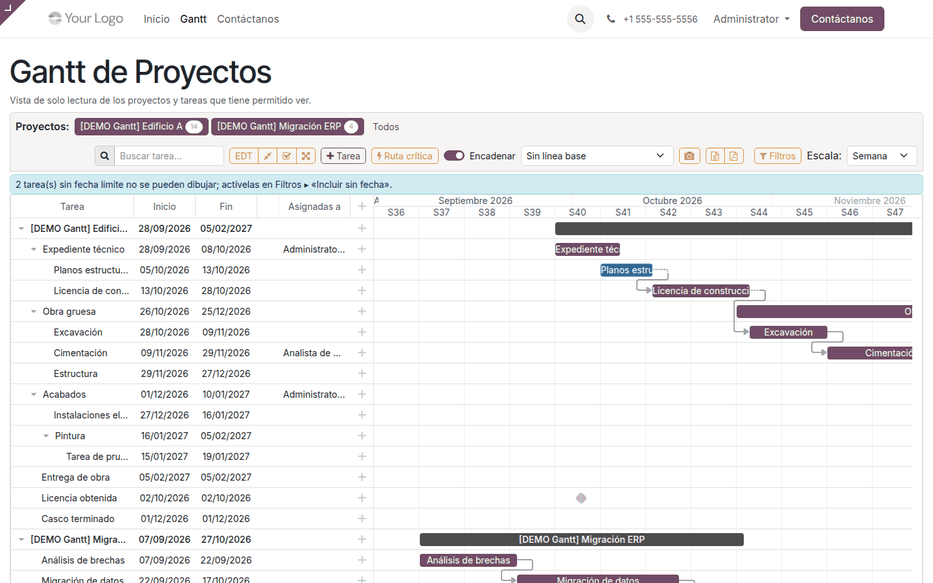
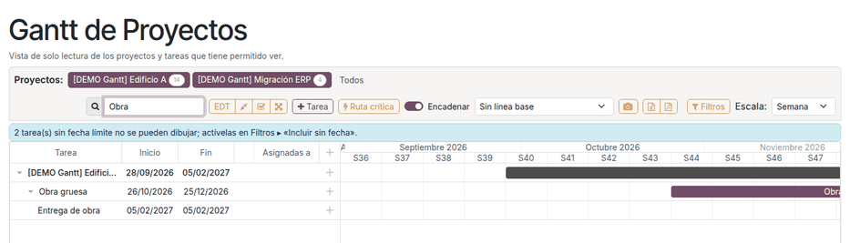

# Gantt en el sitio web

La página **`/gantt`** del sitio web de Odoo muestra el
[diagrama de Gantt](gantt.md) con las mismas herramientas que la aplicación
del backend. Sirve para pantallas de pared, tablets de obra o personal interno
que no trabaja dentro de la aplicación Proyecto.

No es una página de portal: clientes, usuarios de portal y visitantes no la
abren aunque tengan el enlace. Para mostrar el avance a un cliente, use el
portal de Proyecto.

## Configuración

1. Instale **Gantt de Proyectos — Website** (`al_project_gantt_website`).
   Instala Sitio web y el núcleo del Gantt si faltan.
2. Dé el permiso **Gantt de Proyectos: Usuario** a quienes deban ver la
   página.
3. Opcional: mueva o renombre el menú **Gantt** del sitio con el editor del
   sitio web.

## Acceso

La página exige una sesión de usuario interno con el permiso del Gantt:

| Usuario | Página /gantt | Datos del diagrama |
|---|---|---|
| Visitante sin sesión | Pide iniciar sesión y vuelve a /gantt | No |
| Usuario de portal | Error 403 | No |
| Interno sin el permiso **Gantt de Proyectos** | Error 403 | No |
| Interno con el permiso | Página | Sí, según sus permisos de Proyecto |

La página no aparece en el mapa del sitio ni en los buscadores.

## Usar el diagrama

1. Abra **Sitio web ‣ Gantt** o vaya a `/gantt`. El diagrama ocupa el 70 % del
   alto de la ventana.
2. Use **Filtros** para acotar por personas, estado o fechas.
3. Escriba en **Buscar tarea…**: el diagrama filtra al escribir y conserva los
   niveles superiores de cada tarea encontrada.
4. Edite como en el backend: arrastre, doble clic o clic derecho. La barra
   muestra «Guardando…» y «Guardado».
5. Con clic derecho ‣ **Abrir en Odoo** o **Planificar actividad**, la ficha de
   la tarea se abre en una pestaña nueva del backend.
6. Exporte a **Excel** o **PDF** lo que está en pantalla.

### Diferencias con el backend

| Aspecto | Backend | Sitio web |
|---|---|---|
| Dónde | **Gantt ‣ Diagrama de Gantt** | `/gantt` |
| **Abrir en Odoo** | Misma pestaña | Pestaña nueva |
| Añadir subtarea | En el menú contextual | Con el signo **+** de la fila |
| Aviso de guardado | Notificación de Odoo | Texto en la barra |
| Asistente de IA | Sí, con [al_project_gantt_ai](gantt_ai.md) | No |

## Ejemplo

1. Una tablet de obra abre `/gantt`. Como no hay sesión, pide iniciar sesión y
   vuelve sola a la página.
2. Con el usuario del jefe de obra (interno, con el permiso) aparece el
   diagrama de «[DEMO Gantt] Edificio A».
3. En **Buscar tarea…** escribe «Obra»: quedan «Obra gruesa» y «Entrega de
   obra», con su proyecto como nivel superior.
4. Arrastra «Excavación» 5 días con **Encadenar**: «Cimentación» pasa de
   09/11–29/11 a 14/11–04/12 y «Estructura» de 29/11–27/12 a 04/12–01/01.
5. Un cliente con usuario de portal que recibe el enlace obtiene error 403: el
   plan interno no queda expuesto.

## Casos especiales

| Situación | Qué pasa | Qué hacer |
|---|---|---|
| Error 403 a un empleado | No tiene el permiso **Gantt de Proyectos** | Asignarlo en su usuario |
| No aparece el botón **Tarea** | El usuario no puede crear tareas | Revisar sus permisos de Proyecto |
| El menú **Gantt** no se ve | Se quitó del menú del sitio | Reponerlo con el editor o ir a `/gantt` |

!!! info "Ver también"
    - [Diagrama de Gantt](gantt.md)
    - [Sitio web en Odoo 19](https://www.odoo.com/documentation/19.0/applications/websites/website.html)
    - [Permisos de acceso en Odoo 19](https://www.odoo.com/documentation/19.0/applications/general/users/access_rights.html)
    - Referencia técnica: [al_project_gantt_website](../../../developer/reference/modules/al_project_gantt_website/index.md)
