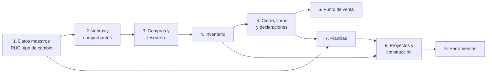

# Ruta de pruebas funcionales

Esta ruta ordena la prueba de todos los módulos de la suite para que un
consultor funcional los revise **de lo más simple a lo más complejo**: primero
las consultas básicas (RUC, tipo de cambio) y los datos maestros, después la
facturación, las compras, el inventario y el cierre contable, y al final el
punto de venta, las planillas y los proyectos. Cada etapa usa lo que se
aprobó en las anteriores, así que un error se detecta donde nace y no varias
etapas después.

Cada caso dice **qué hacer** (con la ruta del menú) y **qué debe verse**. El
detalle de cada módulo está en su página de la documentación, enlazada al
final de cada bloque.

## Mapa de la ruta

| Etapa | Qué se prueba | Depende de |
|---|---|---|
| 1 | Base contable, consulta RUC/DNI, tipo de cambio, medios de pago, numeración, validez de comprobantes y ayuda | — |
| 2 | Factura, boleta, notas, detracciones, retenciones, percepciones, anticipos, OSE, libro de reclamaciones y aprobación de ventas | 1 |
| 3 | Liquidación de compra, 4.ª categoría, DUA, cheques, letras, pagos masivos, caja chica, depósitos, factoring y pasarelas de pago | 1 y 2 |
| 4 | Base de inventario, guía de remisión, traslados internos y kárdex | 1 a 3 |
| 5 | Diferencia de cambio, destinos, NIIF 16, estados financieros, declaración mensual, PLE y SIRE | 1 a 4 |
| 6 | Comprobantes en el punto de venta, vendedor, catálogo, tema e impresoras | 1, 2 y 5 |
| 7 | Feriados, planilla mensual, asistencia, beneficios, documentos, contabilización, importadores y construcción civil | 1 y 5 |
| 8 | Gantt, requerimientos de obra, planificación de obra, sedes y hoja de trabajo | 4 y 7 |
| 9 | Servidor MCP | Todas |

## Antes de empezar

1. **Base de pruebas.** Pruebe siempre en una base de pruebas o en una copia,
   nunca en producción. Si la base tiene datos de demostración, varios
   módulos traen ejemplos listos (prefijos **DEMO**).
2. **Compañía peruana.** Con RUC, dirección fiscal, moneda soles y el plan
   contable de Perú (PCGE).
3. **Usuarios por perfil.** Un usuario por rol (facturación, contabilidad,
   tesorería, almacén, recursos humanos, jefe de obra), para probar también los
   permisos y no solo el administrador.
4. **Credenciales de prueba.** Token de consulta RUC/DNI, usuario y clave SOL
   (o credenciales de API de SUNAT) y el ambiente de pruebas del OSE. Sin
   ellas, los casos que llaman a un servicio externo se marcan como
   **bloqueados**, no como fallidos.
5. **Módulos instalados.** Instale los módulos de la etapa antes de probarla;
   la [referencia de módulos](../developer/index.md) dice qué instala cada uno.

## Cómo registrar los resultados

Lleve una hoja de control con una fila por caso:

| Columna | Contenido |
|---|---|
| N.º | El del caso (por ejemplo **2.1.3**) |
| Resultado | **Correcto**, **Con observaciones**, **Error** o **Bloqueado** |
| Evidencia | Captura, PDF, XML o número del documento creado |
| Observación | Qué pasó distinto de lo esperado y con qué datos |
| Responsable y fecha | Quién lo probó y cuándo |

!!! tip "Consejo"
    Repita un caso con error después de la corrección y deje las dos filas: la
    del error y la de la nueva prueba. Así queda la historia del defecto.

!!! warning "Importante"
    No pase a la etapa siguiente con casos en **Error** en la actual: las
    etapas siguientes usan sus documentos (por ejemplo, el cierre de la
    etapa 5 usa las facturas de la etapa 2).

## Etapa 1: Datos maestros y consultas básicas

Se valida la base de la suite: la aplicación **Perú**, los contactos, los tipos
de cambio, los medios de pago, las series y las consultas a SUNAT. Va primero
porque no depende de otros módulos y todas las etapas siguientes usan estos
datos.

### 1.1 Configuración contable básica (`al_account_base`)

**Antes:** compañía con país Perú y plan contable de `l10n_pe`; usuario administrador.

| N.º | Caso | Cómo | Resultado esperado |
|---|---|---|---|
| 1.1.1 | Página de ajustes de la app Perú | Abra **Perú ‣ Configuración ‣ Ajustes** | Se ve el bloque **Contabilidad (PE)** y los bloques de cada módulo instalado. El menú **Perú ‣ Configuración** agrupa **Contabilidad**, **Comprobantes electrónicos**, **Tributos SUNAT**, **Cuentas de la localización** y **Consultas RUC / DNI** |
| 1.1.2 | Naturaleza y exclusión del PLE en un diario | En **Perú ‣ Configuración ‣ Contabilidad ‣ Diarios**, abra un diario, elija la **Naturaleza del diario** (**Movimiento**, **Apertura** o **Cierre**) y active **Excluir del PLE** en un diario auxiliar | Los dos campos se guardan en el diario |
| 1.1.3 | Código SUNAT del banco (límite) | En **Perú ‣ Configuración ‣ Contabilidad ‣ Cuentas bancarias**, escriba **02** y luego **123** en **Código SUNAT del banco** | **02** se acepta; **123** se rechaza: debe tener dos dígitos |
| 1.1.4 | Establecimiento anexo (límite) | En un contacto con país Perú, debajo del RUC, escriba **0000** y luego **00123** en **Establecimiento anexo** | **0000** se acepta; **00123** se rechaza: debe tener cuatro dígitos |
| 1.1.5 | Asiento con glosa | En **Contabilidad ‣ Contabilidad ‣ Asientos contables**, cree un asiento con **Glosa** en la cabecera; active la columna **Glosa** en **Apuntes contables** y escriba una en una línea. Luego duplique el asiento | La glosa queda en la cabecera y en el apunte. En el duplicado la glosa sale vacía |
| 1.1.6 | Restablecer un comprobante que exige baja (error) | En un comprobante enviado a SUNAT, intente **Restablecer a borrador** | Da error: se corrige con la nota de crédito o la comunicación de baja |

Detalle: [Configuración contable básica](../applications/finance/fiscal_localizations/peru/accounting_base.md)

### 1.2 Consulta de RUC y DNI (`l10n_pe_vat_sunat`)

**Antes:** al menos una conexión con token, o la conexión **SUNAT (oficial)** desde una IP del Perú.

| N.º | Caso | Cómo | Resultado esperado |
|---|---|---|---|
| 1.2.1 | Activar la validación y las conexiones | En **Perú ‣ Configuración ‣ Ajustes**, sección **Validación RUC/DNI (PE)**, active **Validar RUC**, **Validar DNI** y **Fallback en cascada**. Revise **Perú ‣ Configuración ‣ Consultas RUC / DNI ‣ Conexiones RUC/DNI** | Hay cinco conexiones por compañía, ordenables por prioridad; las que no tienen token se saltan |
| 1.2.2 | Crear un contacto con RUC | En **Contactos**, **Nuevo**, escriba un RUC de 11 dígitos en **Número de identificación** | Se completan nombre, dirección con distrito, provincia y departamento, **Estado SUNAT** y **Condición**. **Buen contribuyente** y **Agente de retención** se marcan según el padrón |
| 1.2.3 | Contacto con DNI | **Nuevo** contacto, tipo **DNI**, 8 dígitos | El contacto pasa a persona y toma el nombre; la dirección depende del servicio |
| 1.2.4 | Número con longitud incorrecta (error) | Escriba un RUC de 10 dígitos o un DNI de 7 | Se rechaza antes de consultar |
| 1.2.5 | Consulta fallida | En un contacto, **Actualizar desde API** con todos los servicios sin respuesta (por ejemplo, plan vencido) | El contacto muestra «No hay conexión con SUNAT/API o los datos no existen» y el botón explica el motivo |
| 1.2.6 | Padrón SUNAT | Abra **Perú ‣ Configuración ‣ Consultas RUC / DNI ‣ Padrón SUNAT** y verifique la acción **SUNAT: Sincronizar padrón** en **Ajustes ‣ Técnico ‣ Acciones planificadas** | Se listan los RUC de ambos padrones con su fecha, filtrables por tipo; la acción está activa |

Detalle: [Consulta de RUC y DNI](../applications/finance/fiscal_localizations/peru/ruc_dni_lookup.md)

### 1.3 Tipo de cambio (`al_l10n_pe_currency`)

**Antes:** USD activo; cuentas 676 y 776 en la compañía; 1.2 hecha si se usa Decolecta o apis.net.pe.

| N.º | Caso | Cómo | Resultado esperado |
|---|---|---|---|
| 1.3.1 | Criterio por defecto | En **Contabilidad ‣ Configuración ‣ Ajustes**, sección **Tipo de cambio (Perú)**, revise **T.C. en ventas** y **T.C. en compras** | Ambos en **Venta** por defecto. La acción **Tipo de cambio: actualizar desde SUNAT** está activa y corre cada hora |
| 1.3.2 | Cargar un mes histórico | **Perú ‣ Tesorería ‣ Tipo de cambio ‣ Actualizar tipo de cambio**, fuente BCRP, un mes | En **Perú ‣ Tesorería ‣ Tipo de cambio ‣ Tipos de cambio** cada día tiene **Compra**, **Venta** y **Origen** |
| 1.3.3 | Tasa manual protegida | Edite a mano la tasa de un día y vuelva a ejecutar la actualización | La tasa queda con origen **Manual** y la actualización no la pisa |
| 1.3.4 | Compra mayor que venta (límite) | Registre una tasa con compra mayor que venta; en otra registre solo la venta | Odoo avisa pero deja guardar. Si solo hay venta, la compra toma el mismo valor |
| 1.3.5 | Factura en dólares con su tipo | En **Contabilidad ‣ Clientes ‣ Facturas**, cree una factura en USD, cambie **Tipo de T.C.** a compra y publique | El importe en soles usa la tasa elegida y queda fijo. Ej.: US$ 1 180,00 a venta 3,400 = S/ 4 012,00 |
| 1.3.6 | Cobro a otro tipo y diferencia de cambio | Registre el cobro con **Pagar** y **Tipo de T.C.** compra el mismo día | Al conciliar se registra la diferencia de cambio (676 o 776). Ej.: S/ 10,62 de pérdida con compra 3,391. Con la factura publicada, el **Tipo de T.C.** ya no se puede cambiar |

Detalle: [Tipo de cambio](../applications/finance/fiscal_localizations/peru/exchange_rates.md)

### 1.4 Medios de pago SUNAT (`al_account_payments`)

**Antes:** facturas de proveedor publicadas; diario de banco.

| N.º | Caso | Cómo | Resultado esperado |
|---|---|---|---|
| 1.4.1 | Catálogo cargado | Abra **Perú ‣ Configuración ‣ Tributos SUNAT ‣ Medios de pago** | Hay 20 medios (001 a 011, 101 a 108 y 999); 003 Transferencia de fondos marcado **Para detracción** |
| 1.4.2 | Pago con medio y operación | En **Contabilidad ‣ Proveedores ‣ Facturas**, **Pagar**, busque el **Medio pago** por «003» o «transf» y escriba el **Número de operación banco**; **Crear pago** | El pago guarda medio y número; confirmado, quedan de solo lectura |
| 1.4.3 | Pago agrupado | Seleccione dos facturas del mismo proveedor, **Pagar**, active **Agrupar pagos** | Se crea un solo pago con los datos del asistente |
| 1.4.4 | Fecha de pago futura (límite) | En el asistente **Pagar**, ponga una **Fecha de pago** posterior a hoy | Aparece un aviso; el pago se crea y el aviso queda en el historial |
| 1.4.5 | Número de operación exigido (error) | En **Contabilidad ‣ Configuración ‣ Diarios**, marque **Exigir número de operación** en el banco y confirme un pago sin número | «Indique el número de operación del banco»: no se confirma |
| 1.4.6 | Compra y venta de moneda | **Perú ‣ Tesorería ‣ Tipo de cambio ‣ Compra y venta de moneda**: cuenta en soles y en USD, monto y **Tipo de cambio del banco**; **Registrar** | Se crean dos pagos por la cuenta de transferencias de liquidez; la diferencia va a 676 o 776. Ej.: US$ 1 000 a 3,80 con sistema 3,75 = pérdida S/ 50 |

Detalle: [Medios de pago SUNAT](../applications/finance/fiscal_localizations/peru/payment_methods.md)

### 1.5 Numeración de asientos y series (`al_account_move_name_sequence`)

**Antes:** administrador de Contabilidad; diario de ventas con documentos.

| N.º | Caso | Cómo | Resultado esperado |
|---|---|---|---|
| 1.5.1 | Crear y publicar una serie | **Perú ‣ Configuración ‣ Comprobantes electrónicos ‣ Series CPE**, **Nuevo**, tipo factura, serie **F001**; **Publicar** | Se proponen **FC01** y **FD01**; se crean tres secuencias sin huecos de ocho dígitos |
| 1.5.2 | Serie con formato inválido (error) | Cree una serie de factura **B001** o de boleta **F001**, o repita una serie existente | No se guarda: facturas F + 3 alfanuméricos, boletas B o E + 3; cada serie es única |
| 1.5.3 | Activar el diario | **Perú ‣ Configuración ‣ Contabilidad ‣ Diarios**: marque **Numerar por secuencia** y asigne **F001** y **F002** | El diario queda con sus Series CPE |
| 1.5.4 | Emitir con serie elegida | En **Contabilidad ‣ Clientes ‣ Facturas**, en borrador elija **Serie CPE** F002 y **Confirmar** | El número (p. ej. F002-00000002) se asigna al confirmar, no al crear el borrador |
| 1.5.5 | Nota de crédito con serie rectificativa | Emita una nota de crédito de esa factura | Toma la serie de origen: FC02-00000001 |
| 1.5.6 | Diario sin documentos y retiro de serie | En un diario de caja, escriba **Prefijo (serie)** CC01- y registre un asiento; luego, en una serie, **Inhabilitar** | El asiento sale CC01-0000000N. La serie inhabilitada ya no se ofrece; **Volver a borrador** la reabre |

Detalle: [Numeración de asientos y series](../applications/finance/fiscal_localizations/peru/entry_numbering.md)

### 1.6 Consulta de validez de comprobantes (`al_l10n_pe_cpe_validation`)

**Antes:** client ID y client secret de SUNAT SOL (o los del SIRE); proveedores con RUC (1.2).

| N.º | Caso | Cómo | Resultado esperado |
|---|---|---|---|
| 1.6.1 | Credenciales y comportamiento | **Ajustes ‣ Perú ‣ Consulta de comprobantes**: **Client ID**, **Client secret** y **Al publicar una factura de proveedor** | Se guardan las opciones: no consultar, consultar y avisar, o consultar y bloquear |
| 1.6.2 | Consultar una factura | En una factura de proveedor con número serie-número y fecha, **Validar en SUNAT** | **Otra información ‣ Validez en SUNAT** muestra los tres estados, la fecha y el resultado: válido, válido con observaciones o no válido |
| 1.6.3 | Consulta en lote | **Contabilidad ‣ Proveedores ‣ Facturas**, filtro **Sin consultar en SUNAT**, seleccione y **Acciones ‣ Validar en SUNAT** | Un aviso resume válidas, con observaciones, no válidas y no consultadas |
| 1.6.4 | Bloqueo al publicar | Con **Consultar y bloquear si no es válido**, publique una factura no informada a SUNAT | No se publica y Odoo lista cuáles son |
| 1.6.5 | Número mal formado o sin RUC (error) | Valide una factura con número sin guion o de un proveedor sin RUC | «el número no tiene el formato serie-número» o «el proveedor no tiene RUC»: no se consulta |
| 1.6.6 | SUNAT no responde | Publique con credenciales erróneas en modo bloquear | La factura se publica igual y el error queda en su historial |

Detalle: [Consulta de validez de comprobantes](../applications/finance/fiscal_localizations/peru/cpe_validation.md)

### 1.7 Ayuda contextual (`al_docs_help`)

**Antes:** 1.1 hecha (URL en **Ajustes ‣ Perú ‣ Documentación**) o acceso a `https://docs.altalatam.com/latest/`.

| N.º | Caso | Cómo | Resultado esperado |
|---|---|---|---|
| 1.7.1 | Botón ? en una pantalla | En **Contabilidad ‣ Facturas**, pase el ratón por el botón **?** de la barra superior y haga clic | El texto indica la sección; se abre en una pestaña nueva la página de Configuración contable básica |
| 1.7.2 | Botón ? en un asistente | Abra un asistente de la suite | El botón está en la cabecera, junto a la **X** de cerrar |
| 1.7.3 | Lista de pantallas | En modo desarrollador, **Ajustes ‣ Técnico ‣ Ayuda contextual**; filtre por módulo y **Con sección** | Cada fila abre su página. Una fila creada a mano no se pisa al actualizar |
| 1.7.4 | Módulo dueño desinstalado (límite) | Revise una pantalla cuyo módulo de página no está instalado | No aparece el botón **?** |
| 1.7.5 | Cambio de URL del sitio | Cambie la URL en **Ajustes ‣ Perú ‣ Documentación** y recargue el navegador | El botón usa la URL nueva |

Detalle: [Ayuda contextual](../applications/general/contextual_help.md)

### 1.8 Ficha completa del módulo (`al_base_module_info`)

**Antes:** módulos de la suite con ficha generada por el generador de fichas.

| N.º | Caso | Cómo | Resultado esperado |
|---|---|---|---|
| 1.8.1 | Abrir la ficha | En **Aplicaciones**, quite el filtro **Aplicaciones**, busque «Perú» y haga clic en **Ver la ficha completa del módulo** de «PE - Base Contabilidad (AL)» | La ficha se abre con su diseño en una pestaña nueva, en `/<módulo>/static/description/index.html` |
| 1.8.2 | Módulo de Odoo sin ficha | Revise la tarjeta de «Perú - Contabilidad» y de «EDI para Perú» | Muestran **Más información** e **Información del módulo**, sin el botón de la ficha |
| 1.8.3 | Menú ⋮ de la tarjeta | Abra el menú ⋮ de un módulo de la suite | Está **Ver la ficha completa del módulo** y **Más información** |
| 1.8.4 | Ficha recién generada (límite) | Genere la ficha de un módulo nuevo sin reiniciar el servidor | No aparece el botón hasta reiniciar: la detección está en caché |

Detalle: [Ficha completa del módulo](../applications/general/module_info.md)

!!! success "Para pasar a la etapa siguiente"
    - Contactos con RUC completados desde la consulta y padrón SUNAT cargado.
    - Tipos de cambio compra y venta del periodo de pruebas cargados.
    - Series CPE publicadas y asignadas a los diarios de venta, y medios de pago revisados.

## Etapa 2: Ventas y comprobantes electrónicos

Se validan la emisión y la impresión de comprobantes y los tributos que los
acompañan: detracción, retención y percepción, anticipos, operador OSE, libro
de reclamaciones y aprobación de ventas. Va después de la etapa 1 porque usa
los contactos, el tipo de cambio, las series y los medios de pago ya
validados.

### 2.1 Comprobante impreso (`al_l10n_pe_invoice`)

**Antes:** etapa 1; localización `l10n_pe_edi` con certificado, operador y diarios con series F y B.

| N.º | Caso | Cómo | Resultado esperado |
|---|---|---|---|
| 2.1.1 | Firmas y eslogan | **Perú ‣ Configuración ‣ Ajustes ‣ Comprobantes electrónicos**: active **Firma y eslogan en el reporte**, elija el **Representante** y escriba el **Eslogan** | El A4 sale con el bloque de firmas; sin la opción, sale sin él |
| 2.1.2 | A4 y ticket | Publique una factura en **Contabilidad ‣ Clientes ‣ Facturas**; **Imprimir** y luego **⚙ ‣ Imprimir ‣ CPE Ticket** | A4 con papel **Comprobantes: A4 SUNAT**, nombrado con el número y el cliente; ticket de 80 mm |
| 2.1.3 | Desglose tributario | Imprima una boleta con productos gravados, exonerados, inafectos y una bolsa | Filas Op. gravadas, exoneradas, inafectas, IGV e ICBPER, solo las que tienen importe. Ej. B001-00000001: total 99,10 |
| 2.1.4 | Detracción y crédito | Imprima una factura con servicio al 12 % y otra con términos «30 % ahora, el resto en 60 días» | Bloque **Información de la detracción — SPOT** con monto sin decimales (2 301,00 × 12 % → S/ 276,00); forma de pago **CRÉDITO** con **Información del crédito** por cuota |
| 2.1.5 | Cliente agente de retención | Factura de S/ 1 180,00 en dos cuotas a un cliente agente | **Monto neto pendiente de pago** S/ 1 144,60 y cuotas de 572,30 |
| 2.1.6 | Sin XML firmado (límite) | Imprima un comprobante en borrador o no enviado | Sin número en el recuadro y sin QR; la información legal ocupa todo el ancho |

Detalle: [Comprobante impreso](../applications/finance/fiscal_localizations/peru/electronic_invoicing/invoice_report.md) y [Facturación electrónica](../applications/finance/fiscal_localizations/peru/electronic_invoicing.md)

### 2.2 Detracciones (`al_l10n_pe_detraction`)

**Antes:** etapa 1; Odoo Enterprise; cuenta de la compañía en el Banco de la Nación con su diario.

| N.º | Caso | Cómo | Resultado esperado |
|---|---|---|---|
| 2.2.1 | Catálogo y producto | Revise **Perú ‣ Configuración ‣ Tributos SUNAT ‣ Detracciones** y asigne el **Tipo de detracción** en la pestaña **Contabilidad** de un servicio | Hay 32 códigos con porcentaje y mínimo; el producto queda afecto |
| 2.2.2 | Factura con detracción y reparto | Active **Separar detracción en el asiento** en **Perú ‣ Configuración ‣ Ajustes**, sección **Detracciones**, con sus cuentas. Registre una compra de S/ 3 540,00 con código 022 | Pestaña **Detracción**: S/ 425 (424,80 redondeado) y neto S/ 3 115,00; el asiento separa ambos importes |
| 2.2.3 | Bajo el mínimo o nota de crédito (límite) | Registre una factura con total bajo el mínimo y una nota de crédito | No aparece la pestaña **Detracción** |
| 2.2.4 | Reparto sin cuentas (error) | Con el reparto activo y sin las dos cuentas, publique una factura afecta | La factura no se publica |
| 2.2.5 | Depósito individual | En la compra publicada, pestaña **Detracción**, **Registrar depósito** con número y fecha de constancia | Se crea un pago estándar y la constancia queda en la factura; el botón ya no aparece |
| 2.2.6 | Depósito masivo e importación | **Perú ‣ Proveedores ‣ Detracciones, retenciones y percepciones ‣ Depósito masivo (Banco de la Nación)**; luego **Importar constancias de detracción** con el archivo de SUNAT | TXT de ancho fijo con excluidos y su motivo; vista previa con estados *Por registrar*, *Ya registrada*, *Otra constancia*, *No encontrado* y *Fila no válida* |

Detalle: [Detracciones (SPOT)](../applications/finance/fiscal_localizations/peru/detractions.md)

### 2.3 Retenciones del IGV (`al_l10n_pe_retention`)

**Antes:** etapa 1 (padrón SUNAT y medios de pago); impuesto -3 % con **Retención en el pago**, cuenta 40114 y secuencia R001; operador y certificado.

| N.º | Caso | Cómo | Resultado esperado |
|---|---|---|---|
| 2.3.1 | Configurar el agente | **Perú ‣ Configuración ‣ Ajustes**, sección **Retenciones del IGV**: marque **Agente de retención del IGV** y elija el impuesto | Tasa 3 % y mínimo S/ 700. Sin impuesto elegido, la factura sujeta a retención no se publica: «falta configurar el Impuesto de retención IGV en Ajustes ▸ Perú» |
| 2.3.2 | Retener al pagar | Publique una compra de S/ 5 900 a un proveedor sin excepciones y haga clic en **Pagar** | Factura **Sujeta a retención de IGV**; el asistente propone S/ 177,00 y neto S/ 5 723,00; el pago toma número **R001-########** |
| 2.3.3 | Bajo el mínimo o proveedor exceptuado (límite) | Pague una factura de S/ 650 y otra a un proveedor agente o buen contribuyente | No se propone retención |
| 2.3.4 | Enviar y revisar el CRE | En el pago, **Enviar CRE a SUNAT**; revise **Perú ‣ Proveedores ‣ Detracciones, retenciones y percepciones ‣ Retenciones efectuadas** | El pago pasa a **Enviado**; la lista muestra plazo y estado (amarillo: fuera de plazo; rojo: rechazado) |
| 2.3.5 | Pago con CRE aceptado (error) | Intente pasar a borrador el pago; luego **Revertir CRE** con motivo y **Consultar reversión** | No pasa a borrador. Con la reversión aceptada el CRE queda **Anulado** y el pago se puede corregir |
| 2.3.6 | Retención sufrida | **Perú ‣ Clientes ‣ Detracciones, retenciones y percepciones ‣ Retenciones sufridas**, **Nuevo**, factura de S/ 3 540; **Registrar** | Se propone S/ 106,20; asiento contra 40114 conciliado; visible en **Facturación PE** de la factura |

Detalle: [Retenciones del IGV](../applications/finance/fiscal_localizations/peru/withholdings.md)

### 2.4 Percepciones del IGV (`al_l10n_pe_perception`)

**Antes:** etapa 1; cuentas y diario de percepciones; productos sujetos.

| N.º | Caso | Cómo | Resultado esperado |
|---|---|---|---|
| 2.4.1 | Configurar | **Ajustes ‣ Perú ‣ Percepciones del IGV**: agente, cuentas y diario; en el producto, pestaña **Contabilidad**, **Percepción del IGV** | Productos sujetos con su grupo; contactos con **Agente de percepción** y **Exceptuado de la percepción** |
| 2.4.2 | Venta sujeta al 2 % | Publique una venta de S/ 4 366,00 a una empresa | **Facturación PE ‣ Percepción IGV**: S/ 87,32; tipo de operación **2001**; el PDF lleva «Operación sujeta a percepción del IGV» |
| 2.4.3 | Cliente agente al 0,5 % | Publique una venta de S/ 9 912,00 a un agente de percepción | Percepción S/ 49,56 |
| 2.4.4 | Operación excluida (límite) | Venta con detracción, o a un cliente agente de retención con factura | No se percibe; **Motivo** explica la exclusión |
| 2.4.5 | Emitir el comprobante | Cobre el total más la percepción; en el pago, **Comprobante de percepción**, **Emitir** y **Enviar a SUNAT** | Número **P001-########**, asiento conciliado. Ej.: cobrado S/ 4 453,32, factor 0,019608, S/ 87,32 |
| 2.4.6 | Percepción que nos cobran | **Perú ‣ Proveedores ‣ Detracciones, retenciones y percepciones ‣ Percepciones que nos cobran**, línea y **Registrar**; revise **Perú ‣ SUNAT ‣ Declaraciones ‣ Percepciones del F.V. 621** | Asiento a la cuenta de percepciones por aplicar; el resumen 621 lo aplica por mes y arrastra el saldo |

Detalle: [Percepciones del IGV](../applications/finance/fiscal_localizations/peru/perceptions.md)

### 2.5 Anticipos y descuentos (`al_l10n_pe_edi_downpayment_discount`)

**Antes:** 2.1; Ventas con producto y cuenta de anticipos en **Ventas ‣ Configuración ‣ Ajustes**.

| N.º | Caso | Cómo | Resultado esperado |
|---|---|---|---|
| 2.5.1 | Factura del anticipo | En **Ventas ‣ Pedidos**, confirme un pedido con diseño gravado y capacitación exonerada; **Crear factura**, **Anticipo** 20 %; publique y envíe | Comprobante del anticipo de S/ 3 360,00 aceptado |
| 2.5.2 | Factura del saldo | **Crear factura**, **Factura normal**; publique y envíe | Sección **Anticipos** resta lo cobrado; total S/ 13 440,00. El XML lleva cargos 04 y 05 y un solo `PrepaidPayment` de S/ 3 360 |
| 2.5.3 | Descuento global | Agregue una línea negativa con el impuesto de lo descontado | Sobre lo gravado sale como descuento 02; sobre lo no gravado se reparte como 00 |
| 2.5.4 | Descuentos mayores que los ítems (error) | Ponga un descuento de un impuesto mayor que sus ítems y publique | El módulo avisa al publicar: el XML no puede cuadrar |
| 2.5.5 | Nota de crédito de la factura final | En la factura final, **Nota de crédito** | Se publica con las mismas líneas; el asiento es el inverso |

Detalle: [Anticipos y descuentos](../applications/finance/fiscal_localizations/peru/electronic_invoicing/down_payments_discounts.md)

### 2.6 OSE Factory HKA (`al_ose_factory_hka`)

**Antes:** 2.1; certificado digital; credenciales y WSDL de Factory HKA.

| N.º | Caso | Cómo | Resultado esperado |
|---|---|---|---|
| 2.6.1 | Configurar el operador | **Ajustes ‣ Contabilidad ‣ Facturación electrónica peruana**: **Certificado (PE)**, **Operador** **The Factory HKA**, credenciales y **Entorno de prueba** | Credenciales visibles solo para administradores; **Comprobantes de retención (CRE)** y **Reversión del CRE** activas |
| 2.6.2 | Emitir y enviar | Confirme una factura y haga clic en **Procesar ahora** | Queda **Enviada** con XML firmado y CDR en un ZIP; el archivo usa número de 8 dígitos (`RUC-01-F001-00000011.zip`) |
| 2.6.3 | Sin credenciales (error) | Quite el usuario o la contraseña y procese | El documento queda por enviar con el motivo; nunca va al ambiente de demostración |
| 2.6.4 | Anular factura | En una factura aceptada, **Motivo de cancelación** y **Solicitar cancelación de EDI**; **Procesar ahora** | Se envía la baja RA; el ticket queda en **Número de CDR de cancelación**; al aceptarse, **Cancelado** |
| 2.6.5 | Anular nota de boleta | Igual sobre una nota de crédito de boleta | Se envía un resumen diario RC con estado 3 |
| 2.6.6 | Anulación mezclada (límite) | Anule juntas una factura y una nota de boleta, o notas de boleta de fechas distintas | Error: hay que anularlas por separado |

Detalle: [OSE Factory HKA](../applications/finance/fiscal_localizations/peru/electronic_invoicing/ose_factory_hka.md)

### 2.7 Libro de reclamaciones (`al_l10n_pe_complaints_book`)

**Antes:** sitio web; servidor de correo saliente; calendario laboral con feriados.

| N.º | Caso | Cómo | Resultado esperado |
|---|---|---|---|
| 2.7.1 | Crear el libro | **Libro de reclamaciones ‣ Configuración ‣ Libros**: código, tipo, domicilio, sitios web y responsables; **Imprimir aviso (Anexo II)** | Libro creado; aviso A4 con «(virtual)» o «(físico)» |
| 2.7.2 | Hoja desde el sitio web | Desde el enlace del pie del sitio, llene y envíe la hoja sin cuenta | Hoja **Registrada** con número `000000001-AAAA`; constancia PDF al correo |
| 2.7.3 | Hoja sin correo ni domicilio (error) | Envíe el formulario sin esos datos | No se envía |
| 2.7.4 | Plazo con feriado | Registre una hoja el 05/10/2026 | Vence el **27/10/2026** (el 08/10 no cuenta) |
| 2.7.5 | Oferta no aceptada | **Atender**, **Oferta de solución** el 09/10 y **Oferta no aceptada** el 13/10 | El plazo se suspende y se reanuda: vence el **29/10/2026** |
| 2.7.6 | Responder y exportar | **Enviar respuesta**, **Cerrar**; luego **Libro de reclamaciones ‣ Informes ‣ Exportar al SIREC** | Hoja **Respondida** y **Cerrada**; archivo de 18 campos separados por `|`, hojas marcadas como reportadas |

Detalle: [Libro de reclamaciones](../applications/finance/fiscal_localizations/peru/complaints_book.md)

### 2.8 Aprobación de órdenes de venta (`al_sale_approval`)

**Antes:** Odoo Enterprise (**Aprobaciones**); aprobador configurado.

| N.º | Caso | Cómo | Resultado esperado |
|---|---|---|---|
| 2.8.1 | Configurar | En **Aprobaciones ‣ Configuración ‣ Categorías de aprobación**, cree la categoría con referencia obligatoria; elíjala en **Ajustes ‣ Ventas ‣ Aprobación de órdenes de venta**; active **Requiere aprobación de venta** en el producto | La cotización con ese producto muestra **Aprobación**: *Por solicitar* |
| 2.8.2 | Confirmar sin aprobar (error) | Haga clic en **Confirmar** en esa cotización | «La orden … necesita una solicitud aprobada» |
| 2.8.3 | Solicitar y aprobar | **Solicitar aprobación**, **Enviar**; el aprobador aprueba; **Confirmar** | La orden pasa a *En aprobación* y luego *Aprobada*; se confirma |
| 2.8.4 | Rechazo | El aprobador rechaza la solicitud | La orden queda *Rechazada* y se puede volver a solicitar |
| 2.8.5 | Sin categoría (error) | Quite la categoría de los ajustes y solicite aprobación | «Elija la categoría de aprobación de ventas» |

Detalle: [Aprobación de órdenes de venta](../applications/sales/sales/sale_approval.md)

### 2.9 Tienda en línea peruana (`al_website_sale_pe`)

**Antes:** tienda en línea instalada; consulta de RUC/DNI activa (**Perú ‣ Configuración ‣ Consultas RUC / DNI ‣ Conexiones RUC/DNI**); una pasarela publicada.

| N.º | Caso | Cómo | Resultado esperado |
|---|---|---|---|
| 2.9.1 | Factura con RUC | En el checkout, **Factura** y el RUC 20131312955 | El tipo pasa a RUC; se llenan la razón social de SUNAT, la calle, el código postal 150101 y Lima/Lima/Lima |
| 2.9.2 | Boleta con DNI | Cambie a **Boleta** | El tipo pasa a DNI; con un DNI se emite boleta |
| 2.9.3 | RUC inválido (error esperado) | Escriba 20131312954 y **Consultar en SUNAT** | «No se encontraron datos…»: no se gasta una consulta |
| 2.9.4 | Comprobante emitido | Pague el pedido de 2.9.1 y facture | Factura electrónica (01) al RUC con la dirección consultada |

Detalle: [Checkout peruano](../applications/sales/ecommerce/peruvian_checkout.md)

!!! success "Para pasar a la etapa siguiente"
    - Facturas, boletas y notas aceptadas por el operador, con A4 y ticket que coinciden con el XML.
    - Detracción, retención y percepción calculadas y con su comprobante o constancia registrados.
    - Libro de reclamaciones, aprobación de ventas y checkout peruano probados de punta a punta.

## Etapa 3: Compras y tesorería

Se validan los comprobantes de compra propios de Perú y el ciclo del dinero: pagos, cobros, fondos, depósitos y financiamiento. Va después de la facturación, las detracciones y las retenciones porque los pagos ya descuentan esos importes y varias operaciones parten de facturas publicadas.

### 3.1 Liquidación de compra electrónica (`al_l10n_pe_edi_purchase_settlement`)

**Antes:** etapas 1 y 2 aprobadas; operador electrónico en el entorno de prueba; vendedor con DNI, dirección y distrito; producto de oro marcado.

| N.º | Caso | Cómo | Resultado esperado |
|---|---|---|---|
| 3.1.1 | Configuración creada al instalar | **Ajustes ‣ Perú ‣ Liquidación de compra electrónica**: revisar impuestos, importe mínimo y UIT | Existen el diario **Liquidaciones de compra** (LCE, serie L001) y los impuestos **-18% IGV retenido LC**, **-1,5% Retención IR LC** y **-4% Retención IR LC (oro)**; importe mínimo S/ 700 |
| 3.1.2 | Emitir una liquidación con retención de renta | **Perú ‣ Proveedores ‣ Comprobantes ‣ Liquidaciones de compra** ‣ **Nuevo**: 1 250 kg de café a S/ 9,50 con IGV; **Confirmar** y **Enviar a SUNAT** | Tipo **(04) Liquidación de compra**; número L001-…; IGV retenido 2 137,50, renta 178,13, total neto 11 696,87; queda **Aceptada por SUNAT** con el ZIP y la constancia en el historial |
| 3.1.3 | Operación bajo S/ 700 | Crear otra liquidación de importe menor a S/ 700 | Solo se añade el IGV retenido; no hay retención de renta |
| 3.1.4 | Compra de oro | Liquidación con un producto marcado **Oro (retención de renta del 4 %)**; revisar **Facturación PE ‣ Liquidación de compra** | Se aplica **-4% Retención IR LC (oro)**; tipo de operación 0503 |
| 3.1.5 | Revertir una liquidación aceptada | Escribir el **Motivo de la reversión**, **Revertir en SUNAT** y **Consultar reversión** | Pasa a **Reversión en proceso** con ticket RR-AAAAMMDD-N y luego a **Revertida**; el asiento se anula y el número no se reutiliza |
| 3.1.6 | Error esperado: vendedor sobre 75 UIT | Emitir liquidaciones del año al mismo vendedor que superen 75 UIT | Aviso en la parte superior de la liquidación |

Detalle: [Liquidación de compra electrónica](../applications/finance/fiscal_localizations/peru/electronic_invoicing/purchase_settlement.md)

### 3.2 Retención de renta de 4.ª categoría (`al_l10n_pe_fourth_category`)

**Antes:** compañía marcada como agente de retención en **Ajustes ‣ Perú ‣ Renta de 4.ª categoría**; prestadores con RUC (tipo 6).

| N.º | Caso | Cómo | Resultado esperado |
|---|---|---|---|
| 3.2.1 | Recibo con retención | **Perú ‣ Proveedores ‣ Comprobantes ‣ Recibos por honorarios**: recibo (02) E001-58 por S/ 2 000 y publicar | La línea recibe **Retención 4.ª categoría 8 %**; retención S/ 160, neto S/ 1 840; **Contabilidad PE ‣ Renta de 4.ª categoría** muestra «Retenido» |
| 3.2.2 | Recibo bajo el tope | Recibo E001-59 por S/ 1 200 | Estado «No supera el tope»; sin retención; neto S/ 1 200 |
| 3.2.3 | Prestador con suspensión | **Perú ‣ Proveedores ‣ Detracciones, retenciones y percepciones ‣ Suspensiones de 4.ª categoría**: registrar la constancia y luego un recibo de S/ 5 000 | **Vigente desde** el día siguiente a la emisión y **Vigente hasta** el 31/12; el recibo queda «Suspendido», sin retención |
| 3.2.4 | Declaración mensual | **Perú ‣ SUNAT ‣ Declaraciones ‣ Retenciones de 4.ª categoría (PLAME)**: año y mes, **Calcular** y **Generar archivo .4ta** | Solo aparecen los recibos pagados por completo en el mes; se descarga `0601AAAAMMRUC.4ta` con el total retenido |
| 3.2.5 | Error esperado: constancia tardía | Registrar la constancia después de publicar un recibo | El recibo conserva su retención; se corrige restableciéndolo a borrador y publicándolo de nuevo |
| 3.2.6 | Certificado anual | **Perú ‣ Proveedores ‣ Comprobantes ‣ Recibos por honorarios ‣ Certificado de rentas y retenciones**: ejercicio e **Imprimir** | PDF del certificado por prestador |

Detalle: [Retención de renta de 4.ª categoría](../applications/finance/fiscal_localizations/peru/fourth_category.md)

### 3.3 DUA de importación (`al_l10n_pe_import_dua`)

**Antes:** contacto SUNAT (RUC 20131312955), cuenta puente, **Ajustes ‣ Perú ‣ Importaciones (DUA)** completo; recepción y factura del exterior registradas; percepciones instaladas.

| N.º | Caso | Cómo | Resultado esperado |
|---|---|---|---|
| 3.3.1 | Registrar la DUA | **Perú ‣ Proveedores ‣ Comprobantes ‣ DUA de importación** ‣ **Nuevo**: tipo (50), pestaña **DUA** con número de la DAM y liquidación; **Generar líneas de la DUA** | Número `118-2026-10-204518`; líneas de derechos, base imponible con IGV 18 % y compensación de la base en negativo |
| 3.3.2 | Regenerar sin duplicar | Volver a hacer clic en **Generar líneas de la DUA** | Las líneas se reemplazan, no se duplican |
| 3.3.3 | Percepción aduanera | Publicar la DUA con percepción | Se crea y publica la percepción recibida; aparece el botón **Percepción** |
| 3.3.4 | Costos en destino | Vincular recepciones y gastos de aduana, elegir **Repartir costos**, clic en **Costos en destino** y **Validar** | Costo en destino con los derechos y los gastos; el costo del producto sube |
| 3.3.5 | Corrección después de publicar | Restablecer a borrador, corregir, generar líneas y publicar | La percepción ya registrada no se duplica |

Detalle: [DUA de importación](../applications/finance/accounting/import_dua.md)

### 3.4 Cheques recibidos y girados (`al_l10n_pe_check`)

**Antes:** diarios **Cheques de terceros** (CHQT) y **Cheques rechazados** (CHQR) y cuentas 1033001, 1689001 y 1049001 creados al instalar.

| N.º | Caso | Cómo | Resultado esperado |
|---|---|---|---|
| 3.4.1 | Recibir un cheque | Registrar el cobro de una factura con el diario **Cheques de terceros** y el método **Nuevos cheques de terceros** | El cheque queda en cartera, la 1033001 sube y la factura queda cobrada |
| 3.4.2 | Emisor con DNI | Cambiar el documento del emisor a un DNI de 8 dígitos | Se acepta |
| 3.4.3 | Error esperado: cheque duplicado | Registrar dos veces el mismo banco, emisor y número | Odoo avisa en el pago |
| 3.4.4 | Depositar con avisos | **Contabilidad ‣ Clientes ‣ Cheques de Terceros**: filtros **Por cobrar esta semana** y **Plazo de presentación vencido**; **Transferir Cheque** con uno diferido y uno vencido | Columna **Presentar hasta**; el asistente avisa antes de confirmar; el cheque pasa al banco |
| 3.4.5 | Rechazo y devolución | Transferir al diario **Cheques rechazados** y pagar con **Devolver cheques de terceros** | La deuda del cliente vuelve a quedar abierta |
| 3.4.6 | Cheque propio | Pago a proveedor con el método **Cheques propios**; luego anular en **Contabilidad ‣ Proveedores ‣ Cheques Propios** ‣ **Anular cheque** | Queda **Entregado** en la 1049001 (al conciliar, **Debitado**); al anular, la deuda vuelve a quedar abierta |

Detalle: [Cheques recibidos y girados](../applications/finance/accounting/checks.md)

### 3.5 Letras de cambio (`al_l10n_pe_account_letter`)

**Antes:** **Perú ‣ Configuración ‣ Cuentas de la localización ‣ Cuentas de letras** con al menos **En cartera**; diarios con «letra» y «cobrar»/«pagar»; grupo **Gestión de letras**.

| N.º | Caso | Cómo | Resultado esperado |
|---|---|---|---|
| 3.5.1 | Canjear una factura por 3 letras | **Perú ‣ Clientes ‣ Letras por cobrar ‣ Canje de letras** ‣ **Nuevo**: factura de S/ 3 540, **Confirmar**, **Crear letras** (3, a 30 días), numerar y **Canjear** | Tres letras de S/ 1 180; asiento 1232 contra 1212; la factura queda conciliada y **Canjeado** |
| 3.5.2 | Descuento bancario | **Canje**, **Por letra**, tipo **Descuento**; luego **Liquidar descuento** con intereses 35,00 y gastos 4,50 | Envío 1234 contra 1232; liquidación: banco 1 140,50, 6734 35,00, 6391 4,50 contra 4511 1 180,00 |
| 3.5.3 | Cobranza libre | Enviar otra letra a **Cobranza libre** y **Cobro del banco** con gastos 5,00 | Banco 1 175,00 y 6391 5,00 contra 1233 1 180,00 |
| 3.5.4 | Protesto y refinanciación | **Protesto** sobre una letra descontada y luego **Refinanciar** | 4511 contra banco; letra **Protestada**; el saldo pasa a un canje nuevo con letras nuevas |
| 3.5.5 | Error esperado: falta la cuenta | Enviar al banco un tipo de letra o moneda sin fila de cuenta | Mensaje «No se ha configurado la cuenta» |
| 3.5.6 | Límite: fecha futura | Intentar un canje con fecha futura | No se permite |

Detalle: [Letras de cambio](../applications/finance/accounting/bills_of_exchange.md)

### 3.6 Pagos masivos a proveedores (`al_l10n_pe_batch_payment`)

**Antes:** Enterprise; banco con **Formato de pago masivo**; diario con cuenta de cargo y método **Pago masivo (TXT de banco peruano)**; proveedores con cuenta de confianza y CCI.

| N.º | Caso | Cómo | Resultado esperado |
|---|---|---|---|
| 3.6.1 | Cuenta propuesta del mismo banco | Registrar un pago desde el diario BCP a un proveedor con cuentas en varios bancos | Se propone su cuenta en el mismo banco (la corriente antes que la de ahorros) |
| 3.6.2 | Generar el TXT | **Contabilidad ‣ Proveedores ‣ Pagos por lote**: lote saliente con 3 pagos y **Validar** | Archivo adjunto `BANCO_MONEDA_DIARIO_LOTE.txt` con **Registros del archivo** y **Total del archivo** |
| 3.6.3 | BCP con comprobantes | Dos pagos al mismo proveedor y cuenta, vinculados a facturas | Un solo abono con la suma y sus comprobantes (registro 3) debajo |
| 3.6.4 | Error esperado: sin CCI | Pago a proveedor de otro banco sin CCI de 20 dígitos | El lote no se valida y lista el problema |
| 3.6.5 | Error esperado: monedas mezcladas | Lote con pagos en soles y dólares | No se permite: un lote, una moneda |

Detalle: [Pagos masivos a proveedores](../applications/finance/accounting/batch_payments.md)

### 3.7 Entregas a rendir y caja chica (`al_l10n_pe_cash_fund`)

**Antes:** **Ajustes ‣ Perú ‣ Entregas a rendir y caja chica** con cuentas conciliables, diario de rendiciones, RMV y tope diario 4 %.

| N.º | Caso | Cómo | Resultado esperado |
|---|---|---|---|
| 3.7.1 | Entregar S/ 500 | **Perú ‣ Tesorería ‣ Entregas a rendir ‣ Entregas a rendir y caja chica** ‣ **Nuevo**; **Aprobar** y **Entregar** | El fondo recibe número ER/…; se abre el pago al responsable contra la cuenta del fondo |
| 3.7.2 | Rendición con factura y movilidad | **Nueva rendición**: factura de S/ 300 y movilidad S/ 55 + S/ 18; **Confirmar** | Asiento 4212 300,00 y 63112 73,00 contra 1413 373,00; saldo por rendir S/ 127 |
| 3.7.3 | Exceso de movilidad | Revisar la rendición del ejemplo (RMV S/ 1 130) | Aviso de exceso de S/ 9,80 en el día; la planilla lo muestra como no deducible; **Planilla de movilidad** imprime el documento |
| 3.7.4 | Devolución y cierre | **Registrar devolución** por el saldo y **Cerrar** | Se abre un cobro; con saldo cero el fondo se cierra y concilia la cuenta |
| 3.7.5 | Error esperado: cuenta no conciliable | Elegir la 102 como cuenta de caja chica | Mensaje «La cuenta … del fondo debe ser conciliable» |
| 3.7.6 | Caja chica | Fondo de tipo **Caja chica**, rendición y **Reponer** | Se prepara el pago por lo gastado |

Detalle: [Entregas a rendir y caja chica](../applications/finance/accounting/cash_fund.md)

### 3.8 Depósitos a plazo y garantías (`al_l10n_pe_term_deposit`)

**Antes:** **Perú ‣ Configuración ‣ Cuentas de la localización ‣ Depósitos y garantías** revisado; **Ajustes ‣ Perú ‣ Depósitos y garantías** con días de aviso e ITF.

| N.º | Caso | Cómo | Resultado esperado |
|---|---|---|---|
| 3.8.1 | Abrir un depósito | **Perú ‣ Tesorería ‣ Depósitos y garantías ‣ Depósitos** ‣ **Nuevo**: S/ 100 000, TEA 6 %, base 360, 180 días; **Abrir** | Número DEP/AAAA/NNNN; 1062 100 000,00 y 6412 5,00 contra 1041 100 005,00; estado **Vigente** |
| 3.8.2 | Devengar intereses | **Devengar intereses** al 31/01 | 1631 contra 7721 por 486,76; nunca duplica |
| 3.8.3 | Cancelación anticipada | **Cancelar el depósito** al 31/03 con intereses 1 000 y penalidad 150 | Banco 100 850,00; ajuste 7721 600,96 sin cuenta de penalidad |
| 3.8.4 | Renovar con capitalización | **Renovar** con intereses capitalizados | Depósito nuevo de 102 956,30 sin ITF; el anterior queda **Renovado** |
| 3.8.5 | Liberar una garantía | Garantía de alquiler S/ 18 000; **Liberar** 6 000 y luego 12 000 | Saldo 12 000 tras la primera; al liberar todo, la garantía se cancela |
| 3.8.6 | Error esperado | **Liberar** un depósito a plazo | Mensaje «Solo se liberan las garantías» |

Detalle: [Depósitos a plazo y garantías](../applications/finance/accounting/term_deposits.md)

### 3.9 Factoring (`al_l10n_pe_factoring`)

**Antes:** **Perú ‣ Configuración ‣ Cuentas de la localización ‣ Factoring** revisado; diario de varios; factor con RUC; contrato en **Perú ‣ Clientes ‣ Factoring ‣ Contratos**; factura al crédito enviada a SUNAT.

| N.º | Caso | Cómo | Resultado esperado |
|---|---|---|---|
| 3.9.1 | Crear la operación | En la lista de facturas, **Acciones ‣ Ceder a factoring** (factura de S/ 11 800, cliente agente de retención, 90 %) | Operación en **Borrador** con nominal 11 446,00 (sin el 3 %); adelanto 10 301,40; retenido 1 144,60 |
| 3.9.2 | Ceder y desembolsar sin recurso | **Simular liquidación**, **Ceder facturas** y **Registrar desembolso** (intereses 180, comisión 118, gastos 20) | Cesión 1214 contra 1212; banco 9 983,40; estados **Cedida** y **Desembolsada** |
| 3.9.3 | Con recurso | Operación con recurso: ceder e intentar **Pagar** la factura | Sin asiento de cesión; la factura sigue pendiente, marcada **Cedida**, y **Pagar** está bloqueado; desembolso contra 4512 |
| 3.9.4 | Cobro del factor en dos partes | **Cobro del factor** por 6 000 y luego 5 446 | El primero no genera asiento; el segundo libera 1 144,60; operación **Liquidada** |
| 3.9.5 | Error esperado: disconformidad o doble cesión | Ceder una factura disconforme o ya cedida | La revisión lista todos los motivos y **Crear operación** usa solo las válidas |
| 3.9.6 | Factura negociable | **Facturación PE ‣ Factura negociable**: **Registrar evento** de transferencia sin conformidad | Mensaje «No se transfiere sin conformidad» |

Detalle: [Factoring](../applications/finance/accounting/factoring.md)

### 3.10 Culqi (`al_payment_culqi`)

**Antes:** llaves `pk_test`/`sk_test` en **Contabilidad ‣ Configuración ‣ Proveedores de pago ‣ Culqi**; métodos **Tarjeta** y **Yape** activos; proveedor publicado.

| N.º | Caso | Cómo | Resultado esperado |
|---|---|---|---|
| 3.10.1 | Validación de llaves | Escribir una llave `live` en modo de prueba | Odoo rechaza el prefijo que no corresponde al modo |
| 3.10.2 | Cobro con tarjeta | Pagar una factura de S/ 590 desde el enlace de pago | Transacción confirmada; pago 1041 contra 1212 por 590,00 conciliado con la factura |
| 3.10.3 | 3DS y rechazo | Pagar con una tarjeta que pide 3DS y con otra rechazada | 3DS: el cliente se autentica y el cargo se repite; rechazo: el mensaje de Culqi se muestra y queda en la transacción |
| 3.10.4 | Yape en dólares | Intentar pagar con Yape en una factura en dólares | No procede: Yape solo admite soles |
| 3.10.5 | Devolución parcial | **Contabilidad ‣ Configuración ‣ Transacciones de pago**: abrir la transacción y **Reembolsar** S/ 100 | Pago de salida de S/ 100; la nota de crédito se emite aparte |

Detalle: [Culqi](../applications/finance/payment_providers/culqi.md)

### 3.11 Niubiz (`al_payment_niubiz`)

**Antes:** código de comercio, usuario y contraseña de la API y RUC del comercio en **Contabilidad ‣ Configuración ‣ Proveedores de pago ‣ Niubiz**; **Modo de prueba**; proveedor publicado.

| N.º | Caso | Cómo | Resultado esperado |
|---|---|---|---|
| 3.11.1 | Cobro con Visa | Pagar una factura de S/ 1 180 desde el enlace de pago | Transacción confirmada con autorización, traza y marca; 1041 contra 1212 por 1 180,00 |
| 3.11.2 | Rechazo 116 | Pagar con una tarjeta sin fondos | El cliente vuelve a la página de pago con el motivo y puede reintentar sin crear otro pedido |
| 3.11.3 | PagoEfectivo | Elegir PagoEfectivo | Transacción pendiente con código CIP hasta que se paga |
| 3.11.4 | Anulación el mismo día | Abrir la transacción y **Anular en Niubiz** | Transacción y pago cancelados; la factura vuelve a quedar pendiente |
| 3.11.5 | Error esperado: devolución anticipada | **Reembolsar** antes de 48 horas hábiles | Niubiz rechaza la devolución |

Detalle: [Niubiz](../applications/finance/payment_providers/niubiz.md)

### 3.12 Izipay (`al_payment_izipay`)

**Antes:** identificador de la tienda, contraseña (`testpassword_…`) y clave pública (`<tienda>:testpublickey_…`) en **Contabilidad ‣ Configuración ‣ Proveedores de pago ‣ Izipay**; **Modo de prueba**; proveedor publicado.

| N.º | Caso | Cómo | Resultado esperado |
|---|---|---|---|
| 3.12.1 | Validación de claves | Pasar el proveedor a **Activado** con las claves de test | Odoo rechaza el prefijo que no corresponde al modo |
| 3.12.2 | Cobro con Visa | Pagar una factura de S/ 590 desde el enlace de pago con la tarjeta 4970100000000055 | Transacción confirmada con la referencia de Izipay y la marca Visa; 1041 contra 1212 por 590,00 |
| 3.12.3 | Rechazo y reintento | Pagar con 4970100000000071 (fondos insuficientes) y luego con 4970100000000055 | El formulario muestra el motivo y deja reintentar; la transacción se confirma con la segunda tarjeta |
| 3.12.4 | Devolución parcial el mismo día | Abrir la transacción y **Reembolsar** S/ 100 | Pago de salida de S/ 100; en Izipay el importe por capturar baja a S/ 490 (no se anula todo) |
| 3.12.5 | Devolución total el mismo día | **Reembolsar** lo que queda | El pago queda anulado en Izipay y el pago de salida cubre el resto |

Detalle: [Izipay](../applications/finance/payment_providers/izipay.md)

!!! success "Para pasar a la etapa siguiente"
    - Liquidación de compra, recibos por honorarios y DUA publicados con los asientos e importes de la página.
    - Cheques, letras, lotes, fondos, depósitos y factoring recorridos hasta su estado final (cobrado, liquidado, cerrado o cancelado).
    - Un cobro y una devolución de prueba en Culqi, Niubiz e Izipay conciliados con su factura.

## Etapa 4: Inventario

Se validan los datos peruanos de las transferencias, las guías de remisión y el kárdex. Va después de compras porque las recepciones, las facturas de proveedor y la DUA alimentan el costo y los documentos del kárdex.

### 4.1 Datos peruanos en transferencias (`al_stock_base`)

**Antes:** compañía peruana; módulos de guía, traslados y kárdex instalados.

| N.º | Caso | Cómo | Resultado esperado |
|---|---|---|---|
| 4.1.1 | Página Logística PE | **Inventario ‣ Operaciones ‣ Transferencias**: abrir una transferencia | Aparece la página **Logística PE** con sus grupos; la pestaña **EDI PE** nativa queda oculta |
| 4.1.2 | Grupos por módulo | Revisar los grupos con los módulos instalados | **Guía de remisión**, **Transporte**, **Libros electrónicos (PLE)**, **Requerimiento de obra** y **Bienes de terceros** según el módulo instalado |
| 4.1.3 | Compañía no peruana | Abrir una transferencia de otra compañía | No aparece la página |
| 4.1.4 | Sin asientos | Completar la página y validar | El módulo no genera asientos |

Detalle: [Datos peruanos en transferencias](../applications/inventory_and_mrp/inventory/stock_base.md)

### 4.2 Guía de remisión impresa (`al_l10n_pe_delivery_guide_report`)

**Antes:** `l10n_pe_edi_stock` con credenciales de la API de SUNAT; distrito en almacén y clientes; vehículos en **Perú ‣ Configuración ‣ Comprobantes electrónicos ‣ Vehículos (guías de remisión)**.

| N.º | Caso | Cómo | Resultado esperado |
|---|---|---|---|
| 4.2.1 | Emitir la GRE | **Inventario ‣ Operaciones ‣ Entregas**: validar, completar **Logística PE** (motivo, modalidad, fecha, vehículo y conductor) y generar la guía | La entrega recibe número de guía y ticket de SUNAT |
| 4.2.2 | Imprimir con bienes agrupados | Clic en **Guía de remisión** con fierro en dos lotes (60 + 30) | PDF A4 `GUIA_REMISION - <cliente> - <referencia>`; un solo bien con 90 y sus dos lotes; QR con CDR |
| 4.2.3 | Peso de respaldo | Productos sin peso y **peso para envío** de 4 870 kg | Peso bruto declarado 4 870 kg, no 0 KGM |
| 4.2.4 | Transporte público | Modalidad pública con transportista | La guía imprime razón social, RUC y registro MTC del transportista |
| 4.2.5 | Error esperado: sin distrito | Cliente sin distrito | SUNAT rechaza; la guía aparece en rojo en **Perú ‣ Clientes ‣ Comprobantes ‣ Guías de remisión** (filtro **Con error**); completar y reenviar desde **Guías por enviar** |

Detalle: [Guía de remisión impresa](../applications/finance/fiscal_localizations/peru/electronic_invoicing/delivery_guide.md)

### 4.3 Traslados y bienes de terceros (`al_l10n_pe_stock_transfer`)

**Antes:** almacenes con dirección, distrito y **Establecimiento anexo**; **Consignación** activa en **Inventario ‣ Configuración ‣ Ajustes**; vehículos y transportista con MTC.

| N.º | Caso | Cómo | Resultado esperado |
|---|---|---|---|
| 4.3.1 | Traslado entre establecimientos | **Inventario ‣ Operaciones ‣ Traslados** (Interno): 8 andamios alquilados planta → obra; **Logística PE**, modalidad y **Generar guía de remisión** | Motivo 04 propuesto; partida anexo 0001, llegada anexo 0002; peso 200 kg; propietario en las observaciones; número T001-… |
| 4.3.2 | Compra que recoge la empresa | Recepción de 15 andamios con su transporte | Motivo 02 propuesto; documento relacionado la factura del proveedor; peso 270 kg |
| 4.3.3 | Devolución al dueño | Entrega de 4 andamios alquilados al propietario | Motivo 06 propuesto; peso 100 kg |
| 4.3.4 | Bienes de terceros | **Inventario ‣ Reportes ‣ Ubicaciones** con filtro **De terceros** | 8 andamios en la obra y 0 en la planta; no entran a la valorización |
| 4.3.5 | Mismo establecimiento | Transferencia interna entre ubicaciones del mismo anexo | No aparece el botón de guía |
| 4.3.6 | Errores esperados | Motivo 13 sin descripción; motivo 08 sin DAM; motivo 02 en una entrega | «Con el motivo 13… describa el traslado»; «Con importación o exportación indique la declaración aduanera»; «Los motivos 02, 07 y 08 son de ingreso» |

Detalle: [Traslados y bienes de terceros](../applications/inventory_and_mrp/inventory/stock_transfers.md)

### 4.4 Kárdex valorizado SUNAT (`ol_stock_kardex_pe`)

**Antes:** productos con tipo de existencia (tabla 5), unidades con código SUNAT (tabla 6), almacenes con anexo; compras y ventas del mes publicadas.

| N.º | Caso | Cómo | Resultado esperado |
|---|---|---|---|
| 4.4.1 | Kárdex en pantalla | **Perú ‣ Contabilidad ‣ Kardex (12.1 / 13.1) ‣ Generar Kardex**: formato 13.1, julio 2026, **Ver en pantalla** | Movimientos con tablas 10 y 12 y saldo corrido; costo promedio 23,00 tras la segunda compra; saldo final 100 por 2 300,00 |
| 4.4.2 | PDF y Excel | Mismo filtro con **PDF** y **Exportar Excel** | Un bloque por producto con la cabecera SUNAT |
| 4.4.3 | Segundo plano | **Generar en segundo plano** para un periodo largo | El archivo aparece en **Perú ‣ Contabilidad ‣ Kardex (12.1 / 13.1) ‣ Kardex generados** con estado **Listo** |
| 4.4.4 | Documento sin comprobante | Revisar un traslado o ajuste | Tipo 09 en ventas o compras sin comprobante; 00 en el resto |
| 4.4.5 | Corrección manual | Editar el **Documento del kardex** de una transferencia y luego **recalcular** | El llenado automático no la cambia; **recalcular** vuelve al automático |
| 4.4.6 | Sin movimientos | Generar un periodo sin movimientos ni saldos | No se genera nada y se avisa |

Detalle: [Kárdex valorizado (SUNAT)](../applications/inventory_and_mrp/inventory/kardex.md)

!!! success "Para pasar a la etapa siguiente"
    - Guías de remisión de entregas y traslados aceptadas por SUNAT e impresas.
    - Bienes de terceros fuera de la valorización y del kárdex valorizado.
    - Kárdex 13.1 del mes cuadrado con la valorización de Odoo.

## Etapa 5: Cierre contable, libros y declaraciones

Se valida el cierre del mes y lo que se presenta a SUNAT. Va al final porque cada informe toma los asientos de todas las etapas anteriores y los periodos se calculan en orden.

### 5.1 Diferencia de cambio (`al_l10n_pe_exchange_closure`, `al_l10n_pe_multicurrency_revaluation`)

**Antes:** tasas de compra y venta del mes cargadas; cuentas 676 y 776; diario CTC en **Perú ‣ Configuración ‣ Ajustes**; cuentas en moneda extranjera marcadas en el plan de cuentas.

| N.º | Caso | Cómo | Resultado esperado |
|---|---|---|---|
| 5.1.1 | Cierre de tipo de cambio | **Perú ‣ Contabilidad ‣ Cierre del mes ‣ Cierre de tipo de cambio** ‣ **Nuevo**: junio 2026, USD; **Traer T.C.** y **Calcular** | Compra 3,410 y venta 3,418; detalle por cuenta y socio; ganancia 540,00, pérdida 204,00, neto +336,00 |
| 5.1.2 | Contabilizar | **Vista previa del asiento** y **Contabilizar** | Asiento al 30/06 en el diario CTC; estado **Contabilizado**; la 776 del cliente con analítica hereda 60 % / 40 % |
| 5.1.3 | Saldos acumulados | Calcular julio (3,395/3,404) | Solo se reconoce la variación del mes |
| 5.1.4 | Corregir un cierre | **Cancelar** un mes con un cierre posterior contabilizado | Hay que cancelar primero los posteriores, en orden |
| 5.1.5 | Ganancias/pérdidas no realizadas (Enterprise) | **Perú ‣ Contabilidad ‣ Cierre del mes ‣ Ganancias/pérdidas no realizadas** y **Asiento de ajuste** | Columna **T.C.** por cuenta (compra 3,72, venta 3,75); provisión al 30/09 revertida el 01/10 |
| 5.1.6 | Error esperado: falta configuración | Calcular sin el diario o sin las cuentas 676/776 | Error al calcular |

Detalle: [Diferencia de cambio](../applications/finance/fiscal_localizations/peru/exchange_differences.md)

### 5.2 Asientos de destino (`al_account_destinations`)

**Antes:** sección **Asientos de destino** en **Perú ‣ Configuración ‣ Ajustes** (sentido, diario y cuenta 791); cuentas analíticas con cuenta de destino.

| N.º | Caso | Cómo | Resultado esperado |
|---|---|---|---|
| 5.2.1 | Destino al publicar | Publicar una factura de energía de S/ 1 000 + IGV con analítica 70 % / 30 % | Asiento «Destino: número»: 942100 700,00 y 951100 300,00 contra 7910000 1 000,00; enlace en **Otra información** |
| 5.2.2 | Reparto por cuenta y redondeo | **Perú ‣ Configuración ‣ Contabilidad ‣ Plan contable** ‣ **Configuración de destinos** con tres destinos de 33,3333 %; gasto de S/ 100 | 33,33 + 33,33 + 33,34 |
| 5.2.3 | Cuadre del periodo | **Perú ‣ Contabilidad ‣ Cierre del mes ‣ Asientos de destino** | Saldo de la 79 igual al Elemento 9; diferencia 0 |
| 5.2.4 | Cambio de reparto | Cambiar un reparto y **Regenerar destinos** | Los destinos publicados se rehacen con la configuración vigente |
| 5.2.5 | Errores esperados | Porcentajes que no suman 100 %; gasto sin centro de costo ni reparto | La cuenta no se guarda; error al publicar con el porcentaje sin destino |

Detalle: [Asientos de destino](../applications/finance/fiscal_localizations/peru/destination_entries.md)

### 5.3 Arrendamientos NIIF 16 (`al_l10n_pe_lease`)

**Antes:** Enterprise; cuentas del PCGE revisadas; producto «Alquiler de inmueble» con IGV y detracción; diario de operaciones misceláneas.

| N.º | Caso | Cómo | Resultado esperado |
|---|---|---|---|
| 5.3.1 | Registrar el contrato | **Perú ‣ Contabilidad ‣ Arrendamientos ‣ Contratos** ‣ **Nuevo**: 36 meses, S/ 3 000 adelantada, 12 %; **Crear subcuentas del pasivo**, **Calcular** y **Confirmar** | Pasivo 88 988,92; derecho de uso 91 988,92; activo fijo y préstamo creados; estado **En curso** |
| 5.3.2 | Contrato exento | Contrato de 12 meses | Se marca **Corto plazo**; al confirmar queda **Exento** y la cuota va a gasto |
| 5.3.3 | Registrar cuota | **Registrar cuota** | Factura de proveedor en borrador: 4522 3 000,00 y IGV 540,00 contra 4212 3 540,00 |
| 5.3.4 | Remedir | **Remedir** desde el 01/10/2026 con cuota de S/ 3 300 | Pasivo remedido 79 019,18; aumento del derecho de uso 7 858,79 |
| 5.3.5 | Error esperado: fecha con asientos | Remedir desde una fecha con asientos contabilizados | Aviso «Ya hay asientos contabilizados desde…» |
| 5.3.6 | Diferencias temporales | **Perú ‣ Contabilidad ‣ Arrendamientos ‣ Diferencias temporales** | Gasto contable 39 120,11, deducible 36 900,00, diferencia 2 220,11, impuesto diferido 654,93 |

Detalle: [Arrendamientos (NIIF 16)](../applications/finance/accounting/leases.md)

### 5.4 Estados financieros (`al_l10n_pe_financial_reports`)

**Antes:** PCGE con cuentas 50 a 59; diarios con **Naturaleza del diario** (Apertura y Cierre) en **Perú ‣ Configuración ‣ Contabilidad ‣ Diarios**.

| N.º | Caso | Cómo | Resultado esperado |
|---|---|---|---|
| 5.4.1 | Estado 3.19 | **Perú ‣ Informes ‣ Estados financieros ‣ 3.19 Estado de Cambios en el Patrimonio Neto** | Saldo inicial 75 000, movimientos por rubro y saldo final 89 000 |
| 5.4.2 | Cuadre con el Balance | **Perú ‣ Informes ‣ Estados financieros ‣ Balance** a la misma fecha | Patrimonio igual al saldo final del 3.19 |
| 5.4.3 | Línea editable | Lápiz de una línea: importe y nota | El importe se suma al estado |
| 5.4.4 | Exportar | Botones **PDF** y **XLSX** | Archivos con el mismo contenido |
| 5.4.5 | Error esperado: resultado duplicado | Asiento de cierre en un diario de movimiento | El resultado sale duplicado y el saldo no cuadra; se corrige con un diario de naturaleza **Cierre** |

Detalle: [Estados financieros](../applications/finance/fiscal_localizations/peru/financial_statements.md)

### 5.5 Declaración mensual IGV y renta (621) (`al_l10n_pe_monthly_tax`)

**Antes:** régimen en **Perú ‣ Configuración ‣ Tributos SUNAT ‣ Régimen tributario**; coeficientes en **Ajustes ‣ Perú ‣ Declaración mensual (621)**; percepciones y retenciones del mes registradas.

| N.º | Caso | Cómo | Resultado esperado |
|---|---|---|---|
| 5.5.1 | Calcular el periodo | **Perú ‣ SUNAT ‣ Declaraciones ‣ Declaración mensual (621)** ‣ **Nuevo**: año, mes y **Calcular** | Ventas y compras con su IGV, saldo a favor, percepciones, retenciones y pago a cuenta; importes a pagar en soles enteros |
| 5.5.2 | IGV de liquidación de compra | Mes con una liquidación de compra | El IGV retenido no entra (va en el formulario 1662) |
| 5.5.3 | Arrastre al mes siguiente | Calcular el mes siguiente | Toma el saldo a favor y las percepciones y retenciones no aplicadas del anterior |
| 5.5.4 | Declarar y pago a cuenta | **Marcar como declarado** y **Registrar asiento del pago a cuenta** | El periodo declarado no se recalcula; asiento contra la cuenta por pagar |
| 5.5.5 | Primer periodo sin anterior | Calcular sin periodo anterior | Hay que escribir a mano los saldos de arrastre antes de calcular |

Detalle: [Declaración mensual IGV y renta (621)](../applications/finance/fiscal_localizations/peru/monthly_tax.md)

### 5.6 Libros electrónicos PLE (`al_l10n_pe_ple`)

**Antes:** RUC de 11 dígitos; naturaleza de diarios; pestaña **PLE SUNAT** de los activos; tabla 5 en productos.

| N.º | Caso | Cómo | Resultado esperado |
|---|---|---|---|
| 5.6.1 | Exportar simplificados | **Ajustes ‣ Perú** ‣ **Libros PLE simplificados**; **Perú ‣ SUNAT ‣ Libros PLE ‣ Exportar PLE**: 2026, mes 09, indicador 1, formatos 5.2 y 14.2; **Generar** | ZIP con dos TXT y dos Excel; nombre `LE2051252845820260900050200001111.txt` |
| 5.6.2 | Retenciones 4.1 | **Perú ‣ SUNAT ‣ Libros PLE ‣ Retenciones 4.1**: capturar en positivo y exportar | El TXT emite la retención en negativo |
| 5.6.3 | Activos fijos | **Perú ‣ SUNAT ‣ Libros PLE ‣ Activos fijos (Libro 7)**; **TXT 7.1** | Un renglón por activo agrupado por cuenta; columna **Tipo (T18)** vacía señala los que fallarán |
| 5.6.4 | Nota sin original | Nota de crédito sin comprobante enlazado; completar **Facturación PE ‣ Comprobante modificado** | Antes: «…no están enlazadas al comprobante que modifican…»; después, el TXT se genera |
| 5.6.5 | Errores esperados | Libro mensual sin mes; simplificados sin la opción en Ajustes | «Indique el mes…»; «Los formatos simplificados… Habilítelos en Ajustes» |
| 5.6.6 | Libros nativos con XLSX | **Perú ‣ SUNAT ‣ Libros PLE nativos** | Junto a cada botón TXT, un botón **XLSX** armado con el mismo TXT |

Detalle: [Libros electrónicos (PLE)](../applications/finance/fiscal_localizations/peru/ple.md)

### 5.7 Registros SIRE (`al_l10n_pe_sire`)

**Antes:** credenciales SIRE en **Ajustes ‣ Perú**, sección **SIRE (RVIE / RCE)**, o TXT de la propuesta descargado del portal; facturas del mes publicadas.

| N.º | Caso | Cómo | Resultado esperado |
|---|---|---|---|
| 5.7.1 | Obtener la propuesta | **Perú ‣ SUNAT ‣ SIRE ‣ Ventas (RVIE)**: crear el periodo y **Solicitar propuesta** (o **Carga manual** del TXT) | Ticket en la pestaña **SUNAT**; propuesta descargada |
| 5.7.2 | Comparar | **Desplegar SIRE**, **Desplegar sistema** y **Comparar** | Líneas **Correcto**, **No cuadran**, **Solo en SIRE** o **Solo en Sistema**; columna **Diferencias** con ambos valores; XLSX de trabajo |
| 5.7.3 | Error esperado: aceptar con diferencias | **Aceptar propuesta** con diferencias | El botón se niega y explica el motivo |
| 5.7.4 | Reemplazo | **Validar**, **Enviar reemplazo**, **Consultar envío** y **Registrar preliminar** | ZIP con las líneas del sistema; periodo **Realizado** |
| 5.7.5 | Un solo envío | Intentar un segundo envío o **Reiniciar** | Se rechaza mostrando el primer ticket; **Reiniciar** bloqueado |
| 5.7.6 | Compras (RCE) | **Perú ‣ SUNAT ‣ SIRE ‣ Compras (RCE)** con una DUA y una liquidación de compra | DUA por base + IGV + otros derechos; liquidación por su total, no por el neto |

Detalle: [Registros SIRE](../applications/finance/fiscal_localizations/peru/sire.md)

!!! success "Para pasar a la etapa siguiente"
    - Cierre de tipo de cambio y destinos del mes contabilizados y cuadrados (79 = Elemento 9).
    - Estado 3.19 cuadrado con el Balance y 621 del mes calculado y marcado como declarado.
    - TXT del PLE validados en el programa de SUNAT y periodo SIRE en estado **Realizado**.

## Etapa 6: Punto de venta

Se valida la caja peruana: comprobantes electrónicos, vendedor, catálogo, marca e impresión. Va después de facturación electrónica e inventario porque la boleta y la factura del TPV usan los mismos diarios, series y envío a SUNAT, y las ventas descargan stock.

### 6.1 Comprobantes electrónicos en el TPV (`al_l10n_pe_edi_pos`)

**Antes:** etapa de facturación electrónica aprobada (certificado y operador); un diario de ventas para boletas y otro para facturas, con sus series publicadas.

| N.º | Caso | Cómo | Resultado esperado |
|---|---|---|---|
| 6.1.1 | Activar el flujo en la caja | **Punto de venta ‣ Configuración ‣ Ajustes**, sección **Contabilidad**, bloque **Comprobantes electrónicos (Perú)**: elija el diario de boletas y el de facturas | En la pantalla de pago aparece el botón del comprobante, con **Boleta electrónica** por defecto |
| 6.1.2 | Venta con boleta | En la caja, registre una venta; en el pago, botón del comprobante ‣ **Boleta electrónica**, elija la serie B###, deje **Emitir a SUNAT** y haga clic en **Validar** | Factura contable publicada en el diario de boletas; ticket «BOLETA DE VENTA ELECTRÓNICA» con desglose (op. gravadas, exoneradas, ICBPER, IGV), importe en letras y QR con nueve datos separados por `\|` |
| 6.1.3 | Factura sin RUC (error esperado) | Pago ‣ **Factura electrónica** con un cliente sin RUC de 11 dígitos | Aviso **Factura electrónica**; se abre el cliente y el cobro no procede hasta completar el RUC |
| 6.1.4 | Factura con RUC y recibo | Repita con un cliente con RUC de 11 dígitos y serie F###; luego haga otra venta con **Recibo** | La factura va al diario de facturas con ticket «FACTURA ELECTRÓNICA»; el recibo sale como ticket estándar, sin factura contable |
| 6.1.5 | Serie fija y diálogo sin serie (caso límite) | Marque una serie con la estrella y haga otra venta; luego, en otra venta, quite la serie e intente confirmar | La venta siguiente trae la serie sola; sin serie elegida, el diálogo no se puede confirmar. La serie fija es por caja y tipo, no se comparte con otra caja |
| 6.1.6 | Emisión retenida y su liberación | Desmarque **Emitir a SUNAT** y valide; abra **Punto de venta ‣ Órdenes ‣ Órdenes** y luego el comprobante en **Contabilidad ‣ Clientes ‣ Facturas**, pestaña **Otra información** | La orden muestra **Tipo de comprobante (PE)**, **Serie CPE** y la marca; **Procesar ahora** no lo envía mientras **Emisión SUNAT retenida** esté marcada; al desmarcarla se envía |

Detalle: [Comprobantes electrónicos en el TPV](../applications/sales/point_of_sale/electronic_invoicing.md)

### 6.2 Vendedor por venta (`al_pos_vendedor`)

**Antes:** empleados creados en **Empleados** en la compañía de la caja; sesión de la caja cerrada.

| N.º | Caso | Cómo | Resultado esperado |
|---|---|---|---|
| 6.2.1 | Autorizar vendedores | **Punto de venta ‣ Configuración ‣ Punto de venta**, abra la caja, pestaña **Configuración**: active **Vendedores autorizados** y elija los **Vendedores**; recargue el TPV | En la pantalla de pago aparece el botón **Vendedor** con las tarjetas y el buscador |
| 6.2.2 | Asignar vendedor a una venta | En el pago, **Vendedor** ‣ elija una tarjeta ‣ **Validar** | La orden queda con su vendedor y el recibo muestra «Vendedor:» |
| 6.2.3 | Vendedor del turno | En el diálogo, marque un vendedor con la estrella; cree otra orden y recargue la página | Las órdenes nuevas lo traen asignado y se conserva tras recargar, mientras la sesión siga abierta |
| 6.2.4 | Validar sin vendedor (error esperado) | Use **Quitar**, haga clic en **Validar** y cierre el selector sin elegir | Aviso **Vendedor requerido**; la venta sigue abierta |
| 6.2.5 | Ventas por vendedor | **Punto de venta ‣ Órdenes ‣ Órdenes**, **Agrupar por ‣ Vendedor**; luego **Punto de venta ‣ Reportes ‣ Órdenes**, dimensión **Vendedor** | Cada vendedor suma sus órdenes; la suma por vendedor iguala el total de la sesión (ejemplo: 33,26 + 18,73 + 50,00 = 101,99). Órdenes anteriores a la opción salen como «Ninguno» |

Detalle: [Vendedor por venta](../applications/sales/point_of_sale/salesperson.md)

### 6.3 Vista de productos (`al_pos_product_view`)

**Antes:** productos de la caja con etiquetas de producto; caja configurada.

| N.º | Caso | Cómo | Resultado esperado |
|---|---|---|---|
| 6.3.1 | Preparar etiquetas | **Punto de venta ‣ Productos ‣ Etiquetas de producto**: dé color y orden y marque **Mostrar en la barra de filtros del TPV** | La lista permite editarlas en bloque; existen etiquetas de ejemplo creadas al instalar |
| 6.3.2 | Activar en la caja | **Punto de venta ‣ Configuración ‣ Ajustes**, sección **Interfaz de PdV**: elija la **Vista de productos por defecto** y active **Filtrar productos por etiqueta** | Al abrir el TPV se ven los chips sobre el catálogo |
| 6.3.3 | Filtrar con chips | En el TPV, toque uno o varios chips y luego **Limpiar** | Se ven los productos con **alguna** de las etiquetas (ej.: **Promoción** deja Gaseosa 500ml y Fruta fresca (kg)); **Limpiar** quita todos los filtros |
| 6.3.4 | Lista compacta | Haga clic en **Lista**, agregue 2 Gaseosa 500ml y 1 Libro educativo; cierre y vuelva a entrar con el mismo usuario | Cada fila muestra código, código de barras, etiquetas, stock, cantidad en el carrito y precio final; el pedido suma S/ 33,26; la vista elegida se recuerda |
| 6.3.5 | Botón de información | Use el botón de **información** de un producto | Muestra los datos del producto sin añadirlo al pedido |
| 6.3.6 | Filtro sin resultados (caso límite) | Marque chips que no coincidan con ningún producto | El catálogo queda vacío pero los chips siguen visibles; se recupera con **Limpiar** |

Detalle: [Vista de productos](../applications/sales/point_of_sale/product_view.md)

### 6.4 Tema del TPV (`al_pos_theme`)

**Antes:** al menos dos cajas; logo de la compañía cargado.

| N.º | Caso | Cómo | Resultado esperado |
|---|---|---|---|
| 6.4.1 | Marca de una caja | **Punto de venta ‣ Configuración ‣ Ajustes**, elija la caja, sección **Apariencia**: **Nombre**, **Logo**, **Icono de pestaña** y colores **Primario**, **Secundario**, **Acento** y **Fondo**; cierre y vuelva a abrir el TPV | La pestaña, la pantalla de bloqueo, el recibo y los mensajes muestran la marca de la caja, sin rastros de Odoo |
| 6.4.2 | Color no válido (error esperado) | Escriba un color fuera del formato `#RRGGBB` | El valor se rechaza |
| 6.4.3 | Caja sin configurar | Abra la segunda caja, sin datos en **Apariencia** | Usa el nombre y el logo de la compañía con la paleta neutra; sin logo de la compañía, la marca neutra del módulo (azul y pizarra) |
| 6.4.4 | Pago en el panel de la orden | En escritorio o tablet horizontal, haga clic en **Pago** | El panel derecho muestra total, métodos de pago, cambio, cliente y teclado; el catálogo queda bloqueado y siguen los botones de vendedor y comprobante. En teléfono o tablet vertical, el pago conserva su pantalla |
| 6.4.5 | Modo oscuro (Enterprise) | Menú ☰ de la caja ‣ **Cambiar al modo oscuro** | Cambia el modo y se recuerda en ese navegador; un primario poco legible se aclara solo |

Detalle: [Tema del TPV](../applications/sales/point_of_sale/theme.md)

### 6.5 Impresoras de red (`al_pos_network_printer`)

**Antes:** impresora térmica con IP fija y puerto RAW 9100; servidor con `queue_job` cargado como módulo global (`--load=base,web,queue_job`).

| N.º | Caso | Cómo | Resultado esperado |
|---|---|---|---|
| 6.5.1 | Impresora de la caja | **Punto de venta ‣ Configuración ‣ Ajustes**, elija la caja: active **Impresora ESC/POS de red**, IP, puerto 9100 y **Método de impresión** ‣ **Backend de Odoo**; haga clic en **Probar impresora** | Sale un ticket de prueba y un aviso verde |
| 6.5.2 | Recibo al cobrar | Active **Imprimir automáticamente al pagar** y cobre una venta | La caja imprime el recibo con el diseño del TPV (con boleta, el formato del comprobante) |
| 6.5.3 | Impresora de preparación | **Punto de venta ‣ Configuración ‣ Impresoras de preparación ‣ Nuevo**, tipo **Usar una impresora ESC/POS genérica de red**, IP, puerto y categorías; asígnela a la caja y haga un pedido mixto | La comanda lleva solo los productos de sus categorías (2 lomos saltados sí, la gaseosa no) |
| 6.5.4 | Impresora apagada (caso límite) | Con **Reintentar impresión fallida en segundo plano** activo, apague la impresora, cobre y enciéndala; repita con el reintento inactivo | Con reintento, el ticket sale solo al volver (cola de unos 20 minutos); sin reintento, aparece el aviso de impresión del TPV para reintentar a mano |
| 6.5.5 | Agente local (Odoo en la nube) | Método **Agente local**, **URL** y **Token** del agente ‣ **Probar agente** | Respuesta correcta; con Odoo en HTTPS y el agente en HTTP, el navegador bloquea la conexión |
| 6.5.6 | Configuraciones inválidas (error esperado) | Active a la vez ePos (Epson) y ESC/POS en la caja; luego pruebe con una IP errónea | No se permiten ambas impresoras en una caja; **Probar impresora** falla si la impresora no responde en esa IP y puerto |

Detalle: [Impresoras de red](../applications/sales/point_of_sale/network_printers.md)

### 6.6 Cliente por RUC o DNI (`al_pos_pe_partner_lookup`)

**Antes:** consulta de RUC/DNI activa; caja abierta.

| N.º | Caso | Cómo | Resultado esperado |
|---|---|---|---|
| 6.6.1 | RUC no registrado | Cliente ‣ buscar 20100130204 ‣ **Crear cliente … desde SUNAT** | Se crea «BANCO BBVA PERU» con su dirección y queda en la orden |
| 6.6.2 | Ya registrado | Repita la búsqueda | Aparece el cliente; no hay botón ni duplicado |
| 6.6.3 | Formato inválido (error esperado) | Busque un RUC con el dígito verificador mal | Aviso, sin consulta |

Detalle: [Cliente por RUC o DNI](../applications/sales/point_of_sale/customer_lookup.md)

### 6.7 Cobros con QR y pasarelas (`al_pos_pe_wallet_qr`)

**Antes:** cuenta bancaria con el QR de la billetera en un diario de banco; método de pago QR «QR de billetera (Yape, Plin)»; para el pago en línea, Izipay (u otra pasarela) en modo de prueba y un método con **Pago en línea**. Datos DEMO: `docs/tpv_pe/preparar_demo_qr.py` y `docs/tpv_pe/preparar_demo_pasarelas.py`.

| N.º | Caso | Cómo | Resultado esperado |
|---|---|---|---|
| 6.7.1 | Cobro con Yape | Venta de S/ 4,13 ‣ **Pago** ‣ método de la billetera ‣ **Enviar** ‣ **Confirmar pago** | El QR se ve en la caja y en la pantalla del cliente; la venta queda pagada en el diario de la billetera |
| 6.7.2 | Cuenta sin QR (error esperado) | Cree el método con una cuenta sin imagen | «Suba la imagen del QR de billetera…» |
| 6.7.3 | Pago en línea | Método de pago en línea ‣ **Validar**; pague desde el teléfono con la tarjeta de prueba 4970100000000055 | El TPV recibe el pago y muestra el ticket; la orden queda pagada con la transacción de Izipay |

Detalle: [Cobros con QR y pasarelas](../applications/sales/point_of_sale/qr_payments.md)

!!! success "Para pasar a la etapa siguiente"
    - Boletas y facturas del TPV publicadas en su diario y enviadas a SUNAT; ninguna queda retenida sin motivo.
    - Las órdenes muestran tipo, serie y vendedor, y el análisis por vendedor cuadra con el total de la sesión.
    - Recibos y comandas impresos en la red de la tienda con la marca de cada caja.
    - Clientes creados por RUC desde la caja y ventas cobradas con QR de billetera y con pago en línea.

## Etapa 7: Planillas

Se valida la nómina peruana de lo básico a lo complejo: calendario, ficha y planilla mensual, asistencia, beneficios, documentos, asiento, importación y régimen de construcción civil. Cada módulo usa las boletas calculadas en el anterior, y el asiento usa el plan de cuentas aprobado en las etapas contables.

### 7.1 Feriados (`al_hr_pe_public_holidays`)

**Antes:** Vacaciones y Entradas de trabajo instaladas; horarios de trabajo con zona horaria America/Lima.

| N.º | Caso | Cómo | Resultado esperado |
|---|---|---|---|
| 7.1.1 | Revisar el calendario | **Vacaciones ‣ Feriados de Perú ‣ Feriados**, filtre 2026 | 16 feriados nacionales; Semana Santa el jueves 02/04 y viernes 03/04 |
| 7.1.2 | Aplicar a los calendarios | Active las compañías en el selector, seleccione los feriados y use **Aplicar a los calendarios**; abra el botón **Calendarios** de uno | Un descanso por horario, de 00:00 a 23:59 en la zona horaria de cada horario (06/08 queda 05:00 → 04:59 del día siguiente en UTC) |
| 7.1.3 | Aplicar dos veces (caso límite) | Repita **Aplicar a los calendarios** sobre los mismos feriados | El descanso se actualiza; no se duplica |
| 7.1.4 | Feriado de medio día | **Nuevo**, marque **Medio día** con hora 13:00 y aplíquelo | Descanso de 00:00 a 13:00 en Lima (05:00 → 18:00 UTC) |
| 7.1.5 | Zona horaria errónea (error esperado) | Cambie la zona de un horario de prueba y aplique | El feriado aparece corrido un día; se corrige la zona y se vuelve a aplicar. Los horarios de una compañía no activa no se tocan |

Detalle: [Feriados](../applications/hr/payroll/peru/public_holidays.md)

### 7.2 Planilla peruana: núcleo (`al_hr_pe`)

**Antes:** 7.1 aprobado; aplicación Nómina y localización peruana; plan de cuentas aprobado.

| N.º | Caso | Cómo | Resultado esperado |
|---|---|---|---|
| 7.2.1 | Parámetros de la compañía | **Ajustes ‣ Nómina ‣ Perú** (SCTR, representante y firma); **Nómina ‣ Configuración ‣ Parámetros ‣ Configuración principal** (regla del neto, ingresos afectos AFP y pestaña **Boleta**); registre la UIT y use **Configuración ‣ Parámetros ‣ Generar periodos** | Periodos AAAAMM del ejercicio (y AAAAMM-S01… con semanas); cada compañía con su configuración principal |
| 7.2.2 | Ficha y versión del trabajador | **Nómina ‣ Empleados**, página **Planilla PE**; en la versión, régimen, AFP con CUSPP u ONP, seguro social y tipo de trabajador (o en **Nómina ‣ Empleados ‣ Registros de los empleados**) | Datos del T-Registro (E04, E05, E17, E29, E30) completos y versión con su histórico |
| 7.2.3 | Derechohabientes y asignación familiar | En la ficha, **Derechohab.**: una hija de 10 años, un hijo de 20 sin estudios superiores y el cónyuge; luego **Derechohabientes ‣ Exportar para el T-Registro** | Solo la hija da derecho a la asignación (113,00 = 10 % de la RMV 1 130); Excel con las hojas Altas y Bajas |
| 7.2.4 | Alta y baja en el T-Registro | **Nómina ‣ Empleados**, seleccione ‣ **Acciones ‣ T-Registro: generar alta**; para un cesado, **Acciones ‣ T-Registro: generar baja**. Repita con un trabajador sin establecimiento o sin cuenta de abono | ZIP `RP_<RUC>` con `.ide`, `.tra`, `.per`, `.est`, `.edu` y `.cta`; la baja lleva fecha y motivo T17. Con datos faltantes no se genera el archivo y se lista lo que falta por trabajador |
| 7.2.5 | Planilla mensual de julio de 2026 | **Nómina ‣ Recibos de nómina ‣ Periodos de nómina**: cree el lote, genere y calcule; revise **Planilla PE ‣ Cálculo**. Después cambie una tasa AFP | Salazar (AFP flujo): ingresos 2 913,00, aportes 385,97, neto 2 527,03, EsSalud 262,17; Huamán (ONP): 234,00, neto 1 566,00; Rivas (mixta): 526,50, neto 3 973,50. Feriados 23, 28 y 29 como 3 días de descanso remunerado (24 h), sin descuento. Las boletas ya calculadas conservan su tasa |
| 7.2.6 | Suspensiones y archivos PLAME | Registre una falta en **Nómina ‣ Entradas de trabajo ‣ Suspensiones de labores** con su tipo T21; en el lote, menú ⋮, exporte los archivos | `0601202607<RUC>.rem` (una línea por trabajador y código SUNAT), `.jor`, `.snl` con la suspensión, `.toc` con Vida Ley y AFPNet `.xlsx` |

Detalle: [Perú](../applications/hr/payroll/peru.md)

### 7.3 Asistencia y turnos (`al_hr_pe_attendance`)

**Antes:** 7.1 y 7.2 aprobados; Planeación y Asistencias instaladas; feriados aplicados a los horarios.

| N.º | Caso | Cómo | Resultado esperado |
|---|---|---|---|
| 7.3.1 | Parámetros del tareaje | **Ajustes ‣ Nómina ‣ Perú ‣ Perú — tareaje** (franja 22:00–06:00, 2:00 al 25 %, tolerancia, reparto por obra); **Configuración principal ‣ Tareaje** (DLAB, DOM, FER, FAL, TAR, HE25, HE35, HE100); **Sujeto a horas extras (PE)** en la versión | Parámetros guardados por compañía |
| 7.3.2 | Control de ciclos atípicos | **Nómina ‣ Configuración ‣ Asistencia ‣ Ciclos atípicos**: cree 14×7 de 10 h, 4×3 de 12 h y 14×7 de 12 h | 46:40 h se admite; 48:00 queda en el límite; 56:00 se rechaza (supera 48 h semanales) |
| 7.3.3 | Turnos desde la asignación | En **Asignaciones de ciclo**, asigne el ciclo con fecha de inicio y use **Turnos**; repita sobre fechas con turnos existentes | Turnos generados en Planeación; con choque no se crea ninguno y se listan las fechas en conflicto |
| 7.3.4 | Monitor de asistencia | **Nómina ‣ Entradas de trabajo ‣ Asistencia ‣ Monitor de asistencia**; en una falta, **Reg. ausencia** | Compara día por día lo planificado con lo marcado, en lista o tabla dinámica |
| 7.3.5 | Tareaje del 1 al 14/09/2026 | **Nómina ‣ Entradas de trabajo ‣ Asistencia ‣ Tareaje**, cree el tareaje ‣ **Procesar** ‣ **Aplicar al periodo** | Rivas: 12 laborados, 1 descanso laborado, HE 25 % 4:00, HE 35 % 0:30, HE 100 % 2:00; Salazar (no sujeta a extras): 1 falta y 0:25 de tardanza, sin sobretiempo. La boleta de Rivas recibe DLAB 12 días (90 h), HE25 4 h, HE35 0,5 h y HE100 2 h |
| 7.3.6 | Marcación incompleta y corrección (error esperado) | Deje una marcación solo de entrada; luego, en un tareaje aplicado, use **Reabrir**, corrija y vuelva a aplicar | La marcación incompleta se señala como inconsistencia y no se clasifica; un tareaje en borrador no lo usa la boleta; tras reaplicar, se recalcula la boleta |

Detalle: [Asistencia y turnos](../applications/hr/payroll/peru/attendance.md)

### 7.4 Beneficios sociales (`al_hr_pe_benefits`)

**Antes:** 7.2 aprobado; lotes mensuales calculados con su periodo; UIT del año; **Configuración principal ‣ Beneficios sociales** completa.

| N.º | Caso | Cómo | Resultado esperado |
|---|---|---|---|
| 7.4.1 | Gratificación | **Nómina ‣ Beneficios sociales ‣ Beneficios ‣ Gratificación**: cree, **Procesar**, **Exportar** | Con remuneración computable 2 613,00, 5 meses y 4 faltas: gratificación 2 119,43 + bonificación 9 % 190,75 = 2 310,18 en la boleta |
| 7.4.2 | CTS | **Nómina ‣ Beneficios sociales ‣ Beneficios ‣ CTS**: cree el semestre, **Procesar**, **Exportar** | Una línea por trabajador con el **sexto de la gratificación** (la de diciembre para la CTS de mayo, la de julio para la de noviembre). Con los datos del ejemplo (2 613,00; 5 meses, 26 días, 4 faltas) y la gratificación de 2 119,43 procesada: 1 417,20; sin gratificación procesada, el sexto sale en cero y la CTS es 1 248,44 |
| 7.4.3 | Renta de 5.ª categoría | **Beneficios sociales ‣ Renta de 5ta categoría**: genere el mes, registre **Rem. otros empleadores** en una línea y **Exportar** | Sueldo 6 000 con UIT 5 500: impuesto anual 4 871,20 y retención de 405,93 de enero a marzo; los ingresos de otro empleador entran a la proyección; QUINTA llega a la boleta |
| 7.4.4 | Liquidación de cese | **Beneficios sociales ‣ Liquidación de cese**: cree, **Procesar** y exporte a la boleta del cesado | Sueldo 2 800, ONP, cese 31/08/2026: gratificación 933,33 + bono 84,00, CTS 466,67, vacaciones 466,67 − ONP 60,67; total 1 890,00 |
| 7.4.5 | Préstamo en cuotas | **Beneficios sociales ‣ Adelantos y préstamos**: préstamo de S/ 1 500 en 3 cuotas | Cuotas de 500 al 30/09, 31/10 y 30/11/2026, descontadas en cada boleta |
| 7.4.6 | Ajuste manual protegido (caso límite) | Edite el importe de una línea, marque **No recalcular** y vuelva a **Procesar**; repita sin marcarlo | Con la marca se conserva el ajuste; sin ella se pierde. Un trabajador con menos de un mes en el semestre no deposita CTS |

Detalle: [Beneficios sociales](../applications/hr/payroll/peru/benefits.md)

### 7.5 Reportes y documentos (`al_hr_pe_reports`)

**Antes:** lote del mes validado; **Ajustes ‣ Nómina ‣ Perú** con firmante y diarios de pago masivo; cuentas de haberes y CTS y correo laboral de cada trabajador; correo saliente configurado.

| N.º | Caso | Cómo | Resultado esperado |
|---|---|---|---|
| 7.5.1 | Boleta impresa | **Recibos de nómina** ‣ **Imprimir** (o menú ⋮ del lote) | Boleta peruana con códigos de la tabla 22: ingresos 2 613,00, descuentos 346,22, neto 2 266,78 en letras, EsSalud 235,17, días laborados y horas ordinarias |
| 7.5.2 | Envío y confirmación | **Enviar boleta** en el recibo, o **Acciones ‣ Enviar boletas PE por correo** en la lista; abra el enlace y pulse **Confirmar recepción** | PDF (cifrado con el documento, si se activó) y enlace de 90 días; la columna **Recepción confirmada** muestra la fecha. Boletas sin correo o no validadas se omiten y se listan en el aviso |
| 7.5.3 | Pago masivo y TXT | En el lote, **Generar pago masivo**; en el documento, cargue las líneas, **Generar TXT** y **Finalizar** | Un documento por diario de cargo con el TXT adjunto en el formato del banco; finalizado queda de solo lectura y puede volver a borrador |
| 7.5.4 | Pago masivo con errores (error esperado) | Genere el TXT con el lote abierto; quite la regla de neto en la configuración principal; use un trabajador con cuenta en otra moneda | Sin TXT con boletas en borrador; importes en cero sin regla de neto; la cuenta en otra moneda queda fuera del archivo |
| 7.5.5 | Certificados y carta de CTS | **Empleados**, seleccione varios ‣ **Certificado de trabajo**, **Carta de retiro de CTS** o **Certificado de 5.ª categoría** | PDF con un documento por página; el de 5.ª recalcula el impuesto (4 871,20 en el ejemplo, saldo 0,00). Sin UIT del ejercicio avisa antes de imprimir |
| 7.5.6 | Contrato desde plantilla | Ficha del trabajador ‣ **Planilla PE ‣ Contrato de trabajo** ‣ **Imprimir contrato** | «S/ 2800.00 (DOS MIL OCHOCIENTOS CON 00/100 Soles)»; ingreso 01/03/2025 con prueba de 3 meses termina el 01/06/2025; un marcador desconocido queda sin sustituir |

Detalle: [Reportes y documentos](../applications/hr/payroll/peru/reports.md)

### 7.6 Contabilización de planillas (`al_hr_pe_account`)

**Antes:** cuentas en las reglas salariales y en las afiliaciones; **Ajustes ‣ Nómina ‣ Perú: contabilidad de planillas** completo; estructura salarial sin diario; boletas del lote validadas.

| N.º | Caso | Cómo | Resultado esperado |
|---|---|---|---|
| 7.6.1 | Asiento por lote | En el lote, **⋮ ‣ Asiento PE por lote**, previsualice y genere | Asiento `PLA` + mes + año publicado y enlazado al lote, cuadrado; el saldo de la 4111000 es el neto (Salazar: 2 527,03) y cada AFP va a la cuenta de su afiliación |
| 7.6.2 | Bloqueos y redondeo (error esperado) | Intente un segundo asiento del mismo lote; deje una boleta en borrador; quite la cuenta de una afiliación; provoque un descuadre de céntimos | No se genera otro asiento hasta anular y eliminar el anterior; la boleta en borrador bloquea; se listan los trabajadores sin cuenta de afiliación; el descuadre de céntimos pide la cuenta y agrega **Ajuste por Redondeo** |
| 7.6.3 | Cuentas por condición | **Nómina ‣ Configuración ‣ Salario ‣ Cuentas por condición**: centro de costo **Obra A** → cuenta 621300; con **Asiento de lote con analítica**, obrero de S/ 3 000 al 60/40 | 621300 por 1 800,00 (Obra A) y 6211000 por 1 200,00 (Obra B) contra 4111000 por 3 000,00 |
| 7.6.4 | Provisión mensual | **Beneficios sociales ‣ Provisiones** ‣ **Generar asiento** | Estado **Hecho**; sueldo 2 800: CTS 233,33, gratificación 466,67, bono 42,00, vacaciones 233,33; total 975,33 |
| 7.6.5 | CTS y gratificación contra la provisión | En **CTS** o **Gratificación**, **Obtener provisiones** ‣ **Generar asiento**; compare sin **Obtener provisiones** | Se revierte la provisión acumulada y solo la diferencia va a gasto; sin obtenerla, todo el importe va a gasto |
| 7.6.6 | Liquidación de cese | **Liquidación de cese ‣ Asientos contables** del cesado al 31/08/2026 | Un asiento por cesado que revierte lo provisionado; liquidaciones por pagar 1 890,00 y ONP 60,67; totales 1 950,67; la fila queda en **No recalcular** |

Detalle: [Contabilización de planillas](../applications/hr/payroll/peru/accounting.md)

### 7.7 Importación de novedades (`al_hr_pe_import`)

**Antes:** número de documento en la versión vigente de cada trabajador; lote del mes con boletas en borrador; inputs permitidos en la estructura; tipos de adelanto creados.

| N.º | Caso | Cómo | Resultado esperado |
|---|---|---|---|
| 7.7.1 | Plantilla | **Nómina ‣ Configuración ‣ Importar desde Excel**, elija el importador ‣ **Descargar plantilla** | Excel con las columnas exactas y una fila de ejemplo |
| 7.7.2 | Novedades de agosto de 2026 | Inputs de boletas: cargue las 6 filas del ejemplo, elija el lote en **Configurar** y ejecute | 4 filas CREADO por S/ 1 430,26 (PREST 180,255 → 180,26); 2 filas ERROR: «HEX25» no existe y el documento 40000001 no tiene boleta; reporte Excel con fila, motivo y sugerencia; registro en **Historial de importaciones** |
| 7.7.3 | Volver a subir | Suba de nuevo el archivo con y sin **Actualizar existentes** | Con la opción se actualizan las filas ya cargadas; sin ella se omiten |
| 7.7.4 | Datos PE de versiones (error esperado) | Importe un régimen «CAS» | Fila rechazada: se aceptan general, small, micro, practicante y construccion |
| 7.7.5 | Récord vacacional | Importe un saldo de 12,5 días / S/ 1 166,67 con fecha `2026-01-01`; repita con «01/01/2026» escrito como texto | El saldo reemplaza al inicial (no lo suma); la fecha escrita como texto se rechaza |
| 7.7.6 | Asistencias y archivos no admitidos (caso límite) | Importe una entrada de las 14:00 con zona Lima; intente un `.xls` y una boleta validada | Se guarda como 19:00 UTC; el `.xls` no se lee; la boleta validada no se importa |

Detalle: [Importación de novedades](../applications/hr/payroll/peru/import.md)

### 7.8 Construcción civil (`al_hr_pe_construction`)

**Antes:** 7.2 a 7.6 aprobados; periodos generados con **Generar también semanas**; SCTR y cuenta del CONAFOVICER en la empresa; obras creadas.

| N.º | Caso | Cómo | Resultado esperado |
|---|---|---|---|
| 7.8.1 | Tabla salarial | **Nómina ‣ Configuración ‣ Construcción civil ‣ Tablas salariales**; use **Importar tabla del convenio** con el PDF publicado | Tabla 2026 con jornal de operario 89,30; la importada llega **archivada** para revisarla. Dos tablas activas con vigencias solapadas no se guardan |
| 7.8.2 | Ficha del obrero | Ficha ‣ **Planilla PE ‣ Construcción civil**: régimen, categoría, obra, especialidad y cobertura SCTR | Datos guardados; un trabajador sin SCTR marcado solo aporta EsSalud sobre la TREM |
| 7.8.3 | Boleta semanal del 3 al 9/08/2026 | **Nómina ‣ Recibos de nómina**, boleta con la estructura **CONSTRUCCIÓN CIVIL** para un operario ONP, BAE 10 % y obra cota cero, 6 días | Ingresos 1 228,78; CONAFOVICER 12,50; ONP 112,00 (13 % de TREM 861,54); neto 1 104,28; EsSalud 77,54; se imprime con la boleta del régimen |
| 7.8.4 | Tres categorías y horas extras | Calcule una semana completa de operario, oficial y peón sin bonificaciones de obra; agregue 4 horas al 60 % al operario | Total salarios 848,16 / 665,40 / 604,24 y CONAFOVICER 12,50 / 9,77 / 8,79; horas extras 71,44 |
| 7.8.5 | Semana que cruza el mes (caso límite) | Genere la semana que incluye el fin de mes y el lote semanal | La semana se corta en el fin de mes y el lote se declara en la PLAME de su mes; las boletas antiguas conservan su jornal ante una tabla nueva |
| 7.8.6 | Resumen CONAFOVICER | **Nómina ‣ Configuración ‣ Construcción civil ‣ CONAFOVICER**: cree el resumen de agosto, calcúlelo y exporte | 2 % de jornal + D.S.O.: base 6 130,43, retenido 122,61, vence el 15/09/2026; Excel adjunto para el depósito |

Detalle: [Construcción civil](../applications/hr/payroll/peru/construction.md)

!!! success "Para pasar a la etapa siguiente"
    - Planilla mensual, semanal de construcción y beneficios calculados con los importes de referencia de cada página.
    - Archivos PLAME, AFPNet y T-Registro generados sin datos faltantes; boletas enviadas con recepción confirmada.
    - Asientos de planilla, provisiones, CTS, gratificación y liquidación cuadrados y enlazados a su documento.

## Etapa 8: Proyectos y construcción

Se valida el Gantt de proyectos y, sobre él, el ciclo completo de una obra: pedido de materiales, plan de recursos, abastecimiento, contratas, ingresos y cambios. Va después de compras, inventario y planillas porque la obra compra, despacha, paga contratas y costea personal con esos módulos.

### 8.1 Diagrama de Gantt (`al_project_gantt_base`, `al_project_gantt_backend`)

**Antes:** proyecto con tareas con **Fecha límite** (o el demo «[DEMO Gantt] Edificio A»); usuario con **Gantt de Proyectos: Usuario**. Ejecutar 8.1 a 8.3 antes de instalar la planificación de obra.

| N.º | Caso | Cómo | Resultado esperado |
|---|---|---|---|
| 8.1.1 | Abrir el diagrama y ver la EDT | **Gantt ‣ Diagrama de Gantt**; elegir el proyecto, **Escala** Mes y activar **EDT** | «Expediente técnico» es 1, «Planos estructurales» 1.1, «Obra gruesa» 2, «Cimentación» 2.2 y «Acabados» 3 |
| 8.1.2 | Ruta crítica y línea base | Clic en **Ruta crítica**; luego en el botón de la cámara y elegir la línea base en el desplegable **Sin línea base** | Aparece la columna **Holgura (h)** y «Entrega de obra» tiene holgura 0; cada tarea muestra la barra gris y la columna **Desvío (d)** (positivo en rojo, negativo en verde) |
| 8.1.3 | Encadenar al reprogramar | Activar **Encadenar** y arrastrar «Excavación» 5 días hacia adelante | «Cimentación» pasa de 09/11–29/11 a 14/11–04/12 y «Estructura» de 29/11–27/12 a 04/12–01/01; cada una conserva su duración |
| 8.1.4 | Dependencia en ciclo (error esperado) | Enlazar dos barras de modo que formen un ciclo | El sistema rechaza la dependencia |
| 8.1.5 | Exportar a Excel y PDF | Botones **Excel** y **PDF** | Excel con hojas **Tareas** y **Diagrama**; PDF A4 horizontal con EDT, barras, marca de ruta crítica y leyenda |
| 8.1.6 | Tarea sin fecha (caso límite) | Quitar la **Fecha límite** de una tarea y abrir **Filtros** ‣ **Incluir sin fecha** | Sin la opción, aviso «tareas sin fecha límite» y la tarea no se dibuja; con la opción, aparece |

Detalle: [Diagrama de Gantt](../applications/services/project/gantt.md)

### 8.2 Gantt en el sitio web (`al_project_gantt_website`)

**Antes:** 8.1 aprobada; un usuario interno con el permiso, uno interno sin él y uno de portal.

| N.º | Caso | Cómo | Resultado esperado |
|---|---|---|---|
| 8.2.1 | Visitante sin sesión | Abrir `/gantt` sin iniciar sesión | Pide iniciar sesión y vuelve sola a `/gantt` |
| 8.2.2 | Usuario con permiso | **Sitio web ‣ Gantt** con el usuario interno con **Gantt de Proyectos: Usuario** | Se ve el diagrama de «[DEMO Gantt] Edificio A», ocupando el 70 % del alto de la ventana |
| 8.2.3 | Buscar tareas | Escribir «Obra» en **Buscar tarea…** | Quedan «Obra gruesa» y «Entrega de obra», con su proyecto como nivel superior |
| 8.2.4 | Editar desde la web | Arrastrar «Excavación» 5 días con **Encadenar**; luego clic derecho ‣ **Abrir en Odoo** | La barra muestra «Guardando…» y «Guardado»; las sucesoras se corren como en 8.1.3; la ficha se abre en una pestaña nueva |
| 8.2.5 | Usuario de portal (error esperado) | Abrir `/gantt` con el usuario de portal y con el interno sin permiso | Error 403 en ambos casos; no se exponen datos |

Detalle: [Gantt en el sitio web](../applications/services/project/gantt_website.md)

### 8.3 Asistente de IA del Gantt (`al_project_gantt_ai`)

**Antes:** 8.1 aprobada; clave de API de Anthropic, OpenAI o DeepSeek con créditos.

| N.º | Caso | Cómo | Resultado esperado |
|---|---|---|---|
| 8.3.1 | Sin configuración (caso límite) | Abrir **Gantt ‣ Diagrama de Gantt** sin clave ni modelo | No aparece el botón **Asistente** |
| 8.3.2 | Configurar el proveedor | **Gantt ‣ Configuración ‣ Ajustes**: **Proveedor**, **Clave** y **Modelo** | El modelo se propone solo (`claude-opus-5-5`, `gpt-5` o `deepseek-chat`); el botón **Asistente** aparece en el diagrama |
| 8.3.3 | Preguntar por el cronograma | **Asistente** ‣ escribir «¿Qué tareas de Obra gruesa están atrasadas respecto a la línea base y cómo recupero el plazo?» | Respuesta en la conversación y tarjetas en **Cambios propuestos** (la respuesta exacta depende del modelo) |
| 8.3.4 | Aplicar solo una propuesta | Marcar una tarjeta y clic en **Aplicar (1)** | Se guarda solo ese cambio, el diagrama se recarga y el cambio queda en el historial de la tarea |
| 8.3.5 | Clave inválida (error esperado) | Poner una clave errónea en Ajustes y preguntar | Mensaje «Clave rechazada» |
| 8.3.6 | Sin personas asignadas | Dejar desactivado **Enviar personas asignadas** y pedir una reasignación | No propone reasignaciones |

Detalle: [Asistente de IA del Gantt](../applications/services/project/gantt_ai.md)

### 8.4 Requerimientos de materiales (`al_construction_material_request`)

**Antes:** etapas de compras e inventario aprobadas; obra con **Es obra** y **Jefe de proyecto**; ajustes completos (**Completar configuración**); usuarios con **Solicitante**, **Aprobador** y **Logística**; datos «DEMO RQO».

| N.º | Caso | Cómo | Resultado esperado |
|---|---|---|---|
| 8.4.1 | Alta de obra | **Proyecto ‣ (proyecto) ‣ Ajustes**: activar **Es obra** | Se crean la cuenta analítica y la ubicación `OBRAS/<código>` (u `OBRAS/<obra>` sin código) |
| 8.4.2 | Pedir y aprobar | **Requerimientos de obra ‣ Requerimientos ‣ Requerimientos ‣ Nuevo**: obra Colegio A, 100 bolsas de cemento, 50 fierros 1/2", 8 m³ de arena; **Solicitar aprobación**; el jefe hace **Validar** | Número `RQO/AAAA/#####`, valor estimado S/ 5 770,00; solo revisa el jefe de proyecto y queda **Aprobado** |
| 8.4.3 | Umbral por monto (caso límite) | Mismo requerimiento con 400 bolsas (S/ 11 800,00) | Pide además la revisión de gerencia de operaciones |
| 8.4.4 | Procesar | Logística: **Procesar** | Despacho a obra reservado con 60 bolsas, 50 fierros y 5 m³; requerimiento de compra aprobado con 40 bolsas (vía central) y 3 m³ (directo a obra); transferencia central → obra de 40 bolsas en espera; estado **En proceso** |
| 8.4.5 | Despachar, comprar y cerrar | Validar el despacho; desde **Req. de compra** crear y recibir la OC | Despacho con guía motivo 04 y sin asiento contable; al tener todo en `OBRAS/Colegio A`, el requerimiento pasa solo a **Hecho** |
| 8.4.6 | Rechazo | Un revisor hace **Rechazar**; luego **Volver a borrador** | Queda **Rechazado**; al volver a borrador se borran las revisiones y se puede pedir aprobación de nuevo |
| 8.4.7 | Compra masiva consolidada | Tres requerimientos de dos obras del mismo producto (100, 40 y 25) procesados sin stock; **Compras ‣ Pedidos ‣ Compra masiva**: marcar 100 y 40 ‣ **Acción ‣ Crear petición de oferta**; luego marcar la de 25 y agregarla a la misma orden | Una línea de 165 sin analítica; cada solicitud y cada requerimiento muestran comprado 100, 40 y 25; el origen nombra las tres solicitudes con su obra; las tres salen de la lista |

Detalle: [Requerimientos de materiales](../applications/services/project/construction/material_requests.md)

### 8.5 Configuración y catálogo de la obra (`al_construction_planner`)

**Antes:** 8.4 aprobada; obra con **Es obra** y cuenta analítica; grupos **Planificador**, **Administrador**, **Reporte de avance** y **Planificación de obra: ingresos** asignados.

| N.º | Caso | Cómo | Resultado esperado |
|---|---|---|---|
| 8.5.1 | Actividades y tarifas | **Planificación de obra ‣ Configuración ‣ Plan de obra ‣ Actividades de obra** y **Tarifas de contrata**: tarifa base 16.00 por ML y tarifa de la obra 18.00 | La tipología muestra la instalación a 18.00 (tarifa de la obra), no a la base |
| 8.5.2 | Vigencias superpuestas (error esperado) | Crear dos tarifas de la misma combinación obra y contrata con vigencias que se cruzan | No se permite: las vigencias de una combinación no se superponen |
| 8.5.3 | Tipología con módulos | **Configuración ‣ Plan de obra ‣ Tipologías**: tipología 01 con 7 módulos y anchos | Calcula **ML bajo** y **ML alto**; armado de la tipología S/ 85.29 (54.00 + 5.79 + 25.50) |
| 8.5.4 | Plantilla de niveles | **Configuración ‣ Plan de obra ‣ Plantillas de niveles**: elegir **Torres** en la obra | El árbol y los informes muestran los nombres de la plantilla («Torre B») |
| 8.5.5 | Árbol de la obra mal colgado (error esperado) | En **Proyecto**, crear un ambiente colgado directamente de un piso | Aviso «Debe colgar de un …» |
| 8.5.6 | Reglas analíticas y productos de servicio | **Configuración ‣ Plan de obra ‣ Actividades de obra** ‣ acción **Crear productos de servicio**; revisar **Reglas analíticas** | Cada actividad sin producto recibe un servicio en la categoría de su etapa |

Detalle: [Catálogo y árbol de la obra](../applications/services/project/construction/planning/catalog.md), [Niveles de la obra y tipologías](../applications/services/project/construction/planning/levels_typologies.md) y [Tramos, analítica y presupuesto](../applications/services/project/construction/planning/analytic_budget.md)

### 8.6 Importar maestro y ETO (`al_construction_planner`)

**Antes:** 8.5 aprobada; obra nueva con cuenta analítica; maestro y ETO de ejemplo descargados del asistente.

| N.º | Caso | Cómo | Resultado esperado |
|---|---|---|---|
| 8.6.1 | Vista previa del maestro | **Planificación de obra ‣ Configuración ‣ Plan de obra ‣ Importar maestro y ETO**; obra, libro de ejemplo y **Crear los productos que no existen** | Sin escribir nada: 13 actividades, 4 tipologías, 17 módulos de plantilla, 19 actividades por ambiente, 30 filas de materiales, 10 productos por crear y 36 ambientes |
| 8.6.2 | Advertencias del ejemplo | Revisar la lista de advertencias | Melamina hidrófuga de C01 sin etapa (S/ 585.00), tornillo de C02 sumado (100 unidades), pin de repisa sin costo, 2.4375 planchas guardadas como 2.44 |
| 8.6.3 | Importar | **Importar** | Se abre la lista de tipologías con su lista de materiales; el historial de la obra registra la importación |
| 8.6.4 | ETO con ambiente inexistente (caso límite) | Importar el ETO de ejemplo | Se crean 26 módulos reales de las 4 cocinas del piso 01; la fila del Dpto 105 se avisa y se omite |
| 8.6.5 | Volver a importar | Importar el mismo libro otra vez | No se duplica nada; los planes ya generados no cambian |
| 8.6.6 | CATALOGO con planificador (error esperado) | Importar el maestro con un usuario **Planificador** | Aviso: la hoja CATALOGO solo la aplica un **Administrador** |

Detalle: [Importar maestro y ETO](../applications/services/project/construction/planning/import_master.md)

### 8.7 Hoja de trabajo del maestro (`al_construction_planner_spreadsheet`)

**Antes:** 8.6 aprobada; Odoo Enterprise con **Documentos** y **Hoja de cálculo**.

| N.º | Caso | Cómo | Resultado esperado |
|---|---|---|---|
| 8.7.1 | Crear la hoja | **Planificación de obra ‣ Obras ‣ Obras y tareas ‣ Obras** ‣ obra ‣ pestaña **Planificación** ‣ **Hoja de trabajo** | Se crea la hoja en Documentos con una pestaña por hoja del maestro y la pestaña **REFERENCIAS** con actividades y tipologías de la obra |
| 8.7.2 | Reabrir | Volver a pulsar **Hoja de trabajo** | Abre la misma hoja, no crea otra |
| 8.7.3 | Enviar al planificador | En la hoja, **Archivo ‣ Enviar al planificador** | Se abre **Importar maestro y ETO** con lo que creará o actualizará, advertencias y errores con hoja y fila, sin escribir nada |
| 8.7.4 | Reenviar (caso límite) | Enviar dos veces y pulsar **Importar** | No se duplica nada |

Detalle: [Pestaña Planificación y hoja de trabajo](../applications/services/project/construction/planning/planning_worksheet.md)

### 8.8 Generar el plan y aplicar costo (`al_construction_planner`)

**Antes:** 8.5 o 8.6 aprobada; árbol de la obra con la tipología de cada ambiente (demo: piso 05 de cocinas).

| N.º | Caso | Cómo | Resultado esperado |
|---|---|---|---|
| 8.8.1 | Crear y generar | **Planificación de obra ‣ Obras ‣ Plan de recursos ‣ Planes de recursos ‣ Nuevo**; **Generar plan** y confirmar | Plan `PLR/AAAA/#####` · v1 en borrador; módulos creados en estado **Planificado**; contratas con tarifa y materiales en cero con el aviso «líneas sin costo» |
| 8.8.2 | Aplicar costo | **Aplicar costo** con base **Ponderado de 6 meses** sobre la melamina blanca | Costo 121.62 y base «Ponderado de 6 meses al …: 121,62» en las líneas |
| 8.8.3 | Resumen por etapa | Pestaña **Resumen por etapa** | Piso 05: 66 módulos, 41.33 ML, S/ 8,944.44 (6,642.91 de material y 2,301.53 de contrata) |
| 8.8.4 | Regenerar | **Generar plan** con **Reemplazar lo generado** | Borra solo las líneas generadas; conserva manuales y costos escritos; no duplica módulos |
| 8.8.5 | Segundo plan en preparación (error esperado) | Crear otro plan en borrador para la misma obra | Aviso «Ya tiene un plan en preparación» |
| 8.8.6 | Ambiente sin tipología (caso límite) | Generar con un ambiente sin tipología | No se genera y se avisa |

Detalle: [Generar el plan](../applications/services/project/construction/planning/generate_plan.md)

### 8.9 Árbol de recursos y cronograma (`al_construction_planner`)

**Antes:** 8.8 aprobada.

| N.º | Caso | Cómo | Resultado esperado |
|---|---|---|---|
| 8.9.1 | Recorrer el árbol | **Planificación de obra ‣ Obras ‣ Plan de recursos ‣ Árbol de recursos** | Piso 05: 66 · 41.33 · 6,642.91 · 2,301.53 · 8,944.44; Dpto 501: 7 · 4.22 · 735.29 · 258.37 · 993.66 |
| 8.9.2 | Filtrar por etapa | **Filtros** ‣ etapa **Instalación** | El piso 05 muestra S/ 941.17 de contrata |
| 8.9.3 | Selección en cascada | Marcar el piso 05 y desmarcar un módulo | Barra «66 módulos · 8 ambientes · 41.33 ML · S/ 8,944.44»; tras desmarcar, 65 módulos y guion en los niveles superiores |
| 8.9.4 | Cronograma con carga semanal | **Planificación de obra ‣ Obras ‣ Cronograma ‣ Cronograma de la obra** | Una barra por etapa de cada ambiente; barras sin contrata en claro; S/ 941.17 de instalación en la carga de la semana del 26/10 |
| 8.9.5 | Mover una etapa | Arrastrar las barras de instalación del piso 05 a la semana del 02/11 | La necesidad de sus líneas se desplaza 7 días; las otras etapas no cambian |
| 8.9.6 | Sin permiso de escritura (error esperado) | Arrastrar una etapa con un usuario sin escritura en las tareas | No se puede mover |

Detalle: [Árbol de recursos](../applications/services/project/construction/planning/resource_tree.md) y [Cronograma con recursos](../applications/services/project/construction/planning/schedule.md)

### 8.10 Aprobación: línea base y versiones (`al_construction_planner`)

**Antes:** 8.8 aprobada; reglas en **Planificación de obra ‣ Configuración ‣ Aprobaciones y Gantt ‣ Reglas de aprobación**; política de exceso y tolerancia en la pestaña **Políticas**.

| N.º | Caso | Cómo | Resultado esperado |
|---|---|---|---|
| 8.10.1 | Bloqueo por líneas incompletas (error esperado) | **Solicitar aprobación** con una línea sin etapa o sin costo | Se bloquea y el mensaje lista las líneas |
| 8.10.2 | Aprobar la v1 | Corregir la etapa, **Solicitar aprobación** y **Validar** en el bloque de revisiones | Plan **Aprobado**; presupuesto analítico de S/ 8,944.44 en la cuenta de la obra; diferencia 0.00 en cada etapa |
| 8.10.3 | Editar un plan aprobado (caso límite) | Cambiar la cantidad de una línea aprobada | Bloqueado; solo cambia la fecha de necesidad |
| 8.10.4 | Nueva versión | **Nueva versión** con motivo y copia **todo**; aplicar ponderado de 6 meses y agregar una rejilla sin etapa ni costo | Resumen con diferencia −819.06 y fila **Sin etapa**; **Solicitar aprobación** se bloquea listando la rejilla |
| 8.10.5 | Aprobar la versión | Corregir la rejilla y aprobar la v2 | La v1 pasa a **Reemplazado** y su presupuesto a **Revisado**; el nuevo presupuesto la tiene como padre |
| 8.10.6 | Cerrar con documentos abiertos (error esperado) | **Cerrar** con una compra o un requerimiento abierto | Aviso «Tiene documentos abiertos» |

Detalle: [Línea base y versiones](../applications/services/project/construction/planning/baseline.md)

### 8.11 Abastecimiento desde el plan (`al_construction_planner`)

**Antes:** 8.10 aprobada (plan **Aprobado**); planificador con los grupos de requerimientos de compra, de obra y de fabricación; código de familia en las categorías.

| N.º | Caso | Cómo | Resultado esperado |
|---|---|---|---|
| 8.11.1 | Precios de compra | **Planificación de obra ‣ Abastecimiento ‣ Precios de compra del producto** con la melamina blanca | Estadísticos en soles; compras atípicas en rojo; **Aplicar costo** solo escribe en un plan en borrador («Elija el plan en borrador» si no) |
| 8.11.2 | Compra masiva | Árbol: etapa Producción del piso 05 ‣ **Compra masiva** | Requerimiento de compra en borrador como stock general (sin analítica): 18, 9 y 3 planchas menos lo libre en el central y lo que ya viene, con sus asignaciones |
| 8.11.3 | Requerimiento de obra en plan | Árbol ‣ **Requerimiento de obra** del piso 05: 1,100 tornillos 4×50 y 700 tapatornillos | Requerimiento en borrador con la tarea «Piso 05» y control **En plan** |
| 8.11.4 | Exceso sobre el plan | Segundo requerimiento del Dpto 501 con 20 tornillos más, política **pedir aprobación** | Columna **Control** «Excede 20»; asistente de exceso con justificación obligatoria y revisión «Exceso sobre el plan: jefatura del planificador» |
| 8.11.5 | Política bloquear (error esperado) | Repetir 8.11.4 con política **Bloquear** | «Pide más de lo que queda en el plan … bloquear»; no se envía |
| 8.11.6 | Orden de fabricación y tablero | Árbol ‣ **Orden de fabricación** del Dpto 502; luego **Abastecimiento ‣ Abastecimiento de la obra** | OF de 1 «Cocina tipo 02» asignada a producción y armado (sin tornillos); el tablero muestra necesidad por semana, stock libre, OC en camino y alertas de precio |
| 8.11.7 | Metrado con diferencia | **Ejecución ‣ Avance ‣ Generar metrados** del piso 05; en **Cargar medidas**, 2.90 ML de mueble bajo en la cocina del Dpto 501; **Enviar metrados**; abrir **Orden de fabricación** del piso | Diferencia 0.78 ML y S/ 14.04; el metrado queda **En aprobación** y la OF deja fuera ese ambiente con «Metrado con diferencia por aprobar»; al aprobarlo la Jefatura, vuelve a aparecer |

Detalle: [Metrado del ambiente](../applications/services/project/construction/planning/measurement.md), [Precios y abastecimiento](../applications/services/project/construction/planning/prices_supply.md) y [Asignaciones y compras](../applications/services/project/construction/planning/supply.md)

### 8.12 Contratas y liquidación semanal (`al_construction_planner`)

**Antes:** 8.10 aprobada; semana de las contratas y cuenta de retención en **Ajustes ‣ Planificación de obra**; tarifas de la obra cargadas.

| N.º | Caso | Cómo | Resultado esperado |
|---|---|---|---|
| 8.12.1 | Asignar contrata | **Planificación de obra ‣ Ejecución ‣ Contratas ‣ Asignar contrata**: instalación del piso 05, contrata Leandro | 8 actividades por S/ 941.17, retención 94.12, neto 847.05; OC de servicio en borrador con 8 líneas |
| 8.12.2 | Registrar avance sin foto (error esperado) | **Ejecución ‣ Avance ‣ Registrar avance** sin adjuntar foto | «Necesita al menos una foto» |
| 8.12.3 | Validar avance | Registrar 2.70 ML con foto en la cocina del Dpto 504; **Avance ‣ Avances por validar** ‣ **Validar** | Línea al 100 % (**Completa**) e instalación de la cocina en 42.2 % (48.60 de 115.10) |
| 8.12.4 | Avance sobre lo presupuestado (caso límite) | Reportar más que lo planificado más la tolerancia | «Con este avance se reportan … de … presupuestados» |
| 8.12.5 | Liquidar la semana | **Contratas ‣ Liquidaciones semanales** ‣ **Actualizar avances**, **Presentar**, **Validar** y aprobar | Bruto 380.88, retención 38.09, neto 342.79; recepción en la OC y factura con vencimiento el sábado 07/11 |
| 8.12.6 | OC de servicio sin confirmar (error esperado) | Aprobar la liquidación con la OC en borrador | «Confirme la OC de servicio … antes de aprobar» |
| 8.12.7 | Material extra desde el portal | Capataz de Leandro: **Mi cuenta ‣ Mis obras ‣ Pedir material extra**, cocina del Dpto 501, 2 planchas de melamina, motivo **Merma**, con foto | Requerimiento extra en borrador con la foto y una actividad al responsable de la obra; sin transferencia |
| 8.12.8 | Extra sin motivo (error esperado) | En el backend, marcar **Material extra** sin motivo y **Solicitar aprobación** | «Indique el motivo del material extra» |
| 8.12.9 | Descuento a la contrata | La Jefatura aprueba el extra con **Descontar a la contrata** Leandro por S/ 50.00; **Actualizar avances** de la liquidación del 05/11 y aprobarla | Pestaña **Descuentos** con el extra; neto 292.79; factura con la línea negativa de S/ 50.00 a la cuenta de descuento |
| 8.12.10 | Aprobación por la jefatura | Usuario solo **Administrador** del planificador y usuario del grupo **jefatura de proyectos**: pedir aprobación de un material extra | Revisa la jefatura (cualquiera de sus usuarios, también un reemplazo); el administrador no aparece como revisor |
| 8.12.11 | Asistente de proyectos | Usuario del grupo **asistente de proyectos**: crear un requerimiento a obra y **Solicitar aprobación**; luego, con un usuario con Inventario que no sea de Logística, validar el despacho | Queda **En aprobación** y el asistente no puede validarlo; el despacho da «El despacho a obra … lo valida el almacén» |
| 8.12.12 | Armado por el portal | Asignar el armado de módulos tarugo a una contrata; su capataz en **Mi cuenta ‣ Mis obras** registra 1 en «Tarugo 1» de la cocina del Dpto 501 con foto | Una fila por módulo; el avance entra **Por validar** en la tarea del módulo |

Detalle: [Contratas y liquidación semanal](../applications/services/project/construction/planning/contractors.md) y [Material extra y descuento a la contrata](../applications/services/project/construction/planning/extra_material.md)

### 8.13 Control y personal propio (`al_construction_planner`)

**Antes:** 8.11 y 8.12 aprobadas; rol en las actividades en horas y **costo hora** de los empleados.

| N.º | Caso | Cómo | Resultado esperado |
|---|---|---|---|
| 8.13.1 | Revisar el control | Plan ‣ pestaña **Control**; **Planificación de obra ‣ Informes ‣ Plan ‣ Control de saldo** | Por etapa y tipo de recurso: planificado, comprometido, real, saldo y % ejecutado |
| 8.13.2 | Asignar cuadrilla | **Ejecución ‣ Contratas ‣ Asignar cuadrilla**: cocina Dpto 501, dos obreros, 2 semanas, 4 h por semana; un obrero registra 6 h | 4 turnos y 16 h; real 57.00, comprometido 95.00, saldo 40.00 |
| 8.13.3 | Rol sin líneas (error esperado) | **Asignar cuadrilla** sobre una selección sin personal propio de ese rol | «La selección no tiene líneas de personal propio del rol» |
| 8.13.4 | OC con analítica sobre el presupuesto | Confirmar una OC de material con la analítica de la obra que pase el presupuesto, política **Avisar** | Se confirma y queda **Excede el plan** (con **Bloquear**, no se confirma) |
| 8.13.5 | Cambiar fechas | **Cambiar fechas**: postergar 14 días solo la instalación del piso 05 | La necesidad de sus líneas se desplaza 14 días sin mover tareas; el requerimiento recibe la actividad «Fechas del plan cambiadas» |
| 8.13.6 | Cero días (caso límite) | **Cambiar fechas** con 0 días | «Las fechas no cambian» |

Detalle: [Control y personal propio](../applications/services/project/construction/planning/control.md)

### 8.14 Portal de obra, sedes y marcación (`al_construction_attendance`)

**Antes:** 8.12 aprobada; planilla de construcción civil instalada (etapa de planillas); usuario de portal de una contrata.

| N.º | Caso | Cómo | Resultado esperado |
|---|---|---|---|
| 8.14.1 | Configurar una sede | **Planificación de obra ‣ Configuración ‣ Plan de obra ‣ Sedes de obra**: obra, latitud, longitud | Radio 200 m y hora límite 7:50 por defecto; enlace del quiosco con clave propia |
| 8.14.2 | Avance desde el portal | Usuario de portal: **Mi cuenta ‣ Mis obras** ‣ registrar avance con foto | Solo ve lo de su empresa; el avance entra **Por validar** con origen *Portal*, ubicación y distancia a la sede |
| 8.14.3 | Marcar en el quiosco | En la tablet, documento o PIN; marcar dos veces | La primera es ingreso y la segunda salida |
| 8.14.4 | Avisos del quiosco (caso límite) | Marcar después de 7:50, lejos de la sede y con un trabajador de contrata con SCTR vencido | Avisos **fuera de hora**, **fuera del radio** y **SCTR vencido** |
| 8.14.5 | Avances sin asistencia | **Ejecución ‣ Asistencia** con un avance de contrata en un día sin marcación de su empresa | Aparece en **avances sin asistencia** |
| 8.14.6 | Costo de personal por sede | Boleta con distribución analítica solo de la sede | Se suman la etapa por defecto de la sede y la partida MODF de **Configuración ‣ Ajustes** |

Detalle: [Portal de obra, sedes y marcación](../applications/services/project/construction/planning/site_portal.md)

### 8.15 Ruta del ingreso (`al_construction_planner`)

**Antes:** 8.12 aprobada; orden de venta del contrato con una línea por partida; grupo **Planificación de obra: ingresos**; valores en **Ajustes ‣ Planificación de obra ‣ Ingresos**.

| N.º | Caso | Cómo | Resultado esperado |
|---|---|---|---|
| 8.15.1 | Calendario de la obra | Obra ‣ pestaña **Calendario e ingresos**: elegir la orden de venta | Valorización 1: presentación 30/10, confirmación 04/11, factura 06/11, cobro 07/12; la 5 pasa del feriado 25/12 al 28/12 |
| 8.15.2 | Entrega semanal | **Planificación de obra ‣ Ingresos ‣ Entregas semanales ‣ Actualizar**; **Confirmar** | Avance de la partida 28.10 % → 42.94 %; ingreso 23,627.65, costo 25,338.96, margen −1,711.31 |
| 8.15.3 | Orden de confirmación (error esperado) | Confirmar una entrega con una anterior en borrador | «Confirme primero las entregas anteriores» |
| 8.15.4 | Valorizar con el cliente | **Ingresos ‣ Preparar valorización**; **Enviar al cliente**; **Confirmar** sin cargo del cliente | Falta un dato: «Para confirmar la valorización falta…»; completo, las entregas pasan a **Valorizadas** |
| 8.15.5 | Facturar | **Crear factura** en la valorización confirmada | Cantidad al % acumulado (p. ej. 0.42), subtotal igual a lo confirmado; sin fondo de garantía en la factura; estado **Facturada** |
| 8.15.6 | Cobranza | Conciliar el pago; **Ingresos ‣ Cobranza de la obra** | La factura figura con su estado de pago |

Detalle: [Ruta del ingreso](../applications/services/project/construction/planning/income.md)

### 8.16 Contratos de obra e hitos de cobro (`al_construction_planner`)

**Antes:** 8.15 aprobada; obra con plantilla de niveles y tipologías.

| N.º | Caso | Cómo | Resultado esperado |
|---|---|---|---|
| 8.16.1 | Plantilla de hitos | **Planificación de obra ‣ Configuración ‣ Cobro al cliente ‣ Plantillas de hitos de cobro**: crear una que sume 90 | No se acepta: los porcentajes deben sumar 100 |
| 8.16.2 | Contrato de obra | **Ingresos ‣ Contratos de obra**: plantilla 80/15/5, factor de descuento, precios por tipología; **Marcar unidades** pisos pares | El contrato cubre solo las unidades de pisos pares |
| 8.16.3 | Generar hitos | **Generar hitos**; abrir **Ingresos ‣ Hitos por unidad** | Un hito por unidad y línea de plantilla; monto = precio de la tipología × factor × % del hito |
| 8.16.4 | Documento obligatorio faltante (error esperado) | Valorizar y enviar sin un documento habilitante obligatorio | Se bloquea el envío de la valorización |
| 8.16.5 | Valorizar hitos | Contrato **Vigente** ‣ **Valorizar hitos** | Valorización con lo ganado y no cobrado; pestaña **Hitos** con % anterior y de ahora |

Detalle: [Contratos de obra e hitos de cobro](../applications/services/project/construction/planning/client_contracts.md)

### 8.17 Cronograma valorizado, inicio y márgenes (`al_construction_planner`)

**Antes:** 8.15 aprobada; **Supervisores de obra** en **Proyecto ‣ Ajustes ‣ Supervisión de obra**.

| N.º | Caso | Cómo | Resultado esperado |
|---|---|---|---|
| 8.17.1 | Escenario plan | **Planificación de obra ‣ Informes ‣ Cronograma valorizado ‣ Cronograma valorizado** ‣ **Plan** | Costo 170,764.10, ingreso 159,231.23, margen −11,532.87; curva S y tabla semanal |
| 8.17.2 | Escenario real | Escenario **Real** | Material consumido el 20/10 en la semana 15/10–21/10 y contrata del 22/10 en la 22/10–28/10 |
| 8.17.3 | Sin orden de venta (caso límite) | Abrir el cronograma de una obra sin orden de venta del contrato | Sin ingreso, valorización ni cobro |
| 8.17.4 | Inicio por grupo | Abrir **Planificación de obra** con supervisor, Jefatura y Finanzas | **Obras** con plan, saldo, avance y próximo hito; **Pendientes de hoy** distintos según el grupo |
| 8.17.5 | Márgenes de la obra | Obra ‣ pestaña **Planificación** | Margen planificado, devengado y contable con ingreso, costo y %; un margen negativo en rojo |

Detalle: [Cronograma valorizado e inicio](../applications/services/project/construction/planning/valued_schedule.md) y [Pestaña Planificación y hoja de trabajo](../applications/services/project/construction/planning/planning_worksheet.md)

### 8.18 Adicionales, deductivos y dependencias (`al_construction_planner`)

**Antes:** 8.10 y 8.16 aprobadas (plan vigente y contrato de obra).

| N.º | Caso | Cómo | Resultado esperado |
|---|---|---|---|
| 8.18.1 | Adicional cobrable | **Planificación de obra ‣ Ejecución ‣ Cambios**: tipo **Adicional** en una unidad en producción | Regla propuesta **Diferencia de precio** |
| 8.18.2 | Tipo y signo (error esperado) | Cambio **Deductivo** con una cantidad positiva | No se acepta: el deductivo solo admite cantidades negativas |
| 8.18.3 | Aprobar y llevar al plan | **Aprobar y llevar al plan** | Líneas con origen **Cambio** en el plan vigente, con reglas analíticas; costo sumado al presupuesto; el contrato lo muestra en **Adicionales y deductivos** |
| 8.18.4 | Dependencia de terceros | Crear una dependencia (encimera) que bloquea Instalación, con fecha prevista; intentar un avance | La etapa no admite avances; el cronograma la muestra rayada en rojo |
| 8.18.5 | Mover cronograma y cumplir | **Mover cronograma**; luego **Cumplida** | Las etapas bloqueadas pasan al día hábil siguiente a la fecha prevista; al cumplirla se liberan |
| 8.18.6 | Avance duplicado (caso límite) | Registrar dos avances del mismo nivel, actividad, tramo y fecha | Aviso **Posible duplicado** y filtro **Posibles duplicados** en **Avances** |

Detalle: [Adicionales, deductivos y dependencias](../applications/services/project/construction/planning/changes.md)

### 8.19 Configuración por rubro (`al_construction_planner` y sus puentes)

**Antes:** base de pruebas con el núcleo y `al_construction_planner_suite`; usuario **Administrador** del planificador.

| N.º | Caso | Cómo | Resultado esperado |
|---|---|---|---|
| 8.19.1 | Perfil de construcción | **Planificación de obra ‣ Configuración ‣ Ajustes ‣ Perfil de vertical**: **Construcción por partidas** ‣ **Aplicar el perfil** | Funciones de contratas, compras, cuadrillas, presupuesto e ingresos activas, sin producción ni mobiliario; semana que empieza el lunes; planes analíticos Disciplina, Subpartida y Partida creados |
| 8.19.2 | Obra nueva del perfil | Crear una obra con **Es obra** | Toma el perfil y la plantilla «Disciplina › Subpartida › Partida › Actividad»; la compra masiva va directo a la obra |
| 8.19.3 | Aplicar dos veces (caso límite) | Volver a pulsar **Aplicar el perfil** | No se duplican los planes analíticos ni las etapas |
| 8.19.4 | Desvíos | Cambiar el día de inicio de la semana en Ajustes y abrir el perfil, pestaña **Desvíos de la compañía** | Aparece el día de inicio de la semana; la plantilla de niveles no figura como desvío |
| 8.19.5 | Exportar e importar | Perfil ‣ **Exportar**; en **Configuración ‣ Plan de obra ‣ Importar perfil**, cargar el JSON dos veces | Mismo resumen de niveles, puentes y parámetros; etapas con su etapa anterior; la segunda importación actualiza el mismo perfil |
| 8.19.6 | Perfil mobiliario | Aplicar **Mobiliario** y cargar la demo (`suite/tools/planner_demo_data.py`) | Plantilla **Edificio**, semana jueves-jueves-sábado; piso 05 con 66 módulos, 41.33 ML y S/ 8,944.44 |
| 8.19.7 | Permiso (error esperado) | Aplicar un perfil con un usuario **Planificador** | Aviso: solo el administrador del planificador aplica perfiles |
| 8.19.8 | Receta y niveles libres | **Configuración ‣ Plan de obra ‣ Importar recetas y niveles** con un libro de hojas RECETAS y NIVELES; en el plan, **Generar desde la receta** | Las líneas salen de la receta por el metrado de cada nivel; importar de nuevo no duplica recetas ni tareas |
| 8.19.9 | Compra masiva por partida | Plan aprobado con la placa en dos partidas (muro 66, luminarias 2); **Compra masiva** agrupada por partida; en Compras, cotizar el muro a tres proveedores y confirmar uno | Dos líneas de requerimiento (66 y 2); tres solicitudes de cotización; al confirmar una, el comprado del muro es 66 |
| 8.19.10 | Spools de tuberías | Plantilla Área › Línea › Spool, etapas Prefabricación (producción) y Montaje (campo); **Orden de fabricación** desde el plan | Dos OF, una por línea con 3 spools; al terminarlas, el tubo consumido en las líneas del plan suma 18 m |
| 8.19.11 | Cuadrilla por rol | **Asignar cuadrilla** con operario, oficial y peón, 1 semana de 40 h | Tres turnos con su rol (120 h); comprometido del operario 40 × 15.00; 8 h registradas suben el real a 120.00 |
| 8.19.12 | Funciones | Desactivar **Control** en **Ajustes ‣ Funciones** | Desaparecen el menú **Control de saldo** y la pestaña **Control** del plan; al activarlo vuelven |

Detalle: [Configuración por rubro](../applications/services/project/construction/planning/vertical_configuration.md)

!!! success "Para pasar a la etapa siguiente"
    - El Gantt (backend, web e IA) edita, exporta y respeta los permisos de Proyecto.
    - Una obra completa recorre requerimiento, plan aprobado, compras, contratas liquidadas, valorización facturada y cambios, y el presupuesto analítico cuadra con el plan.
    - Los errores esperados de cada subsección (bloqueos de aprobación, exceso, fotos, permisos) aparecen tal como se describen.

## Etapa 9: Herramientas

Se valida el servidor MCP, que da a asistentes de IA acceso a los datos de Odoo. Va al final porque solo expone lo que las etapas anteriores ya dejaron cargado y con sus permisos probados.

### 9.1 Servidor MCP (`al_mcp_server`)

**Antes:** etapas 1 a 8 aprobadas; Odoo publicado con HTTPS; un cliente MCP (Claude Desktop, n8n u otro) y un usuario con facturas de cliente visibles.

| N.º | Caso | Cómo | Resultado esperado |
|---|---|---|---|
| 9.1.1 | Revisar la configuración | **Servidor MCP ‣ Configuración** | Retención de sesiones 7 días y de registros 30 días; límite de 60 solicitudes por 60 segundos; caché de esquema 300 segundos |
| 9.1.2 | Generar un token personal | **Servidor MCP ‣ Gestión ‣ Tokens**: PAT de alcance `read`, modelos `account.move` y `res.partner`, IP de la oficina | El token se muestra una sola vez y vale 30 días |
| 9.1.3 | Consultar con el asistente | Configurar en el cliente la URL `/mcp` y `Authorization: Bearer <token>`; pedir «Lee odoo://context y odoo://catalog» y luego las facturas impagas de más de 30 días agrupadas por cliente | El asistente conoce compañía, moneda (PEN) y modelos; devuelve las facturas agrupadas por cliente con su saldo |
| 9.1.4 | Escribir con token de lectura (error esperado) | Pedir «Crea una nota de crédito» | Se rechaza: el token es de solo lectura |
| 9.1.5 | Auditoría | **Servidor MCP ‣ Gestión ‣ Sesiones** | La sesión con cada llamada (herramienta, modelo, resultado); con **Capturar cargas útiles**, el detalle con datos personales ocultos |
| 9.1.6 | Revocar el token | **Servidor MCP ‣ Gestión ‣ Tokens** ‣ abrir el token y revocarlo; repetir una consulta | El token deja de funcionar al instante |

Detalle: [Servidor MCP](../applications/general/mcp_server.md)

!!! success "Para cerrar las pruebas"
    - El asistente solo ve y hace lo que permiten el usuario, el alcance y las listas del token.
    - Cada llamada queda en **Sesiones** y un token revocado deja de funcionar al instante.

## Al terminar la ruta

1. Revise la hoja de control: todos los casos en **Correcto** o con una
   observación aceptada por el cliente; los **Bloqueados**, con el dato o la
   credencial que falta.
2. Repita la etapa 5 (cierre) con un mes completo: es la prueba de que los
   documentos de las etapas 2 a 4 llegan bien a los libros y declaraciones.
3. Entregue al cliente la hoja de control con la evidencia y la lista de
   configuraciones pendientes.

!!! info "Ver también"
    - [Documentación para usuarios](../applications/index.md)
    - [Instalar la suite](../administration/install.md)
    - [Actualizar módulos](../administration/upgrade.md)
