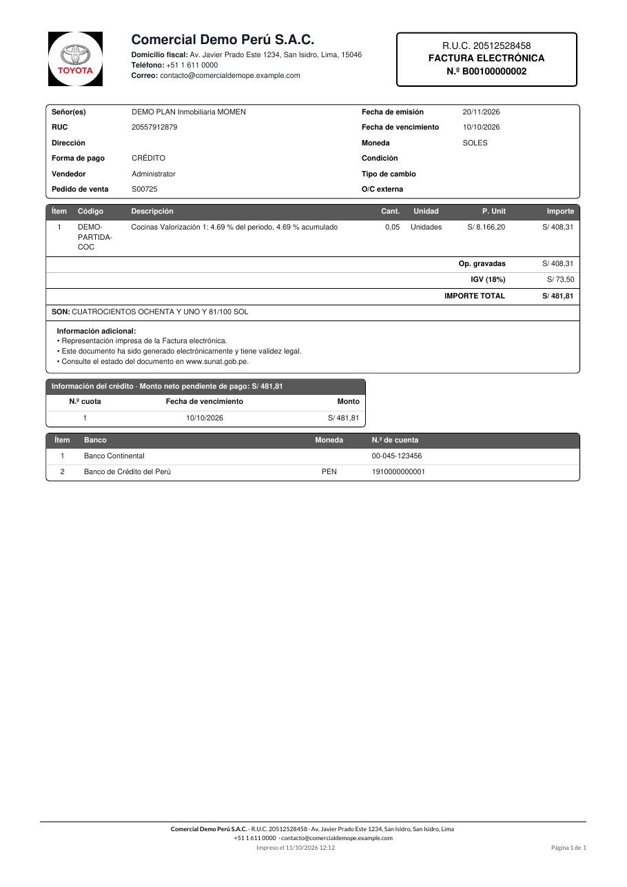

# Formato de los documentos impresos

Todos los documentos PDF de la suite usan el formato del comprobante
electrónico A4, definido en el módulo `al_report_base`: el mismo encabezado,
el mismo pie, la misma hoja de estilos y el mismo papel.



## Configuración

1. Agregue `al_report_base` a `depends` del módulo que imprime.
2. En la acción del reporte, use el papel `al_report_base.paperformat_pe_a4`
   (o `al_report_base.paperformat_pe_a4_landscape` para tablas anchas).

## Escribir un documento

La plantilla `al_report_base.report_pe_page` arma la página completa:

```xml
<template id="report_mi_documento">
    <t t-call="web.html_container">
        <t t-foreach="docs" t-as="o">
            <t t-call="al_report_base.report_pe_page">
                <t t-set="company" t-value="o.company_id"/>
                <t t-set="doc_title" t-value="'Requerimiento de obra'"/>
                <t t-set="doc_number" t-value="o.name"/>
                <table class="pe-doc-table mb-3">
                    <tr>
                        <td class="pe-doc-label">Obra</td>
                        <td class="pe-doc-value" t-out="o.project_id.name"/>
                    </tr>
                </table>
            </t>
        </t>
    </t>
</template>
```

| Parámetro | Para qué |
|---|---|
| `o` | Registro del documento (edición en línea) |
| `company` | Compañía del encabezado y del pie |
| `doc_title` | Tipo de documento, en el recuadro |
| `doc_number` | Número; sin él, el recuadro no muestra «N.º» |
| `doc_extra` | Otra línea del recuadro (periodo, fecha) |
| `doc_address` | Dirección del encabezado, si no es la de la compañía |
| `page_class` | Clases de la página (por ejemplo `pe-doc-text` para cartas) |

!!! warning "Importante"
    El documento va dentro de un `div` con clase `article` (lo pone
    `report_pe_page`); el pie va como hermano de ese `div`. Sin la clase,
    wkhtmltopdf no empareja el pie con su página.

## Clases de estilo

| Clase | Uso |
|---|---|
| `pe-doc-table` | Tabla de datos con borde redondeado, sin líneas internas |
| `pe-doc-table pe-doc-lines` | Tabla de detalle: filas separadas por una línea fina |
| `pe-doc-thead` | Fila de cabecera gris oscuro con texto blanco |
| `pe-doc-total`, `pe-doc-subtotal`, `pe-doc-note` | Filas del pie de la tabla |
| `pe-doc-label`, `pe-doc-value` | Etiqueta y valor en tablas de datos |
| `pe-doc-title` | Título centrado de un documento de texto |
| `pe-doc-text` | Párrafos justificados (certificados, cartas, contratos) |
| `pe-doc-section` | Barra de sección gris oscuro |
| `pe-doc-highlight` | Importe destacado (neto a pagar, total) |
| `pe-doc-signatures`, `pe-doc-sign-img`, `pe-doc-sign-line` | Firmas |
| `pe-doc-keep` | Bloque que no se parte entre páginas |
| `pe-doc-fs-11` … `pe-doc-fs-20` | Tamaños de letra |

!!! note "Nota"
    Las tablas `pe-doc-table` anulan los bordes que Bootstrap deja en celdas
    y filas; sin eso, wkhtmltopdf dibuja líneas fantasma.

!!! info "Ver también"
    - [Convenciones de Odoo 19](conventions.md)
    - [Informes QWeb de Odoo](https://www.odoo.com/documentation/19.0/developer/reference/backend/reports.html)
